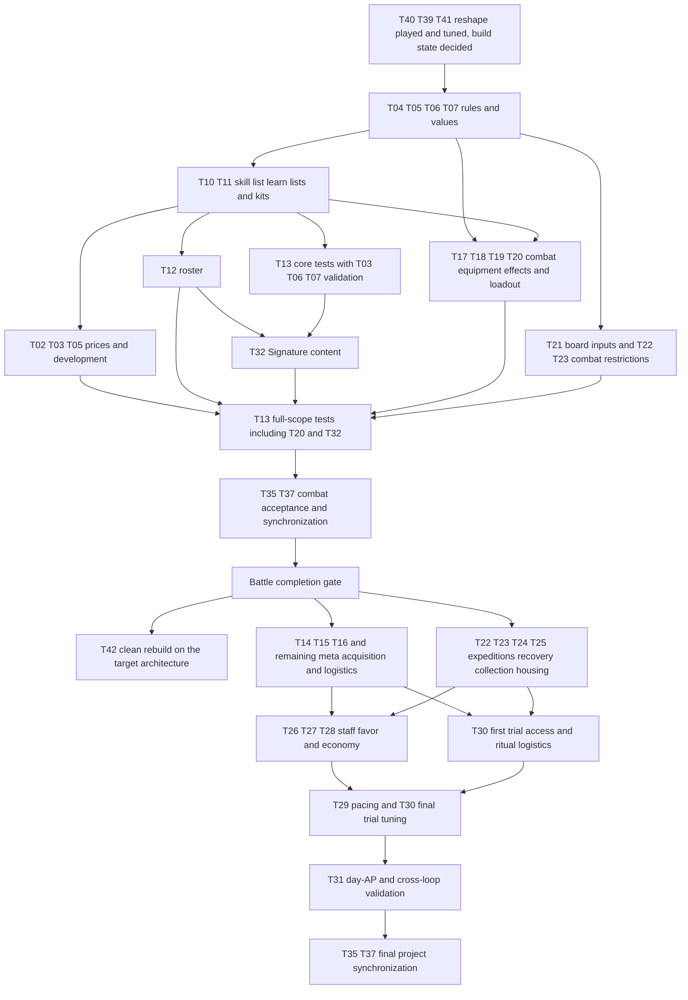

# Temporary Clarification List — Road of the Beasts

Central list of open design decisions and validation tasks from Battle, Monsters, Overworld and the central Skills GDD. **User priority (restated 2026-11-12): the Battle is the core and is finished first; the Overworld does not matter until the Battle stands and the user is satisfied with it, or until the user says otherwise. Overworld tasks stay listed here but are not worked on and do not constrain Battle decisions.** The sequence below organizes work; it does not approve new gameplay rules. **Branch and write scope follow [CLAUDE.md](../CLAUDE.md)** (GDD work: `docs/` on `main`, released by the user on 2026-11-12; the Godot battle implementation was released for `main` on 2026-11-11).

## Usage

- The GDDs describe the current working state; existing proposals and numbers are **not automatically approved** by moving open tasks here.
- Open questions, alternatives and review tasks are maintained exclusively here. The GDDs hold the current design, including labelled content drafts and prototype deviations needed to distinguish it from historical implementations. Use Git history to trace changes; do not maintain changelogs in the GDDs or this file. Keep the handoff current rather than appending a running change history.
- Prerequisites apply to the named deliverable, not automatically to the whole task. **D/K** contracts can precede pricing/content; **V** closes only after suitable executed tests. Do not make test inputs depend on the completion of their own validation. Independent work within the current priority may proceed in parallel; meta-only Overworld work is queued until the Battle gate.
- **Implementation:** open points of the Godot battle implementation live under [Implementation](#implementation). They decide no rule: a rule question found there is settled in the owning GDD section and task.
- **Session close:** refresh [Context Handoff](#context-handoff) after every session so another agent/computer can resume without chat history. Reusable instructions belong under [AI Prompts](#ai-prompts), not in the active task list.
- On completion: incorporate the decision into the specified GDD sections, synchronize affected companion files and check off the item here. For playtests, document measurements and results before changing rules if necessary.
- **Task fields:** every editable task carries **Status**, **Prerequisites**, **Sources**, the concrete gap/decision bullets and **Done when** (completion conditions). Status values: *Open* (no decision yet), *Partly drafted/decided* (working draft or partial decision exists, not validated), *Blocked* (named prerequisite or user decision missing). Completed tasks move to [Completed Tasks](#completed-tasks-ids-retained-for-references) with their IDs retained; IDs are never reused for other topics. Validation tasks close only with tests actually performed and documented.
- **D** = design decision, **V** = validation/balance, **K** = consistency correction. Sources refer to the current GDD section numbers unless explicitly labelled historical.
- **Central skill specification:** [gdd_skills.md](gdd_skills.md) is the single file for everything about monster skills: kit, the skill card, what a skill does itself and what it creates, value and prices, slot development, data and validation, Strike shapes and movement kinds, passives, the kits and the skill list. Battle owns the board: what grounds, zones and props do and when, and generic resolution; Overworld only meta integration, economy and its own tamer/loadout content; [gdd_monsters.md](gdd_monsters.md) keeps monster identity, stats, Kins, roster and growth. Do not maintain parallel monster-skill price lists or upgrade rules. Historical statements are not active specifications.

# Context Handoff

**Last updated: 2026-11-15, after the user decisions of that day were written into the GDDs and the build (HEAD `6573a05` plus an uncommitted working tree; nothing is committed).** Resume from current files, not chat history.

## Current State and Immediate Next Step

- **Focus (user, 2026-11-14/15):** battles end too early (mostly round 2); every stat must matter; small numbers with 10 as the highest HP; battle works from the start and offers upgrade paths through stats and skills. **Raising HP across the board is declined.** New on 2026-11-15: **generalise** — one shape vocabulary for everything, one sheet format for ground, zones and props, few stats (Pace does two jobs).
- **What changed on 2026-11-15** (table [below](#decisions-of-2026-11-15-and-where-they-stand)): the stat is called **Pace**, **Stamina** is the rule, the round end ticks its clocks last, a solid prop gives cover, traps exist as walkable props, props and zones may be on Dragon Veins, a Strike's damage and push are both optional, one shape per skill with free shapes arranged before the battle, one sheet for ground, zones and props. All of it is in the owning GDD sections and in `godot/` with tests. **Later the same day** (user answers to the first report): the Stamina recovery reads the **current** Pace (zones and timed effects count); the **length target** is a mean of 3.0–4.9 rounds, and every result states the battles under 3 and over 5 rounds; the readings on Storm +1, free shapes for created props and the 8×8 default of four veins are confirmed, the kit requirement for the kits the bots play; the action bar has the layout the user asked for; seven monsters carry filled test stats, five of them with a Pace of 2.1–2.2 ([Monsters §4.1](gdd_monsters.md#41-first-roster-draft--9-monsters)); **the round end moves first and acts afterwards** (the Storm Drum pushes before Blight and the Ember Brazier act; Lava keeps its own moment).
- **Build and GDDs agree again on the rules**; what is still only a draft of the build is content: the prop catalogue of [Battle §4.10](gdd_battle.md#410-prop-catalogue-and-damage), the seven prop skills and the fifth kit slots ([Skills §10](gdd_skills.md#10-kits-of-the-nine-monsters)/[§11](gdd_skills.md#11-skill-list)), button squares, the board switches. What is built: [godot/README.md](../godot/README.md). **Not built:** slot development, Dragon Veins on the 1v1 and 2v2 boards, one line class for the three sheet kinds, an arrangement of free shapes for the AI.
- **No human has played this state:** Pace and Stamina recovery, the shape editor, the 8×8 and 9×9 boards and the changed round end are checked by tests, the headless UI run and bots only (I40); the same holds for the new action bar (checked on rendered pictures of the screen) and the filled test stats.
- **What S028–S031 indicate (bots; indications only):** before 2026-11-14 battles ended in 2.46 rounds (greedy); S028/S029 gave about 3.5 (greedy) and 4.25 (tactic); [S030](simulation_log.md#s030--2026-11-15--rules-of-2026-11-15-and-3v3-on-88-and-99-boards) (rules of 2026-11-15 before the shape merge) read 4.51 / 5.09 (greedy / tactic) on the default board. **[S031](simulation_log.md#s031--2026-11-15--after-the-shape-merge-the-board-rows-of-s030-again-with-the-battles-under-3-and-over-5-rounds)** (after the shape merge; greedy 320, tactic 160 battles per row; mean rounds · battles under 3 · over 5): 7×7 with 3 veins greedy 4.32 · 27 · 53, tactic 4.70 · 7 · 44; 8×8 with 4 veins 4.14 · 16 · 46 and 4.80 · 4 · 41; 9×9 with 5 veins 4.44 · 4 · 50 and 4.67 · 0 · 32; greedy only: 8×8 with 2 veins 5.38 · 6 · 116, 9×9 with 3 veins 4.78 · 2 · 73. **Against the target (mean 3.0–4.9) every row except 8×8 with two veins lies inside**, with 20–28 % of the tactic battles over 5 rounds; the three boards do not differ beyond the noise in that tail, 9×9 has almost no battle under 3 rounds, and Draws are most frequent on the larger boards. Stat slopes (S030, random stats, greedy): HP 38 → 58 %, TPR 43 → 56 %, AP 45 → 54 %, Stamina pool 46 → 53 %, Reach flat, Pace 2.x as 1.x (49 % each); the bots do not budget Stamina. **The filled test stats and the recovery by the current Pace are not measured:** a series on them was started and stopped on 2026-11-15 on the user's instruction (simulation series only on explicit request, [CLAUDE.md](../CLAUDE.md)); nothing of it is recorded.
- **Still unsolved:** HP as the dominant stat; a job for Reach; whether the recovery by Pace is felt (five monsters recover 2 since the fill; play has to show it); the stat calculation, whose price scale the user wants to discuss next (T03); a quarter of the battles under the strong bot still last over 5 rounds.
- **Next (user): discuss the monster calculation** (HP at 5 or 3 points with everything scaled, budgets, Pace ceilings: proposal in T03, open question 1), **then play the build by hand:** the new action bar, the fast monsters with a recovery of 2, the shape editor (“Arrange shapes” in the draft), the boards 8×8 and 9×9, the fifth prop slot of the kits with cover and traps, button squares.
- **Then decide** ([Open Questions for the User](#open-questions-for-the-user)): the stat prices, budgets and Pace ceilings (T03); what `slow` and `haste` mean under Stamina and whether movement keeps its AP (T41); which props of the build's catalogue stay (T41); the board size for 3v3 (T39); the readings marked “to confirm” below.
- **Simulation series only on the user's explicit request** *(user, 2026-11-15; [CLAUDE.md](../CLAUDE.md))*: the user wants changes delivered quickly; an agent proposes a series and does not start one.
- **Next for an agent, no user decision needed:** the rest of the K batch of T35; the bot work of T13 (value for blocking, for round-end pushes, a Stamina budget). **Not for the prototype:** one line class for ground, zone and prop records (I74). The user asked on 2026-11-15 whether that merge makes sense; the agent's advice: one line type in the rebuild (T42, as [architecture.md](architecture.md) §4 says), no merge in the prototype (no playable gain, about forty data files and three resolvers to touch while the prop catalogue is still open), and never one record type for ground, zone and prop. Not decided.
- **Battle blockers:** T41 (catalogue and Stamina details), T05 (slot plan in the game), T03 (Pace range, frames), T39 (board and veins) and the human play behind them; after them T10–T12 (content), T02 (prices), the battle parts of T17–T23, T32 and the tests of T13. **Queued behind the Battle gate (meta):** T14–T16, T24–T31 and the meta parts of T05, T17–T23 and T30.
- **Defaults and preserved content:** normal 7×7 uses **three Dragon Veins**, and ZONE PUSH/PULL skills, Bog included, cost **1 AP**. One central vein ([S024](simulation_log.md#s024--2026-11-14--one-dragon-vein-count-control)), the 2-AP override and the discovery skills stay experiments, not defaults. Normal player stats and kits are preserved, no user-authored record at present (the experiment monster `asdf`, its three skills and Blaze Tiger's `new_skill` were deleted on the user's instruction on 2026-11-15); their Pace was converted like everyone's, and the two Arc Strikes got the 3 AP they had by their shape written on their cards. The five simulation resources are excluded from normal gameplay and builders.
- **Git / validation (2026-11-15):** branch `main`, HEAD `6573a05`; the working tree holds the audit of this list plus the changes of the decisions (docs, `CLAUDE.md`, `godot/`); nothing is staged or committed.
  - **Run in this session:** the full gdUnit4 suite (358 cases; 213 in `tests/battle` and 7 in `tests/game` without a failure, the two known non-battle failures of I46 remain); `tools/smoke_ui.gd` on 7×7, 8×8 and 9×9 (0 refused clicks) with the new action bar; rendered pictures of the battle screen with three, one and no tamer skill (off-screen, `gamescope --backend headless`), every square found again under its own screen position after the camera shift; the overview, draft and both builder scenes loaded headless without errors (before the bar change); `progression.gd --self-test` (1262 / 0) and `discovery.gd --self-test` (7296 / 0, 37 action fixtures) after the stat fill; `compare.gd` once with its new length column; bot runs before and after each rule step of the morning; the series of S030 and S031.
  - **Not done:** human play; any test of the entry state; a series on the filled test stats (stopped, see above); a bot that budgets Stamina.
- **Execution policy:** full CPU use is allowed ([CLAUDE.md](../CLAUDE.md)); the optional launcher deliberately keeps Idle priority and two-CPU affinity. Neither promises automatic parallelism or 100 % CPU utilization.

## Decisions of 2026-11-15 and Where They Stand

All rows are user decisions of 2026-11-15, written into the owner section and built. “Reading” marks what the user did not say in so many words; “confirmed” marks a reading the user confirmed later that day.

| Decision | Owner section | Reading to confirm |
|---|---|---|
| **Pace** replaces the term Initiative everywhere (GDDs, UI, code, data). One stat, two jobs: queue position, and the whole number of its **current** value (at least 1) is the Stamina recovered per round | [Battle §2.2](gdd_battle.md#22-pace-and-the-queue), [§2.3](gdd_battle.md#23-action-points-and-stamina), [Monsters §2.1](gdd_monsters.md#21-the-stats) | **Decided later that day: the current Pace counts**, zones and timed effects included (first built from the sheet value). Reading: the recovery comes before the clocks tick, so an effect in its last round counts once more |
| **Pace scale:** base 1.0, 1 stat point = +0.1, at the roll and at a level-up alike | [Monsters §2.2](gdd_monsters.md#22-frame-budget-level-ups) | Old values converted by their points (9.0 → 1.4 … 1.0 → 1.0); effects count in points (Mire 1, level II–III 2; Siphon 1; Qi Suppression 1; prep pill +1); an extra-turn entry 2 points lower. The stage ceilings are converted only and need new values (T03) |
| **Stamina is the rule:** the pool is the earlier Movement stat; a movement skill pays the movement cost of every square it enters (Plain 1, Rubble 2) | [Battle §2.3](gdd_battle.md#23-action-points-and-stamina) | Range 3 per skill, AP in addition, Step without Stamina, a path over squares 1 per square: as the switch of S029 played |
| **Round end:** first everything moves, then everything acts, then all clocks tick together | [Battle §2.4](gdd_battle.md#24-effect-timing-reference) | “Moves first” was decided later that day, after a Storm Drum pushed a monster onto Lava without damage in the user's play: the props that push or pull now act before round-end ground and before the damaging props. Lava keeps its moment (the end of its occupant's turn), so that case still deals no damage at the round end; swapping the moments of Lava and Blight was offered and not chosen |
| **Cover:** a solid prop takes the Strike and shields the square behind it | [Battle §4.9](gdd_battle.md#49-props) | Walkable props and monsters give none; Strikes only |
| **Traps exist again, as walkable props** (“no traps” of 2026-11-13 is lifted) | [Battle §4.3](gdd_battle.md#43-the-square-ground-zone-and-occupant), [§4.9](gdd_battle.md#49-props) | — |
| **Props and zones may be on a Dragon Vein:** ordinary ground that nothing changes | [Battle §4.2](gdd_battle.md#42-dragon-veins-surrounding-and-late-round-pressure) | Also at board generation; only the centre square stays free |
| **A Strike may push and may deal damage; neither is required.** Push is a property of the single skill | [Skills §3](gdd_skills.md#3-what-a-skill-does-itself), [Battle §6.4](gdd_battle.md#64-displacement) | **Confirmed for the kits the bots play:** “at least one skill that pushes or pulls” ([Skills §10](gdd_skills.md#10-kits-of-the-nine-monsters)); no rule for kits the player composes follows from it. A Strike's AP stands on its card (Shove 1 AP) |
| **AP-lowering passives never go below 1 AP** | [Skills §9](gdd_skills.md#9-passives) | The only fixed limit; amount and condition are content |
| **Slots:** the prototype plays with 6 open; in the game single slots are upgrades | [Skills §1](gdd_skills.md#1-the-kit) | How many are open at the start stays open (T05) |
| **One shape per skill:** six base shapes with extensions around the user, or a free shape of N squares that the player arranges before the battle; props use the shapes without a direction | [Skills §2](gdd_skills.md#place-shape-and-rotation), [§8.1](gdd_skills.md#81-shapes) | **Confirmed:** Storm +1 is the eight lines (16 squares), an extended Arc stays straight only, and a skill that creates props uses a free shape too (Earth Wall: 3 squares). Still a reading: a free shape is connected over edges, contains its anchor, still turns in battle and is visible to the opponent |
| **One sheet for ground, zones and props** (“when · what · how much · where”) | [Battle §4.12](gdd_battle.md#412-one-sheet-for-ground-zones-and-props) | The roles of 2026-11-13 stay as a permission table; no moment at the start of a turn or round; AP and turns-per-round effects on others only in the vocabulary |
| **Board switches for 8×8 and 9×9** and test runs | build only ([Battle §4.1](gdd_battle.md#41-battlefield-generation) notes them) | **Confirmed:** 8×8 has its Dragon Veins in mirrored pairs on the two centre rows, 4 by default |
| **Length target:** a mean of 3.0–4.9 rounds per 3v3 battle (“3.x to 4.x”); every result states how many battles ended in under 3 and in over 5 rounds | [Battle §1.2](gdd_battle.md#12-battle-design-pillars), [tools README](../godot/tools/README.md#recording-results), [CLAUDE.md](../CLAUDE.md) | “Turns” in the user's wording read as rounds; a battle counts the round it ends in |
| **Action bar:** tamer skills apart from the monster's skills; Step over two rows, a small gap, then three columns of two skills | build only (`BattleHud`, I78) | The tamer skills stand in a panel of their own beside the bar; End Turn is two rows high too; the board is centred in the room above the bar |
| **Test stats filled** so that a Pace of 2.x occurs: five monsters at 2.1–2.2, three of them +1 HP, two bulky ones +Stamina | [Monsters §4.1](gdd_monsters.md#41-first-roster-draft--9-monsters) (test values, not defaults) | The values follow the HP-5 price draft of T03, which is **not decided**; `asdf` was deleted later that day and Ember Hawk and Thorn Mites set to Reach 2, so all nine cost 60 points |

## Findings Still Open

What the audit of 2026-11-15 and the work after it found and no decision has closed. Each is a task, not a rule.

| Area | Finding | Task |
|------|---------|------|
| Stat calculation | Decided on 2026-11-15 and in Monsters §2 (ranges from 1, prices, 25 points +5 per step, no ceilings or unlocks); every number untested. All nine monster files cost 60 points since 2026-11-15 (Ember Hawk and Thorn Mites at Reach 2); the experiment monster `asdf` and its skills are deleted, content `2026-11-15.4`, not measured by any series. A drain of one Pace point cannot pass a monster with a lower base Pace (the tie goes to the higher base) | T03, T04, T06 |
| Stamina | The pool sizes are the earlier Movement values; `slow` / `haste` still change the range of movement skills; whether movement keeps its AP is a switch. Nothing of it is played by a human | T41, T03 |
| Prop catalogue | The catalogue of the build is a draft: aura props are archived, the Thorn Idol passes a Strike on to its neighbours in the same turn (against “fair damage at range”), props a skill creates have no clock | T41 |
| Displacement directions | Strikes, landings and props push in eight directions, zones cardinal: written as the build plays it, not confirmed | T04 |
| Reach | The build measures Reach in orthogonal steps (Manhattan); [Skills §2](gdd_skills.md#place-shape-and-rotation) and [Battle §4.1](gdd_battle.md#41-battlefield-generation) say board distance | T04, I72 |
| Readings without a GDD line | Only walking acts on the squares of its way (written in Skills §3; unconfirmed for the path kinds “straight line over monsters”) | T04, I66 |
| Entry state | Qi Gathering plays only 1v1, on a board without Dragon Veins, with 25 points per monster (HP 2–4, AP 2); the length target and every test are 3v3 | T13, T39, T03 |
| Slot development | Supply of 2 / 3 / 10–12 / 14–18 steps by rarity against 12 or 18 places in six slots; two ways to repeat a skill; “keeps its development” on replacement is undefined | T05 |
| Content | Siphon is an effect on another monster against Skills §3; the Signature task still carried the removed Major baseline | T06, T32 |
| Overworld interfaces to the battle | No tamer skills for the Immortal and Sovereign lists; artifact examples refer to the dropped Spatial Pull; prose still calls Life Thread and Second Wind “proposed”; Overworld §6.3 omits AP 4 and AP 5; the Pace numbers of Qi Suppression, its artifact example and the Swift pill are conversions | T20, T17, T35 |
| Build | The three sheet kinds are read as one sheet but stored as three line classes; the stat fields are still called `movement` / `move`; the overworld rolls individuals with the six earlier stat shapes and converts their Pace at one seam | I74, I75, I46 |

## Open Questions for the User

Bundled for the next Battle discussion; ask them with the question tool, recommendation first. None is decided here.

| # | Question | Needed for | After |
|---|----------|------------|-------|
| 1 | Monster calculation, the rest: how does a shape split the points at the roll? | T03 | now |
| 2 | Stamina: do `slow` and `haste` become “the square costs more / less Stamina” or stay a change of range? Does a movement skill keep its AP cost? | T41 | play |
| 3 | Which props of the build's catalogue stay (Earth Wall, Thorn Idol, Ember Brazier, Storm Drum at the round end, the two traps), and do the aura props return? May a prop a skill creates last for rounds only? | T41, T10 | play |
| 4 | 3v3 on 7×7, 8×8 or 9×9, and how many Dragon Veins on an even board? | T39, T21 | play |
| 5 | Slot plan in the game: how many slots are open at the start, and what opens the others? | T05 | now |
| 6 | Which modes and developed states belong to the Battle gate (1v1 entry state, 2v2, 5v5, Soul and above)? | gate, T13, T39 | now |
| 7 | Confirm the readings still open: props at board generation on Dragon Veins; the Stamina recovery before the clocks tick (an effect in its last round counts once more); whether the kit requirement (a skill that pushes or pulls; confirmed for the kits the bots play) should also bind kits in the game | T39, T03, T11 | now |
| 8 | Which pushes are cardinal, which use the eight directions? Is Reach board distance (GDD) or counted in orthogonal steps (build)? | T04 | now |
| 9 | How far may a shape be extended? (Storm +1 as the eight lines is confirmed.) | T06 | now |
| 10 | Is Siphon the one effect a monster may put on another, and may AP or turns-per-round effects ever reach other monsters? | T06, T07 | now |

## Decisions Versus Drafts

| Class | Content (owner section holds the details) |
|-------|-------------------------------------------|
| Decided by the user (2026-11-13, reshape) | No height, no air layer, no Surges (the “no traps” of that day was lifted on 2026-11-15: a trap is a walkable prop); ground and zone with one role each; a skill only delivers ([Skills §2](gdd_skills.md#2-the-skill-card)); fair damage at range; Dragon Veins by last touch, at least one per map; displacement is movement; damage on leaving a square as an effect; AP and turn effects only as `experiment`; ground acts as long as it lies; 7×7 stays; `content_status` on grounds, zones and props. |
| Decided earlier and still valid | Chebyshev distance and Voidscar reading, payload order and execution-time legality, simultaneous damage and queue-order displacement ties, damage-modifier stacking, modifier bounds, prop principles (fixed, previewed effects; the class-based catalogue gave way to props that act at moments, [Battle §4.10](gdd_battle.md#410-prop-catalogue-and-damage), whose content is open: T41), queue ties, zones independent of ground, no aspects or attunement, no physical evolution, slot development at advancement steps, no skill rarity, monster cap by stage, one AP ceiling. The 2×2 body rules have no object since 2×2 left the scope (T09). Owners: Battle §2–§6, Skills §6, Monsters §2. |
| Decided by the user (2026-11-14), in the GDDs | Every slotted skill once per turn unless its card names more (`usage_limit`); up to 6 kit slots; no Epic+ extra passive slot; Dragon Veins stay “last touch owns” (`vein_touch` = false is only a switch) and the owning side picks at the last tie; surrounding and late-round pressure stay (start rounds 2v2 6, 5v5 8 as working values); push and pull zones do not move anyone at cast; props are displaced like monsters; 2×2 bodies are out of scope (T09); Spatial Pull is dropped; [architecture.md](architecture.md) is confirmed (T42). Owners: [Skills §1–§2](gdd_skills.md#1-the-kit), [Battle §2.3](gdd_battle.md#23-action-points-and-stamina)/[§2.4](gdd_battle.md#24-effect-timing-reference)/[§4.2](gdd_battle.md#42-dragon-veins-surrounding-and-late-round-pressure)/[§6.4](gdd_battle.md#64-displacement), [Monsters §5.1](gdd_monsters.md#51-monster-rarity), [Overworld §6.4](gdd_overworld.md#64-tamer-skills). |
| Decided by the user (2026-11-14), not yet a finished rule | No general HP raise, 10 stays the highest HP (T03); passives that lower AP are allowed and never go below 1 AP (decided 2026-11-15; the passives themselves are content, T11); Qi Suppression stays and Spirit Shield is to be redefined (T20); Ancient's Strike effect is postponed until the Kin identity has been played (T06). |
| Decided by the user (2026-11-15), in the GDDs and the build | Pace with its two jobs and its scale, the Stamina recovery by the current Pace; the length target of a mean of 3.0–4.9 rounds, reported with the battles under 3 and over 5 rounds; Stamina as the rule; the round end with the clocks last; cover; traps as walkable props; props and zones on Dragon Veins; damage and push of a Strike both optional; AP passives never below 1 AP; six open slots in the prototype and slots as upgrades in the game; one shape per skill with free shapes arranged before the battle; one sheet for ground, zones and props. Details, owners and readings: [table above](#decisions-of-2026-11-15-and-where-they-stand). |
| Drafts of the build (content and switches, not rules) | The prop catalogue of the rework (Earth Wall, Thorn Idol, Ember Brazier, Storm Drum at the round end, the two traps; aura props archived), seven prop skills and a fifth kit slot, button squares (`map_buttons`), the balanced kit draw, the board switches (`board_size` 8 and 9, `wells`, `map_props`). Owner: T41 (with T07, T21, T39, T40). |
| Working values, not validated | Highest hit 2; every number of the monster calculation (Monsters §2.2); the 31 slotted skills of [Skills §11](gdd_skills.md#11-skill-list) and the nine kits ([Skills §10](gdd_skills.md#10-kits-of-the-nine-monsters)); ground and zone values; three Dragon Veins on 7×7; ground laid in battle lasts 2 rounds; the draft Strikes push; movement skills with a range of 3 and Stamina per square (Run 1 AP, other reference movement 2 AP; authored experiments may differ); the Pace values and Stamina pools of the nine monsters; an extra-turn entry 0.2 lower in the queue; extra turns from round 2; prop catalogue values; test stats of the nine monsters. |
| Open | Stat prices, four-frame calculation draft and budgets ([Monsters §2.2](gdd_monsters.md#22-frame-budget-level-ups), not enforced by the build; the price scale is under discussion, T03); the Pace range and its ceilings; every skill price ([Skills §5](gdd_skills.md#5-value-and-prices)); Kin access and learn lists; what a slot level allows; Dragon Veins, length target and tests for 1v1, 2v2 and 5v5. |
| Validation / tool boundary | [godot/tools](../godot/tools/README.md) are tools for trying things out, not rule sources or price authorities. Runs use bots on test content and give indications only. No task closes from a numeric fit or a simulation run. |

## Working Practices

- Follow [CLAUDE.md](../CLAUDE.md) for branch and write scope, preserve user work, no unrequested Git actions. **An audit session writes only `docs/temp_todo.md`;** GDD corrections and calculator/simulation-tool work below are follow-up tasks, not permission to edit them during the audit (`docs/` and `godot/tools/` are otherwise in the write scope of CLAUDE.md). The earlier checker authorization covers only the temporary docs script, never engine/prototype implementation.
- Resume from the current tasks and linked owners, not prior chat. Use the skill card of Skills §2 and the ground, zone and prop definitions of Battle §4, never a parallel model or a copied list. Skill content is edited only in [gdd_skills.md](gdd_skills.md).
- New recommendations/numbers need explicit status; general design changes need user decisions. Keep history in Git and replace stale handoff text rather than appending a log.

# Open Tasks

## Recommended Work Order

**Selected work priority: Battle first, Overworld second.** The task sections below are thematic groups, not execution phases; this table and the scoped prerequisites determine execution order. Parallel work stays within the Battle workstream unless the user changes priority.

| Order | Deliverable | Tasks | Boundary |
|-------|-------------|-------|----------|
| B1 — next | The reshaped battle played and tuned: rules that give every stat a job, kits that fit the length target; the rules of 2026-11-15 (Pace and Stamina, shapes, sheets, cover, traps) played; the drafts still open decided into the GDDs or dropped (prop catalogue, Stamina details, Pace range, board size, slot plan in the game); the scope of the gate stated (modes, entry state) | T40, T39, T41; D/K of T03/T04/T05/T06/T07 | The user plays first; bot runs with `tactic` and the random-draw variants measure candidates |
| B1-K — parallel to B1 | GDD text brought up to decisions already taken | K batch of T35 with the pointers in T04/T05/T11 | Editorial only and no user decision needed; a point that needs a choice stays with its D task |
| B2 | Skill list, learn lists, passives, kits and roster on the skill card | T10/T11/T12; T06 content | No price needed to play; prices follow |
| B3 | Stat and skill prices, slot development | T02, T03, T05 | From play and the measured values of B1/B2, not from the earlier sheets |
| B4 | All battle-facing external effects and request/result interfaces | Battle parts of T17–T21 and T22/T23 conflicts | Tamer skills, artifacts, medicine/array effects, loadout limits, swap/HP/defeat/Draw result and board inputs; the effects that named Surges or height are redefined here |
| B5 | Core tests, then Signature content and full-scope interaction tests | T13 with T03/T06/T07/T20 V; T32 | |
| B6 | Battle acceptance, clean-up of the removed mechanics in code and data; then the clean rebuild on the target architecture ([architecture.md](architecture.md)) | Battle gate; T40 clean-up; battle deliverables of T35/T37; T42 | Every in-scope combat feature needs complete rules, content and documented suitable tests |
| O1 — after Battle gate | Translate battle requirements into acquisition, progression execution and world systems | T14/T15/T16; meta parts of T05/T17–T25/T30 | Recipes/prices/availability, expeditions, injuries, catching, housing, ritual sites and replacement logistics follow the combat specification |
| O2 | Management, progression pacing and day economy | T26–T31; final T35/T37 | Use tested battle states and resource demands to tune supply/XP/day AP |

### Battle Completion Gate

**Status:** Open. A rules draft is not a validated Battle completion. This milestone does not close mixed Battle/Overworld tasks wholesale or authorize implementation.
**Prerequisites:** Battle deliverables in B1–B5 and their combat-source corrections; no completion of meta-only tasks.
**Sources:** [Battle §7](gdd_battle.md#7-technical--prototype), [Skills §6–§7](gdd_skills.md#6-slot-levels-development-and-replacement), [Monsters §2](gdd_monsters.md#2-stats), [Overworld §6.4–§6.9](gdd_overworld.md#64-tamer-skills); detailed owning links remain under each task.
**Done when:** all four acceptance conditions below are met for the user-agreed combat scope; unresolved test failures or unapproved omissions keep the gate open.

- **Design ready:** T02–T07/T10–T12 and T39–T41 combat deliverables, combat parts of T17–T23, T32 and related T35/T37 corrections specify legal battle inputs, actions, developed variants, passives, external effects, board generation, timing, preview and result outputs. Final intended battle scope must be explicit; a reduced roster, omitted items or deferred late-game mechanics need user approval (2×2 bodies were removed by the user on 2026-11-14, T09), not an assumed shortcut. The air layer is already removed by user decision, not deferred scope.
- **Validated:** T13 executes and documents suitable current-design tests across the agreed scope, including developed/high-stage states, core and full loadouts, source-specific exceptions and T03/T06/T07/T20 V. The Godot battle (`godot/battle`, rebuilt 2026-11-11) implements the confirmed rules and can serve as the harness; an implementation and its rule tests are not the validation itself, and the HTML prototype and paper calculations do not satisfy this gate.
- **Handoff to Overworld:** record the accepted combat constraints and still-open **meta-only** questions against their existing IDs. Use finished test sheets/loadouts without simulating the whole economy; keep reachable state/slot/upgrade limits explicit. Acquisition frequency, XP pacing, recipes, ritual locations and day AP stay open for Overworld, not invented free/instant defaults.
- **Integration safeguard:** resolve T22/T23 restrictions that could alter in-battle healing, HP or fall prevention before acceptance; defer their run/recovery economy. Later meta tuning must respect accepted battle contracts; any proposed combat change needs an explicit decision and affected regression tests.
- **Scope still to state explicitly (open; nothing below is dropped by default, and leaving any of it out needs a user decision):**
  - **Modes:** 3v3 on 7×7 is the tuned standard. 1v1 (the only mode at Qi Gathering, [Monsters §5.3](gdd_monsters.md#53-monster-progression-the-18-steps)), 2v2 and 5v5 have no Dragon Vein rule and no length target (T39, T13); 5v5 is not offered in the sandbox (I43).
  - **Developed states:** TPR 3 from Soul, AP 4 at Immortal and AP 5 at Sovereign have no test sheet and partly no price or payer (T03); slot development has no content (T05).
  - **Content and external effects:** roster size (T12); tamer skills, artifacts, medicines, arrays and battle-prep pills (T17–T20); Signature skills (T32).
  - **Removed so far, by explicit decision:** the air layer, height and Surges (2026-11-13) and 2×2 bodies (T09, 2026-11-14). Traps were removed with them and came back on 2026-11-15 as walkable props.
  - **Board:** 3v3 on 8×8 and 9×9 exists as a test switch since 2026-11-15; whether the standard board changes is part of T39.

### Audit Coverage and Disposition

Audit of 2026-11-15: every existing ID was reconciled with its owner sections in all four GDDs; none was renumbered, merged or closed, and no task closed from arithmetic. The user decisions of the same day were then written into the GDDs and the build; the table shows the state after them. New code readings are I65–I77. Links and detailed acceptance criteria remain in the task entries.

| Tasks | Current disposition |
|-------|---------------------|
| T01, T08, T09, T33, T34, T36, T38 | Closed: removals, the scope decision on 2×2 bodies and the superseded Surge task, kept as reference IDs |
| T40, T39 | Reshape and Dragon Veins are decided in form and played once; values, the other modes and the measurement remain open. Decided 2026-11-15: traps exist as walkable props; props and zones may be on Dragon Veins. New: 3v3 on 8×8 and 9×9 as switches (S030) |
| T41 | The rule questions are decided and written (traps, cover, props on veins, the round end, Stamina). Open: which content of the build's prop catalogue stays, its conflicts with earlier decisions, the Stamina details |
| T42 | Clean rebuild on the target architecture; architecture confirmed 2026-11-14 and extended 2026-11-15 (shared vocabularies, one sheet); waits for the Battle rules and an implementation plan |
| T02, T03, T05 | Prices and numeric entry remain open; the four-frame/16-point Core High calculation draft is unvalidated. Decided 2026-11-15: Pace at 0.1 per point with the Stamina recovery as its second job (range and ceilings open); a Strike's AP on its card; six open slots in the prototype, slots as upgrades in the game (the number at the start open). Open arithmetic: Qi Gathering budget, payment of AP 4/5, Reach scaling, slot-development supply |
| T04, T06, T07 | Decided 2026-11-15: the round-end order, cover, one shape vocabulary, one sheet format with the roles as a permission table, damage and push of a Strike both optional. To confirm: displacement directions, the measure of Reach, Storm +1. Open: Siphon as an effect on another monster, a one-point Pace drain against the tie rule |
| T10–T12 | The skill list (31 plus Step, with the seven prop skills of the build as drafts) and the kits (five skills each) exist as working drafts; the build fields 35 skill records and a tenth experiment monster; learn lists, passives and the roster are open |
| T13 | First human play exists; bot evidence through S030; human play of the build of 2026-11-15 is next. No target and no test yet for 1v1, 2v2, 5v5 and the entry state; full validation remains open |
| T14 | After the stat prices; queued |
| T15, T16 | Queued after the Battle gate; unchanged |
| T17–T20 | Combat effects first; effects that named Surges or height need new definitions (Spirit Shield, two arrays). No tamer skills for the Immortal and Sovereign lists; examples that still refer to the dropped Spatial Pull; the Pace numbers of Qi Suppression and the Swift pill are conversions |
| T21–T25 | Battle board/HP/healing/defeat interfaces first; expedition, acquisition, recovery and housing details after the gate. The battle request now carries the arrangement of free shapes (T19/T21) |
| T26–T31 | Meta work, queued; re-read against Overworld §2–§7, unchanged |
| T32 | Signature content only; the Major baseline of the earlier task text went with Surges |
| T35, T37 | Part of the K batch was worked on 2026-11-15; the remaining rows are listed; all relative links resolve; whole-project synchronization and acceptance remain open |

## Battle Foundations — Resolution, Stats and Valuation

### [ ] T02 · Find Skill Prices (D/V)
**Status:** Open — **reset by the reshape of 2026-11-13.** No skill, ground, zone or prop has a price. The earlier construction-point sheets priced Surges, timers, Mountains and air coverage and were removed with that model.
**Prerequisites:** play of the reshaped build (T40, T13); a stable skill list (T10).
**Sources:** [Skills §5](gdd_skills.md#5-value-and-prices), [§2](gdd_skills.md#2-the-skill-card), [§8.1](gdd_skills.md#81-shapes), [§11](gdd_skills.md#11-skill-list); [simulation_log.md](simulation_log.md) S020–S031.
- **Earlier progression direction (S022; S023 new gameplay takes priority):** working start and upgrade paths are user-approved goals, not approved numeric starts. Keep stat/skill ledgers separate and validate joint action thresholds; calculator prices are not frozen. Current ZONE PUSH/PULL overrides include mixed Slow effects as in S021. Proxy AP 2 leaves authored cost-3 `new_skill`, `asdf`, `strike_thrust` unaffordable despite all units having an affordable active; next check starter kits and distinguish AP-3 unlocks from extra actions. No source budget fit checked or price adopted.
- **Principles that stand** (earlier user decisions): a skill is paid with AP and its use limit; no skill rarity; a complete kit at original AP; stats and skills priced apart.
- **Evidence boundary:** [S020–S024](simulation_log.md#s024--2026-11-14--one-dragon-vein-count-control) compare rules, kits, action thresholds and maps, not equal-price components. Prices cannot repair a mechanical lack of meaningful choices; bot results do not prove that a stat or skill has no value. Review whole skills and combinations before deriving prices.
- **Open:** what a price is expressed in (AP only, or AP plus a kit budget); whether the 1-AP and 2-AP split of the build holds; the value of the two `experiment` effects (AP +1, one more turn) that the user wants rare and expensive; prices of created props.
- **Price parts added on 2026-11-14 (to price, nothing is priced):** the use limit is now a real part of a price (once per turn by default, `usage_limit`); a second copy of a skill in another slot buys a second use with a slot ([Skills §1](gdd_skills.md#1-the-kit)); slots 5 and 6 (T05).
- **AP values inside the price-free model (K/D):** since 2026-11-15 a Strike's AP stands on its card like every other cost; [Skills §8.1](gdd_skills.md#81-shapes) keeps draft AP for the ten shapes that had one (Jab 2 up to 5 for Arc +1, Whirl +1 and Cross +1) and “open” for Jab +2, Pincer +1 and Storm +1. Shove therefore costs the 1 AP of its card; the build charged it the 2 AP of the Jab shape in every run up to S030. Decide with the price form whether the per-shape values are the price list in the making or placeholders, and mark them alike in §5, §8.
- **Price parts added on 2026-11-15 (to price, nothing is priced):** an extension of a base shape; a square of a free shape (the arrangement is the player's, so the number of squares is what is left to price); damage and push of a Strike as two parts; Stamina as a second cost of movement, and the range of a movement skill.
- **`internal_calc_cost`** in the Resource files holds numbers of the removed sheets for older records and −1 for everything since: decide whether the field stays.
- **Done when:** the user has played, a price form is decided and written into Skills §5, and every skill of the game carries a price that play and runs support.

### [ ] T03 · Review Stat Budgets, Frames and Progression Limits (V/K)
**Status:** Open — consistency conflicts remain; arithmetic is not gameplay validation. S022 tests an AP-2/TPR-1 entry proxy and teamwide upgrades, not a frame, budget or approved stage/start.
- **Evidence:** [S022](simulation_log.md) is a proxy, not an approved start or equal-cost stat valuation. Cap-blocked increments, kit interactions and bot sensitivity require joint action-threshold tests with alternative growth paths; AP/TPR escalation can shorten battles too far and HP alone does not remove long tails. Current authored AP does not establish distinct kit identity.
**Prerequisites:** D/K review can start from current Monsters rules; relevant T02 costs/content for comparative testing. V closes with T13, not before T11 can supply test kits.
**Current owner status:** [Monsters §2.2](gdd_monsters.md#22-frame-budget-level-ups) retains an unvalidated four-frame calculation draft (Core High 16 points), while §4.1 uses spread authored test stats outside that model. Its free HP base of 4 conflicts with the build floor of 3 and Qi HP ceiling of 4. No numeric entry state is approved. Bot observations do not establish absent Pace, Stamina or Reach value; test their roles with suitable kits/maps (T40).
**Sources:** Monsters [§2.1](gdd_monsters.md#21-the-stats)–[§2.3](gdd_monsters.md#23-stat-ceilings-per-stage), [§5.3](gdd_monsters.md#53-monster-progression-the-18-steps); Overworld [§1.2](gdd_overworld.md#12-design-pillars), [§2.4](gdd_overworld.md#24-cultivation-loop).
- **User direction (2026-11-14):** no general HP raise to lengthen battles; investing in a stat other than HP must pay off as its own way to play (low-HP long-Reach caster, Pace plus Stamina, Stamina plus AP and Strikes). 10 stays the highest HP.
- **Stamina and Pace (decided 2026-11-15; the values are open):** the Movement stat became the Stamina pool, and Pace does a second job: the whole number of its current value, at least 1, is the Stamina recovered per round ([Battle §2.3](gdd_battle.md#23-action-points-and-stamina), [Monsters §2.1](gdd_monsters.md#21-the-stats)/[§2.2](gdd_monsters.md#22-frame-budget-level-ups)). Open here:
  - **The Pace range:** 1 point = 0.1 from a base of 1.0 puts a recovery of 2 at 10 points, and the converted ceilings (1.2 / 1.3 / 1.4 / 1.4) keep every monster of the calculation draft at 1. New ceilings and prices are needed: the proposal below.
- **The calculation is decided by the user (2026-11-15) and written into [Monsters §2](gdd_monsters.md#2-stats):** one fixed range per stat, every stat starts at its lowest value, no ceilings and no unlocks per stage, the price list (AP steps 5 / 10 / 15 / 20; a second turn 10 + 5 per AP, a third twice that), 25 points at the start, +5 per step, 110 at the end; a lowest HP of 3 was never a rule; a Jab need not cost 2 AP. Every number is an untested starting value. The earlier variants (HP 2 / 3 / 5 with free bases, Pace ceilings, stage unlocks) are superseded.
  - **Basis of the ratios:** the random-stat series S026–S030 (greedy bots, team win rate per fielded value): about 4 points of win rate per HP up to 6, the second turn +9 to +13, AP 3 +7 to +10, a Stamina point under 2; Reach and Pace without a slope. The prices of Pace and Reach are set, not measured.
  - **Still open here:** how a shape splits the points at the roll (frames went with the ceilings); the reference column of Monsters §4.1; 120 instead of 110 at the end as a noted option; the overworld's stat shapes, stage caps and [Overworld §6.3](gdd_overworld.md#63-stage-unlock-table) still describe the earlier unlocks (T35, after the battle).
  - **To watch in play:** two turns stay a little cheaper per action than many AP; sturdy monsters have little to buy after HP 10; whether fast monsters feel worth their Pace.
- **Next (user, 2026-11-15): the skills and their calculation are reworked once the monsters stand** (T02, T10): the present skills are examples, AP costs included.
- **Stat-role coverage:** test low-HP/high-Reach builds and Movement with an appropriate movement skill; old kit-specific outcomes are not universal stat values. Stronger bots and human decisions must inform calibration; do not derive permanent prices from one-step bot rankings.
- **Calculation gaps:** derive the other-stage frames and review budgets/ceilings together, including sturdy-versus-middle coverage, third-turn and AP-above-3 pricing. The retained calculation's universal AP-3 purchase does not differentiate kits. Overworld shape data still uses the earlier six shapes (I33); debug overview visibility is not frame validation.
- Check prices, budgets and scaled frames against Reach's current creation-range role, not Strike range ([Monsters §2.1](gdd_monsters.md#21-the-stats)).
- **Pace at the roll and at growth (decided 2026-11-15):** 1 point = 0.1 in both cases, so a rolled and a raised individual with equal points have equal Pace; the earlier conflict (2.0 at the roll against 0.2 at a level-up) is gone. No free decimal is rolled any more, so equal points mean exact ties in the queue more often ([Battle §2.2](gdd_battle.md#22-pace-and-the-queue)). Not validated.
- **Monster cap (decided, user 2026-11-11):** the player's **stage**, not the exact sub-tier ([Monsters §2.2](gdd_monsters.md#22-frame-budget-level-ups)); [§5.3](gdd_monsters.md#53-monster-progression-the-18-steps) sets no separate sub-tier cap.
- **Frame limits the roll only:** [Overworld §1.2](gdd_overworld.md#12-design-pillars) pillar 7 still lets players allocate level-up points “within its frame and stage ceilings”; the monster GDD limits only the roll by the frame (K).
- Step-only monsters: explicitly resolve random Stamina points versus “stays at frame minimum”.
- **Reach stage scaling (decided, user 2026-11-11):** ratio (stage ceiling − 1) ÷ (Core ceiling − 1), round half up, written into the rule text of [Monsters §2.2](gdd_monsters.md#22-frame-budget-level-ups); the table is unchanged.
- **Verification boundary:** the earlier six-frame/31-point arithmetic is superseded, not evidence for the current four-frame draft. Recalculate current frames, budgets and scaled ceilings when their inputs are selected.
- **Arithmetic of the audit of 2026-11-15 (the draft checked against itself; no gameplay validation):**
  - **Sums hold:** the nine reference individuals of Monsters §4.1 cost 16 points each and lie inside their Core frames; the three worked examples of §2.2 sum to 16; the budget steps (+1 per sub-tier, +2 per breakthrough, +4 into Foundation) match the table; the column “current prototype stats” equals the nine monster files.
  - **Qi Gathering has no stat choice:** under the §2.3 ceilings only Pace (to the converted ceiling of 1.2 = 2 points) and Stamina (to 3 = 2 points) can be bought; HP, Reach, TPR and AP sit at their free base. The 4 points of Qi Lower buy exactly that, and the points of Middle and High cannot be spent before Foundation. A Qi Gathering monster that spends its points therefore always has the same sheet (HP 4, initiative 5.0, Movement 3, Reach 2, TPR 1, AP 2), and that is the state the player meets first (entry state, T13). The GDD already notes that the Qi HP ceiling equals the HP base.
  - **AP 4 and AP 5 have no payer:** Immortal and Sovereign add no points (the budget stays 20), while AP 4 costs +5, AP 5 +7 and a third turn has no price. [Monsters §5.3](gdd_monsters.md#53-monster-progression-the-18-steps) lists TPR and AP values under “Gain on reaching the step”, although §2.2/§2.3 treat them as ceilings that are bought. State whether a step grants the value or only opens the ceiling, and from which points it is paid (saved points, a Reshape whose frames exist only for Core with AP 2–3, or a grant). [Overworld §6.3](gdd_overworld.md#63-stage-unlock-table) lists neither AP 4 nor AP 5 (T35).
  - **Reach scaling falls below the stat's range:** the decided ratio anchors at 1 with a minimum of 1; a Core limit of 2 becomes 1 + 1 × ⅓ = 1.33 → 1 at Qi Gathering, below the Reach range 2–4 and its free base of 2 (Monsters §2.1/§2.2). The GDD marks the rule as written for the earlier frames; re-derive the anchor together with them.
  - **Missing or imprecise entries (K):** Stamina has no range in Monsters §2.1 (the builder allows 1–5, the ceilings 3 / 4 / 5 / 5); the lifetime scale of §2.3 lists HP 4–10 against 3–10 in §2.1 and omits Movement and Reach; §1.2 calls Reach the “cast range of all skills” although Strikes do not use it; the weights with which a Kin lean picks a shape at the roll are not defined, and the leans of Spirit and Ancient are stat words, not shapes (Monsters §1.1/§3.1).
- **One AP ceiling (decided):** Monsters §2.2/§2.3 applies the stage AP ceiling to every monster without reciprocal AP/TPR restrictions. Validate unrestricted combinations and action-threshold interactions, including third turns and high AP; S022 is limited evidence, not validation of the full range. No action-scaled TPR-price formula is approved.
- **Done when:** each finding above is resolved in its owning section (Monsters §2.2/§2.3/§5.3, Overworld §1.2/§2.6) or consciously deferred; the V part closes only after documented frame/price/budget/ceiling tests (shared with T13).

### [ ] T04 · Make Resolution Rules and Edge Cases Consistent (D/K)
**Status:** Partly decided — the rules that survive the reshape are in [Battle §2–§6](gdd_battle.md#2-battle-flow); the questions about Surge scheduling, Mountains and the air layer are gone with them. On 2026-11-15 the user decided the round-end order and cover, and the text conflicts of Battle §2.4/§4.11/§6.4 were written out; the displacement directions and the measure of Reach are written as the build plays them and wait for confirmation.
**Prerequisites:** none; the points that concern props are settled together with T41.
**Sources:** [Battle §2.1](gdd_battle.md#21-core-battle-loop), [§2.4](gdd_battle.md#24-effect-timing-reference), [§4.9](gdd_battle.md#49-props)–[§4.11](gdd_battle.md#411-prop-tags), [§6.2](gdd_battle.md#62-payload-resolution), [§6.4](gdd_battle.md#64-displacement); [Skills §3](gdd_skills.md#3-what-a-skill-does-itself), [§8.2](gdd_skills.md#82-movement-kinds); [Implementation](#implementation).
- **Draw result:** both sides without monsters after one resolution is a Draw; what the BattleResult carries and what follows in an expedition is open (with T19/T23).
- **Late-round pressure (decided by the user, 2026-11-14: keep, as a brake for the modes without Dragon Veins):** start rounds decided the same day: 2v2 round 6, 5v5 round 8 (1v1 6, 3v3 8); confirm in play (I15). On 7×7 it practically never runs with last-touch ownership.
- **Dragon Vein tie (decided by the user and built, 2026-11-14, as in [Battle §4.2](gdd_battle.md#42-dragon-veins-surrounding-and-late-round-pressure)):** among equally near, equally strong enemies the owning side picks the target at the round end. Built: the round end waits for `choose_target` when the owning side is in `Battle.choice_sides` (the player in the battle scene); the AI and simulations pick by a fixed rule (user decision 2026-11-14): fewest HP, then highest Pace, then lowest max HP, then roster order. The preview is built (each option shows its HP after the round end, or “falls”, from a dry run on a copy; not seen by a human yet). Open: whether the choice set is wider than the current exact tie (the three criteria of Battle §4.2 already prefer more HP and more Pace, so the AI rule only separates units equal in HP and Pace).
- **Readings the code chose** (I01–I18, I51, I65–I77): the ones about Mountains, the air layer and Surges are void; confirm or correct the rest in their owner sections: walking direction (I01; Skills §8.2 now states cardinal steps for Step and Run, the user has not confirmed it), board-edge Strike legality (I02), Tail Sweep on multi-cell shapes (I04), total Pace (I11), late-round start rounds (I15), and the readings below.
- **Leaving and entering in one move:** a push off Binding Vines onto Thornbed fires both, the leaving effect first; confirm the order with the user once played.
- **Push and pull zones at cast (decided by the user, 2026-11-14: no; written into Battle §2.4 and §4.6):** a zone does not move anyone when it is cast; it pushes or pulls only at the end of the occupant's turn (S025: mean 2.41 → 3.41 rounds, defeats before the victim's own first turn 8 → 0). §6.1 “fair damage at range” holds again for zones. Remaining: the tests that pin the old behaviour (`TestHelpers.legacy_rules()`), the review lead on the `CREATE_ZONE` asymmetry (T13), and Battle §6.2 step 3, whose pull wording (“nearest the anchor first”) now applies only to what props do.
- **Round-end order (decided by the user, 2026-11-15; written into [Battle §2.4](gdd_battle.md#24-effect-timing-reference) and built):** first everything moves, then everything acts, then all clocks tick together: push and pull zones move props → props that push or pull (Storm Drum) → round-end ground → the other round-end lines of the props (Ember Brazier) → Dragon Vein and surround damage → Stamina recovery by the current Pace → zones lose a round, timed unit effects expire, ground laid in battle fades → late-round pressure → queue. Tests pin it (`test_at_the_round_end_everything_acts_before_the_clocks_tick`, `test_at_the_round_end_a_storm_drum_pushes_before_ground_and_props_act`, `test_lava_does_not_act_at_the_round_end_but_when_its_occupant_ends_a_turn_on_it`).
- **Pace ties (new, D):** on a grid of 0.1 with the tie going to the higher base Pace, a drain of one Pace point never passes a monster with a lower base: Siphon and Mire at level I only reorder monsters of equal base Pace. Decide whether that is wanted or whether drains count double, or the tie rule changes ([Battle §2.2](gdd_battle.md#22-pace-and-the-queue); with T06).
- **Displacement directions (written as the build plays them; to confirm):** [Battle §6.4](gdd_battle.md#64-displacement) now holds one table: a Strike that pushes, a landing push and a prop move along the offset in eight directions; a push zone moves in its cardinal direction and a pull zone cardinally toward its anchor, with no move on an exact diagonal (I67). Unwritten: the corner cases of a diagonal move (between two blockers, into a board corner).
- **Reach is measured two ways (new, K/D):** [Skills §2](gdd_skills.md#place-shape-and-rotation) says “within Reach (board distance from the user)” and [Battle §4.1](gdd_battle.md#41-battlefield-generation) makes board distance Chebyshev; the build counts orthogonal steps (Manhattan, `BattleCasting.error`), so a diagonal anchor is out of Reach sooner than the GDD says (I72). Decide which one holds.
- **Zones and props (written 2026-11-15):** [Battle §4.11](gdd_battle.md#411-prop-tags), [§4.3](gdd_battle.md#43-the-square-ground-zone-and-occupant) and [Skills §4](gdd_skills.md#4-what-a-skill-creates) now say the same: the stat effects of a zone do not apply to a prop, a push or pull zone moves it at the end of the round, and that step and the props' round-end lines stand in Battle §2.4.
- **Strikes and props (decided 2026-11-15):** a solid prop takes the hit and shields the square behind it ([Battle §4.9](gdd_battle.md#49-props), I65); a Strike without damage pushes a prop and does not damage it ([Battle §4.10](gdd_battle.md#410-prop-catalogue-and-damage)).
- **Movement over squares (reading, new):** only walking acts on every square of its way; a straight line and a free path count for the landing square alone, for ground, Dragon Veins and traps alike (I66). Skills §3/§8.2 say so only for Leap, and [Battle §4.2](gdd_battle.md#42-dragon-veins-surrounding-and-late-round-pressure) gives a vein to whoever “walked onto or across it”. Step is “1 square, cardinal” in Skills §8.2 and “neighbouring square” in §11.
- **Done when:** each point has a rule in its owner section and the readings are confirmed or corrected.

## Battle Content — Skills, Development and Monster Identity

### [ ] T05 · Complete Skill Improvements (D)
**Status:** Partly decided — slot plan decided by the user on 2026-11-15: the multiplayer mode plays with all six slots open, in the game single slots are planned as upgrades (how many are open at the start and what opens the others is open); principles confirmed (slot development granted at advancement steps, no experience currency, pill-based replacement, no damage/AP/Reach upgrades); what a development changes on a skill card is open.
**Prerequisites:** T02 for prices; T10 for a stable skill list. **Battle first:** which developed states are legal on a test sheet (slot count, levels, what a development changes) comes before the meta part (pill economy, where the choice is made, day AP), which waits for the gate.
**Sources:** [Skills §6](gdd_skills.md#6-slot-levels-development-and-replacement); [Monsters §5.1](gdd_monsters.md#51-monster-rarity)/[§5.3](gdd_monsters.md#53-monster-progression-the-18-steps); [Overworld §6.3.2](gdd_overworld.md#632-permanent-skill-slot-development-confirmed).
- **Decided (user, 2026-11-08):** permanent slot development only at advancement steps, on one slot of one monster; replacement with a relearning pill keeps the slot's development; slot levels 1–3; never more damage, lower AP or more Reach.
- **S022 evidence boundary:** the damaging-Strike + Thornbed proxy (only without an existing ground BoardOp) preserves AP/damage and other fields; it is not an approved slot choice. Unchanged outcomes do not prove absent value. Validate alternative paths and joint stat/slot action thresholds; no lower-AP upgrade. Viable entry and useful alternatives are goals, not a numeric start or confirmed development option.
- **Slot plan (user decisions 2026-11-14 and 2026-11-15):** up to 6 slots; the multiplayer mode plays with all six open; in the game single slots are upgrades ([Skills §1](gdd_skills.md#1-the-kit)). **Decide for the game:** how many slots a monster starts with; what opens a further slot (an advancement step, a rarity, an item) and whether that competes with the slot-development steps of Skills §6; whether the stage table carries it. **Files that still say four (K):** [Monsters §1.3/§5.3](gdd_monsters.md#13-monster-identity--the-6-axes) and [Overworld §6.3](gdd_overworld.md#63-stage-unlock-table) (“4 slots”); they wait for that decision. Skills §7, §9 and §10 were corrected on 2026-11-15 (one to six skills, six builder slots, the fifth kit column). A 6-slot kit also changes the “about 8 learnable skills” draft ([Monsters §5.3](gdd_monsters.md#53-monster-progression-the-18-steps)).
- **Epic+ “extra passive slot” (decided by the user, 2026-11-14: struck):** [Monsters §5.1](gdd_monsters.md#51-monster-rarity) no longer grants one; rarity gives development steps and the maximum stage only. Remnants (K, T35): §5.1 still says rarity “buys slots”, §5.2 “unlock new rarity's slots/caps”, [Battle §1.1](gdd_battle.md#11-battle-modes) points to “kit size and rarity exceptions” and Overworld §6.3 to “rarity slots”. The Epic+ second artifact slot of Overworld §6.3/§6.7 is a separate matter under T17.
- **Open on the skill card:** which parts a development may change (one more extension of a base shape or one more square of a free shape, zone rounds, range and what a movement passes over, a second thing created, `usage_limit` — the candidates of Skills §6); step-to-level mapping; step supply incl. Normal rarity; deferral; respec; passive-only slots; the relearning pill's economy (T16/T31); the Evolution Pillar's function.
- **Supply against capacity (audit arithmetic 2026-11-15 on legacy working values):** [Monsters §5.3](gdd_monsters.md#53-monster-progression-the-18-steps) has nine advancement rows with a slot-development step (steps 4, 7, 10 and 13–18). Normal ends at Core with 2 steps, Rare at Soul with 3; Epic reaches Immortal with 10–12 and Legendary Sovereign with 14–18, depending on whether the rows written “+1 slot-development step” (14, 15, 17, 18) also double for Epic and Legendary. Six slots with levels 1–3 hold 12 developments if level 1 is the starting state and 18 if it is the first development. Decide the mapping, and whether a spread of 2 / 3 / 10+ / 14+ fits “rarity is potential, not raw power” ([Monsters §5.1](gdd_monsters.md#51-monster-rarity)).
- **Two ways to repeat a skill:** one more use per turn as a development (`usage_limit`), and the same skill in two slots, each copy with its own count ([Skills §1](gdd_skills.md#1-the-kit)). Decide whether both stay once slots 5 and 6 exist.
- **What a replaced slot keeps:** Skills §6 lets a slot keep “its development” when the skill is replaced, although the options are written for the equipped skill; [Overworld §6.3.2](gdd_overworld.md#632-permanent-skill-slot-development-confirmed) refers to a “retained progress/upgrade reselection” that Skills §6 does not define. State what carries over: the level with options chosen anew, or nothing that belongs to the old skill.
- **Learn list against six slots:** 4 defaults + 1 per breakthrough give 8 learnable skills at Immortal and 6 for a Normal monster that ends at Core; with six slots that leaves little or no choice.
- **Done when:** these points are decided and Skills §6 lists the development options of every skill of the game.

### [ ] T06 · Complete Strike Shapes and Kin Effects (D/V)
**Status:** Partly decided — one shape vocabulary of six base shapes with extensions (user, 2026-11-15; [Skills §8.1](gdd_skills.md#81-shapes)); an extended Arc is straight only, Beast Bite has no effect and the Winged Dive retreats (user, 2026-11-11); damage and push of a Strike are both optional and stand on the single skill (user, 2026-11-15; before: every Strike pushes).
**Prerequisites:** none for D; V with T13.
**Sources:** [Skills §3](gdd_skills.md#3-what-a-skill-does-itself), [§8.1](gdd_skills.md#81-shapes); [Monsters §3.1](gdd_monsters.md#31-kin-table); [Battle §3.1](gdd_battle.md#31-effective-stats), [§4.9](gdd_battle.md#49-props).
- **Ancient has no Strike effect any more** (it destroyed Mountains): a new one is needed; **the user postponed it (2026-11-14)** until the Kin identity as a whole has been played (T11).
- **Kins beyond the Strike:** with Surge sizes, movement layers and the air layer gone, the Kin table holds only a stat lean and a Strike effect. What else sets Kins apart (skill access, a passive each) is open, with T11.
- **Shape coverage:** distinguish draft Jab/Thrust/Shove/Thorn Lash cards from archived shape skills and user-authored experiments, including `new_skill` Arc ([Skills §8.1](gdd_skills.md#81-shapes)/§10). Decide intended defaults and AP access; an archived reference skill does not mean the shape cannot appear in an experiment.
- **Open after the shape decision (D):** Storm +1 as the eight lines of 2 (16 squares, the written rule) or as the full ring (24, which the 5×5 block of a prop is); how far a shape may be extended; the AP of Jab +2, Pincer +1 and Storm +1. **Changed by the merge:** Thrust (Jab +1) may now be aimed diagonally (the earlier Diagonal Thrust), and a skill that creates something around its user (Cinder Dive) may be aimed in eight directions instead of four.
- **Siphon is an effect on another monster (new, K/D):** the Spirit Strike gives its target −1 Pace point (−0.1) next round, which on the 0.1 grid only reorders monsters of equal base Pace (T04). [Skills §3](gdd_skills.md#effect-on-the-user) says a skill cannot place an effect on another monster and that what reaches others goes through the board, and the Pace row of [Battle §3.1](gdd_battle.md#31-effective-stats) does not list it. Confirm it as the one named exception or change it; then write its duration and stacking under the rules of Battle §3.1 and its order against the tamer skill Qi Suppression (T20).
- **Strikes and props:** cover is decided (2026-11-15: a solid prop takes the hit and shields the square behind it, [Battle §4.9](gdd_battle.md#49-props)). What a Strike does to a walkable prop (it has HP and can be struck; whether striking a trap sets it off) belongs to T41.
- **Readings:** board-edge Strike legality (I02), Tail Sweep on multi-cell shapes (I04).
- **Displacement access (user decision 2026-11-12):** push skills are not bound to Scaled; which species get which displacement tool is T11.
- **AP per shape:** the AP column of Skills §8.1 is a working value under T02; its sentence “AP 2 is the ceiling until Core, so early Strikes are Jabs” depends on the ceilings of T03.
- **Done when:** every Kin has its Strike effect and identity, the shape list of the game is decided, and T13 has compared the shapes.

### [ ] T07 · Ground and Zone Values (D/V)
**Status:** Partly decided — roles (ground at a moment, zone while inside), independence of zone and ground, no healing or damage by zones, unlimited Mossbed entries are decided; ground, zones and props share one sheet format with those roles as a permission table (user, 2026-11-15; [Battle §4.12](gdd_battle.md#412-one-sheet-for-ground-zones-and-props)); every value is a working draft.
**Prerequisites:** play (T13/T40).
**Sources:** [Battle §4.6](gdd_battle.md#46-zones-effects-rules--opposites), [§4.7](gdd_battle.md#47-ground--neutral-hazard-and-blessed), [§4.5](gdd_battle.md#45-lifecycles).
- **Ranged damage is weak by design now:** hazards deal their level (1, at most 2), only Binding Vines 2. Check in play whether ground pressures enough or battles are decided by Strikes and Dragon Veins alone.
- **Damage zones as skills (user missed them in manual play, 2026-11-14):** by decision zones never deal damage ([Battle §4.6](gdd_battle.md#46-zones-effects-rules--opposites)); ranged damage comes only from ground. The draft list has damaging ground skills (Lava Field, Cinder Dive, Fire Trail, Thornbed, Gloom Rift and Coiling Rift with Blight; Snare 2 on leaving), but each hits for 1 (at most 2) at a later moment. Open for the user: is the gap that such damage is too weak or too slow, or that a zone-like timed area damage is wanted? The second reopens the zone role and the fair-damage rule ([Battle §6.1](gdd_battle.md#61-the-damage-law)); first check values and skills (this task, T10) before changing the role.
- **Binding Vines:** 2 on leaving, no levels, may be laid under a monster. Is a second cast a refresh only; does a blocked push count (no: no movement); is 2 right against HP 3.
- **Healing:** only Mossbed (1 on entering). Whether a ground that heals at the end of a turn is wanted (the earlier healing zone is archived).
- [ ] **“Button” squares (user idea; built as the board switch `map_buttons` on 2026-11-15, number field “Button pairs” in the draft screen; experiment content, no rule):** a square the map generator places that does something on the board once a monster collects it (enters it, also by a push), without damage. Built as walkable runes: Moss Rune (Mossbed on the 3×3 block), Bog Rune (Bog zone, 2 rounds, on the 8 squares around it, pulling toward the rune square), Wall Rune (Earth Wall on each free cardinal neighbour); each is used up. Decide the values here after play: which effects, the area size, whether it is used up, how many per map and where (point-symmetric, [Battle §4.1](gdd_battle.md#41-battlefield-generation)); its form (a prop, a ground, its own thing) is the open question of T41 and the Potential Extensions row on squares that act once. Keep “no damage at range without a turn since the cast” ([Battle §6.1](gdd_battle.md#61-the-damage-law)).
- **Stat effects on a square:** only zones (and props that work while they stand: none in the catalogue). The archived Hearth, Umbra and Hallowed could return as zones if wanted.
- **Sheet vocabulary (2026-11-15):** the moments are fixed (no start of a turn or of a round). In the vocabulary but in no content: AP and turns-per-round changes on other monsters; the user named them as possible effects (a monster at 0 turns does nothing that round). Decide whether they ever enter content: a lost turn would be the harshest effect in battles of 3–5 rounds and has to stay avoidable. Under Stamina, decide whether `slow` / `haste` become a movement cost of the square (the user's sheet sketch gives ground and zones a movement cost of 1–3) or stay a change of range (with T41).
- **Levels:** hazards to II by laying again, zones to III by casting again; check whether levelling is used or only clutters the rules. With one use per turn (decided 2026-11-14) a monster levels its own ground or zone only in a later turn, with a second copy of the skill, or together with another monster, and all of it inside a 2-round clock.
- **Prop dependants:** Wardstone's former Surge reduction needs redefinition/removal; the Wardstone is archived together with the other aura props (T41; [Battle §4.10](gdd_battle.md#410-prop-catalogue-and-damage) names them as not in the catalogue). Ancestor Tablet currently leaves Mossbed instead of Hallowed; validate or replace that working aftermath ([Battle §4.10](gdd_battle.md#410-prop-catalogue-and-damage)), not the removed effect.
- **Done when:** the values are confirmed in play and written into Battle §4.6/§4.7 without the open marks.

### [ ] T10 · The Skill List (D)
**Status:** Partly drafted — [Skills §11](gdd_skills.md#11-skill-list) lists 31 slotted skills plus Step as working draft: the 24 chosen while building and, since 2026-11-15, the seven prop-placing skills of the prop rework, marked as build drafts (T41). The build fields 35 skill records: these 31 and four user experiments (`new_skill`, `asdf`, `asdf_2`, `asdf_3`). First human play exists, full validation open.
**Prerequisites:** play; T40 for the open rules; T41 before the placing skills lose their draft mark.
**Sources:** [Skills §2](gdd_skills.md#2-the-skill-card), [§11](gdd_skills.md#11-skill-list); skill builder and generator ([Skills §7](gdd_skills.md#7-data-and-validation)).
- **Open:** which of the draft skills stay; skills that give Pace and Stamina a use; combinations (Strike + zone, movement + zone) that no skill of the list uses yet; whether Quake Leap's “push all neighbours on landing” returns (strongest single part in the generator runs); skills around created props (the user's idea of throwing a prop across the board is not built).
- **“Where” in §11 (rewritten 2026-11-15):** every row names one shape: a base shape around the user or the number of squares of a free shape with its default arrangement. Still loose: Step says “neighbouring square” against “1 square, cardinal” in §8.2.
- **Free shapes (decided 2026-11-15; open details):** the largest number of squares (1–5 today); whether props a skill creates use a free shape too (written so: Earth Wall, 3 squares; reading to confirm); what a free shape costs per square (T02); the opponent's AI plays the default arrangements.
- **Placing skills of the build (draft, T41):** `raise_wall` (Earth Wall, 2 AP), `set_idol` (Thorn Idol), `light_brazier` (Ember Brazier, 2 AP), `set_drum` (Storm Drum), `set_urn` (Clay Urn), `lay_spikes` (Spike Trap), `lay_vortex` (Vortex Trap), the others 1 AP. Every one but `set_drum` sits in a kit as fifth slot (T11). All seven stand in Skills §11 as build drafts since 2026-11-15.
- **Archived skill files** (30 files carry `archived` at this audit; the earlier note counted 26 plus the six of the Surge and trap removal): delete what the user does not want back.
- **Done when:** the user has played and fixed a list, and Skills §11 carries it without the draft mark.

### [ ] T11 · Learn Lists, Passives and Kits (D)
**Status:** Open — nine hand-made kits exist ([Skills §10](gdd_skills.md#10-kits-of-the-nine-monsters)); no species has a learn list; one passive is in the game and no kit equips it.
**Prerequisites:** T10; T06 for Kin identity.
**Sources:** [Skills §1](gdd_skills.md#1-the-kit), [§9](gdd_skills.md#9-passives), [§10](gdd_skills.md#10-kits-of-the-nine-monsters); [Monsters §4.1](gdd_monsters.md#41-first-roster-draft--9-monsters).
- **Kits:** use current prototype Resources and the manual-experiment boundary in Skills §10, not historical bot rankings as identity rules. The user's earlier experiments (`asdf`, `new_skill`) were deleted on his instruction on 2026-11-15. Player-shaped kits need species learn lists (draft about 8 skills: 4 defaults + 1 per breakthrough, [Monsters §5.3](gdd_monsters.md#53-monster-progression-the-18-steps); against six slots see T05).
- **Kits of the build (2026-11-15, user instruction: six skills, balanced, for the multiplayer mode):** the nine monster files and [Skills §10](gdd_skills.md#10-kits-of-the-nine-monsters) agree: every kit has a damaging Strike, a skill that moves others, a ground and a prop skill, and all but the Forge Golem a movement skill. The sixth skills are the agent's choice and unconfirmed one by one; the user's `new_skill` (Blaze Tiger) is deleted. Content `2026-11-15.5`; not played, not measured. The skills and their calculation are the next thing to rework (T02, T10).
- **Kit requirement (confirmed 2026-11-13; reworded 2026-11-15, reading to confirm):** [Skills §10](gdd_skills.md#10-kits-of-the-nine-monsters) now reads “at least one skill that pushes or pulls”: since damage and push of a Strike are both optional and belong to the single skill, a Strike that pushes counts. With it every one of the nine kits meets the requirement (Gloom Wolf through Shove and Thorn Lash, Blaze Tiger through its Strikes). If the user meant displacement at a distance, the wording has to say so and Blaze Tiger and Gloom Wolf fall short again.
- **Kin access:** the earlier movement and skill lock-outs are gone ([Monsters §3.1](gdd_monsters.md#31-kin-table)); [Skills §1](gdd_skills.md#1-the-kit) no longer names Kin lock-outs (corrected 2026-11-15). A new access rule is open (with T06).
- **Passives that lower AP costs (user decisions 2026-11-14 and 2026-11-15):** allowed, and no action ever costs less than 1 AP; that floor is read as the only fixed limit and stands in [Skills §9](gdd_skills.md#9-passives). The earlier draft limit of this list (“at most −1 AP, only while a named condition holds”) is not decided. The concrete passives, how much each lowers and under which condition are still to be written.
- **Other passives:** the candidates that still fit are listed in Skills §9 without numbers; Frenzy is unresolved.
- **Passive as identity:** [Monsters §1.3](gdd_monsters.md#13-monster-identity--the-6-axes) calls the passive the biggest personality driver and [Overworld §8](gdd_overworld.md#8-technical-notes-overworld--development-phases) stores a “species passive”, while a passive is an ordinary kit slot (Skills §9) that no current kit uses. Decide whether a species has a fixed passive, then align the three texts.
- **Done when:** every species of the roster has a learn list and default kit, the passive list is decided, and Skills §9/§10 carry them.

### [ ] T12 · Select the Launch Roster (D)
**Status:** Blocked — T11 identities/coverage are not ready; candidate names alone are not launch selection.
**Prerequisites:** T11.
**Sources:** Monsters [§4.1](gdd_monsters.md#41-first-roster-draft--9-monsters)–[§4.2](gdd_monsters.md#42-additional-species-candidates).
- Without a mandatory Kin×aspect matrix, select a diverse roster from the nine reference monsters and additional name ideas (previous target about 15); prioritize free themes and distinct playstyles over category completeness.
- Check missing blueprint/movement coverage and distinct one-sentence identities.
- **Pool at this audit:** nine reference monsters ([Monsters §4.1](gdd_monsters.md#41-first-roster-draft--9-monsters)) and nine named candidates (§4.2); the in-game pool holds exactly these nine since the user's experiment monster `asdf` was deleted (2026-11-15). The roster size is part of the scope of the Battle gate.
- **Done when:** the launch roster is recorded in [Monsters §4](gdd_monsters.md#4-roster) with a documented coverage and identity review.

## Battle Validation and the Post-Battle Reshape Follow-up

### [ ] T13 · Plan and Evaluate Battle Tests (V)
**Status:** Open — **first human play and feedback exist; systematic validation remains open.** Bot runs S001–S031 are recorded in [simulation_log.md](simulation_log.md) and give indications only. **New series only on the user's explicit request** *(user, 2026-11-15)*.
**Prerequisites:** the user's play of the reshaped build; for the full pass T12 roster and the battle parts of T17–T20.
**Sources:** [Battle §1.2](gdd_battle.md#12-battle-design-pillars) (goals), [§7.2](gdd_battle.md#72-prototype--playtests); [godot/tools/README.md](../godot/tools/README.md).
- **Goals as metrics (user instruction of 2026-11-15, replaces “mean 3–5, outliers <2 / >5”):** 3v3 with a **mean of 3.0–4.9 rounds** (“3.x to 4.x”), and **every result states how many battles ended in under 3 and in over 5 rounds** (the tools print both, I80); ended by fighting, meaningful decisions, no defeat without a chance to act, situational skills, useful stats and distinct monsters.
- **Modes and the entry state (new gap):** every target and every run so far is 3v3 on 7×7. The player starts in 1v1 on 5×5 ([Monsters §5.3](gdd_monsters.md#53-monster-progression-the-18-steps) step 1, [Overworld §6.3](gdd_overworld.md#63-stage-unlock-table)) with one or two monsters ([Overworld §4.4](gdd_overworld.md#44-capacity-and-growth)), on a board without Dragon Veins ([Battle §4.1](gdd_battle.md#41-battlefield-generation): open) where late-round pressure from round 6 is the only brake, and with the one Qi Gathering sheet of the stat draft (HP 4, AP 2, TPR 1; T03). No length target, run or play exists for that state, nor for 2v2 and 5v5. Set targets per mode in the scope of the gate, then test the entry state first: “battle works from the start” rests on it.
- **Evidence index:** [simulation_log.md](simulation_log.md) **S020–S029** holds the complete raw reports, provenance and sample limitations: S020/S021 current-content costs, response windows and collision chains; S022 entry/upgrade proxies; S023 authored-stat skill discovery and ablation; S024 matched one-versus-three-vein controls; S025–S027 the battle-length and charged-vein switches (handoff); S028/S029 the new build defaults, prop rework, balanced draw and Stamina. Do not pool correlated draws, side swaps, repeated cases or conditions as independent samples. None adopts a price, numeric start, upgrade or map default.
- **Limits:** mixstats reports **team win rates conditional on a fielded monster stat**, not individual win rates or causal additive prices. S020 rows are rounded; later output includes exact wins. Never reconstruct exact wins from rounded rates. Greedy has strong one-step bot limits; stronger-bot checks remain small and policy-dependent. No robust ranking or proof of absent stat value follows. Tactic assumes a greedy opponent, cannot reliably build dilemmas/surrounds, and earlier side bias remains unresolved.
- **Reporting gap in S020:** totals include Dragon Veins (`well`) and surrounding (`flank`), missing as columns; displayed shares do not sum to 100 %. Fixed in the tool after the measurement series, with one smoke battle; raw blocks stay unchanged.
- **Current next stage:** the user plays the build of 2026-11-15 (handoff: Stamina with recovery by Pace, the shape editor, the 8×8 and 9×9 boards, the fifth prop slot with cover and traps, vein-owner display and Dragon Vein choice, button squares, Pace with blocking); the one-central-vein versus three-vein human comparison (S024) stays open, distinguishing less passive damage from tactical benefit. No fairness validation, adoption or task closure. Normal gameplay remains three veins and cost 1 for ZONE PUSH/PULL; cost 2 is a trial override, not monster AP 2.
- **Bot work that would make runs say more (from S028/S029):** value for blocking (walls on paths and veins), for round-end pushes and a Stamina budget; the bots hardly use walls, the Vortex Trap, drums and push/pull zones, so props and Pace are under-measured. Unsolved in every column of S028/S029: a job for Pace (then initiative) and Reach.
- **S030 (2026-11-15; the rules of that day and 3v3 on larger boards):** [report](simulation_log.md#s030--2026-11-15--rules-of-2026-11-15-and-3v3-on-88-and-99-boards). Mean rounds greedy (320 battles per row) / tactic (160): 7×7 with 3 veins 4.51 / 5.09; 8×8 with 4 veins 4.23 / 4.92; 8×8 with 2 veins 5.61 / 6.99; 9×9 with 3 veins 4.89 / 5.50; 9×9 with 5 veins 4.50 / 4.79. Battles over 5 rounds with tactic: 37 % / 27 % / 61 % / 44 % / 22 %. Larger boards delay the first defeat and nearly remove battles under 3 rounds; the vein share of damage grows with the number of veins; four veins on 8×8 give the most Draws with greedy (17 of 320), five on 9×9 with tactic (9 of 160). Random-stat series (greedy, 480 battles): Pace 1.x 49 %, Pace 2.x 49 %; HP 38 → 58 %, TPR 43 → 56 %, AP 45 → 54 %, Stamina pool 46 → 53 %, Reach flat. Limits: Shove still cost 2 AP in this series, every kit monster recovers 1 Stamina, the bots do not budget Stamina, and no human played a larger board.
- **[S031](simulation_log.md#s031--2026-11-15--after-the-shape-merge-the-board-rows-of-s030-again-with-the-battles-under-3-and-over-5-rounds) (2026-11-15; after the shape merge, kit set `953ee09679e4`):** mean rounds · battles under 3 · over 5, greedy of 320 and tactic of 160: 7×7 with 3 veins 4.32 · 27 · 53 and 4.70 · 7 · 44; 8×8 with 4 veins 4.14 · 16 · 46 and 4.80 · 4 · 41; 9×9 with 5 veins 4.44 · 4 · 50 and 4.67 · 0 · 32; greedy only: 8×8 with 2 veins 5.38 · 6 · 116, 9×9 with 3 veins 4.78 · 2 · 73. The same rows in S030: 4.51 · 23 · 69 and 5.09 · 3 · 59; 4.23 · 18 · 51 and 4.92 · 6 · 43; 4.50 · 2 · 56 and 4.79 · 0 · 36; 5.61 · 4 · 128; 4.89 · 2 · 78. Every row is a little shorter after the merge; all but 8×8 with two veins lie inside the target, with 20–28 % of the tactic battles over 5 rounds. Which part of the merge shortened them is not separated.
- **Not measured (2026-11-15):** the Stamina recovery by the current Pace and the filled test stats (five monsters recover 2; content `2026-11-15.2`); a series on them was started and stopped on 2026-11-15 on the user's instruction (simulation series only on explicit request, [CLAUDE.md](../CLAUDE.md)); nothing of it is recorded. The ID S032 is unused. If the user asks for the comparison: the rows of S031 with the same seeds.
- **To measure next:** which change lengthened 7×7 under `tactic` between S028 (4.25) and S030 (5.09) and which part of the shape merge shortened it again (4.70): separate Stamina, the round-end order, props on veins at generation, Shove at 1 AP and the eight directions; a bot that budgets Stamina before the Pace slope is read again.
- **Measured switches, not adopted (off by default; draft screen and `sim.gd --variant`; raw reports in the log):**
  - **[S024](simulation_log.md#s024--2026-11-14--one-dragon-vein-count-control), one central vein against three:** means 2.44 → 2.98 at cost 1, 3.02 → 3.85 at cost 2, 3.25 → 5.13 with tactic, 8 games per map; single-vein tails of 1/4/3 games above 5 rounds, maxima 6/8/8, controls none above 5. Less vein damage is not proof of better tactics or fairness.
  - **[S025](simulation_log.md#s025--2026-11-14--three-battle-length-switches-once-per-turn-no-cast-push-one-sided-collision), three switches:** two became rules on 2026-11-14 (no push at cast, once per turn); one-sided collision (`collision_both` off) stays a switch. No cast push: mean 2.41 → 3.41 rounds with greedy (128 paired battles each) and 2.41 → 3.38 with tactic (32 each), no round-1 endings, defeats before the victim's own first turn 8 → 0. Once per turn and one-sided collision showed no established effect alone; all three together reached 4.00 with tactic on 32 battles (a lead only).
  - **[S026](simulation_log.md#s026--2026-11-14--charged-dragon-veins-and-a-step-over-the-full-movement):** `vein_charge` (every vein charged at round start; the first monster to touch it, or the one standing on it at the end of its turn, discharges it for 1 damage to the nearest enemy; no ownership, no round-end vein damage) and `step_full_move` (Step walks up to Movement for 1 AP). With random stats and `zone_cast_push` off, charged veins give initiative its first measured slope (team win rate by initiative band 50 / 49 / 49 % → 45 / 51 / 54 %, 480 paired greedy battles per variant); Movement stays within noise and `step_full_move` shows no established effect while kits still carry Run. **Conflict found:** discharges hit at once, so defeats before the victim's own first turn return (0 → 10–11 of 128). HP keeps the steepest slope in every variant.
  - **[S027](simulation_log.md#s027--2026-11-14--charged-dragon-veins-with-the-damage-at-the-end-of-the-round), user idea:** `vein_charge_late`: the first touch of a round wins the vein for that round, wherever the monster stands afterwards, and the damage comes at the end of the round. The early defeats of S026 disappear (0 of 128 greedy and 0 of 32 tactic battles) and the initiative slope stays (46 / 48 / 53 %); length about 3.6 (greedy) and 4.3 (tactic) rounds with `zone_cast_push` off.
- **Latest executed checks (before the build commit of 2026-11-14):** Godot 4.7.2 with normal/full-CPU settings: battle suite 177 cases, 0 failures; full suite 322 cases with only the two known failures (I46); after the prop displacement of 2026-11-14 (I63): 328 cases, the same two known failures, battle suite 183 cases with none; after the Dragon Vein choice step (I54): 332 cases, the same two known failures, battle suite 189 cases with none (AI rule and choice preview added), `smoke_ui.gd` clean; after the button squares (I64, 2026-11-15): battle suite 193 cases, 0 failures (incl. the mid-route wall stop), `smoke_ui.gd` clean (full suite not rerun). Harness/regression checks are not human acceptance or balance validation; this audit ran no tests and added no gameplay measurement.
- **Deferred S023 follow-up:** Mist trail versus identical walking, Cloudstep opening versus emergency use, screen opportunity cost and non-Winged retreat; slot substitutions are not free additions or equal-price comparisons. No-own-turn (first positive hit → death without another own turn) is descriptive, not a fairness verdict. Four skills plus Reed Screen stay simulation-only until user selection: excluded from normal gameplay and builders, but visible in the default unfiltered debug overview (**In game only** initially off). S023's old overview-exclusion claim is not current behaviour; historical measurements remain unchanged.
- **Additional open checks:** human play of AP 2 for current ZONE PUSH/PULL skills versus a one-shot option, or a targeted stat-role intervention. Further experiments including skills/items/one-shot boosts/maps are authorized, not mechanics adoption. Replay S020 battle 43 shows all victims had acted before the stationary collision chain killed them; first-turn survival does not prove fairness. Open review leads: pull sorting and initial-push/code-payload behaviour despite zone cancellation (`CREATE_ZONE` asymmetry), not confirmed bugs. The earlier incomplete 40-battle tactic attempt remains excluded.
- **Done when:** core and full-scope test passes by play are executed on a build implementing the agreed combat scope, and their results are documented.

### [ ] T40 · Reshape the Square and the Skills (D/K)

**Status:** Partly decided — the direction and the form are decided by the user (2026-11-13), built and written into the GDDs; values and content are working drafts; first human play and feedback exist, full validation remains open.
**Prerequisites:** the user's play.
**Sources:** [Battle §1.2](gdd_battle.md#12-battle-design-pillars), [§4](gdd_battle.md#4-battlefield), [§6](gdd_battle.md#6-damage--displacement); [Skills §2–§4](gdd_skills.md#2-the-skill-card); [simulation_log.md](simulation_log.md) S016–S021.

- **Purpose:** every stat should support meaningful choices and monsters should differ through their kits and decisions. Earlier bot/kit observations motivate testing, not a universal verdict that Pace, Stamina or fragile bodies have no value.
- **Decided by the user:** the skill-delivery model and removed mechanics are owned by Battle §1.2/§4 and Skills §2–§4. Preserve those decisions; do not reopen the discarded universal Shove or standalone stat-zone alternatives.
- **Open (user):**
  - **A job for Pace and Stamina.** Since 2026-11-15 Pace also sets the Stamina recovery and the Movement stat is the Stamina pool; whether that gives both a job is unmeasured. Test touch control, leaving damage and turn timing with suitable kits and human decisions; existing bot results do not isolate their value. First-arrival-dependent vein damage and distance-moved rewards remain unadopted ideas, not missing approved mechanics.
  - **First-play feedback is decided:** more non-Strike displacement in kits, no Shove action for everyone; Dragon Veins remain standable and last touch owns; stat zones only as extras on other skills. Validate rather than reopen discarded alternatives. **Prototype exception:** Blaze Tiger's user `new_skill` is an experiment Arc Strike and its current kit does not meet the non-Strike displacement goal ([Skills §10](gdd_skills.md#10-kits-of-the-nine-monsters)). Preserve the authored file; ask for the design decision later, do not silently restore Headbutt or approve this as a default.
  - **Battle length and candidates:** T13 owns the current evidence review and the links to S020–S031. One central vein versus three is next for human review; costs, repetition limits, one-shot survival, new skills/items and maps remain authorized experiments, not automatic adoption. No price/entry-proxy restart.
  - **Squares that act once and vanish** (Potential Extensions): **decided by the user on 2026-11-15: they exist as walkable props** (a trap acts when entered and is used up; [Battle §4.3](gdd_battle.md#43-the-square-ground-zone-and-occupant)/[§4.9](gdd_battle.md#49-props)); the “no traps” decision of 2026-11-13 is lifted. Content: Spike Trap, Vortex Trap and the generator's button runes (T41, T07/T21).
  - **Stamina and a job for Pace:** Stamina as the rule with recovery by Pace (T03/T41) and Pace with blocking by walls and zones are untested by humans; bots cannot score blocking and do not budget Stamina.
  - **Dragon Veins:** count and squares for boards without a centre row; the owner's choice at a tie is decided and built for the human side; the owner mark in the view is built (tint, label, log line) and not yet seen by a human; props on a vein (T39).
  - **Removed-mechanic dependants:** Ancient's Strike effect (T06), Wardstone and other prop effects (T07), Spirit Shield (T20), High Ground/Warding Arrays (T18) and passive candidates (T11). Ancestor Tablet's current Mossbed aftermath is a working implementation, not the former Hallowed effect; validate or replace it rather than treating it as missing.
- **Clean-up still to do:** I56/I57 own removal of unused height/air/Surge code with its marker traps and associated tests/switches, the earlier Movement rule kept as the switch `stamina` = false, together with the 2×2 body code, tests and GDD remnants (T09, I14, I30). Review unwanted archived content, the overworld's six-shape adapter (T03/I33) and retention of `internal_calc_cost` (T02); do not delete authored experiments or treat the note as a current price rule.

- **Working content, not approval:** Battle §4–§6 owns touch/ground/prop timing and displacement, Monsters §4.1 owns authored test stats, Skills §10/§11 owns draft kits/cards and experiment effects. The numerical values, content selection and prices remain unvalidated. `wells`/`WELL` are retained implementation names for Dragon Veins, not a second mechanic. Preserve user-authored overrides; use the owner sections rather than maintaining a second catalogue here.

**Done when:** the user has played and decided the open points, the working values are confirmed or replaced, and the clean-up is done.

### [ ] T39 · Dragon Veins: Square Control as the Way to Win by Defeat (D/V)

**Status:** Partly decided *(user decisions 2026-11-13: three squares on the centre row, damage at the end of a round, surrounding, extra turns from round 2, late-round pressure only as a brake; ownership by last touch; all working drafts in [Battle §4.2](gdd_battle.md#42-dragon-veins-surrounding-and-late-round-pressure) / [§2.2](gdd_battle.md#22-pace-and-the-queue), standard of the build; bot runs S013–S020; first human play exists, full validation open)*.
**Prerequisites:** play.
**Sources:** [Battle §1.2](gdd_battle.md#12-battle-design-pillars), [§4.1](gdd_battle.md#41-battlefield-generation), [§4.2](gdd_battle.md#42-dragon-veins-surrounding-and-late-round-pressure), [§4.7](gdd_battle.md#47-ground--neutral-hazard-and-blessed); [simulation_log.md](simulation_log.md) S013, S017, S018, S024–S028.

- **User frame (2026-11-13):** the win condition stays “all enemy monsters defeated”; square control is the way there. The queue by Pace (then initiative) stays (no alternating activation), four free skill slots stay (six since 2026-11-14), monsters keep their variety. Rejected by the user: extra damage against a monster that cannot evade, armour by facing, alternating activation, healing or AP on these squares for the start.
- **Current comparison:** S024 and T13 compare one central vein with unchanged three-vein control. Lower passive damage and longer means come with wider tails; no causal stat-role or fairness conclusion follows. Three veins remain the normal 7×7 default; one vein has not been adopted. Earlier rejected/unselected candidates remain evidence in the log, not parallel active rules.
- **Vein rule (user decision 2026-11-14 after S028): last touch owns**, the GDD rule and the build default again; "vein held" stays a switch (`vein_touch` = false). [S028](simulation_log.md#s028--2026-11-14--new-build-defaults-prop-rework-balanced-kit-draw-and-stamina): held veins run longer than the 3–5 target with the stronger bot and flatten Movement.
- **Props on a Dragon Vein (decided by the user, 2026-11-15: allowed):** a Dragon Vein is ordinary ground that nothing changes, so props and zones may be on it ([Battle §4.2](gdd_battle.md#42-dragon-veins-surrounding-and-late-round-pressure)); a solid prop on a vein keeps monsters off the square and is a way to deny it. Reading to confirm: board generation may start a mirrored prop pair on veins too (built; only the centre square stays free). Still unwritten: whether the AI should value blocking a vein.
- **Board size under test (user request 2026-11-15; switches, not rules):** 3v3 on 8×8 and 9×9 ([Battle §4.1](gdd_battle.md#41-battlefield-generation)). An even board has no centre row: its veins lie in mirrored pairs on the two centre rows and their number is even, so no side can hold a majority by one. First indications (S030, T13): the number of veins moves the length more than the board does (8×8 with two veins is the longest row, with four the shortest and the richest in Draws); 9×9 with three veins reads 4.9 (greedy) and 5.5 (tactic) mean rounds against 4.5 and 5.1 on 7×7. **After the shape merge (S031)** the default board, 8×8 with four veins *(the confirmed default of the 8×8 switch)* and 9×9 with five veins all lie inside the length target under both bots (tactic 4.70 / 4.80 / 4.67 mean rounds; 44 / 41 / 32 of 160 battles over 5 rounds; 7 / 4 / 0 under 3), so the bots give no reason to prefer one board for the length; the larger boards have fewer very short battles and more Draws. Decide after play whether 3v3 keeps 7×7 and, for an even board, how many veins.
- **Measured alternatives, not adopted:** charged veins ([S026](simulation_log.md#s026--2026-11-14--charged-dragon-veins-and-a-step-over-the-full-movement), [S027](simulation_log.md#s027--2026-11-14--charged-dragon-veins-with-the-damage-at-the-end-of-the-round); the slope of Pace (then initiative) with `zone_cast_push` off, S026 early defeats removed by S027's end-of-round damage) and held veins (S028: longer than the target, flatter Movement). They remain switches, not parallel rules.
- **Open:** count and squares per mode (even boards have no centre row; the build places none on 1v1 and 2v2, three on the centre row of 9×9 as on 7×7, and 1v1 is the mode the player starts in, T13); the owner's choice at the last tie is decided and built for the human side; whether damage starts in round 1; a mark in the view for who is hit next (the owner is shown since 2026-11-14); 2×2 bodies are out of scope (T09). **Surrounding stays (decided by the user, 2026-11-14).**

**Done when:** the user has played and decided these points and T13 has measured the result.

### [ ] T41 · Bring the Props, Slots and Stamina of the Build into the GDDs, or Drop Them (D/K)

**Status:** Partly decided — on 2026-11-15 the user decided the rule questions, and they are written and built: traps exist as walkable props, props and zones may be on Dragon Veins, a solid prop gives cover, the round end has its prop step, Stamina is the rule, the prototype plays with six open slots. The prop sections of the Battle GDD were rewritten on the model of the build ([§4.9–§4.12](gdd_battle.md#49-props)). **Still open:** which content of the build's catalogue stays, the conflicts below, and the details of Stamina.
**Prerequisites:** the user's play of the build (T40/T13).
**Sources:** [Battle §2.3](gdd_battle.md#23-action-points-and-stamina), [§2.4](gdd_battle.md#24-effect-timing-reference), [§4.1](gdd_battle.md#41-battlefield-generation)–[§4.3](gdd_battle.md#43-the-square-ground-zone-and-occupant), [§4.9–§4.12](gdd_battle.md#49-props), [§6.1](gdd_battle.md#61-the-damage-law), [§6.4](gdd_battle.md#64-displacement); [Skills §2](gdd_skills.md#2-the-skill-card), [§4](gdd_skills.md#4-what-a-skill-creates), [§10/§11](gdd_skills.md#10-kits-of-the-nine-monsters); [Monsters §2.1](gdd_monsters.md#21-the-stats); [godot/README.md](../godot/README.md); S028–S030; I60–I64.
- **Written as working draft, content to confirm (D):** the catalogue of [Battle §4.10](gdd_battle.md#410-prop-catalogue-and-damage) (Earth Wall, Thorn Idol, Ember Brazier, the Storm Drum acting at the end of the round, Spike Trap, Vortex Trap, the three experiment runes), the seven placing skills in [Skills §11](gdd_skills.md#11-skill-list) and the fifth kit slots in [Skills §10](gdd_skills.md#10-kits-of-the-nine-monsters). The user has not said which of them stay.
- **Conflicts the catalogue still carries:**
  - **(a) Fair damage at range:** the Thorn Idol (1 damage to its eight neighbours when it is hit) can be set next to a monster and struck in the same turn: damage at a distance with no turn of the victim in between ([Battle §1.2](gdd_battle.md#12-battle-design-pillars) pillar 5 and [§6.1](gdd_battle.md#61-the-damage-law) mark it as open). The Ember Brazier at the end of the round behaves like Blight.
  - **(b) Parked idea built:** “props or ground that damage neighbouring squares” (Potential Extensions, parked by the user 2026-11-12) exists as Ember Brazier and Thorn Idol.
  - **(c) Aura props:** archived in the build; Battle §4.10 names them as not in the catalogue, and §4.12 keeps “while it stands” possible for a prop. Decide whether they return (with T07).
  - **(d) No clock for created props:** what a skill lays on the board is temporary by the decision of 2026-11-12, but a prop a skill creates stays until it is destroyed. The user's sheet sketch of 2026-11-15 gives a prop an optional duration in rounds.
  - **(e) Strikes and walkable props:** a walkable prop has HP and is struck and pushed like any prop in the shape; whether striking a trap sets it off is unwritten.
  - **(f) Generator-only props:** the button runes cannot be created by skills (“board only”); they exist as a board switch, not as a rule (T07, T21).
- **Stamina (decided 2026-11-15: the rule; [Battle §2.3](gdd_battle.md#23-action-points-and-stamina), [Monsters §2.1](gdd_monsters.md#21-the-stats)):** the pool is the earlier Movement stat, a movement skill pays the movement cost of every square it enters, and the recovery is the whole number of Pace, at least 1. **Open details (D):** whether a movement skill keeps its AP cost (the build: yes; switch `stamina_ap`); what `slow` and `haste` do (the build changes the range of movement skills; the user's sheet sketch points to a movement cost of the square instead; with T07); the range of 3 per skill and the pool sizes (T03); the reading that the recovery follows the Pace on the sheet. [S029](simulation_log.md#s029--2026-11-14--stamina-at-1-per-square-last-touch-back-as-the-build-default), measured as a switch with a recovery of 1: with the bots the pool shows no clearer slope than Movement (they do not budget Stamina), +2 per round flattens it, and Stamina only (no AP) shortens battles to about 3.1 rounds.
- **Not built:** props that move by themselves, a Weight stat. A recovery stat is not planned: Pace does that job (user, 2026-11-15: few stats). The one-use “button” square is built as a board switch (2026-11-15, I64).
- **Push and pull for props (decided by the user and built, 2026-11-14; values are working drafts):** push and pull move props like monsters ([Battle §6.4](gdd_battle.md#64-displacement)): Strikes, landing pushes, Gong/Vortex Urn aftermaths and, at the round end, push/pull zones (a prop has no turn); `heavy` props stay; a blocked prop takes 1 and a monster in the way 1 (2 from a `spiky` prop). Readings the code chose (I63): zones move props at the round end before zones fade and before prop round-end operations; props rank after monsters; a walkable prop is also blocked by a monster; AI and view do not yet value or show moved props. Still open: whether a prop pushed onto a Dragon Vein, a trap or into another prop's square needs more rules, and whether props moved by zones should rather act at some other moment.
- **Done when:** the user has confirmed or dropped each prop and prop skill of the catalogue; the conflicts (a)–(f) and the Stamina details are decided and written into Battle §2.3/§4.9–§4.12 and Skills §10/§11, or dropped from the build and README; the readings I60–I64 are confirmed or removed.

### [ ] T14 · Safeguard Reshape Against Reroll Exploitation (D/V)
**Status:** Open — queued for post-Battle meta integration; reroll access/cost safeguards remain unvalidated.
**Prerequisites:** Battle gate, T03 and T13 results for legal stat states; relevant T16/T30/T31 economy/ritual inputs before declaring costs sufficient. T03 still checks rolled-versus-raised combat strength before the gate.
**Sources:** [Monsters §2.2](gdd_monsters.md#22-frame-budget-level-ups); Overworld [§2.6](gdd_overworld.md#26-action-catalog), [§7.5](gdd_overworld.md#75-materials-seeds-and-grades).
- Are a rare elixir and ritual costs sufficient, or is a cap/cooldown needed against repeated optimization rolls?
- **Done when:** the elixir/ritual cost is confirmed sufficient or a cap/cooldown is decided, backed by documented T13 results.

## Cross-Document Tasks — Combat Effects First, World Catalogues Later

### [ ] T15 · Define City Powers, Responsibilities and Content (D)
**Status:** Open — queued after the Battle gate by user priority; technically independent, not a combat blocker.
**Prerequisites:** no gameplay dependency on Battle; scheduling waits for its gate. Do not divert the current workstream into city design.
**Sources:** Overworld [§3.1](gdd_overworld.md#31-the-city)–[§3.2](gdd_overworld.md#32-the-powers-of-the-city), [§7.2](gdd_overworld.md#72-favor--faction).
- Define faction names, profiles and offerings for the three families.
- Confirm operators of Arena, Teleport Plaza and Business District: proposal is City Lord, City Lord, Guild.
- Clarify buildings/access for Rival Compounds and the purpose of the Slums; Black Stall remains an optional idea, not a promised feature.
- **Done when:** faction profiles, district operators, Rival Compound access and the Slums purpose are recorded in Overworld §3.1/§3.2/§7.2.

### [ ] T16 · Complete Material, Item and Recipe Catalogues (D)
**Status:** Open — catalogue/recipe/acquisition work queued after the Battle gate; combat effects are defined first under T17–T20.
**Prerequisites:** T01 (decided); Battle gate as scheduling prerequisite; relevant T10/T17–T20 outputs for battle-related products. Full recipes/material catalogues are not prerequisites to defining those combat effects.
**Sources:** Overworld [§6.6](gdd_overworld.md#66-pills--medicines)–[§6.8](gdd_overworld.md#68-arrays-artifacts-for-places), [§7.5](gdd_overworld.md#75-materials-seeds-and-grades)–[§7.8](gdd_overworld.md#78-acquisition-sources).
- Derive concrete materials, herbs, seeds, recipes, seals, scrolls and blueprints from patterns; determine counts, tiers and grades.
- Reconcile the legacy catalogue-count assumption (~40 pills, previously four tiers) with the current six-stage tier model, the §7.5 “ten families” wording, relearning pill and missing Sovereign XP value. Neither a full tier mapping nor a promised catalogue count is established.
- Check grade dependencies and acquisition sources against “money never buys exclusive power”; Legendary bloodline ingredients are currently described both as story-only and as boss/quest/auction rewards.
- Confirm Array recipes and the Forge route (Ore + Beast Parts); decide whether Upper Stones are currency only or also ritual materials. Align Bloodline requirements: Monsters §5.2 does not list the Upper-stone input in Overworld §7.5; do not adopt it from the optional ritual proposal.
- **Done when:** catalogue counts, tiers and grades are defined and the listed conflicts (pill count versus stages, Legendary sources, Upper-stone role, Array/Forge routes) are resolved in Overworld §6.6–§7.8.

### [ ] T17 · Define Artifact Rules and Stacking (D/K)
**Status:** Partly drafted — battle-facing slots/effects/stacking prioritized before the Battle gate; acquisition and meta-only gear bonuses remain later work.
**Prerequisites:** Relevant T03 stat rules, T11 passive definitions and T20 tamer interfaces for combat equipment; no full T16 catalogue prerequisite. T16/T25/T31 for later forging/acquisition, capacity and day-AP bonuses.
**Sources:** Overworld [§6.7](gdd_overworld.md#67-artifacts-equipment--socketed-passives), [§6.9](gdd_overworld.md#69-hard-caps), [§7.5](gdd_overworld.md#75-materials-seeds-and-grades); [Monsters §5.1](gdd_monsters.md#51-monster-rarity).
- **Battle deliverable:** legal equipment slots/Stage gates, effects/stat limits and passive stacking, including modifiers of tamer skills, must resolve into tested sheets/loadouts. **Meta deliverable:** forging/availability and day-AP/capacity/expedition-only bonuses follow after the gate; they remain open, not removed.
- Tamer: two or three slots, and when? Monster: second slot at Epic+, or additionally only from Core? Synchronize tables.
- Clarify passive OR stat modifier versus the schema “passive + small stat modifier”; limit duplicate passives and multiple artifacts.
- Check +1 AP/day, capacity and skill modifiers against day economy, Stage caps and the options-not-numbers rule.
- **Which stat an artifact may raise (new, battle-facing):** “+1 to one stat, never above stage caps” ([Overworld §6.7](gdd_overworld.md#67-artifacts-equipment--socketed-passives)) names no stat. HP, TPR and AP carry the steepest win-rate slopes in the runs (S028); say which stats qualify and whether the point stands outside the stat budget of [Monsters §2.2](gdd_monsters.md#22-frame-budget-level-ups).
- **Examples without an object (K):** the tamer modifier “range of the own-monster repositioning skill” referred to Spatial Pull, dropped on 2026-11-14 (Swap Places has no range); “−3 instead of −2” depends on the open contract of Qi Suppression (T20).
- **Intent to check:** “equipment/tactics should let a Normal beast rival an Epic” against the slot-development supply by rarity (T05).
- **Done when:** slot counts and unlock timing, the passive-versus-stat rule and stacking limits are decided and Overworld §6.3/§6.7/§6.9 agree.

### [ ] T18 · Specify Medicines and Arrays (D)
**Reshape 2026-11-13:** the High Ground Array (a start square as Mountain) and the Warding Array (less Surge damage) have lost their object ([Overworld §6.8](gdd_overworld.md#68-arrays-artifacts-for-places)); the user named arrays as a possible form for squares that act once (Potential Extensions).
**Status:** Partly drafted — medicine and battle-array contracts/classification prioritized for the Battle gate; recipe and non-combat Array work stays open afterward.
**Prerequisites:** Relevant T07-D/T10 effect contracts for battle definitions, not completed healing tests or the T16 catalogue. T16 supplies recipes/acquisition later; T19 consumes resolved combat effects/costs.
**Sources:** Overworld [§6.6](gdd_overworld.md#66-pills--medicines), [§6.8](gdd_overworld.md#68-arrays-artifacts-for-places), [§7.5](gdd_overworld.md#75-materials-seeds-and-grades)–[§7.6](gdd_overworld.md#76-item-schema).
- **Battle deliverable:** concrete medicine/array/battle-prep effects, item classification, consumption/durability, placement and source-specific timing feed T19 and T13. **Meta deliverable:** recipes, purchase/crafting supply and Internal World/business-protection Array content follow after the gate.
- Determine Medicine effects, recipes, item kind and distinction from pills. Protection/healing/board effects need their own source, consumption and timing contracts in the shared data model; monster-effect contracts do not automatically approve items.
- Which Arrays are consumable, and which reusable? Define durability, placement and battle effects.
- Confirm pre-battle Arrays as a limited exception to a neutral/point-symmetric start; review the three listed battle Array drafts and separately define the claimed Internal World/business-protection scope; no additional Array record is currently supplied.
- *New:* the battle-prep pills Swift (+1 Pace point next battle; converted 2026-11-15 from +1 initiative) and Ward (first-hit immunity next battle) in [Overworld §7.5](gdd_overworld.md#75-materials-seeds-and-grades) are neither medicines nor arrays; decide their item treatment, timing and effect contract. “Immunity” sits against the damage-modifier rules (reduction by named sources, no generic immunity; [Battle §6.1](gdd_battle.md#61-the-damage-law), [Skills §9](gdd_skills.md#9-passives); the earlier cite of a protection model in Skills §4 is stale, §4 no longer holds one); Warding Array (“first Surge damage −1”) and Spirit Shield (“next Surge damage is 0”) use different wording again. Also reconcile “pre-battle modifiers (pills, arrays)” in the Battle request ([Overworld §8](gdd_overworld.md#8-technical-notes-overworld--development-phases)) with the loadout categories.
- **Footing Array** (“one start square cannot be pushed or pulled onto/off”) is the only array draft with a live effect: check it against the displacement of monsters and props ([Battle §6.4](gdd_battle.md#64-displacement)) and against Dragon Vein ownership before it counts as a battle input.
- **Done when:** Medicine/Array item kinds, effects, recipes, consumption and timing contracts are specified in the shared model, and the Swift/Ward pill classification is decided.

### [ ] T19 · Complete Battle Loadout and Timing (D)
**Status:** Partly drafted — visibility, pre-battle selection and BattleResult consumption fields exist; counts, activation windows and source handling remain blocked by T18 effects/costs.
**Prerequisites:** T18 combat effects and Battle-AP/consumption contracts, not recipes or market prices; coordinate T17/T20 loadout interfaces. Complete before full-scope T13.
**Sources:** [Battle §5.2](gdd_battle.md#52-tamer-skills-and-battle-loadout) (integration); Overworld [§2.1](gdd_overworld.md#21-battle-loop), [§7.9](gdd_overworld.md#79-inventory-and-loadout), [§8](gdd_overworld.md#8-technical-notes-overworld--development-phases).
- Define Medicine/Array counts, activation windows (own turn or anytime), AP costs and consumption.
- Apply the same rules to human opponents; specify visibility, preview, pre-battle locking and reporting consumed items in BattleResult.
- **Result schema:** Battle §2.1 and Overworld §2.1 now name the **Draw**. Still define the full output contract (no winner, per-monster HP/defeat facts, kill attribution and used-up items; I29). Rewards, XP, injury and Arena consequences remain T23/meta; mentioning Draw does not settle them.
- Dependency is directional: item combat effects/Battle-AP costs first, then loadout limits; no dependency on spirit-stone prices/recipes or mutual blocking. Acquisition frequency is tuned later against the accepted per-battle limits.
- **Request inputs beyond the loadout:** a trial penalty such as “starts at half HP” ([Overworld §6.3.1](gdd_overworld.md#631-breakthrough-trials), T30), pre-battle pills (T18) and the board inputs of T21 all enter through the request; list its fields once, in [Overworld §8](gdd_overworld.md#8-technical-notes-overworld--development-phases), whose result line also still lacks the Draw (K, T35).
- **Done when:** loadout counts, activation windows, AP costs, consumption, human-opponent visibility, BattleResult reporting (including the Draw outcome) are specified in Overworld §7.9/§8 and Battle §5.2.

### [ ] T20 · Validate Tamer Skills Including Beast Swap (D/V)
**Reshape 2026-11-13:** Spirit Shield nullified Surge damage and has lost its object; Domain Glimpse no longer needs to spare Mountains and Surge markers; Swap Places counts as leaving and entering ([Battle §5.2](gdd_battle.md#52-tamer-skills-and-battle-loadout)). Redefine Spirit Shield here.
**Status:** Partly drafted — baseline summary table exists; *proposal* rows are unconfirmed. D can proceed on missing source contracts; V waits for the matching T13 tests.
**Prerequisites:** D uses existing shared contracts and only the affected T18/T19 interfaces (T09 is closed: 2×2 bodies are out of scope); coordinate tamer exceptions with T04 now. V requires testable definitions/loadout timing and T13 execution, not a blanket T13 prerequisite to design.
**Sources:** [Overworld §6.4](gdd_overworld.md#64-tamer-skills); [Battle §5.2](gdd_battle.md#52-tamer-skills-and-battle-loadout) (integration).
- **Battle deliverable:** slots/Stage gates, in-battle effects, activation windows, swap/queue/HP/defeat handling and their T13 tests. Catching-only skills still need explicit loadout-slot/usage/output contracts; their seal supply/acquisition tuning follows with T24. Scroll availability/learning costs and permanent-loss logistics follow the gate, without changing combat permissions.
- Swap Places, Urgent Order, the activation window and Beast Swap runtime rules are confirmed (Battle §5.2, 2026-11-11). Second Wind and Life Thread are confirmed (2026-11-11, incl. Deadly-dungeon protection for Life Thread). Double Bind and Seal Mastery stay proposals until the catching rules (T24) are decided; T01 removed Attune. Explicitly define tamer sources in the shared effect model without transferring monster-skill permissions or AP classes.
- **Decided by the user (2026-11-14):** Spatial Pull is dropped (removed from the Overworld §6.4 table; a remnant example stays in §6.7, T17); Qi Suppression stays; Spirit Shield is to be redefined (new effect to be proposed). **Qi Suppression (“an enemy monster −2 initiative next round”) still has no runtime contract** in [Battle §5.2](gdd_battle.md#52-tamer-skills-and-battle-loadout): specify it against the stat-modifier rule ([Battle §3.1](gdd_battle.md#31-effective-stats): same source refreshes, N-round end), its timing within the queue that is recalculated every round, its relation to the Spirit Strike effect Siphon (T06) and the artifact variant (“2 Pace points instead of 1”, converted 2026-11-15 from “−3 instead of −2”, [Overworld §6.7](gdd_overworld.md#67-artifacts-equipment--socketed-passives)).
- **Stage lists (new gap):** a player breakthrough grants one choice “from that stage's list” and a third slot opens at Immortal, but the table lists skills only for Foundation (3, one of them open), Core (5, one a proposal) and Soul (2, one a proposal). Immortal and Sovereign have none, and Sovereign's “full spatial arsenal” ([Overworld §6.3](gdd_overworld.md#63-stage-unlock-table)) has no content.
- **With T41:** Swap Places counts as leaving and entering, and Beast Swap puts a monster on a square; say whether either springs a walkable trap or a button rune if those become rules.
- Life Thread is decided (Battle §6.1); Spirit Shield's removed-Surge effect needs replacement or removal, not a claim of a current decided protection rule. Test the resulting protections and Urgent Order against initiative; define usage timing for free skills.
- Beast Swap: HP, queue and body-size rules are confirmed (Battle §5.2); injury interaction (T23) and the spatial-space capacity/logistics remain open.
- Scrolls teach skills earlier; Beast Swap may only be slotted from Soul: preserve this explicit gate. Define whether other early-learned later-stage skills may also be used early; do not silently extend the Beast Swap exception to all skills or waive it.
- *New:* Domain Glimpse is fully specified (Overworld §6.4: any tetromino, any orientation, anywhere on the board; Voidscar, Dragon Veins, props and monsters unaffected); its test belongs to T13.
- **Reading and pointers (K):** confirm the build's prohibition on swapping out the active monster (I13) in Battle §5.2. Review navigation to Domain Glimpse and Life Thread; do not count Spirit Shield's obsolete Surge effect as a confirmed current skill. Prose in Overworld §5.2, §6.4 and §6.6 still calls Life Thread and Second Wind “proposed” although both are confirmed and the §6.4 table is right (T35). The size clauses of Swap Places (“two own 1×1 monsters”) and Beast Swap (same body size) are without object since T09.
- **Done when:** each tamer skill is confirmed, changed or rejected, the I13 reading is confirmed or corrected, tamer sources exist in the shared effect model, and Beast Swap and Domain Glimpse rules are specified and tested against the listed interactions.

## Battle Interfaces and Post-Battle Expeditions, Collection and Housing

### [ ] T21 · Define the Dungeon Node ↔ Board Generator Contract (D)
**Status:** Open — board-generation/BattleRequest contract prioritized for Battle; dungeon-node content and healthy-team availability follow afterward.
**Prerequisites:** T04 board rules for generator inputs now; T12 for final opponent/roster coverage tests. No full dungeon/loot/capacity design prerequisite to the board contract.
**Sources:** [Overworld §3.3](gdd_overworld.md#33-dungeons); [Battle §4.1](gdd_battle.md#41-battlefield-generation).
- **Battle deliverable:** finish the allowed board-generation inputs, mode/team-size constraints and deterministic placement responsibility before final T13; test requests can supply these without a whole dungeon run. **Meta deliverable:** populate dungeon nodes and check healthy-team/capacity access after the gate.
- Node-owned mode and wild-monster count are already the working design in Overworld §3.3. Define the remaining parameters: theme/ground families, prop-count ranges, start areas and seed/placement responsibility. Point-symmetric generation remains Battle §4.1's constraint; assigning all these parameters to the node is only a proposal.
- Check encounter access against required team size and available healthy monsters.
- [ ] **Board generator and “button” squares (user idea; built as a switch 2026-11-15):** the generator places `map_buttons` mirrored pairs of runes on free squares outside the start areas, never on a Dragon Vein or a prop, drawn by the board seed (I64). Decide after play whether they become part of the board contract (how many, where, fairness); effect values: T07.
- **Inputs the build already varies (switches, no contract):** the Dragon Vein count (0–7 on 7×7), mirrored prop pairs (-1 = layout, 0 = none, N random pairs) and button pairs (0–4) are number fields of the draft screen. Decide which of them a node may set and which the mode fixes; Dragon Veins for 1v1, 2v2 and 5v5 are T39.
- **Done when:** the node ↔ generator contract is recorded in Overworld §3.3 and Battle §4.1.

### [ ] T22 · Complete Expeditions and Loot Tables (D/V)
**Status:** Partly drafted — persistent HP/free retreat with loot remain working design; run depth/rewards and healing-scope conflict unresolved. Final tuning waits for T16/T19/T21.
**Prerequisites:** Resolve the run-healing restriction's **in-battle** scope with T07/T20 before the Battle gate; do not wait for full expeditions to settle that conflict. Run/reward/supply tuning follows the gate with T16/T19/T21.
**Sources:** Overworld [§2.2](gdd_overworld.md#22-expedition-loop), [§7.8](gdd_overworld.md#78-acquisition-sources).
- Determine floors/battles per run, deeper entry (1/2 day-AP), retreat and reward tables per floor/boss.
- HP persistence and free retreat with loot are already the working state; do not reopen them without cause. Build open edge cases on that basis.
- Clarify “Healing Pill is the only healing during a run” against Mend/Mossbed, healing passives and Second Wind: outside battles only, or also during battles?
- **Done when:** floors/battles per run, deeper entry, retreat edge cases, reward tables and the run-healing scope are decided in Overworld §2.2/§6.6/§7.8.

### [ ] T23 · Align Injury and Deadly Dungeons (D/V)
**Status:** Open — combat fall-prevention/HP/defeat interfaces needed before Battle acceptance; recovery/pricing/Deadly-dungeon tuning queued afterward.
**Prerequisites:** Combat fall-prevention/HP/defeat-output interfaces with T04/T20 before the Battle gate, without deciding the Deadly-dungeon launch scope implicitly. Recovery/permanent-loss logistics and prices follow the gate with T16/T20/T22.
**Sources:** Overworld [§5.2](gdd_overworld.md#52-defeat-and-injury), [§6.6](gdd_overworld.md#66-pills--medicines).
- Review two nights of downtime, Revival price and Deadly loot bonus; confirm or defer optional Deadly dungeons for launch.
- Recovery Spring already halves downtime to one night; define a minimum for the additional −1-night adjacency bonus.
- Define healing on return/overnight for uninjured monsters and HP after recovery; check Soul Tether/Life Thread against permanent loss.
- **Life Thread versus Soul Tether:** Life Thread is confirmed including Deadly-dungeon protection ([Battle §5.2](gdd_battle.md#52-tamer-skills-and-battle-loadout)); its old proposal-label finding is superseded. Still decide consumption order when both protect the same monster and the death/injury details handed to this task.
- **Draw consequence (new gap):** decide whether monsters defeated in a simultaneous-defeat Draw ([Battle §2.1](gdd_battle.md#21-core-battle-loop)) are Injured/lost in expeditions and Deadly dungeons and what Arena/expedition flow follows; the result schema itself is T19.
- **Done when:** injury downtime, Revival price, Deadly-dungeon scope, the Draw consequence and the healing-on-return rules are decided in Overworld §5.2, with the adjacency minimum coordinated with T25.

### [ ] T24 · Specify Binding, Eggs, Breeding and Hive (D/V)
**Status:** Open — blocked by T12, T16, T20, T22.
**Prerequisites:** T12, T16, T20, T22.
**Sources:** Overworld [§5.1](gdd_overworld.md#51-obtaining-monsters), [§7.5](gdd_overworld.md#75-materials-seeds-and-grades).
- Balance seal prices/grades and the **proposed** second binding (Double Bind, T20); keep deterministic post-win binding and player Stage cap. Seal Mastery is a proposal, not permission to exceed that player cap.
- Define breeding/Hive/hatching times per rarity and incubation conditions; clarify same species versus “species of one parent”.
- Preserve the current division: egg fixes species/rarity, hatching rolls shape; clarify visibility before purchase/hatching and when the egg's fixed data are generated. Do not reopen shape-at-hatch as if wholly unspecified. Define Hive offspring species/rarity/stage and its dependency on a housed/assigned Swarm; the current larva timer alone supplies no output contract.
- *New:* eggs are not an item kind in the [item schema](gdd_overworld.md#76-item-schema) although they are found, bought and traded; decide whether eggs are items or monster-side records.
- *New:* breeding needs “a male and a female”, but the individual record of [Monsters §1.1](gdd_monsters.md#11-species-and-individual) holds no sex; decide whether individuals carry one.
- **Done when:** seal grades, proposed second binding, breeding/Hive output contracts and timers, egg visibility/generation timing and egg representation are decided in Overworld §5.1/§7.6, preserving the confirmed acquisition/roll boundaries.

### [ ] T25 · Internal World: Capacity, Buildings, Adjacency (D/V)
**Status:** Partly drafted — queued after the Battle gate; first-Trial-Pillar access conflict retained, not needed to construct legal combat test sheets.
**Prerequisites:** Battle gate as scheduling prerequisite. First-breakthrough access/Evolution Pillar role use T05/T30 interfaces without waiting for all collection/economy tuning. Final sizing/adjacency needs T16/T23/T24 (T09 is closed); none blocks Battle's body/swap legality contracts.
**Sources:** Overworld [§4.2](gdd_overworld.md#42-building-system)–[§4.4](gdd_overworld.md#44-capacity-and-growth).
- Confirm grid/capacity curve, footprints, unlocks and new structures.
- Define housing capacity bonus, Mood/Loyalty and their concrete benefits, or remove an unnecessary system.
- Define hatching at full capacity, rented monsters and bench size.
- Trial Pillar unlocks only at Foundation but is needed to reach it; clarify access to the first breakthrough.
- Adjacency bonuses: minimum times, multiple neighbours and stacking limits; recovery must not silently become zero nights. The old aspect-matched Furnace AP bonus has been removed (§4.3), so it is not an active −1-AP contradiction; retain the general free-planning/paid-execution check under T31.
- Staff remain excluded from the interior for now. Reconsider only for concrete benefits; no implementation merely because it is possible.
- **Remnants and imprecise text (K):** [Overworld §4.3](gdd_overworld.md#43-what-lives-in-the-spatial-space) still explains the footprint with “stationary 2×2 monster = 4”, although 2×2 bodies are out of scope (T09); the bench sentence of §4.4 (“at Core+ it exceeds team size”) holds in 3v3 only from Core High on (capacity 7, bench 4).
- **Done when:** grid/capacity, footprints, unlocks, Mood/Loyalty, hatching at full capacity, Trial Pillar access and adjacency limits are decided in Overworld §4.2–§4.4.

## After Battle — Economy, Progression and Day Balance

### [ ] T26 · Draft Staff Traits and Numbers (D/V)
**Status:** Open — **user decision pending:** Ambitious poaching Standing comparison (whose Standing, against what, which direction); model B itself is chosen.
**Prerequisites:** Battle gate as scheduling prerequisite; no technical combat dependency for the Ambitious decision. T15/T16 for faction-specific wages/output/production tuning. Keep this independent question queued rather than parallel to the current Battle work.
**Sources:** [Overworld §7.1.1](gdd_overworld.md#711-staff-model-b-chosen).
- Model B is selected: visible Skill/Loyalty values plus one trait. Do not choose between models A/B/C again.
- Define trait list, wages, output, Loyalty changes, dismissal, poaching and counteroffers.
- Ambitious poaching offers: resolve the previously contradictory Standing condition in [Overworld §7.1.1](gdd_overworld.md#711-staff-model-b-chosen). Specify whose Standing is compared, the faction/reference it is compared against, and the comparison direction. No comparison condition is selected yet.
- Treat hidden Deception at most as a later scripted story idea, not for random hires.
- **Done when:** trait list, wages, output, Loyalty changes, dismissal and poaching rules are drafted, and the Ambitious comparison is decided by the user and recorded in Overworld §7.1.1.

### [ ] T27 · Align Favor/Standing and Request Pools (D/V)
**Status:** Open — blocked by T15, T16, T26; Favor + Standing model selected, numbers unvalidated.
**Prerequisites:** T15, T16, T26.
**Sources:** [Overworld §7.2](gdd_overworld.md#72-favor--faction).
- Favor + lifetime Earned Total/Standing is the selected model; test numbers, request sizes, durations and thresholds.
- Confirm the rivalry rule (Allied with one family caps the other at Trusted).
- Own family: calculate concrete progression through strength/Arena.
- Standing unlocks access, but the table additionally lists licences/recruitment/invitations as Favor expenses: distinguish access requirements from purchase prices clearly.
- Define request pools per faction and Stage, repeat limits and rewards.
- **Done when:** access requirements and purchase prices are cleanly separated, numbers/request pools/rival rule are tested or reviewed, and Overworld §7.2 has no conflicting drafts.

### [ ] T28 · Balance the Market, Properties and Businesses (D/V)
**Status:** Open — blocked by T16, T22, T26, T27 (catalogues first).
**Prerequisites:** T16, T22, T26, T27.
**Sources:** Overworld [§3.1.5](gdd_overworld.md#315-business-district), [§7.1](gdd_overworld.md#71-businesses), [§7.5](gdd_overworld.md#75-materials-seeds-and-grades)–[§7.8](gdd_overworld.md#78-acquisition-sources).
- Only after the catalogues: determine price fluctuation model, base prices, buying/selling and safeguards against endless arbitrage.
- Compare property costs, licences, facility output, queue duration, sale quantities and staff automation with dungeon income.
- Deal covers many activities: one activity per AP or several in one Deal? Distinguish free Queue from immediate Work production.
- Specify Monster Hall sales, Dojo and Dungeon Company as data configurations.
- **Done when:** the price model, arbitrage safeguards, Deal scope and business configurations are decided, with property/facility economics compared against dungeon income.

### [ ] T29 · Review XP Curves and Cultivation Pacing (V)
**Status:** Open — blocked by T05, T22, T25, T28; no XP or pacing tests run.
**Prerequisites:** Battle gate and T05's battle-facing state/step-supply model, T22/T25/T28 meta outputs. Do not require T05's final day-AP/logistics values before pacing; T31 uses these pacing results to finalize those costs.
**Sources:** [Monsters §5.3](gdd_monsters.md#53-monster-progression-the-18-steps); [Overworld §2.4](gdd_overworld.md#24-cultivation-loop).
- Check the initial 18-step XP curve, pill XP, win XP, Training/Cultivate and idle XP; determine player values separately if necessary.
- Check the target of 3–6 focused days per sub-tier against farm/purchase/staff income; do not treat old prototype numbers as confirmation.
- **Done when:** the XP curve, pill XP, win XP and idle XP are checked with documented calculations/tests, not prototype numbers, and the 3–6 day pacing target is confirmed or revised.

### [ ] T30 · Complete Breakthrough Trials and Rituals (D/V)
**Status:** Open — blocked by T20, T25, T27, T29; trial draft contains confirmed conflicts.
**Prerequisites:** Battle gate before meta trial/ritual design. First-access/logistics use T25's first-Pillar and T16 acquisition interfaces without waiting for all T29 pacing. Full trial tuning uses T20 combat results, T25/T27/T29 outputs; trial encounters must obey accepted Battle contracts.
**Sources:** [Overworld §6.3.1](gdd_overworld.md#631-breakthrough-trials); [Monsters §5.2](gdd_monsters.md#52-rarity-ascension).
- Review the first trial draft against current game flow; prototype quantities are historical inputs, not validation. Confirm material quantities and pill effect, including which trial penalties exist beyond the listed guardian battle.
- “Player starts at half HP”/“player on the winning team” conflicts with the non-combatant tamer role: which monster/team is meant?
- Define player/monster trials, repetition, failure costs and trial access; synchronize rarity-ascension ingredients/site/acquisition with T16. The proposal requires **next-tier materials before breakthrough**, while ordinary dungeons/monster access are Stage-gated: specify how those materials and guardian/new-stage trial encounters are reached without silently removing caps.
- **Trial battles are battle inputs:** a guardian team “of the new stage”, a 5v5 mirror and the half-HP penalty have to fit the BattleRequest (T19/T21) and the accepted Battle contracts; the 5v5 mode and the caps of guardian sheets belong to the scope of the Battle gate.
- **Done when:** trial requirements, player-versus-monster wording, repetition/failure costs, first-Trial-Pillar and next-tier-material/encounter access, rarity-ascension ingredients/site and relevant test results are explicit in Overworld §6.3.1 and Monsters §5.2; prototype quantities do not substitute for tests.

### [ ] T31 · Finalize Day-AP and Action Costs (D/V)
**Status:** Open — blocked by T22, T25, T28–T30; day-AP curve is a proposal only.
**Prerequisites:** T22, T25, T28–T30.
**Sources:** Overworld [§2.3](gdd_overworld.md#23-day-loop), [§2.6](gdd_overworld.md#26-action-catalog).
- Review proposed 3/4/4/5/5/6 AP per Stage and Arena price per tournament round.
- Balance expeditions, cultivation, story and work against each other; account for staff reducing the workload.
- Keep free decisions/queuing/rearranging consistent with paid execution. Decide whether AP reaching 0 immediately ends the day (§2.3) or still permits free healing/harvesting/queueing/planning before night; do not assume one from UI convenience. Include dependency-aware night resolution (production inputs, hatching capacity, recovery and idle XP), not an undefined simultaneous write order.
- **Done when:** day-end/free-action boundary and dependency-aware night resolution are explicit, and the day-AP curve/every action cost in [Overworld §2.6](gdd_overworld.md#26-action-catalog) are compared with documented current-design economy/pacing tests. No arithmetic-only balance closure.

## Battle Late-Game Content and Cross-Project Completion

### [ ] T32 · Design Signature Skills (D)
**Reshape 2026-11-13:** Major Surges are gone with Surges; this task now covers Signature skills only, on the skill card ([Skills §1](gdd_skills.md#1-the-kit)). The earlier Ancient-only Major access question is void.
**Status:** Open — part of Battle completion, not postponed until after Overworld economy; content/access/slot treatment unresolved.
**Prerequisites:** Relevant T02/T05 contracts and T12 roster/access decisions; use initial T13 core results for calibration, then test this content in the full-scope T13 pass. No T29–T31 or complete T13 prerequisite before drafting.
**Sources:** Monsters [§3.1](gdd_monsters.md#31-kin-table), [§5.3](gdd_monsters.md#53-monster-progression-the-18-steps); Skills [§1](gdd_skills.md#1-the-kit) (access), [§2](gdd_skills.md#2-the-skill-card), [§3](gdd_skills.md#3-what-a-skill-does-itself), [§6](gdd_skills.md#6-slot-levels-development-and-replacement); [Battle §5.1](gdd_battle.md#51-monster-skills-central-specification) (integration only).
- **What the GDDs say today (re-verified 2026-11-15):** a Signature skill is an ordinary skill card with restricted access ([Skills §1](gdd_skills.md#1-the-kit)), reached by a Legendary at Sovereign Lower ([Monsters §5.1](gdd_monsters.md#51-monster-rarity) “+ signature at max stage”, §5.3 step 16, [Overworld §6.3](gdd_overworld.md#63-stage-unlock-table)). Skills §11 holds no content and no rule; the build has only the `once_per_battle` use limit (I19).
- **Decide:** the cards themselves (shape, area, Reach, cost, use limit); whether a Signature takes one of the six slots or stands beside them (Monsters §5.1 writes it as an addition, Skills §1 as an ordinary skill); whether one exists per species or per Kin.
- **No Major baseline any more:** earlier text of this task kept a Major 2-AP/once-per-battle baseline, a half-board draft and an Ancient-at-Sovereign access, and warned against reading “Ancient AND Legendary” as a Major grant. No GDD holds any of it since Surges were removed: it is history, not a working value, and is not restored without a user decision. [Monsters §6](gdd_monsters.md#6-design-tracking) still writes “Major/Signature access” (K, T35).
- **Done when:** Signature skills and their access are decided and written on skill cards, and the wording agrees in Skills §1, Monsters §5.3 and Overworld §6.3.

### [ ] T35 · Update GDD Synchronization and Implementation Plan (K)
**Status:** Open — relative references are checked (all resolve, 2026-11-15). Part of the K batch was worked on 2026-11-15 together with the decisions of that day; the rows below remain. Whole-project synchronization closes last, not from this refresh alone.
**Prerequisites:** none for the K batch; the waiting points need the named decision; overall completion after the other tasks.
**Sources:** [Battle §7](gdd_battle.md#7-technical--prototype), [Monsters §5.3](gdd_monsters.md#53-monster-progression-the-18-steps), [Overworld §6.3](gdd_overworld.md#63-stage-unlock-table), [§8](gdd_overworld.md#8-technical-notes-overworld--development-phases); the sections named per row.
- **K batch — text behind decisions already taken; no user decision needed (each row re-verified against the text on 2026-11-15):**

| Where | Stale or inconsistent text | Correct against |
|-------|----------------------------|-----------------|
| Skills §5 | calls the one-vein control test-only without the later switches | the log runs to S030 (S025–S030: battle-length switches, charged veins, prop rework, Stamina, board sizes) |
| Battle §1.1; Monsters §5.1, §5.2; Overworld §6.3 | kit “rarity exceptions”, rarity “buys slots”, “new rarity's slots/caps”, “rarity slots” | the Epic+ extra passive slot is struck (2026-11-14); rarity gives development steps and the maximum stage |
| Monsters §6 | “Major/Signature access: T32”; “runtime reconciliation: T04/T07–T09” | Majors went with Surges; T08 and T09 are closed |
| Overworld §6.3 | the Immortal and Sovereign rows list neither AP 4 nor AP 5 | Monsters §2.3/§5.3 (what the step grants: T03) |
| Overworld §5.2, §6.4, §6.6 | prose still calls Life Thread and Second Wind “proposed” | confirmed 2026-11-11 (Battle §5.2); the §6.4 table is right |
| Overworld §6.7 | example “range of the own-monster repositioning skill” | Spatial Pull dropped 2026-11-14 |
| Overworld §4.3 | footprint example “stationary 2×2 monster = 4” | 2×2 bodies out of scope (T09) |
| Overworld §6.9 | “no gear, pill or evolution raises …” | no evolution exists (T36) |
| Overworld §8 | the result line lacks the Draw | Overworld §2.1, [architecture.md](architecture.md) §3 |
| [godot/README.md](../godot/README.md), [tools](../godot/tools/README.md) | counts of executed checks, to keep current with T13 | the handoff above |

- **Corrected on 2026-11-15 (no longer in the batch):** the evidence ranges of the Skills and Monsters GDDs (now to S030); T41 in the task list of the Skills scope; “dispatch due events” in Battle §2.1; the `snare` id in Battle §4.4; the passive row of Battle §5.1; Reach in the sheet of Monsters §1.2; “Kin lock-outs” in Skills §1; “(Dive, below)” in Skills §8.1; the README's S030 citation, owner mark and kit size; the build drafts named in `CLAUDE.md`.
- **Waiting for a decision (do not correct before it):**
  - **T05:** the slot counts in Monsters §1.3/§5.3 and Overworld §6.3 (how many slots a monster starts with in the game).
  - **T04:** the displacement directions of Battle §6.4 and the measure of Reach, written as the build plays them.
  - **T41:** which props and prop skills of the catalogue keep their rows in Battle §4.10 and Skills §10/§11.
  - **T03:** the Pace ceilings of Monsters §2.3 (converted only).
  - **T11:** the “species passive” of Overworld §8.
  - **T20:** Sovereign's “full spatial arsenal” in Overworld §6.3.
  - **T02:** how the AP values of Skills §8.1/§11 are labelled against “nothing has a price” in §5.
- **Remaining consistency review:**
  - [Monsters §2.2](gdd_monsters.md#22-frame-budget-level-ups)/[§2.3](gdd_monsters.md#23-stat-ceilings-per-stage): retain explicit unvalidated four-frame calculation status; T03 owns HP base/ceiling and roll-versus-growth conflicts, not a return to the old six-frame/31-point account.
  - Overworld unlock/equipment interfaces still need the T17/T32 decisions; Draw result/consequences are explicitly open under T19/T23. The missing-Draw finding is resolved in Battle §2.1 and Overworld §2.1; of the Life Thread/Second Wind labels only the prose remnants of the batch remain.
  - Spirit Shield and two arrays remain deliberately open under T18/T20; explicit open status is not a synchronization failure.
  - Keep future source/anchor changes synchronized. Current Skills §7 and Godot README agree on the initially unfiltered debug overview and the simulation-only gameplay exclusion; historical S020–S024 reports retain their recorded state.
- Keep change history in Git, not in the GDDs or this task list; update the development phases once the battle stands.
- **Done when:** all other tasks are closed or consciously deferred, tables and references are synchronized and prototype comparisons are limited to what distinguishes implementation from design.

### [ ] T37 · Editorial Deduplication Pass (K)
**Status:** Open — current thematic documentation and relative references are checked; continue source-ownership and deduplication checks as unresolved content is decided. This is not whole-project gameplay acceptance.
**Prerequisites:** none; contradictions go to the owning D task.
**Sources:** [Battle §4](gdd_battle.md#4-battlefield)/[§6](gdd_battle.md#6-damage--displacement), [Skills §2–§4](gdd_skills.md#2-the-skill-card); [Overworld §2.6](gdd_overworld.md#26-action-catalog), [§6.3.2](gdd_overworld.md#632-permanent-skill-slot-development-confirmed).
- **To check after consolidation:** verify that timing/displacement references point to Battle §2.4/§4/§6, slot development to Skills §6, and stat/stage progression to Monsters §2.2/§5.3. Distinguish necessary interface summaries from duplicate rules; do not revive old duplicate findings without checking current text. Current relative references are checked; rerun that check after future section moves.
- **Illustration boundary:** Battle §4.4’s `jsonc` board-state example is documentation, not a JSON tool file; it remains intact. Removal would require a separate request.
- **Candidates seen on 2026-11-15:** the direction rule of a push zone stands in full in both [Battle §4.6](gdd_battle.md#46-zones-effects-rules--opposites) and [Skills §2](gdd_skills.md#2-the-skill-card) (Skills §4 only links it); “every effect hits everyone” is stated in Skills §2 and §4 and in Battle §4.6/§4.7; the role sentence of ground and zone recurs in Battle §1.2, §4.3, §4.6, §4.7 and Skills §2. Decide per case between an interface summary and a copy.
- **Done when:** each candidate is merged into one owning section with links elsewhere, or consciously kept, and the link check passes.

### [ ] T42 · Rebuild the Game Cleanly on the Target Architecture (D/K)
**Status:** Partly decided — **user plan 2026-11-14:** the current Godot build stays a prototype; the game is rebuilt from scratch, with translation, a sound manager, graphics and animation. The user confirmed [architecture.md](architecture.md) on 2026-11-14 (CSV translation, German and English from the start, a mid-strength opponent AI between the one-step evaluator and `tactic`). Open: the implementation plan and its time budget for the AI.
**Prerequisites:** the Battle rules are decided (T41, T05, T40/T39 and the first-play decisions), so no rules are rebuilt that may still change; the user has confirmed [architecture.md](architecture.md). Overworld work stays behind the Battle gate; only the shared structure is fixed now.
**Sources:** [architecture.md](architecture.md); [Battle §7](gdd_battle.md#7-technical--prototype); [godot/README.md](../godot/README.md); [godot/tools/README.md](../godot/tools/README.md); I56/I57.
- **Decide (still open):** the exact contract/event list; which prototype tests become the specification; the mid-strength AI (design and time budget per turn, I42). Decided: architecture, CSV, German and English, mid-strength AI.
- **Plan (to write once confirmed):** order of steps (tests and simulations first, then core, then view, then services), what is ported and what is dropped (removed mechanics), and when the prototype is retired.
- **Added to the target on 2026-11-15** ([architecture.md](architecture.md) §3/§4): shared vocabularies for shapes, moments and effects; ground, zones and props as one sheet with **one line type** in the rebuild (the prototype reads three line classes through one reader, I74); what a player configures for one monster lives on that unit's sheet (free shapes in the battle request). Port the vocabularies and the role check, not the three classes.
- **Order to confirm:** the prerequisites above and [architecture.md](architecture.md) §1 start the rebuild once the Battle rules are decided; the work order (B6) and the dependency diagram place it after the Battle gate. The gate asks for tests on “a build implementing the agreed combat scope”: say whether that build is the prototype or the rebuild, and with it where T42 sits.
- **Done when:** an implementation plan with this order is recorded here, and the rebuilt battle passes the ported rule tests and a comparable bot run. Equal results are a regression check, not gameplay validation.

## Completed Tasks (IDs Retained for References)

IDs stay valid for references in the GDDs and this file. Removal decisions were verified against the current four GDDs; residual editorial wording is tracked under T35/T37, not mistaken for undone gameplay decisions or completed balance tests.

### [x] T09 · 2×2 Bodies (D/K) — decided: out of the game's scope (user, 2026-11-14)

**Status:** Decided by the user on 2026-11-14 (question “does 2×2 stay in the Battle scope?”: no). This is an explicit scope decision, not a silent omission; the Battle gate no longer needs 2×2 content or tests.
**Sources:** [Battle §4.3](gdd_battle.md#43-the-square-ground-zone-and-occupant), [§6.3](gdd_battle.md#63-collision); [Skills §8.1](gdd_skills.md#81-shapes); [Monsters §5.3](gdd_monsters.md#53-monster-progression-the-18-steps); [Overworld §6.3](gdd_overworld.md#63-stage-unlock-table).
- GDDs mark 2×2 as removed from the scope; the Soul Tier rewards are TPR 3 and Beast Swap. The 2×2 rules of Battle §4.3/§6.3 and Skills §8.1 stay only as text until the code and tests are cleaned up (open: I14, I30 and the 2×2 body code and tests under I56). The Beast Swap body-size rule (same size) becomes trivial. The open readings of the earlier task (leaving effects, Dragon Vein touch of a body) are void.
- Overworld grid footprints of structures (2×2 cells in the Internal World) are a separate meta concept and unaffected.

### [x] T38 · Raise the Impact of Surges (D/V) — superseded: Surges and traps removed

- **Outcome (user, 2026-11-13):** after the trap direction (2026-11-12), timer variants and `fairsurge` (S002–S017), the user removed Surges and traps altogether with the reshape: damage at range comes from ground, immediate damage only from a Strike. What stays from this task as build rules: every Strike pushes, the board edge deals 1 to a pushed monster, spiky props deal 2, movement skills may push on landing, ground laid in battle lasts 2 rounds ([Battle §4.5](gdd_battle.md#45-lifecycles), [§6.3](gdd_battle.md#63-collision), [§6.4](gdd_battle.md#64-displacement)).

### [x] T01 · Confirm the Aspect System (D/V)
**Status:** Decided removal, incorporated; no balance validation implied.
**Prerequisites:** none.
**Sources:** [Monsters §5.3](gdd_monsters.md#53-monster-progression-the-18-steps); Battle [§3.2](gdd_battle.md#32-monster-identity--skill-access), [§4.8](gdd_battle.md#48-removed-square-mechanics).
- **Decided:** remove the triangle and fixed monster aspects; no fixed replacement elements. Monsters receive free descriptive themes; deliberately designed species learnlists determine their allowed abilities.
- Remove Attunement. Concrete skills, ground types and Surge behaviour remain available in the construction kit, without fixed aspect binding or mandatory sets of three variants.
- Incorporated across the current four GDDs. New ground interactions are addressed under T07; concrete learnlists and roster under T10–T12. This does not validate the balance of the remaining mechanics.

### [x] T36 · Define Physical Evolution (D) — decided: removed
**Status:** Decided by the user (2026-11-08): physical evolution does not exist. It was a relic of the former per-skill evolutions. EP as a spendable currency is removed; slot development is granted only at advancement steps ([Monsters §5.3](gdd_monsters.md#53-monster-progression-the-18-steps)) as an option to develop one skill slot. Removal is reflected across the four GDDs; the Evolution Pillar's remaining role and same-skill reversal/respec logistics are open under T05/T25. The old “take back physical evolutions” action is gone, not a still-existing action to price.
**Prerequisites:** none.
**Sources:** [Skills §6](gdd_skills.md#6-slot-levels-development-and-replacement), [§5.1](gdd_monsters.md#51-monster-rarity), [§5.3](gdd_monsters.md#53-monster-progression-the-18-steps); Overworld [§2.6](gdd_overworld.md#26-action-catalog), [§6.3.2](gdd_overworld.md#632-permanent-skill-slot-development-confirmed).
- Removed: “physical evolution”, the shared EP pool, “Paths offered per evolution”, “physical Size path”, the “Take back physical evolutions” action. Historical prototype mentions remain only as prototype notes in Overworld §8.
- Rarity now sets development steps per advancement (1 for Normal/Rare, 2 for Epic/Legendary; legacy working values) next to slots and maximum stage.

### [x] T08 · Define Water and Swim (D) — decided: removed
**Status:** Decided by the user (2026-11-10): Water ground and the Swim movement mode are removed from the current design. Reason: protected Water that skills can influence would need a second parallel ground set (hazard/blessed variants), which contradicts "few uniform rules"; Rubble and Mountain already cover movement-cost terrain. Applied in Battle §4.7 and Skills §3/§5/§8.2/§10. Re-introduction is only tracked under [Potential Extensions](#potential-extensions-and-improvements).
**Prerequisites:** none.
**Sources:** Battle [§4.7](gdd_battle.md#47-ground--neutral-hazard-and-blessed); Skills [§3](gdd_skills.md#3-what-a-skill-does-itself), [§8.2](gdd_skills.md#82-movement-kinds).
- Not affected: Overworld building adjacency tags ("water" for Qi Spring/Spirit Pond, Immortal-city layout) are a separate meta concept and still need an explicit decision if Water is dropped from the whole game (see Potential Extensions).

### [x] T33 · Legendary Aspect Change Removed (D)
**Status:** Replaced by T01's confirmed removal; no replacement system approved.
**Prerequisites:** T01 (decided); T11/T30 are no longer gates for a removed mechanic.
**Sources:** [Monsters §5.1](gdd_monsters.md#51-monster-rarity).
- Removed by T01: without fixed aspects, there is no aspect change. No replacement feature approved; other Legendary development remains part of existing progression tasks.

### [x] T34 · Dual-Aspect System Removed (D)
**Status:** Replaced by T01's confirmed removal; residual active-table history is T35.
**Prerequisites:** T01 (decided); T09/T13 are no longer gates for a removed mechanic.
**Sources:** [Monsters §5.3](gdd_monsters.md#53-monster-progression-the-18-steps); [Overworld §6.3](gdd_overworld.md#63-stage-unlock-table).
- Removed by T01: no dual aspects or corresponding Immortal unlock. Multiple free themes require no separate unlock or special mechanic.

## Potential Extensions and Improvements

Parked ideas that are **not** part of the current design and not approved; they carry no prerequisites for any task. Add an idea here instead of keeping it in a GDD.

| Idea | Origin | Notes for a later revisit |
|------|--------|---------------------------|
| Board shapes other than 7×7: a set number of squares in a drawn shape, with simple limits against degenerate forms | Reshape discussion (user, 2026-11-13: 7×7 stays for now) | One more variable while the rules are open and harder to learn positions from; revisit when the battle stands. Dragon Vein count and placement (the earlier Wellspring) depend on it. |
| Squares that act once and then vanish (the earlier trap), as a prop, an “array” laid on a square, or another kind of thing | Reshape, second step (user, 2026-11-13: still likes the idea, does not yet know how to build it in; to be thought about later) | Surges and traps were removed and ground acts as long as it lies. Candidates named by the user: props (they already act when destroyed) or arrays. Needs its own life rule next to ground (2 rounds) and props (HP); keep “no damage at range without a turn since the cast” in mind. **Decided by the user on 2026-11-15:** they exist as walkable props (a trap; [Battle §4.9](gdd_battle.md#49-props)); which traps and runes stay is content under T41. |
| Water ground and Swim movement | T08 (removed 2026-11-10) | Last draft: neutral ground, move cost 2, generator origin plus skill creation; Water protected from residue/hazard/blessed ground (user leaning); Swim = walk preset, Water cost 1, otherwise Run (draft 7 CP, unapproved), Kin access via Skills §8.2. Open problem: skills that influence Water would need a second ground set parallel to hazard/blessed ground. Possible lighter variant: generator-only static Water without skill interaction. |
| Additional monster Cleanse sources (Plain reset / zone removal) | T04 (not adopted 2026-11-10) | Former placeholder prices 3×C / 4×C removed from Skills §5. Revisit if T13 shows permanent hazard ground lacks counters (see T07). |
| Status effects on monsters (e.g. poison: damage over several rounds) | T38 discussion (parked by the user 2026-11-12) | Deterministic, but a new unit-bound state system with its own bookkeeping at HP 1–10; revisit only if the displacement and trap direction of T38 leaves too little damage. |
| Props or ground that damage neighbouring squares (on touch, or every N turns/rounds without being destroyed) | T38 discussion (parked by the user 2026-11-12) | Would be damage nobody cast with its own clock; touches “zones never deal damage” and the fixed, previewed prop aftermath. A larger hazard ground or a spiky prop (T38) covers most of the intent. **Partly built as a draft on 2026-11-14** (Ember Brazier at the round end, Thorn Idol on a hit); whether that reopens the parked idea is a decision under T41. |
| Ground that displaces (Ice: a monster pushed or pulled onto it slides 1 square further in the same direction if that square is free) | Surge discussion (parked by the user 2026-11-12) | Not now: the build just gained many displacement sources (every Strike, zones at cast and at turn end, movement with landing displacement, pushing Surges and traps, Gong, Vortex Urn, Storm Drum) and nobody has played them; landings must stay easy to foresee; ground is permanent and has two clear roles so far (hazard, blessed). Ice is the smallest candidate because it only extends an existing displacement and needs no direction per square. Revisit if play shows that displacement falls one square short too often. Not recommended: Current ground (pushes at turn end; overlaps the push zones, needs a direction per square) and spring ground (throws whoever enters it; makes voluntary paths hard to plan). |
| Overworld "water" tags | T08 follow-up | Qi Spring ("counts as water"), Spirit Pond ("water for adjacency") and the Immortal-city "mountains and water" layout in [Overworld](gdd_overworld.md) are meta-world tags independent of battle ground; keep unless the user decides to remove water from the whole game. |

## Dependency Overview



T41 and T05 sit with the first-play decisions because the build state of 2026-11-14/15 must be decided before kits, skill list and prices are fixed. The K batch of T35 (work order B1-K) has no prerequisite and runs beside node A. Arrows summarize scoped deliverables and the selected **Battle → Overworld** schedule, not blanket whole-task dependencies. T03/T06/T07/T20 V is executed within T13; its core pass informs T32, and its full-scope pass tests the resulting content; the scope of that pass (modes, developed states, external effects) is the scope the Battle gate states. Battle-facing T05/T17–T23 outputs do not require final meta prices/recipes/XP/world systems. Combat T35/T37 corrections can start alongside the first contracts; their gate review is shown after tests. All unresolved meta parts remain open after the Battle gate; final project synchronization is separate. Whether T42 follows the gate or the decided rules is a point to confirm (T42).

# Implementation

Open points of the Godot battle implementation (`godot/battle`, rebuilt 2026-11-11 on `main`; layout, extension points and commands: [godot/README.md](../godot/README.md)). This section tracks what the code still lacks or had to assume; **it decides no rule.** A rule question is decided in its owning GDD section under the named task; the code and its test in `godot/tests/battle` follow. IDs (`I..`) are stable and never reused; a point is removed once the code, its test and the owner section agree.

## Readings to Confirm

**Status:** Open — each row is the literal or existing-tool reading the code follows today, kept in one place; none is a decision.
**Done when:** every row is confirmed or corrected in the owner section and the matching test is adjusted.

| ID | Reading in the code | Owner / task | Where |
|----|---------------------|--------------|-------|
| I01 | Walking (Step, Run) and free paths (Glide) step orthogonally; a line (Leap, Headbutt, Fire Trail) uses the eight directions. Skills §8.2 now states “1 square, cardinal” for Step and “walks, cardinal steps” for Run (no user confirmation recorded); the steps of Glide's path and Step's “neighbouring square” in Skills §11 are not stated | Skills §8.2/§11 · T04 | `BattleMoves` |
| I02 | A Strike is legal only if its whole shape lies on the board, so symmetric shapes cannot be used next to the edge | Skills §8.1 · T06 | `Battle.strike_error` |
| I03 | A placed shape is legal only if all its squares lie on the board | Skills §2 · T04 | `BattleCasting.error` |
| I04 | Scaled Tail Sweep on a multi-cell shape pushes every struck monster in the one chosen cardinal direction | Skills §8.1 · T06 | `BattlePayload._phase_displacement` |
| I08 | What a destroyed prop leaves is laid before the ground the same skill creates | Battle §6.2 step 4 · T04 | `BattlePayload._phase_board` |
| I09 | A prop reduced to 0 HP by a collision of the Gong push is removed in a further removal step with its own aftermath | Battle §4.10/§6.2 · T04 | `BattlePayload._phase_board` (removal loop) |
| I10 | Late-round pressure converts squares without a monster and without a prop; zones of a converted square stay | Battle §4.2 · T04 | `BattleTurn._late_pressure` |
| I11 | "Total Pace" of the first tie = sum of the effective Pace of each side's living monsters; extra-turn entries are not counted | Battle §2.2 · T04 | `BattleQueue.build` |
| I13 | Beast Swap cannot swap out the monster whose turn is running | Battle §5.2 · T20 | `BattleTamer.error` |
| I14 | Mixed levels of one zone cast under a 2×2: the highest covered level applies | Battle §4.3 · T09 | `BattleStats.zones_under` |
| I15 | Late-round pressure starts in round 6 on 2v2 and round 8 on 5v5 (user decision 2026-11-14, now also in Battle §4.2; working values) | Battle §4.2 · T13 | `BattleBoards.MODES` |
| I16 | A monster that falls during its own turn ends that turn at once, without end-of-turn effects | Battle §2.4 · T04 | `Battle.apply` |
| I17 | The player picks a movement destination; the route is chosen automatically (least net harm from entering and leaving, then cheapest) | Skills §3 · T04 | `BattleMoves._walk` |
| I51 | A leaving effect fires before the monster moves, an entry effect after; a blocked push fires neither | Battle §6.3 · T04 | `BattleMoves.execute`, `BattleDisplace.shove` |
| I52 | A Dragon Vein is also touched by a monster standing on it at the end of the round; the last tie of its target is roster order | Battle §4.2 · T39 | `BattleTurn._positional` |
| I53 | A movement leaves its ground or zone on its start square and the squares it passed, never on the landing square or under another monster | Skills §4 · T10 | `Battle._use_skill` |
| I60 | Prop rework (working draft, written into Battle §4.9–§4.12 on 2026-11-15): the on-hit prop line damages its eight neighbours, not only the attacker; a trap also springs for its owner's side and for pushed monsters; round-end order ground → props → veins; a hit prop acts in the next board step | Battle §4.9–§4.12/§2.4 · T41 | `BattleProps` |
| I61 | Stamina (the rule since 2026-11-15): the pool is the sheet's Movement field; a movement skill pays the movement cost of every square it walks onto and 1 per square of a line or free path, reaches at most its range of 3 and never more than the Stamina left; Step costs none; the skill's own AP cost is a switch (on); `slow` / `haste` change the range. Recovery at the round end = whole number of the sheet's Pace, at least 1; zones, timed effects and the prep-pill bonus do not change it | Battle §2.3, Monsters §2.1 · T03/T41 | `BattleMoves.distance`, `BattleStats.recovery`, switches `stamina`, `stamina_regen`, `stamina_ap` |
| I62 | Slot plan in the build: up to 6 kit slots, all open; four authored plus a fifth prop-placing skill per monster; every slotted skill once per turn through `usage_limit` | Skills §1/§6 · T05 | monster resources, `usage_limit` |
| I63 | Props are displaced like monsters (user decision 2026-11-14): zones move props at the round end before zones fade and before round-end prop operations; props resolve after all monsters of a step, in uid order; a prop blocked by a monster, prop or the edge takes 1 and a monster in the way 1 (2 from a spiky prop); the view and the AI know nothing of moved props yet | Battle §6.4 · T41 | `BattleDisplace.shove_prop`, `BattleTurn._zones_move_props` |
| I64 | Button squares (board switch `map_buttons`, 2026-11-15): walkable props with an `enter` operation and no damage (Moss Rune, Bog Rune, Wall Rune; `content_status` experiment, not creatable by skills); they spring for any monster that enters, also when pushed, and are used up; the generator draws rune type and squares from the board seed (seed × 7919 + 17), one pair at a time, free squares first, never on a vein, a prop or a start area; a rune's zone pulls toward the rune square; the AI treats a rune as harmless (no value for its effect); new aftermath patterns `block9` and `block25`. **Movement rule found with it (2026-11-15):** a walking route is found before the move; what an entry effect creates on the remaining route (a wall from a Wall Rune, a pulled monster) stops the mover on the square before it (`move_blocked`), so a monster never ends on a wall or another monster. **View:** hovering any standing prop highlights where its operations land (spawn squares, ground, zone, damage squares, push / pull arrows), in any mode, on squares no action highlight uses | Battle §4.1/§4.9, Skills §3 · T07/T21/T41 | `BattleBoards._seeded_buttons`, `BattleProps.enter` |
| I65 | Cover (decided 2026-11-15): a solid prop on the square in front takes the hit and shields the square behind it; every extended square of a shape names its square in front. A damaging Strike deals 2 (Swarm 4) to every prop in its shape, walkable ones included; a Strike without damage pushes a prop and does not damage it; a Strike without push moves nothing | Battle §4.9/§4.10, Skills §3/§8.1 · T06/T41 | `BattlePayload._collect_strike`, `BattleShapes.hits` (`front`) |
| I66 | Only walking acts on every square of its way (entry and leaving effects, Dragon Vein touch, traps); a straight line and a free path count for the landing square alone. Glide searches its path in cardinal steps over passable squares but touches only where it lands | Skills §3/§8.2, Battle §4.2 · T04 | `BattleMoves.options`, `BattleMoves.execute` |
| I67 | Displacement directions: a Strike, a landing push and the push or pull of a prop operation move along the unit's own offset in any of the eight directions (a prop pull is the reversed offset, so diagonal neighbours of a Vortex Urn move diagonally); a zone pushes in its cardinal direction and pulls cardinally toward its anchor, not at all on an exact diagonal | Battle §6.4, Skills §3 · T04 | `BattlePayload._eight_dir`, `BattleProps.collect`, `BattleDisplace.pull_dir` |
| I68 | Round end (decided 2026-11-15, as Battle §2.4): zones move the props standing in them → round-end ground → round-end prop lines → the owner's Dragon Vein choice → Dragon Vein and surround damage → all clocks (zones lose a round, timed unit effects expire, ground laid in battle fades) → late-round pressure → Stamina recovery → queue | Battle §2.4 · T04 | `BattleTurn._end_round`, `_finish_round`, `_tick_clocks` |
| I69 | Pace scale (2026-11-15): the nine monsters, the frames and the examples were converted by their points (old 2.0 = 1 point = 0.1); effect values count in points with odd old values rounded up (Mire 2 → 1, level II–III 3 → 2; Siphon 1 → 1; Qi Suppression 2 → 1; prep pill 1 → 1); an extra-turn entry sits 0.2 lower (old 3.0), which keeps the earlier order of the nine monsters; the game AI weighs a Pace point double so that its choices stay as before | Battle §2.2, Monsters §2.2, Overworld §6.4 · T03/T04 | `BattleStats.PACE_POINT`, `BattleQueue.EXTRA_TURN_PENALTY`, `AiBrain._tag_cost` |
| I70 | Shapes: Jab +1 merges Thrust and Diagonal Thrust (eight directions); Storm +1 is the eight lines of 2; an extended Arc is straight only; the squares of a shape are listed arm by arm from the centre. A skill that creates something on a base shape is aimed by its anchor: the neighbouring square it points to, or the user's own square for a shape without a direction; around a 2×2 body it starts at the origin square only | Skills §8.1/§2 · T06 | `BattleShapes`, `BattleCasting.cells` |
| I71 | Free shapes: the authored footprint is the default arrangement; a player's arrangement needs the same number of squares, the anchor (0, 0) and a connection over edges, otherwise it is ignored without a message in battle; the unit gets its own copy of the skill; the editor reaches 3 squares from the anchor; the opponent's AI and the tools play the defaults; a skill that creates props uses a free shape as well (Earth Wall) | Skills §2 · T10 | `UnitSheets.arrange`, `ShapeEditor`, `BattleRequest.player_shapes` |
| I72 | Reach is counted in orthogonal steps (Manhattan) from the caster's nearest square; Skills §2 and Battle §4.1 say board distance (Chebyshev) | Skills §2, Battle §4.1 · T04 | `BattleCasting.error` |
| I73 | Board switch `board_size`: any mode on a larger board; start squares keep their distance from the back edge and spread over the wider rows, the fixed layout shifts with the centre, a seeded board draws one more prop pair per two squares of side length. Even boards of 8 or more: `wells` rounds up to an even number, mirrored pairs on the two centre rows (8×8: (1,4), (5,4), (2,3), (6,3); with two: (2,4), (5,3)). Boards under 7×7 keep no veins | Battle §4.1 · T39/T21 | `BattleBoards.mode_data`, `BattleExperiment.well_squares` |
| I74 | One sheet, three line classes: `BoardSheet` reads `GroundTrigger`, `FieldEffect` and `PropAftermath` into the same lines; the roles of Battle §4.12 are checked for every ground, zone and prop the game fields; moments and prop shapes come from the shared lists (`Moment`, `BattleShapes`) | Battle §4.12, architecture §4 · T42 | `BoardSheet`, `Moment` |
| I75 | Names kept in the code: `movement` / `move` hold the Stamina pool; `stamina` = false keeps the Movement rule to compare and for the path-kind tests; the overworld's stat shapes and stage caps count Pace on a 1–9 pool scale and convert at one seam; saves from before load through the same conversion | Monsters §2.1 · T03/T40 | `UnitSheet`, `MonsterDef`, `StatShape.pace_from_pool` |
| I76 | A Strike costs the `ap_cost` of its card (Shove 1 AP; before, the AP of its shape: 2); the switch `jab_ap` applies to a plain damaging Jab only; a Strike with neither damage nor push is legal | Skills §3/§5 · T02 | `BattleSkillDef.cost` |
| I77 | Board generation may start a mirrored prop pair on Dragon Veins (all seeded boards differ from those before 2026-11-15); the centre square stays free; button squares keep off veins | Battle §4.1 · T39/T21 | `BattleBoards._pair_squares` |
| I78 | Action bar (user layout 2026-11-15): Step and End Turn stand over both rows, the kit lies in columns of two (three columns; a larger kit adds columns; empty cells keep the block's shape; keys 2–7 in that order), the side's tamer skills have a panel of their own beside the bar, and every cell of a block takes the width of its widest button. The bar collapses to AP and End Turn outside the player's turn (as before). The view lowers its camera by half the bar's height so the board is centred above it. Not asked for in words: the place of the tamer panel, the height of End Turn, the camera shift | build only · T42 (view) | `BattleHud`, `BattleView.bottom_room` |
| I79 | Stamina recovery reads the current Pace (zones, timed effects and the permanent bonus included) and runs before the clocks tick, so an effect in its last round counts once more; the HUD's “(+N)” beside the pool is the same value at that moment, not a forecast of the round end; the AI gives a drain or gain of Pace no value for the recovery | Battle §2.3/§2.4 · T03/T13 | `BattleStats.recovery`, `BattleTurn._finish_round` |
| I80 | Result tables state the battles under 3 and over 5 rounds beside the mean: `sim.gd` (first table, compact row, the list of single battles under 3 or over 5 rounds), `compare.gd`, the aggregate of `progression.gd` / `discovery.gd` (their earlier column counted under 2) | tools README · T13 | `godot/tools` |
| I81 | Round end in two prop steps: `BattleProps.round_end(b, true)` resolves the pushes and pulls of the round-end props before round-end ground, `round_end(b, false)` everything else (damage, created props, ground, zones) after it; the event `props_acted` can therefore come twice in one round end. Lava and Voidscar keep the end of the occupant's turn. The AI gives a round-end push no value | Battle §2.4 · T41/T13 | `BattleTurn._end_round`, `BattleProps.round_end` |
| I82 | Stat points are shown, never checked: `MonsterDef.point_lines` / `points_of` hold the prices of Monsters §2.2; the overview's monster table has a Points column (hover: the calculation, against the 60 points of the multiplayer mode) and `compare.gd` prints the same sum. The overview's top bar is two rows (one row was wider than the screen and pushed the table's right columns out of view). The monster builder offers the new ranges and shows the points of the monster being built against the 60 of the multiplayer mode; the experiment monster `asdf` and its three skills are deleted (content `2026-11-15.4`) | Monsters §2.2 · T03 | `MonsterDef`, `Overview` |

*Void since the reshape of 2026-11-13 (their object is gone): I05 (Mountain under a Slam), I06 (`mend` order), I07 (prop layers), I12 (retreat onto a Surge square), I18 (Surge recipients).*

## Waiting for Rules or Content

**Status:** Blocked by the named tasks — nothing here is implemented beyond the last column; no default stands in for a missing rule.
**Done when:** the owning task supplies the contract or content and the row is implemented with tests.

| ID | Not implemented | Blocked by | Already in place |
|----|-----------------|------------|------------------|
| I19 | Signature skills | T32 | the `once_per_battle` use limit |
| I20 | Tamer skill Qi Suppression (Spatial Pull dropped 2026-11-14); a new Spirit Shield | T20 | one resolver per effect in `BattleTamer` (Spirit Shield still nullifies Surge damage, which no longer occurs) |
| I21 | Tamer skills Double Bind and Seal Mastery | T24 (catching) | — |
| I22 | Medicines and arrays in the battle loadout | T18/T19 | the request carries tamer skills, bench, start squares and a board seed only |
| I23 | Artifacts (extra passive or +1 stat) | T17 | passives are ordinary kit skills; the unit sheet has no artifact slot |
| I24 | Slot development and upgrade choices on battle sheets | T05 | nothing: every individual fights with its species kit |
| I25 | Learn lists, Kin access and approved kits and passives | T06/T10/T11/T12 | nine draft kits inside the monster files; the skill builder writes kit slots; one passive (Immovable) |
| I26 | Event-driven passives beyond one event | T04/T11 | the reaction order of Battle §2.4 with one event type (prop destroyed within Reach → heal) |
| I28 | Board generator contract; start-square choice of the enemy side | T21 | fixed test layouts (seed 0) and a seeded draft generator under the symmetry rules; enemy starts are the mirrored default squares |
| I29 | Draw consequences and the final result schema (kill attribution, used-up items) | T19/T23 | `BattleResult.draw`, HP and alive per monster, used tamer skills |
| I30 | 2×2 bodies are out of scope (T09, decided 2026-11-14); the rules, tests and fields stay until clean-up | T09 · T40 clean-up (I56) | rules and tests; no kit fields a 2×2 |
| I54 | Dragon Vein choice: human choice, AI rule and preview are built (2026-11-14, preview not seen by a human); open: a “who is hit next” hint in the view; Dragon Veins for 1v1, 2v2 and 5v5 | T39 | roster order; the owner is shown (tile tinted in the side colour, label, log line; not yet seen by a human) |
| I55 | Squares that act once and vanish: built as walkable props (Spike Trap, Vortex Trap, the button runes); an “array” form is not built | Battle §4.9 · T41 | `PropDef.solid`, `BattleProps.enter` |

## Overworld Follow-ups

**Status:** Queued after the Battle gate (meta integration); the overworld code is unchanged and still runs the pre-revision monster model. The battle maps its data strictly to the GDD (user decision 2026-11-11).
**Done when:** the overworld adopts the current monster/skill model and the adapter rule of the row can be deleted.

| ID | Gap | Current battle behaviour | Owner / task |
|----|-----|--------------------------|--------------|
| I32 | The monster model has no AP stat | every rolled individual fights with AP 2, the GDD base value (`UnitSheets.BASE_AP`); reference individuals use the Monsters §4.1 sheet stored in their monster file | Monsters §2 · T03 |
| I33 | Reach 1–3 and the stage ceilings in `shared/stage.gd` / `stat_shape.gd` are pre-revision | Reach below 2 is raised to 2; other stats are taken as they are | Monsters §2.3 · T03 |
| I34 | No slot development: the legacy evolution system was deleted with the legacy skill model (2026-11-12) | the Evolution Pillar is a structure without function; old saves lose their evolution picks | Skills §6 · T05 |
| I35 | The dungeon screen still announces an ambush bonus | `BattleRequest.ambush_side` is ignored; `Battle.AMBUSH_BONUS` exists only for that text | Overworld §2.2 · T35 |
| I36 | A Draw has no overworld meaning | reported as a fact; the overworld treats it like any non-win | T19/T23 |
| I37 | Aspects remain in species data, materials and structures | ignored by the rules; the 3D view uses the aspect colour as a look hint only | T01 (removed) · T35 |
| I39 | The overworld never fills the loadout, bench, start-square or board-seed fields of the request | only the draft sandbox does (test loadout) | T19/T21 |

## Verification and Code Follow-ups

**Status:** Open — no design decision needed.
**Done when:** each point is done or consciously dropped.

| ID | Point |
|----|-------|
| I40 | The user has played the build by hand (first play 2026-11-13, manual play 2026-11-14; feedback in T13/T40). No agent check went through the editor window: every one was headless (rule tests, `tools/smoke_ui.gd`, opening the overview and the skill builder, one dungeon → battle → dungeon round trip). No human has seen the state of 2026-11-15 yet (Dragon Vein choice and preview, vein-owner display, button squares, prop hover preview, Stamina with recovery by Pace, the shape editor, the 8×8 and 9×9 boards, the changed round end) |
| I42 | The game's AI (`AiBrain`) is a one-step evaluator: it uses no tamer skills and makes no placement choice. The tools bot `tactic` plans a whole turn and beats it in 93 % of battles (S016) but is far too slow for the game (about 1 s per turn) and assumes a `greedy` opponent. A game opponent between the two is open |
| I43 | 5v5 is not offered in the draft sandbox (nine species cannot fill both sides); board and setup exist and are tested |
| I44 | `UnitSheet.problems()` is checked in tests but `BattleSetup` does not refuse an illegal sheet |
| I45 | `BattleContent.VERSION` is bumped by hand (not bumped for the reshape); only `fingerprint()` is derived from the definitions |
| I46 | Latest Godot 4.7.2 normal/full-CPU full suite (2026-11-15, working tree with the decisions of that day): 355 cases with **2 known failed cases** outside Battle (battle suite 210 cases, `tests/game` 7, 0 failures in both). `test_a_roamer_wanders_and_never_leaves_free_ground` — `res://tests/overworld/test_dungeon_rooms.gd:69`, **958 failed assertions**; `test_reference_individuals_keep_their_fixed_stats` — `res://tests/shared/test_items_and_progression.gd:73`, **1 failed assertion**. Total 959 failed assertions is not 959 failed cases. All battle cases pass. Later runs up to 332 cases show the same two failures (T13). Failures remain open; no audit has investigated or fixed them |
| I48 | No planned T13 scenario has been played on the build (the user's free play exists, I40); bot runs: [simulation_log.md](simulation_log.md) |
| I56 | **Dead code of the removed mechanics** (T40): height and Mountains (`BoardCell.height`, climbing, fall, collapse, Raise Ground, Mountain destruction), the air layer (`Board.AIR`, flyers, air props), Surges and traps (`PendingSurge`, timers, `spring_traps`, the Surge fields of `BattleSkillDef`), the shield, `mend` and `expose` effects, and their texts, view parts and AI terms. Nothing of the game reaches them; the tests that build them by hand still pass and go with them |
| I57 | Test switches of `BattleExperiment` that belong to removed mechanics (`surge_fair`, `surge_at_caster`, `surge_wall`, `surge_ground`, `trap_cap`, `trap_rounds`, `no_shield_zones`) and the matching `sim.gd` variants: remove with I56. Still meaningful: `wells`, `vein_touch`, `flank`, `tpr_from_round`, `ground_rounds`, `delay_*`, `damage_from_round`, `push_steps`, `start_back`, `pressure_mode` |
| I58 | The skill builder cannot build passives other than Immovable, cannot edit an existing skill's fields from its file and has no “remove from kit”; it overwrites a file of the same id after a warning in the preview only. Filter boundary: builders use in-game content only; the debug overview defaults to all Resources with **In game only** off, so simulation records can appear there without becoming playable |
| I59 | A push zone left by a skill that also creates something else gets its direction from the rotation; a line shape therefore cannot push sideways in that case (a zone-only skill can) |

# AI Prompts

## Godot-Battle anhand der aktuellen GDDs implementieren

```text
Du sollst das Battle-System dieses Godot-Projekts auf den Stand der aktuellen Game Design Documents bringen. Arbeite direkt im Repository und setze die erforderlichen Änderungen vollständig um.

Umfang und maßgebliche Quellen:
- Dieser Prompt beschreibt einen späteren Implementierungsauftrag. Vor dem Start müssen der Arbeitsbranch und der Schreibbereich für Godot-Code ausdrücklich freigegeben sein, falls die dann geltenden Repository-Anweisungen weiterhin nur Dokumentationsarbeit erlauben. Der gespeicherte Prompt allein hebt diese Beschränkungen nicht auf.
- Beschränke deine Arbeit auf das Battle-System und dessen notwendige Anbindung. Die Overworld soll funktional unverändert bleiben.
- Lies zuerst die Repository-Anweisungen, docs/temp_todo.md (Context Handoff, offene Battle-Aufgaben und Battle Completion Gate), die aktuellen GDDs und den bestehenden Battle-Code. Maßgeblich sind docs/gdd_battle.md, docs/gdd_monsters.md und docs/gdd_skills.md sowie die Battle-Schnittstellen in docs/gdd_overworld.md. Bestehender Code kann veraltet sein.
- Unterscheide bestätigte Regeln, gekennzeichnete Entwürfe und offene Entscheidungen. Ein GDD-Entwurf ist keine automatische Freigabe. Wenn zentrale Regeln widersprüchlich oder ungeklärt sind, frage gezielt nach und arbeite an unabhängigen Teilen weiter, statt eine Spielregel zu erfinden.
- Du darfst den Battle-Code umfassend refactoren oder ersetzen. Bewahre vorhandene Implementierungen dort, wo sie zur neuen Spezifikation und Architektur passen. Erhalte unbeteiligte Nutzeränderungen.
- Implementiere keine zusätzlichen Spielmechaniken außerhalb der GDDs. Keine Commits oder sonstigen eingreifenden Git-Aktionen ohne ausdrücklichen Auftrag.

Architektur und Erweiterbarkeit:
- Das Battle soll deterministisch, gut nachvollziehbar und leicht erweiterbar sein. Verwende klare Verantwortlichkeiten, geeignete Klassen und explizite Verträge für Monster, Skills, Props, Ground und ihre Interaktionen. Nutze zu Godot und der verwendeten Sprache passende Mittel, etwa Resources, Komposition und gemeinsame Basistypen.
- Trenne Definitionen (Daten zu Monstern, Skills, Props, Ground und Effekten), Battle-Zustand (veränderliche Daten einer Begegnung), Regelauswertung (Validierung und deterministische Auflösung) sowie Darstellung und Eingabe (Szenen, Animationen, UI, Audio und Steuerung).
- Die Regelauswertung darf nicht von Animationen, Framerate, Szenenbaum-Timing oder UI-Zuständen abhängen. Die Darstellung bildet die Ergebnisse der Simulation ab.
- Modelliere gemeinsame Mechaniken über wiederverwendbare Regeln, Effekte und Fähigkeiten. Vermeide verstreute Abfragen nach konkreten Monster-, Skill-, Prop- oder Ground-IDs. Kapsle tatsächlich einzigartige Mechaniken hinter klaren Erweiterungspunkten.
- Baue keine unnötig abstrakte Universal-Engine oder eigene Regelsprache. Wähle die einfachste Architektur, die die aktuellen GDDs sauber abbildet und absehbare Inhaltserweiterungen ermöglicht. Neue Inhalte mit bestehenden Mechaniken sollen meist nur Daten brauchen; neue Mechaniken dürfen neuen Code brauchen.

Konkretes Erweiterungsziel:
- Ein zusätzlicher Ground-Typ soll sich über eine neue Definition und gegebenenfalls wiederverwendbare Verhaltenselemente ergänzen lassen, ohne Änderungen in zahlreichen unabhängigen Systemen zu benötigen.
- Wasser ist dafür nur ein hypothetisches Architekturbeispiel, kein Implementierungsauftrag und keine Wiederaufnahme der entfernten Water/Swim-Mechanik. Eigenschaften und Interaktionen bestimmen ausschließlich die aktuellen bestätigten Regeln.
- Dasselbe Prinzip gilt für Monster, Skills und Props: Bestehende Mechaniken sollen durch neue Daten kombinierbar sein. Neue Mechaniken sollen einen klaren, möglichst lokalen Erweiterungspunkt haben.

Determinismus:
- Gleicher initialer Battle-Zustand, gleiche versionierte Inhaltsdefinitionen, gleicher Seed und gleiche geordnete Aktionen müssen zum gleichen Ergebnis führen.
- Verwende ausschließlich kontrollierte Zufallsquellen innerhalb der Simulation, soweit die GDDs überhaupt Zufall vorsehen.
- Definiere eine stabile Reihenfolge für Aktionen, Effekte, Trigger und Gleichstände entsprechend den GDDs.
- Vermeide Abhängigkeiten von unbestimmter Iterationsreihenfolge, Echtzeit oder Darstellungsabläufen.
- Stelle Battle-Ergebnisse und relevante Zustandsänderungen so bereit, dass sie unabhängig von der Darstellung geprüft und nachvollzogen werden können.

Arbeitsweise:
1. Prüfe GDDs und Implementierung. Erstelle eine knappe Bestandsaufnahme mit Abweichungen, offenen Regelfragen und betroffenen Battle-Systemen.
2. Leite daraus einen konkreten Implementierungsplan und eine passende Zielarchitektur ab. Verknüpfe wesentliche Anforderungen mit ihren GDD-Quellen. Offene Designentscheidungen bleiben sichtbar und werden nicht durch technische Standardwerte entschieden.
3. Setze den Plan um. Bleibe nicht bei Analyse oder Architekturvorschlägen stehen. Frage nur nach, wenn eine ungeklärte Entscheidung die korrekte Umsetzung tatsächlich blockiert; bearbeite unabhängige Teile weiter.
4. Prüfe die Umsetzung mit geeigneten automatisierten Tests für Battle-Regeln, Effektinteraktionen, stabile Auflösungsreihenfolgen und Determinismus. Nutze nach Möglichkeit Tests ohne grafische Oberfläche und überprüfe konkrete erwartete Ergebnisse, nicht nur die Wiederholbarkeit.
5. Prüfe zusätzlich die spielbare Battle-Anbindung in Godot sowie die bestehenden Übergänge zur Overworld. Fehlende Meta-Systeme dürfen nicht durch erfundene Erwerbs-, Wirtschafts- oder Fortschrittsregeln ersetzt werden; nötige Battle-Testdaten klar als Testdaten kennzeichnen.
6. Dokumentiere kurz, wo neue Monster, Skills, Props und Ground-Typen ergänzt werden und wann neue Verhaltenslogik nötig ist.

Abnahmekriterien:
- Die Battle-Regeln entsprechen den aktuellen bestätigten GDDs; verbleibende Lücken und noch nicht freigegebene Inhalte werden konkret benannt. Keine stillschweigende Verkleinerung des vereinbarten Battle-Umfangs.
- Battle-Simulation und Darstellung sind voneinander getrennt.
- Determinismus ist durch reproduzierbare Tests belegt.
- Gemeinsames Verhalten wird wiederverwendet; inhaltsspezifische Sonderfälle sind lokal gekapselt.
- Neue Inhalte mit bestehenden Mechaniken lassen sich ohne Änderungen an der zentralen Battle-Auflösung hinzufügen.
- Das Battle ist in Godot spielbar und korrekt angebunden.
- Die Overworld bleibt funktional unverändert.
- Behaupte keinen vollständigen Battle-Abschluss, solange erforderliche Regeln, Inhalte oder tatsächlich ausgeführte Prüfungen fehlen. Das aktuelle Battle Completion Gate bleibt maßgeblich.

Berichte abschließend knapp, was umgesetzt wurde, welche Prüfungen tatsächlich bestanden haben und welche konkreten Punkte gegebenenfalls noch offen sind.
```

Reusable German chat prompts and subsection titles are an explicit exception to the English documentation rule. These are instructions, not design rules or an execution log. Copy the relevant prompt into a new agent session; the agent must read current files rather than assume the prompt embeds the latest state.

## Alle GDDs prüfen und Aufgabenliste aktualisieren

```text
Analysiere alle GDDs von Road of the Beasts und aktualisiere docs/temp_todo.md passend zum aktuellen Projektstand. Verlasse dich nicht auf frühere Chatverläufe.

Sicherheit und Umfang:
- Lies CLAUDE.md. Prüfe zuerst Branch und Git-Status: nur auf main arbeiten; andernfalls anhalten und nachfragen, nicht selbst wechseln.
- Erhalte Nutzeränderungen. Bearbeite für diese Prüfung ausschließlich docs/temp_todo.md; keine Spielimplementierung und keine GDD-Änderungen. Keine Commits, Branchwechsel, Pulls, Pushes, Resets oder automatische Synchronisierung.
- Chat Deutsch, Dokumentation Englisch. Ausnahme: wiederverwendbare Chat-Prompts samt Unterüberschriften unter AI Prompts bleiben Deutsch. Nutze kompakte thematische Stichpunkte und hilfreiche Übersichtstabellen; bewahre Bedingungen, Ausnahmen, Negationen, Einheiten und Entscheidungsstatus. Kein Changelog.

Projektfokus und Reihenfolge — Battle als Kern des Spiels:
- Battle zuerst abschließen; danach die Overworld auf den ausgearbeiteten und getesteten Kampf ausrichten. Prüfe trotzdem alle vier GDDs vollständig und erhalte offene Meta-Aufgaben; Battle-first begrenzt die Arbeitsreihenfolge, nicht den Analyseumfang.
- Battle umfasst mehr als gdd_battle.md: auch Monster-Stats und zulässige Entwicklungsstände, Skills, Passives, Upgrade-Pfade, Slotentwicklung, Roster und Major-/Signature-Inhalte sowie direkte Kampfeinflüsse aus dem Overworld-GDD (Tamer-Skills, Artefakte, Medicines/Arrays, Loadout, Board-Eingaben und HP-/Niederlagen-Schnittstellen).
- Trenne bei gemischten Aufgaben die Battle-Ergebnisse von der späteren Meta-Integration. Kampfauswirkungen, Entwicklungsumfang und legale Test-Sheets/Loadouts zuerst definieren und prüfen; Erwerb, XP-Tempo, Rezepte, Preise, Ritualorte, Gebäude, Wirtschaft und Tages-AP danach darauf abstimmen. Fehlende Meta-Details sind weder kostenlose/sofortige Standardannahmen noch pauschale Blocker für Battle. Bereits beschlossene Mechanikentfernungen nicht durch die neue Priorität rückgängig machen.
- Erhalte die Battle-first-Reihenfolge in Recommended Work Order, Aufgaben-Voraussetzungen, Dependency Overview und Context Handoff. Unabhängige Battle-Arbeit darf parallel laufen; reine Overworld-Themen bleiben bis zum Battle-Abschluss zurückgestellt, sofern der Nutzer die Priorität nicht ausdrücklich ändert. Keine Zyklen erzeugen: notwendige Definitionen vor ihren Tests, nicht abgeschlossene Validierung als Voraussetzung ihrer eigenen Testeingaben.
- Gleiche den Battle-Abschluss mit dem aktuellen Battle Completion Gate ab: vollständige Regeln/Inhalte/Schnittstellen im ausdrücklich vereinbarten Umfang und tatsächlich durchgeführte geeignete Tests mit dokumentierten Ergebnissen. Ein Regelentwurf, Budget-Fit, Rechenprüfer oder historischer Prototyp reicht nicht. Keine stillschweigende Verkleinerung des Rosters oder Auslassung von Items, 2×2 oder Late-Game-Inhalten; dafür wäre eine ausdrückliche Nutzerentscheidung nötig. Die Luftebene ist bereits ausdrücklich entfernt, nicht zurückgestellt. Gemischte Aufgaben bleiben für ihre offenen Meta-Anteile offen.

Lesen und analysieren:
1. Lies die gesamte aktuelle temp_todo.md, besonders Context Handoff, danach alle aktuellen GDDs vollständig: docs/gdd_battle.md, docs/gdd_monsters.md, docs/gdd_overworld.md und die zentrale Skill-Spezifikation docs/gdd_skills.md. Große Dateien abschnittsweise lesen; eine Gliederungsübersicht allein ist keine vollständige Prüfung.
2. Gleiche jede vorhandene Aufgabe mit den zuständigen GDD-Abschnitten ab: noch offen, teilweise bearbeitet, nachweislich abgeschlossen, ersetzt, doppelt oder blockiert. Bestehende Aufgabenformulierungen und Arbeitswerte sind nicht automatisch Beschlüsse; GDD-Texte sind nicht automatisch validiert.
3. Prüfe fehlende Regeln, Widersprüche, offene Alternativen, Zuständigkeiten, doppelte Definitionen, veraltete Verweise, Sprache/Lesbarkeit, quellenspezifische Ausnahmen und den Status als Entwurf/Beschluss/Historie. Prüfe gegebenenfalls Rechensummen; Rechenproben und Prototypergebnisse sind keine Gameplay-/Balancevalidierung.
4. Entscheide keine offenen Gameplayvarianten, erfinde keine Standardannahmen und öffne bestätigte Prinzipien nicht ohne neuen Anlass. Höhe, Luftebene, Surges und Fallen sind entfernt; historische Höhenbruchregeln nicht als aktive Spezifikation wiederherstellen. Unklarheiten benennen, nicht stillschweigend eine Variante bestätigen.

Aufgabenliste aktualisieren:
- Überarbeite oder erstelle temp_todo.md erst neu, nachdem du ihren Bestand mit allen vier aktuellen GDDs abgeglichen hast. Erhalte alle weiterhin relevanten Entscheidungen, Einschränkungen, ausschließlich in der Übergabe enthaltenen Informationen und offenen Fragen. Nicht aus dem Gedächtnis ersetzen oder Punkte nur deshalb streichen, weil sie im GDD fehlen.
- Erhalte Context Handoff und AI Prompts als Hauptabschnitte, einschließlich dieser wiederverwendbaren Prompts. Vorhandene Aufgaben-IDs und gültige Abhängigkeiten möglichst bewahren; bei Zusammenlegung/Ersatz Nachvollziehbarkeit erhalten und alle betroffenen Verweise/Diagrammkanten innerhalb dieser Datei aktualisieren. IDs nie für sachfremde Themen wiederverwenden.
- Eindeutig ersetzte oder abgeschlossene Arbeit erst nach Prüfung ihrer restlichen Informationen und Abschlussbedingungen aus dem aktiven Backlog entfernen. Validierungsaufgaben brauchen tatsächlich durchgeführte geeignete Tests mit dokumentierten Ergebnissen; andernfalls offen lassen.
- Jede bearbeitbare Aufgabe erhält Status, zuständige Quellenlinks, konkrete Lücke/Entscheidung, Voraussetzungen und Abschlussbedingungen. Zusammengehöriges bündeln und eine Battle-first-Reihenfolge mit getrennten Battle-/Meta-Ergebnissen festlegen; unabhängige Battle-Arbeit darf parallel bleiben. Neue Lücken ohne doppelte Aufgaben ergänzen.
- Regeln, Preise und vollständige Referenzrechnungen bleiben in den zuständigen GDDs: verlinken statt kopieren. Vorgeschlagene GDD-Korrekturen als Aufgaben erfassen, nicht als unbestätigte neue Regeln.
- Veraltete Übergabe durch einen knappen aktuellen Stand ersetzen: Fokus, Beschlüsse gegenüber Entwürfen, Blocker, nächste konkrete Aktion/Fragen, betroffene Quellen, beobachteter Git-Stand und tatsächlich erfolgte Prüfungen. Zum Sessionende aktualisieren.

Prüfung und Antwort:
- Fokussierten Diff auf Informationsverlust und unbeabsichtigte Entscheidungsänderungen prüfen; relative Links, Aufgabenverweise, Abhängigkeiten und durchgeführte Rechnungen kontrollieren. git diff --check ausführen.
- Auf Deutsch berichten: tatsächlich geprüfter Umfang, wichtigste Befunde, Aufgabenänderungen, offene Entscheidungen, erfolgte Prüfungen und empfohlene nächste Battle-Besprechung. Benenne Battle-Blocker und später folgende Meta-Aufgaben getrennt. Bei unvollständiger Analyse genau benennen, was fehlt; keine vollständige Prüfung behaupten.
```

## Mit anderem Agent oder Rechner weiterarbeiten

```text
Setze die Dokumentationsarbeit an Road of the Beasts fort, ohne frühere Chatverläufe vorauszusetzen. Lies CLAUDE.md, prüfe Branch/Git-Status und halte an, falls nicht main aktiv ist. Keine eigenständigen Branchwechsel oder automatische Synchronisierung; lokale Nutzeränderungen erhalten.

Lies in docs/temp_todo.md Usage, Context Handoff und die betroffenen offenen Aufgaben; danach die zuständigen GDD-Abschnitte und verlinkten Schnittstellen. Aktueller ausdrücklicher Nutzerauftrag hat Vorrang vor älteren Übergabeanweisungen. Chat Deutsch, Dokumentation Englisch; wiederverwendbare Chat-Prompts samt Unterüberschriften unter AI Prompts bleiben Deutsch. Nur in docs/ arbeiten; keine Implementierung oder unaufgeforderten Git-Eingriffe.

Fasse Fokus und nächsten Schritt kurz zusammen. Belegte redaktionelle Korrekturen direkt bearbeiten; grundlegende Gameplayentscheidungen vorher klären. Entwürfe, Budget-Fit oder historisches Prototypverhalten nicht als bestätigte Regeln behandeln. Zum Abschluss Context Handoff mit tatsächlichem Ergebnis, Blockern, nächstem Schritt, beobachtetem Git-Stand und Validierung aktualisieren; veralteten Text ersetzen statt Historie anzuhängen.
```

## Session abschließen und Kontextübergabe aktualisieren

```text
Aktualisiere ausschließlich docs/temp_todo.md für die Übergabe dieser Dokumentationssession. Lies CLAUDE.md, prüfe Branch/Git-Status (main) und erhalte Nutzeränderungen. Nutze die aktuellen Dateien und ausdrücklichen Entscheidungen dieser Session; Empfehlungen sind keine Freigaben.

Aktualisiere Context Handoff: Fokus, Beschlüsse gegenüber Vorschlägen, offene Fragen/Blocker, genaue nächste Schritte/Quellenlinks, beobachteter Git-/Commit-Stand und tatsächlich erfolgte oder noch fehlende Prüfungen. Aufgabenstatus nur bei erfüllten Abschlussbedingungen ändern. AI Prompts und unbeteiligte Aufgaben erhalten. Keine Regel-/Preiskopien oder laufende Historie; veralteten Kontext ersetzen. Dokumentation Englisch, Antwort Deutsch; wiederverwendbare Chat-Prompts samt Unterüberschriften unter AI Prompts bleiben Deutsch. git diff --check ausführen; ohne ausdrücklichen Auftrag weder committen noch synchronisieren.
```

## GDDs redaktionell refactoren (Duplikate und Fließtext)

```text
Refactore die GDDs von Road of the Beasts redaktionell gemäß CLAUDE.md. Verlasse dich nicht auf frühere Chatverläufe.

Sicherheit und Umfang:
- Lies CLAUDE.md. Prüfe zuerst Branch und Git-Status: nur auf main arbeiten; andernfalls anhalten und nachfragen, nicht selbst wechseln.
- Erhalte Nutzeränderungen. Schreibe nur in docs/ (docs/gdd_battle.md, docs/gdd_monsters.md, docs/gdd_overworld.md, docs/gdd_skills.md; docs/temp_todo.md nur für Verweise und Übergabe). Keine Spielimplementierung, keine Commits, Branchwechsel, Pulls, Pushes oder Resets ohne ausdrücklichen Auftrag.
- Chat Deutsch; alle Dokumentation unter docs/ bleibt Englisch (Ausnahme: Chat-Prompts samt Unterüberschriften unter AI Prompts). Deutsche Bestandsabschnitte ins Englische übersetzen, ohne Regeln oder Entscheidungsstatus zu ändern.

Analyse zuerst:
1. Lies docs/temp_todo.md (Context Handoff, offene Aufgaben) und danach alle vier aktuellen GDDs (Battle, Monsters, Overworld, Skills) vollständig, abschnittsweise. Eine Gliederungsübersicht allein genügt nicht.
2. Erstelle vor dem Bearbeiten eine Befundliste: (a) Spielmechaniken, Regeln, Formeln, Preislisten oder Datenstrukturen, die an mehreren Stellen definiert oder fast wortgleich wiederholt werden; (b) lange Fließtext-Absätze und überlange Tabellenzellen; (c) deutsche Reste; (d) Verweise, die nach Umbauten brechen würden. Lege die Liste dem Nutzer kurz vor, wenn du mehr als nur eindeutige Duplikate zusammenführen willst.

Refactoring-Ziele (in dieser Priorität):
1. Keine doppelten oder mehrfachen Definitionen: Jede Regel, Formel, Preisliste und Datenstruktur hat genau einen zuständigen Abschnitt (Zuständigkeiten laut CLAUDE.md, Tabelle „Dokumentzuständigkeiten“). Alle anderen Stellen verlinken per relativem Markdown-Link und beschreiben nur ihre eigene Schnittstelle, keine Regelkopien. Beispiele und Referenzrechnungen folgen den zentralen Regeln und bilden keine zweite Regelversion. Allgemeine Regeln beschreiben Effekt-/Skillklassen statt Namenslisten; Skill-Ausnahmen nie auf ganze Klassen übertragen.
2. Keine Fließtext-Absätze: Längeren Fließtext in thematische Stichpunktlisten umwandeln, zusammengehörige Aussagen bündeln (nicht jeden Satz einzeln aufzählen), Unterlisten nur für echte Unterstruktur, Abläufe nummerieren, Vergleiche und Referenzwerte in kompakten Tabellen. Kurze Überblicks- und Begründungssätze dürfen bleiben.
3. Sprache: Englisch, einheitliche GDD-Terminologie und Bezeichner.

Harte Grenzen:
- Reines Refactoring: keine Regel, Zahl, Bedingung, Ausnahme, Negation, Einheit und kein Entscheidungsstatus (beschlossen / Arbeitsentwurf / nicht validiert) darf sich ändern. Keine neuen Mechaniken, keine Standardannahmen, offene Alternativen nicht entscheiden. Widersprüche nicht still auflösen, sondern als Aufgabe in docs/temp_todo.md erfassen.
- Informationserhalt prüfen: tatsächlichen Zeichenumfang vergleichen, mehr Zeilen sind keine Kürzung. Beim Zusammenführen von Duplikaten die vollständigste Fassung behalten und nur wirklich redundante Teile entfernen; Bedingungen nur in einer Quelle nicht verlieren.
- Überschriften stabil halten; nach Verschiebungen oder Umbenennungen alle Links, Abschnittsnummern und Anker in allen GDDs und in temp_todo.md aktualisieren. Aufgaben-IDs in temp_todo.md bleiben erhalten.
- Arbeite in kleinen, thematisch geschlossenen Schritten (ein Kapitel oder eine Mechanik pro Schritt) und prüfe jeden Schritt, bevor du fortfährst.

Prüfung und Antwort:
- Prüfe Diff auf Informationsverlust und unbeabsichtigte Entscheidungsänderungen, alle relativen Links und Anker (per Skript), Rechensummen, verbliebene doppelte Definitionen (gezielte Suche nach Schlüsselbegriffen) und `git diff --check`.
- Aktualisiere Context Handoff in docs/temp_todo.md auf den tatsächlichen Stand (Fokus, Blocker, nächster Schritt, Git-Stand, erfolgte Prüfungen).
- Berichte auf Deutsch: geprüfter Umfang, zusammengeführte Duplikate (mit zuständigem Abschnitt), umgewandelte Fließtexte, gefundene Widersprüche und neue Aufgaben, durchgeführte Prüfungen, offene Punkte. Keine vollständige Prüfung behaupten, wenn etwas fehlt.
```
