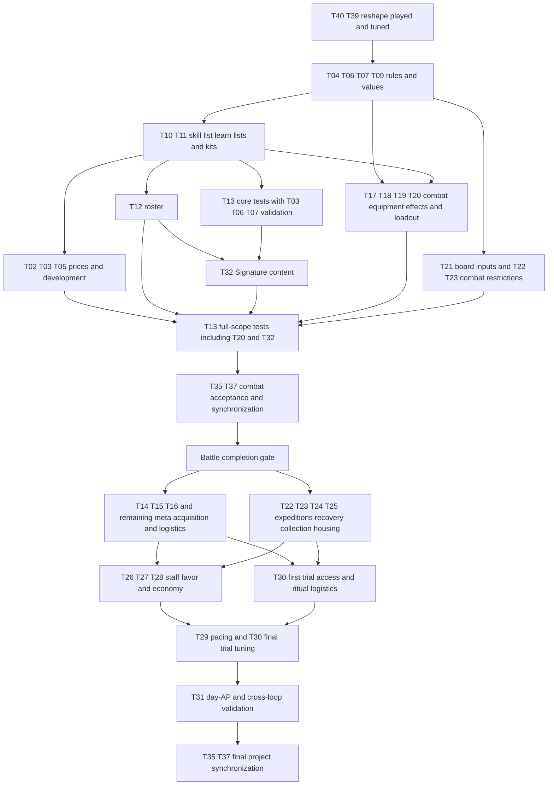

# Temporary Clarification List — Road of the Beasts

Central list of open design decisions and validation tasks from Battle, Monsters, Overworld and the central Skills GDD. **User priority (restated 2026-11-12): the Battle is the core and is finished first; the Overworld does not matter until the Battle stands and the user is satisfied with it, or until the user says otherwise. Overworld tasks stay listed here but are not worked on and do not constrain Battle decisions.** The sequence below organizes work; it does not approve new gameplay rules. **Branch and write scope follow [CLAUDE.md](../CLAUDE.md)** (GDD work: `docs/` on `main`, released by the user on 2026-11-12; the Godot battle implementation was released for `main` on 2026-11-11).

## Usage

- The GDDs describe the current working state; existing proposals and numbers are **not automatically approved** by moving open tasks here.
- Open questions, alternatives and review tasks are maintained exclusively here. The GDDs hold the current design, including labelled content drafts and prototype deviations needed to distinguish it from historical implementations. Use Git history to trace changes; do not maintain changelogs in the GDDs or this file. Keep the handoff current rather than appending a running change history.
- Prerequisites apply to the named deliverable, not automatically to the whole task. **D/K** contracts can precede pricing/content; **V** closes only after suitable executed tests. Do not make test inputs depend on the completion of their own validation. Independent work within the current priority may proceed in parallel; meta-only Overworld work is queued until the Battle gate.
- **Implementation:** open points of the Godot battle implementation live under [Implementation](#implementation). They decide no rule: a rule question found there is settled in the owning GDD section and task.
- **Session close:** refresh [Context Handoff](#context-handoff) after every session so another agent/computer can resume without chat history. Reusable instructions belong under [AI Prompts](#ai-prompts), not in the active task list.
- On completion: incorporate the decision into the specified GDD sections, synchronize affected companion files and check off the item here. For playtests, document measurements and results before changing rules if necessary.
- **Task fields:** every editable task carries **Status**, **Prerequisites**, **Sources**, the concrete gap/decision bullets and **Done when** (completion conditions). Status values: *Open* (no decision yet), *Partly drafted/decided* (working draft or partial decision exists, not validated), *Blocked* (named prerequisite or user decision missing). Completed tasks move to [Completed Tasks](#completed-tasks-ids-retained-for-references) with their IDs retained; IDs are never reused for other topics. Validation tasks close only with tests actually performed and documented.
- **D** = design decision, **V** = validation/balance, **K** = consistency correction. Sources refer to the current GDD section numbers unless explicitly labelled historical.
- **Central skill specification:** [gdd_skills.md](gdd_skills.md) is the single file for everything about monster skills: kit, the skill card, what a skill does itself and what it creates, value and prices, slot development, data and validation, Strike shapes and movement kinds, passives, the kits and the skill list. Battle owns the board: what grounds, zones and props do and when, and generic resolution; Overworld only meta integration, economy and its own tamer/loadout content; [gdd_monsters.md](gdd_monsters.md) keeps monster identity, stats, Kins, roster and growth. Do not maintain parallel monster-skill price lists or upgrade rules. Historical statements are not active specifications.

# Context Handoff

**Last updated: 2026-11-14, documentation consolidation and validation handoff.** Resume from current files, not chat history.

## Current State and Immediate Next Step

- **Latest user request / Git:** full CPU is allowed; all project documentation has been consolidated for the explicitly authorized closing commit on `main`. This snapshot contains the experiment tools, simulation-only candidates, actual-board-vein fix and S020–S024 measurements. Identify the closing commit through Git history; no self-referencing hash is embedded. No branch switch, fetch, pull or push is part of the request.
- **Executed validation:** Godot 4.7.2, normal process/CPU settings: full suite **303 cases, 0 errors, 2 known failed cases** (I46), including **all 158 battle cases passing**. The failures contain **959 failed assertions**, not 959 failed cases. Progression `--self-test`: **1183 passed / 0 failed**; discovery: **6930 passed / 0 failed**, including **37 action fixtures**. These checks validate code/harness behaviour, not gameplay or balance. 603 relative links/heading anchors across nine documents and the focused diff were checked before committing. UI inspection and human play remain unverified.
- **Execution policy:** full CPU permission supersedes the earlier low-CPU constraint. Direct normal Godot invocation is allowed; the optional launcher deliberately retains Idle priority and two-CPU affinity. Neither permission nor normal settings promises automatic parallelism or 100% CPU utilization.

- **Defaults and preserved content:** normal 7×7 uses **three Dragon Veins** and current ZONE PUSH/PULL skills cost **1 AP**, including mixed effects such as Bog. One central vein, the 2-AP override and new discovery skills remain experiments, not adopted defaults. Normal player stats/kits, including user `asdf` content, are preserved. The five simulation resources are excluded from normal gameplay and builders; the debug overview initially shows all records (**In game only** starts off). S023's historical claim that they are excluded from the overview is not current behaviour; S020–S024 raw logs remain unchanged.
- **Gameplay next:** focused human review of one central vein versus unchanged three-vein control; do not restart prices or entry proxies. [S024](simulation_log.md#s024--2026-11-14--one-dragon-vein-count-control) gives short-duration signals: means **2.44 → 2.98** at cost 1, **3.02 → 3.85** at cost 2, **3.25 → 5.13** with tactic (**8 games per map**). Single-vein tails include 1/4/3 games >5, maxima 6/8/8; controls have none >5. Less vein damage is not proof of better tactics or fairness; the user has not approved one vein as default.
- **Open follow-up:** S023 skill/profile controls, response windows and collision chains, stat/kit roles, prices/development, Kin/passives, T40 cleanup, one-use-square form and vein-owner UI remain open. Pull sorting and payload behaviour after zone cancellation are review leads, not confirmed bugs. Full gameplay acceptance and focused human/UI review remain outstanding; no task is closed by the supplied checks.

## Decisions Versus Drafts

| Class | Content (owner section holds the details) |
|-------|-------------------------------------------|
| Decided by the user (2026-11-13, reshape) | No height, no air layer, no Surges, no traps; ground and zone with one role each; a skill only delivers ([Skills §2](gdd_skills.md#2-the-skill-card)); fair damage at range; Dragon Veins by last touch, at least one per map; displacement is movement; damage on leaving a square as an effect; AP and turn effects only as `experiment`; ground acts as long as it lies; 7×7 stays; `content_status` on grounds, zones and props. |
| Decided earlier and still valid | Chebyshev distance and Voidscar reading, payload order and execution-time legality, simultaneous damage and queue-order displacement ties, damage-modifier stacking, modifier bounds, prop principles and the class-based catalogue with fixed aftermath, 2×2 body rules, queue ties, zones independent of ground, no aspects or attunement, no physical evolution, slot development at advancement steps, no skill rarity, monster cap by stage, one AP ceiling. Owners: Battle §2–§6, Skills §6, Monsters §2. |
| Working values, not validated | Highest hit 2 and lowest HP 3; the 26 skills and nine kits ([Skills §10](gdd_skills.md#10-kits-of-the-nine-monsters)/[§11](gdd_skills.md#11-skill-list)); ground and zone values; three Dragon Veins on 7×7; ground laid in battle lasts 2 rounds; every Strike pushes; reference movement over the full Movement stat (Run 1 AP, other reference movement 2 AP; authored experiments may differ); extra turns from round 2; prop catalogue values; test stats of the nine monsters. |
| Open | Stat prices, four-frame calculation draft and budgets ([Monsters §2.2](gdd_monsters.md#22-frame-budget-level-ups), not enforced by the build); every skill price ([Skills §5](gdd_skills.md#5-value-and-prices)); Kin access and learn lists; what a slot level allows. |
| Validation / tool boundary | [godot/tools](../godot/tools/README.md) are tools for trying things out, not rule sources or price authorities. Runs use bots on test content and give indications only. No task closes from a numeric fit or a simulation run. |

## Working Practices

- Follow [CLAUDE.md](../CLAUDE.md) for branch and write scope, preserve user work, no unrequested Git actions. **An audit session writes only `docs/temp_todo.md`;** GDD corrections and calculator/simulation-tool work below are follow-up tasks, not permission to edit them during the audit (`docs/` and `godot/tools/` are otherwise in the write scope of CLAUDE.md). The earlier checker authorization covers only the temporary docs script, never engine/prototype implementation.
- Resume from the current tasks and linked owners, not prior chat. Use the skill card of Skills §2 and the ground, zone and prop definitions of Battle §4, never a parallel model or a copied list. Skill content is edited only in [gdd_skills.md](gdd_skills.md).
- New recommendations/numbers need explicit status; general design changes need user decisions. Keep history in Git and replace stale handoff text rather than appending a log.

# Open Tasks

## Recommended Work Order

**Selected work priority: Battle first, Overworld second.** The task sections below are thematic groups, not execution phases; this table and the scoped prerequisites determine execution order. Parallel work stays within the Battle workstream unless the user changes priority.

| Order | Deliverable | Tasks | Boundary |
|-------|-------------|-------|----------|
| B1 — next | The reshaped battle played and tuned: rules that give every stat a job, kits that fit the length target | T40, T39; D/K of T03/T04/T06 | The user plays first; bot runs with `tactic` and the random-draw variants measure candidates |
| B2 | Skill list, learn lists, passives, kits and roster on the skill card | T10/T11/T12; T06 content | No price needed to play; prices follow |
| B3 | Stat and skill prices, slot development | T02, T03, T05 | From play and the measured values of B1/B2, not from the earlier sheets |
| B4 | All battle-facing external effects and request/result interfaces | Battle parts of T17–T21 and T22/T23 conflicts | Tamer skills, artifacts, medicine/array effects, loadout limits, swap/HP/defeat/Draw result and board inputs; the effects that named Surges or height are redefined here |
| B5 | Core tests, then Signature content and full-scope interaction tests | T13 with T03/T06/T07/T20 V; T32 | |
| B6 | Battle acceptance, clean-up of the removed mechanics in code and data | Battle gate; T40 clean-up; battle deliverables of T35/T37 | Every in-scope combat feature needs complete rules, content and documented suitable tests |
| O1 — after Battle gate | Translate battle requirements into acquisition, progression execution and world systems | T14/T15/T16; meta parts of T05/T17–T25/T30 | Recipes/prices/availability, expeditions, injuries, catching, housing, ritual sites and replacement logistics follow the combat specification |
| O2 | Management, progression pacing and day economy | T26–T31; final T35/T37 | Use tested battle states and resource demands to tune supply/XP/day AP |

### Battle Completion Gate

**Status:** Open. A rules draft is not a validated Battle completion. This milestone does not close mixed Battle/Overworld tasks wholesale or authorize implementation.
**Prerequisites:** Battle deliverables in B1–B5 and their combat-source corrections; no completion of meta-only tasks.
**Sources:** [Battle §7](gdd_battle.md#7-technical--prototype), [Skills §6–§7](gdd_skills.md#6-slot-levels-development-and-replacement), [Monsters §2](gdd_monsters.md#2-stats), [Overworld §6.4–§6.9](gdd_overworld.md#64-tamer-skills); detailed owning links remain under each task.
**Done when:** all four acceptance conditions below are met for the user-agreed combat scope; unresolved test failures or unapproved omissions keep the gate open.

- **Design ready:** T02–T07/T09–T12 combat deliverables, combat parts of T17–T23, T32 and related T35/T37 corrections specify legal battle inputs, actions, developed variants, passives, external effects, board generation, timing, preview and result outputs. Final intended battle scope must be explicit; a reduced roster, omitted items or deferred 2×2/late-game mechanics need user approval, not an assumed shortcut. The air layer is already removed by user decision, not deferred scope.
- **Validated:** T13 executes and documents suitable current-design tests across the agreed scope, including developed/high-stage states, core and full loadouts, source-specific exceptions and T03/T06/T07/T20 V. The Godot battle (`godot/battle`, rebuilt 2026-11-11) implements the confirmed rules and can serve as the harness; an implementation and its rule tests are not the validation itself, and the HTML prototype and paper calculations do not satisfy this gate.
- **Handoff to Overworld:** record the accepted combat constraints and still-open **meta-only** questions against their existing IDs. Use finished test sheets/loadouts without simulating the whole economy; keep reachable state/slot/upgrade limits explicit. Acquisition frequency, XP pacing, recipes, ritual locations and day AP stay open for Overworld, not invented free/instant defaults.
- **Integration safeguard:** resolve T22/T23 restrictions that could alter in-battle healing, HP or fall prevention before acceptance; defer their run/recovery economy. Later meta tuning must respect accepted battle contracts; any proposed combat change needs an explicit decision and affected regression tests.

### Audit Coverage and Disposition

Every existing ID was reconciled with its owner; none was renumbered, merged or closed by arithmetic. Links and detailed acceptance criteria remain in the task entries.

| Tasks | Current disposition |
|-------|---------------------|
| T01, T08, T33, T34, T36, T38 | Closed: removals and the superseded Surge task, kept as reference IDs |
| T40, T39 | The reshape and Dragon Veins have received first human play and decisions; further validation remains open |
| T02, T03, T05 | Prices and numeric entry remain open; four-frame/16-point Core High calculation draft is unvalidated; viable-start and alternative-development principles stand |
| T04, T06, T07, T09 | Rewritten to what the reshape leaves open (Draw result, Kin effects and shapes, ground and zone values, 2×2 bodies) |
| T10–T12 | The skill list and kits exist as working drafts; learn lists, passives and the roster are open |
| T13 | First human play exists; full validation open; bot evidence through S024; focused one-vein control human play is next, full validation remains open |
| T14 | After the stat prices |
| T15, T16 | Queued after the Battle gate |
| T17–T20 | Combat effects first; effects that named Surges or height need new definitions (Spirit Shield, two arrays) |
| T21–T25 | Battle board/HP/healing/defeat interfaces first; expedition, acquisition, recovery and housing details after the gate |
| T26–T31 | Meta work, queued |
| T32 | Signature content; Major Surges are gone with Surges |
| T35, T37 | Current documentation consolidated and references checked; whole-project synchronization and acceptance remain open |

## Battle Foundations — Resolution, Stats and Valuation

### [ ] T02 · Find Skill Prices (D/V)
**Status:** Open — **reset by the reshape of 2026-11-13.** No skill, ground, zone or prop has a price. The earlier construction-point sheets priced Surges, timers, Mountains and air coverage and were removed with that model.
**Prerequisites:** play of the reshaped build (T40, T13); a stable skill list (T10).
**Sources:** [Skills §5](gdd_skills.md#5-value-and-prices), [§2](gdd_skills.md#2-the-skill-card); [simulation_log.md](simulation_log.md) S020–S024.
- **Earlier progression direction (S022; S023 new gameplay takes priority):** working start and upgrade paths are user-approved goals, not approved numeric starts. Keep stat/skill ledgers separate and validate joint action thresholds; calculator prices are not frozen. Current ZONE PUSH/PULL overrides include mixed Slow effects as in S021. Proxy AP 2 leaves authored cost-3 `new_skill`, `asdf`, `strike_thrust` unaffordable despite all units having an affordable active; next check starter kits and distinguish AP-3 unlocks from extra actions. No source budget fit checked or price adopted.
- **Principles that stand** (earlier user decisions): a skill is paid with AP and its use limit; no skill rarity; a complete kit at original AP; stats and skills priced apart.
- **Evidence boundary:** [S020–S024](simulation_log.md#s024--2026-11-14--one-dragon-vein-count-control) compare rules, kits, action thresholds and maps, not equal-price components. Prices cannot repair a mechanical lack of meaningful choices; bot results do not prove that a stat or skill has no value. Review whole skills and combinations before deriving prices.
- **Open:** what a price is expressed in (AP only, or AP plus a kit budget); whether the 1-AP and 2-AP split of the build holds; the value of the two `experiment` effects (AP +1, one more turn) that the user wants rare and expensive; prices of created props.
- **`internal_calc_cost`** in the Resource files holds numbers of the removed sheets for older records and −1 for everything since: decide whether the field stays.
- **Done when:** the user has played, a price form is decided and written into Skills §5, and every skill of the game carries a price that play and runs support.

### [ ] T03 · Review Stat Budgets, Frames and Progression Limits (V/K)
**Status:** Open — consistency conflicts remain; arithmetic is not gameplay validation. S022 tests an AP-2/TPR-1 entry proxy and teamwide upgrades, not a frame, budget or approved stage/start.
- **Evidence:** [S022](simulation_log.md) is a proxy, not an approved start or equal-cost stat valuation. Cap-blocked increments, kit interactions and bot sensitivity require joint action-threshold tests with alternative growth paths; AP/TPR escalation can shorten battles too far and HP alone does not remove long tails. Current authored AP does not establish distinct kit identity.
**Prerequisites:** D/K review can start from current Monsters rules; relevant T02 costs/content for comparative testing. V closes with T13, not before T11 can supply test kits.
**Current owner status:** [Monsters §2.2](gdd_monsters.md#22-frame-budget-level-ups) retains an unvalidated four-frame calculation draft (Core High 16 points), while §4.1 uses spread authored test stats outside that model. Its free HP base of 4 conflicts with the build floor of 3 and Qi HP ceiling of 4. No numeric entry state is approved. Bot observations do not establish absent initiative, Movement or Reach value; test their roles with suitable kits/maps (T40).
**Sources:** Monsters [§2.1](gdd_monsters.md#21-the-stats)–[§2.3](gdd_monsters.md#23-stat-ceilings-per-stage), [§5.3](gdd_monsters.md#53-monster-progression-the-18-steps); Overworld [§1.2](gdd_overworld.md#12-design-pillars), [§2.4](gdd_overworld.md#24-cultivation-loop).
- **Stat-role coverage:** test low-HP/high-Reach builds and Movement with an appropriate movement skill; old kit-specific outcomes are not universal stat values. Stronger bots and human decisions must inform calibration; do not derive permanent prices from one-step bot rankings.
- **Calculation gaps:** derive the other-stage frames and review budgets/ceilings together, including sturdy-versus-middle coverage, third-turn and AP-above-3 pricing. The retained calculation's universal AP-3 purchase does not differentiate kits. Overworld shape data still uses the earlier six shapes (I33); debug overview visibility is not frame validation.
- Check prices, budgets and scaled frames against Reach's current creation-range role, not Strike range ([Monsters §2.1](gdd_monsters.md#21-the-stats)).
- **Initiative roll versus growth:** the old +0.1 level-up account is superseded; current Monsters §2.2 drafts 2.0 at roll versus +0.2 at level-up per point. Compare freshly rolled and raised individuals: equal received points need not yield equal combat strength; neither conversion is validated.
- **Monster cap (decided, user 2026-11-11):** the player's **stage**, not the exact sub-tier ([Monsters §2.2](gdd_monsters.md#22-frame-budget-level-ups)); [§5.3](gdd_monsters.md#53-monster-progression-the-18-steps) sets no separate sub-tier cap.
- Some Overworld texts still limit spent points by the frame; the monster GDD limits only the roll by the frame.
- Step-only monsters: explicitly resolve random Movement points versus “stays at frame minimum”.
- **Reach stage scaling (decided, user 2026-11-11):** ratio (stage ceiling − 1) ÷ (Core ceiling − 1), round half up, written into the rule text of [Monsters §2.2](gdd_monsters.md#22-frame-budget-level-ups); the table is unchanged.
- **Verification boundary:** the earlier six-frame/31-point arithmetic is superseded, not evidence for the current four-frame draft. Recalculate current frames, budgets and scaled ceilings when their inputs are selected; no calculation is rerun in this audit.
- **One AP ceiling (decided):** Monsters §2.2/§2.3 applies the stage AP ceiling to every monster without reciprocal AP/TPR restrictions. Validate unrestricted combinations and action-threshold interactions, including third turns and high AP; S022 is limited evidence, not validation of the full range. No action-scaled TPR-price formula is approved.
- **Done when:** each finding above is resolved in its owning section (Monsters §2.2/§2.3/§5.3, Overworld §1.2/§2.6) or consciously deferred; the V part closes only after documented frame/price/budget/ceiling tests (shared with T13).

### [ ] T04 · Make Resolution Rules and Edge Cases Consistent (D/K)
**Status:** Partly decided — the rules that survive the reshape are in [Battle §2–§6](gdd_battle.md#2-battle-flow); the questions about Surge scheduling, Mountains and the air layer are gone with them.
**Prerequisites:** none.
**Sources:** [Battle §2.1](gdd_battle.md#21-core-battle-loop), [§2.4](gdd_battle.md#24-effect-timing-reference), [§6.2](gdd_battle.md#62-payload-resolution); [Implementation](#implementation).
- **Draw result:** both sides without monsters after one resolution is a Draw; what the BattleResult carries and what follows in an expedition is open (with T19/T23).
- **Late-round pressure:** start rounds for 2v2 and 5v5; whether the brake is still needed at all when Dragon Veins are owned by touch (it then never runs on 7×7).
- **Dragon Vein tie:** the owner's choice among equally near, equally strong enemies needs an input step; the build takes roster order.
- **Readings the code chose** (I01–I18): the ones about Mountains, the air layer and Surges are void; confirm or correct the rest in their owner sections: walking direction (I01), board-edge Strike legality (I02), Tail Sweep on multi-cell shapes (I04), total initiative (I11), late-round start rounds (I15).
- **Leaving and entering in one move:** a push off Binding Vines onto Thornbed fires both, the leaving effect first; confirm the order with the user once played.
- **Done when:** each point has a rule in its owner section and the readings are confirmed or corrected.

## Battle Content — Skills, Development and Monster Identity

### [ ] T05 · Complete Skill Improvements (D)
**Status:** Partly decided — principles confirmed (slot development granted at advancement steps, no experience currency, pill-based replacement, no damage/AP/Reach upgrades); what a development changes on a skill card is open.
**Prerequisites:** T02 for prices; T10 for a stable skill list.
**Sources:** [Skills §6](gdd_skills.md#6-slot-levels-development-and-replacement); [Monsters §5.1](gdd_monsters.md#51-monster-rarity)/[§5.3](gdd_monsters.md#53-monster-progression-the-18-steps); [Overworld §6.3.2](gdd_overworld.md#632-permanent-skill-slot-development-confirmed).
- **Decided (user, 2026-11-08):** permanent slot development only at advancement steps, on one slot of one monster; replacement with a relearning pill keeps the slot's development; slot levels 1–3; never more damage, lower AP or more Reach.
- **S022 evidence boundary:** the damaging-Strike + Thornbed proxy (only without an existing ground BoardOp) preserves AP/damage and other fields; it is not an approved slot choice. Unchanged outcomes do not prove absent value. Validate alternative paths and joint stat/slot action thresholds; no lower-AP upgrade. Viable entry and useful alternatives are goals, not a numeric start or confirmed development option.
- **Open on the skill card:** which parts a development may change (shape, zone rounds, what a movement passes over, a second thing created); step-to-level mapping; step supply incl. Normal rarity; deferral; respec; passive-only slots; the relearning pill's economy (T16/T31); the Evolution Pillar's function.
- **Done when:** these points are decided and Skills §6 lists the development options of every skill of the game.

### [ ] T06 · Complete Strike Shapes and Kin Effects (D/V)
**Status:** Partly decided — Cleave (cardinal only), Beast Bite (no effect) and the Winged Dive retreat are decided (user, 2026-11-11); every Strike pushes (build rule 2026-11-12).
**Prerequisites:** none for D; V with T13.
**Sources:** [Skills §3](gdd_skills.md#3-what-a-skill-does-itself), [§8.1](gdd_skills.md#81-strike-shapes); [Monsters §3.1](gdd_monsters.md#31-kin-table).
- **Ancient has no Strike effect any more** (it destroyed Mountains): a new one is needed.
- **Kins beyond the Strike:** with Surge sizes, movement layers and the air layer gone, the Kin table holds only a stat lean and a Strike effect. What else sets Kins apart (skill access, a passive each) is open, with T11.
- **Shape coverage:** distinguish draft Jab/Thrust/Shove/Thorn Lash cards from archived shape skills and user-authored experiments, including `new_skill` Arc ([Skills §8.1](gdd_skills.md#81-strike-shapes)/§10). Decide intended defaults and AP access; an archived reference skill does not mean the shape cannot appear in an experiment.
- **Readings:** board-edge Strike legality (I02), Tail Sweep on multi-cell shapes (I04).
- **Displacement access (user decision 2026-11-12):** push skills are not bound to Scaled; which species get which displacement tool is T11.
- **Done when:** every Kin has its Strike effect and identity, the shape list of the game is decided, and T13 has compared the shapes.

### [ ] T07 · Ground and Zone Values (D/V)
**Status:** Partly decided — roles (ground at a moment, zone while inside), independence of zone and ground, no healing or damage by zones, unlimited Mossbed entries are decided; every value is a working draft.
**Prerequisites:** play (T13/T40).
**Sources:** [Battle §4.6](gdd_battle.md#46-zones-effects-rules--opposites), [§4.7](gdd_battle.md#47-ground--neutral-hazard-and-blessed), [§4.5](gdd_battle.md#45-lifecycles).
- **Ranged damage is weak by design now:** hazards deal their level (1, at most 2), only Binding Vines 2. Check in play whether ground pressures enough or battles are decided by Strikes and Dragon Veins alone.
- **Binding Vines:** 2 on leaving, no levels, may be laid under a monster. Is a second cast a refresh only; does a blocked push count (no: no movement); is 2 right against HP 3.
- **Healing:** only Mossbed (1 on entering). Whether a ground that heals at the end of a turn is wanted (the earlier healing zone is archived).
- **Stat effects on a square:** only zones. The archived Hearth, Umbra and Hallowed could return as zones if wanted.
- **Levels:** hazards to II by laying again, zones to III by casting again; check whether levelling is used or only clutters the rules.
- **Prop dependants:** Wardstone's former Surge reduction needs redefinition/removal. Ancestor Tablet currently leaves Mossbed instead of Hallowed; validate or replace that working aftermath ([Battle §4.10](gdd_battle.md#410-prop-catalogue-and-damage)), not the removed effect.
- **Done when:** the values are confirmed in play and written into Battle §4.6/§4.7 without the open marks.

### [ ] T09 · 2×2 Bodies (D/K)
**Status:** Partly decided — the air layer is removed (2026-11-13) and with it every open air question; the 2×2 board rules are decided ([Battle §4.3](gdd_battle.md#43-the-square-ground-zone-and-occupant), [§6.3](gdd_battle.md#63-collision)). No monster of the build has a 2×2 body.
**Prerequisites:** content that wants a 2×2 monster (T12).
**Sources:** [Battle §4.3](gdd_battle.md#43-the-square-ground-zone-and-occupant); [Skills §8.1](gdd_skills.md#81-strike-shapes).
- **Open:** leaving effects for a 2×2 body (the squares it no longer covers: written into Battle §4.3 as a reading, to confirm); Dragon Vein touch by a body that covers one; whether 2×2 stays in scope at all before the battle stands.
- **Done when:** the user decides the scope and the two readings are confirmed.

### [ ] T10 · The Skill List (D)
**Status:** Partly drafted — 26 skills on the skill card exist as working draft ([Skills §11](gdd_skills.md#11-skill-list)), chosen while building; first human play exists, full validation open.
**Prerequisites:** play; T40 for the open rules.
**Sources:** [Skills §2](gdd_skills.md#2-the-skill-card), [§11](gdd_skills.md#11-skill-list); skill builder and generator ([Skills §7](gdd_skills.md#7-data-and-validation)).
- **Open:** which of the 26 stay; skills that give initiative and Movement a use; combinations (Strike + zone, movement + zone) that no skill of the list uses yet; whether Quake Leap's “push all neighbours on landing” returns (strongest single part in the generator runs); skills around created props (the user's idea of throwing a prop across the board is not built).
- **Archived skill files** (26 and the six of the Surge and trap removal): delete what the user does not want back.
- **Done when:** the user has played and fixed a list, and Skills §11 carries it without the draft mark.

### [ ] T11 · Learn Lists, Passives and Kits (D)
**Status:** Open — nine hand-made kits exist ([Skills §10](gdd_skills.md#10-kits-of-the-nine-monsters)); no species has a learn list, one passive is in the game.
**Prerequisites:** T10; T06 for Kin identity.
**Sources:** [Skills §1](gdd_skills.md#1-the-kit), [§9](gdd_skills.md#9-passives), [§10](gdd_skills.md#10-kits-of-the-nine-monsters); [Monsters §4.1](gdd_monsters.md#41-first-roster-draft--9-monsters).
- **Kits:** use current prototype Resources and the manual-experiment boundary in Skills §10, not historical bot rankings as identity rules. Preserve Blaze Tiger's `new_skill` and `asdf`; the non-Strike displacement goal remains unmet for Blaze Tiger (T40), requiring later user review. Player-shaped kits need species learn lists (draft about 8 skills: 4 defaults + 1 per breakthrough, [Monsters §5.3](gdd_monsters.md#53-monster-progression-the-18-steps)).
- **Kin access:** the earlier movement and skill lock-outs are gone; a new access rule is open (with T06).
- **Passives:** candidates that still fit are listed in Skills §9 without numbers; passives that lower AP conflict with “no AP reduction”.
- **Done when:** every species of the roster has a learn list and default kit, the passive list is decided, and Skills §9/§10 carry them.

### [ ] T12 · Select the Launch Roster (D)
**Status:** Blocked — T11 identities/coverage are not ready; candidate names alone are not launch selection.
**Prerequisites:** T11.
**Sources:** Monsters [§4.1](gdd_monsters.md#41-first-roster-draft--9-monsters)–[§4.2](gdd_monsters.md#42-additional-species-candidates).
- Without a mandatory Kin×aspect matrix, select a diverse roster from the nine reference monsters and additional name ideas (previous target about 15); prioritize free themes and distinct playstyles over category completeness.
- Check missing blueprint/movement coverage and distinct one-sentence identities.
- **Done when:** the launch roster is recorded in [Monsters §4](gdd_monsters.md#4-roster) with a documented coverage and identity review.

## Battle Validation and the Post-Battle Reshape Follow-up

### [ ] T13 · Plan and Evaluate Battle Tests (V)
**Status:** Open — **first human play and feedback exist; systematic validation remains open.** Bot runs S001–S024 are recorded in [simulation_log.md](simulation_log.md) and give indications only.
**Prerequisites:** the user's play of the reshaped build; for the full pass T12 roster and the battle parts of T17–T20.
**Sources:** [Battle §1.2](gdd_battle.md#12-battle-design-pillars) (goals), [§7.2](gdd_battle.md#72-prototype--playtests); [godot/tools/README.md](../godot/tools/README.md).
- **Goals as metrics (current user instruction):** 3v3 **mean 3–5 rounds**, outliers **<2 / >5** checked separately; ended by fighting, meaningful decisions, no defeat without a chance to act, situational skills, useful stats and distinct monsters.
- **Evidence index:** [simulation_log.md](simulation_log.md) **S020–S024** holds the complete raw reports, provenance and sample limitations: S020/S021 current-content costs, response windows and collision chains; S022 entry/upgrade proxies; S023 authored-stat skill discovery and ablation; S024 matched one-versus-three-vein controls. Do not pool correlated draws, side swaps, repeated cases or conditions as independent samples. None adopts a price, numeric start, upgrade or map default.
- **Limits:** mixstats reports **team win rates conditional on a fielded monster stat**, not individual win rates or causal additive prices. S020 rows are rounded; later output includes exact wins. Never reconstruct exact wins from rounded rates. Greedy has strong one-step bot limits; stronger-bot checks remain small and policy-dependent. No robust ranking or proof of absent stat value follows. Tactic assumes a greedy opponent, cannot reliably build dilemmas/surrounds, and earlier side bias remains unresolved.
- **Reporting gap in S020:** totals include Dragon Veins (`well`) and surrounding (`flank`), missing as columns; displayed shares do not sum to 100 %. Fixed in the tool after the measurement series, with one smoke battle; raw blocks stay unchanged.
- **Current next stage / S024:** focused human play of one central vein versus unchanged three-vein control, distinguishing less passive damage from tactical benefit. See S024 and handoff for matched cost/bot blocks and wider tails; no fairness validation, adoption or task closure. Normal gameplay remains three veins and cost 1 for ZONE PUSH/PULL; cost 2 is a trial override, not monster AP 2.
- **Latest executed checks:** Godot 4.7.2 with normal/full-CPU settings: full suite 303 cases, 0 errors, 2 known failed cases (I46), all 158 battle cases pass; progression self-test 1183/0, discovery 6930/0 including 37 action fixtures. Harness/regression checks are not human acceptance or balance validation. The current documentation/reference pass and focused diff are checked; no new gameplay measurement was added.
- **Deferred S023 follow-up:** Mist trail versus identical walking, Cloudstep opening versus emergency use, screen opportunity cost and non-Winged retreat; slot substitutions are not free additions or equal-price comparisons. No-own-turn (first positive hit → death without another own turn) is descriptive, not a fairness verdict. Four skills plus Reed Screen stay simulation-only until user selection: excluded from normal gameplay and builders, but visible in the default unfiltered debug overview (**In game only** initially off). S023's old overview-exclusion claim is not current behaviour; historical measurements remain unchanged.
- **Additional open checks:** human play of AP 2 for current ZONE PUSH/PULL skills versus a one-shot option, or a targeted stat-role intervention. Further experiments including skills/items/one-shot boosts/maps are authorized, not mechanics adoption. Replay S020 battle 43 shows all victims had acted before the stationary collision chain killed them; first-turn survival does not prove fairness. Open review leads: pull sorting and initial-push/code-payload behaviour despite zone cancellation (`CREATE_ZONE` asymmetry), not confirmed bugs. The earlier incomplete 40-battle tactic attempt remains excluded.
- **Done when:** core and full-scope test passes by play are executed on a build implementing the agreed combat scope, and their results are documented.

### [ ] T40 · Reshape the Square and the Skills (D/K)

**Status:** Partly decided — the direction and the form are decided by the user (2026-11-13), built and written into the GDDs; values and content are working drafts; first human play and feedback exist, full validation remains open.
**Prerequisites:** the user's play.
**Sources:** [Battle §1.2](gdd_battle.md#12-battle-design-pillars), [§4](gdd_battle.md#4-battlefield), [§6](gdd_battle.md#6-damage--displacement); [Skills §2–§4](gdd_skills.md#2-the-skill-card); [simulation_log.md](simulation_log.md) S016–S021.

- **Purpose:** every stat should support meaningful choices and monsters should differ through their kits and decisions. Earlier bot/kit observations motivate testing, not a universal verdict that initiative, Movement or fragile bodies have no value.
- **Decided by the user:** the skill-delivery model and removed mechanics are owned by Battle §1.2/§4 and Skills §2–§4. Preserve those decisions; do not reopen the discarded universal Shove or standalone stat-zone alternatives.
- **Open (user):**
  - **A job for initiative and Movement.** Test touch control, leaving damage and turn timing with suitable kits and human decisions; existing bot results do not isolate their value. First-arrival-dependent vein damage and distance-moved rewards remain unadopted ideas, not missing approved mechanics.
  - **First-play feedback is decided:** more non-Strike displacement in kits, no Shove action for everyone; Dragon Veins remain standable and last touch owns; stat zones only as extras on other skills. Validate rather than reopen discarded alternatives. **Prototype exception:** Blaze Tiger's user `new_skill` is an experiment Arc Strike and its current kit does not meet the non-Strike displacement goal ([Skills §10](gdd_skills.md#10-kits-of-the-nine-monsters)). Preserve the authored file; ask for the design decision later, do not silently restore Headbutt or approve this as a default.
  - **Battle length and candidates:** T13 owns the current evidence review and S020–S024 links. One central vein versus three is next for human review; costs, repetition limits, one-shot survival, new skills/items and maps remain authorized experiments, not automatic adoption. No price/entry-proxy restart.
  - **Squares that act once and vanish** (Potential Extensions): the user still wants them, form open (a prop, an “array”, something of its own).
  - **Dragon Veins:** count and squares for boards without a centre row; the owner's choice at a tie; a mark for the owner in the view.
  - **Removed-mechanic dependants:** Ancient's Strike effect (T06), Wardstone and other prop effects (T07), Spirit Shield (T20), High Ground/Warding Arrays (T18) and passive candidates (T11). Ancestor Tablet's current Mossbed aftermath is a working implementation, not the former Hallowed effect; validate or replace it rather than treating it as missing.
- **Clean-up still to do:** I56/I57 own removal of unused height/air/Surge/trap code and associated tests/switches. Review unwanted archived content, the overworld's six-shape adapter (T03/I33) and retention of `internal_calc_cost` (T02); do not delete authored experiments or treat the note as a current price rule.

- **Working content, not approval:** Battle §4–§6 owns touch/ground/prop timing and displacement, Monsters §4.1 owns authored test stats, Skills §10/§11 owns draft kits/cards and experiment effects. The numerical values, content selection and prices remain unvalidated. `wells`/`WELL` are retained implementation names for Dragon Veins, not a second mechanic. Preserve user-authored overrides; use the owner sections rather than maintaining a second catalogue here.

**Done when:** the user has played and decided the open points, the working values are confirmed or replaced, and the clean-up is done.

### [ ] T39 · Dragon Veins: Square Control as the Way to Win by Defeat (D/V)

**Status:** Partly decided *(user decisions 2026-11-13: three squares on the centre row, damage at the end of a round, surrounding, extra turns from round 2, late-round pressure only as a brake; ownership by last touch; all working drafts in [Battle §4.2](gdd_battle.md#42-dragon-veins-surrounding-and-late-round-pressure) / [§2.2](gdd_battle.md#22-initiative-rules), standard of the build; bot runs S013–S020; first human play exists, full validation open)*.
**Prerequisites:** play.
**Sources:** [Battle §1.2](gdd_battle.md#12-battle-design-pillars), [§4.2](gdd_battle.md#42-dragon-veins-surrounding-and-late-round-pressure); [simulation_log.md](simulation_log.md) S013, S017, S018.

- **User frame (2026-11-13):** the win condition stays “all enemy monsters defeated”; square control is the way there. Initiative order stays (no alternating activation), four free skill slots stay, monsters keep their variety. Rejected by the user: extra damage against a monster that cannot evade, armour by facing, alternating activation, healing or AP on these squares for the start.
- **Current comparison:** S024 and T13 compare one central vein with unchanged three-vein control. Lower passive damage and longer means come with wider tails; no causal stat-role or fairness conclusion follows. Three veins remain the normal 7×7 default; one vein has not been adopted. Earlier rejected/unselected candidates remain evidence in the log, not parallel active rules.
- **Open:** count and squares per mode (even boards have no centre row); the owner's choice at the last tie (input step); whether damage starts in round 1; a mark in the view for the owner and for who is hit next; 2×2 bodies on a vein; whether surrounding stays.

**Done when:** the user has played and decided these points and T13 has measured the result.

### [ ] T14 · Safeguard Reshape Against Reroll Exploitation (D/V)
**Status:** Open — queued for post-Battle meta integration; reroll access/cost safeguards remain unvalidated.
**Prerequisites:** Battle gate, T03 and T13 results for legal stat states; relevant T16/T30/T31 economy/ritual inputs before declaring costs sufficient. T03 still checks rolled-versus-raised combat strength before the gate.
**Sources:** [Monsters §2.2](gdd_monsters.md#22-frame-budget-level-ups); Overworld [§2.6](gdd_overworld.md#26-action-catalog), [§7.5](gdd_overworld.md#75-materials-seeds-and-grades).
- Are a rare elixir and ritual costs sufficient, or is a cap/cooldown needed against repeated optimization rolls?
- **Done when:** the elixir/ritual cost is confirmed sufficient or a cap/cooldown is decided, backed by documented T13 results.

## Cross-Document Tasks — Combat Effects First, World Catalogues Later

### [ ] T15 · Define City Powers, Responsibilities and Content (D)
**Status:** Open — queued after the Battle gate by user priority; technically independent, not a combat blocker.
**Prerequisites:** no gameplay dependency on Battle; scheduling waits for its gate. Do not divert the current workstream into city design.
**Sources:** Overworld [§3.1](gdd_overworld.md#31-the-city)–[§3.2](gdd_overworld.md#32-the-powers-of-the-city), [§7.2](gdd_overworld.md#72-favor--faction).
- Define faction names, profiles and offerings for the three families.
- Confirm operators of Arena, Teleport Plaza and Business District: proposal is City Lord, City Lord, Guild.
- Clarify buildings/access for Rival Compounds and the purpose of the Slums; Black Stall remains an optional idea, not a promised feature.
- **Done when:** faction profiles, district operators, Rival Compound access and the Slums purpose are recorded in Overworld §3.1/§3.2/§7.2.

### [ ] T16 · Complete Material, Item and Recipe Catalogues (D)
**Status:** Open — catalogue/recipe/acquisition work queued after the Battle gate; combat effects are defined first under T17–T20.
**Prerequisites:** T01 (decided); Battle gate as scheduling prerequisite; relevant T10/T17–T20 outputs for battle-related products. Full recipes/material catalogues are not prerequisites to defining those combat effects.
**Sources:** Overworld [§6.6](gdd_overworld.md#66-pills--medicines)–[§6.8](gdd_overworld.md#68-arrays-artifacts-for-places), [§7.5](gdd_overworld.md#75-materials-seeds-and-grades)–[§7.8](gdd_overworld.md#78-acquisition-sources).
- Derive concrete materials, herbs, seeds, recipes, seals, scrolls and blueprints from patterns; determine counts, tiers and grades.
- Reconcile the legacy catalogue-count assumption (~40 pills, previously four tiers) with the current six-stage tier model, the §7.5 “ten families” wording, relearning pill and missing Sovereign XP value. Neither a full tier mapping nor a promised catalogue count is established.
- Check grade dependencies and acquisition sources against “money never buys exclusive power”; Legendary bloodline ingredients are currently described both as story-only and as boss/quest/auction rewards.
- Confirm Array recipes and the Forge route (Ore + Beast Parts); decide whether Upper Stones are currency only or also ritual materials. Align Bloodline requirements: Monsters §5.2 does not list the Upper-stone input in Overworld §7.5; do not adopt it from the optional ritual proposal.
- **Done when:** catalogue counts, tiers and grades are defined and the listed conflicts (pill count versus stages, Legendary sources, Upper-stone role, Array/Forge routes) are resolved in Overworld §6.6–§7.8.

### [ ] T17 · Define Artifact Rules and Stacking (D/K)
**Status:** Partly drafted — battle-facing slots/effects/stacking prioritized before the Battle gate; acquisition and meta-only gear bonuses remain later work.
**Prerequisites:** Relevant T03 stat rules, T11 passive definitions and T20 tamer interfaces for combat equipment; no full T16 catalogue prerequisite. T16/T25/T31 for later forging/acquisition, capacity and day-AP bonuses.
**Sources:** Overworld [§6.7](gdd_overworld.md#67-artifacts-equipment--socketed-passives), [§6.9](gdd_overworld.md#69-hard-caps), [§7.5](gdd_overworld.md#75-materials-seeds-and-grades); [Monsters §5.1](gdd_monsters.md#51-monster-rarity).
- **Battle deliverable:** legal equipment slots/Stage gates, effects/stat limits and passive stacking, including modifiers of tamer skills, must resolve into tested sheets/loadouts. **Meta deliverable:** forging/availability and day-AP/capacity/expedition-only bonuses follow after the gate; they remain open, not removed.
- Tamer: two or three slots, and when? Monster: second slot at Epic+, or additionally only from Core? Synchronize tables.
- Clarify passive OR stat modifier versus the schema “passive + small stat modifier”; limit duplicate passives and multiple artifacts.
- Check +1 AP/day, capacity and skill modifiers against day economy, Stage caps and the options-not-numbers rule.
- **Done when:** slot counts and unlock timing, the passive-versus-stat rule and stacking limits are decided and Overworld §6.3/§6.7/§6.9 agree.

### [ ] T18 · Specify Medicines and Arrays (D)
**Reshape 2026-11-13:** the High Ground Array (a start square as Mountain) and the Warding Array (less Surge damage) have lost their object ([Overworld §6.8](gdd_overworld.md#68-arrays-artifacts-for-places)); the user named arrays as a possible form for squares that act once (Potential Extensions).
**Status:** Partly drafted — medicine and battle-array contracts/classification prioritized for the Battle gate; recipe and non-combat Array work stays open afterward.
**Prerequisites:** Relevant T07-D/T10 effect contracts for battle definitions, not completed healing tests or the T16 catalogue. T16 supplies recipes/acquisition later; T19 consumes resolved combat effects/costs.
**Sources:** Overworld [§6.6](gdd_overworld.md#66-pills--medicines), [§6.8](gdd_overworld.md#68-arrays-artifacts-for-places), [§7.5](gdd_overworld.md#75-materials-seeds-and-grades)–[§7.6](gdd_overworld.md#76-item-schema).
- **Battle deliverable:** concrete medicine/array/battle-prep effects, item classification, consumption/durability, placement and source-specific timing feed T19 and T13. **Meta deliverable:** recipes, purchase/crafting supply and Internal World/business-protection Array content follow after the gate.
- Determine Medicine effects, recipes, item kind and distinction from pills. Protection/healing/board effects need their own source, consumption and timing contracts in the shared data model; monster-effect contracts do not automatically approve items.
- Which Arrays are consumable, and which reusable? Define durability, placement and battle effects.
- Confirm pre-battle Arrays as a limited exception to a neutral/point-symmetric start; review the three listed battle Array drafts and separately define the claimed Internal World/business-protection scope; no additional Array record is currently supplied.
- *New:* the battle-prep pills Swift (+1 initiative next battle) and Ward (first-hit immunity next battle) in [Overworld §7.5](gdd_overworld.md#75-materials-seeds-and-grades) are neither medicines nor arrays; decide their item treatment, timing and effect contract. “Immunity” sits against the shared protection model (reduction, no generic immunity) in [Skills §4](gdd_skills.md#4-what-a-skill-creates); Warding Array (“first Surge damage −1”) and Spirit Shield (“next Surge damage is 0”) use different wording again. Also reconcile “pre-battle modifiers (pills, arrays)” in the Battle request ([Overworld §8](gdd_overworld.md#8-technical-notes-overworld--development-phases)) with the loadout categories.
- **Done when:** Medicine/Array item kinds, effects, recipes, consumption and timing contracts are specified in the shared model, and the Swift/Ward pill classification is decided.

### [ ] T19 · Complete Battle Loadout and Timing (D)
**Status:** Partly drafted — visibility, pre-battle selection and BattleResult consumption fields exist; counts, activation windows and source handling remain blocked by T18 effects/costs.
**Prerequisites:** T18 combat effects and Battle-AP/consumption contracts, not recipes or market prices; coordinate T17/T20 loadout interfaces. Complete before full-scope T13.
**Sources:** [Battle §5.2](gdd_battle.md#52-tamer-skills-and-battle-loadout) (integration); Overworld [§2.1](gdd_overworld.md#21-battle-loop), [§7.9](gdd_overworld.md#79-inventory-and-loadout), [§8](gdd_overworld.md#8-technical-notes-overworld--development-phases).
- Define Medicine/Array counts, activation windows (own turn or anytime), AP costs and consumption.
- Apply the same rules to human opponents; specify visibility, preview, pre-battle locking and reporting consumed items in BattleResult.
- **Result schema:** Battle §2.1 and Overworld §2.1 now name the **Draw**. Still define the full output contract (no winner, per-monster HP/defeat facts, kill attribution and used-up items; I29). Rewards, XP, injury and Arena consequences remain T23/meta; mentioning Draw does not settle them.
- Dependency is directional: item combat effects/Battle-AP costs first, then loadout limits; no dependency on spirit-stone prices/recipes or mutual blocking. Acquisition frequency is tuned later against the accepted per-battle limits.
- **Done when:** loadout counts, activation windows, AP costs, consumption, human-opponent visibility, BattleResult reporting (including the Draw outcome) are specified in Overworld §7.9/§8 and Battle §5.2.

### [ ] T20 · Validate Tamer Skills Including Beast Swap (D/V)
**Reshape 2026-11-13:** Spirit Shield nullified Surge damage and has lost its object; Domain Glimpse no longer needs to spare Mountains and Surge markers; Swap Places counts as leaving and entering ([Battle §5.2](gdd_battle.md#52-tamer-skills-and-battle-loadout)). Redefine Spirit Shield here.
**Status:** Partly drafted — baseline summary table exists; *proposal* rows are unconfirmed. D can proceed on missing source contracts; V waits for the matching T13 tests.
**Prerequisites:** D uses existing shared contracts and only affected T09/T18/T19 interfaces; coordinate tamer exceptions with T04 now. V requires testable definitions/loadout timing and T13 execution, not a blanket T13 prerequisite to design.
**Sources:** [Overworld §6.4](gdd_overworld.md#64-tamer-skills); [Battle §5.2](gdd_battle.md#52-tamer-skills-and-battle-loadout) (integration).
- **Battle deliverable:** slots/Stage gates, in-battle effects, activation windows, swap/queue/HP/defeat handling and their T13 tests. Catching-only skills still need explicit loadout-slot/usage/output contracts; their seal supply/acquisition tuning follows with T24. Scroll availability/learning costs and permanent-loss logistics follow the gate, without changing combat permissions.
- Swap Places, Urgent Order, the activation window and Beast Swap runtime rules are confirmed (Battle §5.2, 2026-11-11). Second Wind and Life Thread are confirmed (2026-11-11, incl. Deadly-dungeon protection for Life Thread). Double Bind and Seal Mastery stay proposals until the catching rules (T24) are decided; T01 removed Attune. Explicitly define tamer sources in the shared effect model without transferring monster-skill permissions or AP classes.
- **Unconfirmed table rows (new gap):** Spatial Pull ("move an own monster to any empty square") and Qi Suppression ("an enemy monster −2 initiative next round") in [Overworld §6.4](gdd_overworld.md#64-tamer-skills) have no runtime contract in [Battle §5.2](gdd_battle.md#52-tamer-skills-and-battle-loadout). Decide confirm/change/reject; check Spatial Pull against Swap Places and Beast Swap (few uniform rules), its legality (range/LOS, body size, ground entry, layers, Surge markers), Qi Suppression against the stat-modifier rule ([Battle §3.1](gdd_battle.md#31-effective-stats): same source refreshes, N-round end) and its initiative timing within the recalculated-every-round queue, and the artifact variant ("−3 instead of −2", [Overworld §6.7](gdd_overworld.md#67-artifacts-equipment--socketed-passives)).
- Life Thread is decided (Battle §6.1); Spirit Shield's removed-Surge effect needs replacement or removal, not a claim of a current decided protection rule. Test the resulting protections and Urgent Order against initiative; define usage timing for free skills.
- Beast Swap: HP, queue and body-size rules are confirmed (Battle §5.2); injury interaction (T23) and the spatial-space capacity/logistics remain open.
- Scrolls teach skills earlier; Beast Swap may only be slotted from Soul: preserve this explicit gate. Define whether other early-learned later-stage skills may also be used early; do not silently extend the Beast Swap exception to all skills or waive it.
- *New:* Domain Glimpse is fully specified (Overworld §6.4: any tetromino, any orientation, anywhere on the board; Voidscar, Dragon Veins, props and monsters unaffected); its test belongs to T13.
- **Reading and pointers (K):** confirm the build's prohibition on swapping out the active monster (I13) in Battle §5.2. Review navigation to Domain Glimpse and Life Thread; do not count Spirit Shield's obsolete Surge effect as a confirmed current skill.
- **Done when:** each tamer skill is confirmed, changed or rejected, the I13 reading is confirmed or corrected, tamer sources exist in the shared effect model, and Beast Swap and Domain Glimpse rules are specified and tested against the listed interactions.

## Battle Interfaces and Post-Battle Expeditions, Collection and Housing

### [ ] T21 · Define the Dungeon Node ↔ Board Generator Contract (D)
**Status:** Open — board-generation/BattleRequest contract prioritized for Battle; dungeon-node content and healthy-team availability follow afterward.
**Prerequisites:** T04 board rules for generator inputs now; T12 for final opponent/roster coverage tests. No full dungeon/loot/capacity design prerequisite to the board contract.
**Sources:** [Overworld §3.3](gdd_overworld.md#33-dungeons); [Battle §4.1](gdd_battle.md#41-battlefield-generation).
- **Battle deliverable:** finish the allowed board-generation inputs, mode/team-size constraints and deterministic placement responsibility before final T13; test requests can supply these without a whole dungeon run. **Meta deliverable:** populate dungeon nodes and check healthy-team/capacity access after the gate.
- Node-owned mode and wild-monster count are already the working design in Overworld §3.3. Define the remaining parameters: theme/ground families, prop-count ranges, start areas and seed/placement responsibility. Point-symmetric generation remains Battle §4.1's constraint; assigning all these parameters to the node is only a proposal.
- Check encounter access against required team size and available healthy monsters.
- **Done when:** the node ↔ generator contract is recorded in Overworld §3.3 and Battle §4.1.

### [ ] T22 · Complete Expeditions and Loot Tables (D/V)
**Status:** Partly drafted — persistent HP/free retreat with loot remain working design; run depth/rewards and healing-scope conflict unresolved. Final tuning waits for T16/T19/T21.
**Prerequisites:** Resolve the run-healing restriction's **in-battle** scope with T07/T20 before the Battle gate; do not wait for full expeditions to settle that conflict. Run/reward/supply tuning follows the gate with T16/T19/T21.
**Sources:** Overworld [§2.2](gdd_overworld.md#22-expedition-loop), [§7.8](gdd_overworld.md#78-acquisition-sources).
- Determine floors/battles per run, deeper entry (1/2 day-AP), retreat and reward tables per floor/boss.
- HP persistence and free retreat with loot are already the working state; do not reopen them without cause. Build open edge cases on that basis.
- Clarify “Healing Pill is the only healing during a run” against Mend/Mossbed, healing passives and Second Wind: outside battles only, or also during battles?
- **Done when:** floors/battles per run, deeper entry, retreat edge cases, reward tables and the run-healing scope are decided in Overworld §2.2/§6.6/§7.8.

### [ ] T23 · Align Injury and Deadly Dungeons (D/V)
**Status:** Open — combat fall-prevention/HP/defeat interfaces needed before Battle acceptance; recovery/pricing/Deadly-dungeon tuning queued afterward.
**Prerequisites:** Combat fall-prevention/HP/defeat-output interfaces with T04/T20 before the Battle gate, without deciding the Deadly-dungeon launch scope implicitly. Recovery/permanent-loss logistics and prices follow the gate with T16/T20/T22.
**Sources:** Overworld [§5.2](gdd_overworld.md#52-defeat-and-injury), [§6.6](gdd_overworld.md#66-pills--medicines).
- Review two nights of downtime, Revival price and Deadly loot bonus; confirm or defer optional Deadly dungeons for launch.
- Recovery Spring already halves downtime to one night; define a minimum for the additional −1-night adjacency bonus.
- Define healing on return/overnight for uninjured monsters and HP after recovery; check Soul Tether/Life Thread against permanent loss.
- **Life Thread versus Soul Tether:** Life Thread is confirmed including Deadly-dungeon protection ([Battle §5.2](gdd_battle.md#52-tamer-skills-and-battle-loadout)); its old proposal-label finding is superseded. Still decide consumption order when both protect the same monster and the death/injury details handed to this task.
- **Draw consequence (new gap):** decide whether monsters defeated in a simultaneous-defeat Draw ([Battle §2.1](gdd_battle.md#21-core-battle-loop)) are Injured/lost in expeditions and Deadly dungeons and what Arena/expedition flow follows; the result schema itself is T19.
- **Done when:** injury downtime, Revival price, Deadly-dungeon scope, the Draw consequence and the healing-on-return rules are decided in Overworld §5.2, with the adjacency minimum coordinated with T25.

### [ ] T24 · Specify Binding, Eggs, Breeding and Hive (D/V)
**Status:** Open — blocked by T12, T16, T20, T22.
**Prerequisites:** T12, T16, T20, T22.
**Sources:** Overworld [§5.1](gdd_overworld.md#51-obtaining-monsters), [§7.5](gdd_overworld.md#75-materials-seeds-and-grades).
- Balance seal prices/grades and the **proposed** second binding (Double Bind, T20); keep deterministic post-win binding and player Stage cap. Seal Mastery is a proposal, not permission to exceed that player cap.
- Define breeding/Hive/hatching times per rarity and incubation conditions; clarify same species versus “species of one parent”.
- Preserve the current division: egg fixes species/rarity, hatching rolls shape; clarify visibility before purchase/hatching and when the egg's fixed data are generated. Do not reopen shape-at-hatch as if wholly unspecified. Define Hive offspring species/rarity/stage and its dependency on a housed/assigned Swarm; the current larva timer alone supplies no output contract.
- *New:* eggs are not an item kind in the [item schema](gdd_overworld.md#76-item-schema) although they are found, bought and traded; decide whether eggs are items or monster-side records.
- **Done when:** seal grades, proposed second binding, breeding/Hive output contracts and timers, egg visibility/generation timing and egg representation are decided in Overworld §5.1/§7.6, preserving the confirmed acquisition/roll boundaries.

### [ ] T25 · Internal World: Capacity, Buildings, Adjacency (D/V)
**Status:** Partly drafted — queued after the Battle gate; first-Trial-Pillar access conflict retained, not needed to construct legal combat test sheets.
**Prerequisites:** Battle gate as scheduling prerequisite. First-breakthrough access/Evolution Pillar role use T05/T30 interfaces without waiting for all collection/economy tuning. Final sizing/adjacency needs T09/T16/T23/T24; none blocks Battle's body/swap legality contracts.
**Sources:** Overworld [§4.2](gdd_overworld.md#42-building-system)–[§4.4](gdd_overworld.md#44-capacity-and-growth).
- Confirm grid/capacity curve, footprints, unlocks and new structures.
- Define housing capacity bonus, Mood/Loyalty and their concrete benefits, or remove an unnecessary system.
- Define hatching at full capacity, rented monsters and bench size.
- Trial Pillar unlocks only at Foundation but is needed to reach it; clarify access to the first breakthrough.
- Adjacency bonuses: minimum times, multiple neighbours and stacking limits; recovery must not silently become zero nights. The old aspect-matched Furnace AP bonus has been removed (§4.3), so it is not an active −1-AP contradiction; retain the general free-planning/paid-execution check under T31.
- Staff remain excluded from the interior for now. Reconsider only for concrete benefits; no implementation merely because it is possible.
- **Done when:** grid/capacity, footprints, unlocks, Mood/Loyalty, hatching at full capacity, Trial Pillar access and adjacency limits are decided in Overworld §4.2–§4.4.

## After Battle — Economy, Progression and Day Balance

### [ ] T26 · Draft Staff Traits and Numbers (D/V)
**Status:** Open — **user decision pending:** Ambitious poaching Standing comparison (whose Standing, against what, which direction); model B itself is chosen.
**Prerequisites:** Battle gate as scheduling prerequisite; no technical combat dependency for the Ambitious decision. T15/T16 for faction-specific wages/output/production tuning. Keep this independent question queued rather than parallel to the current Battle work.
**Sources:** [Overworld §7.1.1](gdd_overworld.md#711-staff-model-b-chosen).
- Model B is selected: visible Skill/Loyalty values plus one trait. Do not choose between models A/B/C again.
- Define trait list, wages, output, Loyalty changes, dismissal, poaching and counteroffers.
- Ambitious poaching offers: resolve the previously contradictory Standing condition in [Overworld §7.1.1](gdd_overworld.md#711-staff-model-b-chosen). Specify whose Standing is compared, the faction/reference it is compared against, and the comparison direction. No comparison condition is selected yet.
- Treat hidden Deception at most as a later scripted story idea, not for random hires.
- **Done when:** trait list, wages, output, Loyalty changes, dismissal and poaching rules are drafted, and the Ambitious comparison is decided by the user and recorded in Overworld §7.1.1.

### [ ] T27 · Align Favor/Standing and Request Pools (D/V)
**Status:** Open — blocked by T15, T16, T26; Favor + Standing model selected, numbers unvalidated.
**Prerequisites:** T15, T16, T26.
**Sources:** [Overworld §7.2](gdd_overworld.md#72-favor--faction).
- Favor + lifetime Earned Total/Standing is the selected model; test numbers, request sizes, durations and thresholds.
- Confirm the rivalry rule (Allied with one family caps the other at Trusted).
- Own family: calculate concrete progression through strength/Arena.
- Standing unlocks access, but the table additionally lists licences/recruitment/invitations as Favor expenses: distinguish access requirements from purchase prices clearly.
- Define request pools per faction and Stage, repeat limits and rewards.
- **Done when:** access requirements and purchase prices are cleanly separated, numbers/request pools/rival rule are tested or reviewed, and Overworld §7.2 has no conflicting drafts.

### [ ] T28 · Balance the Market, Properties and Businesses (D/V)
**Status:** Open — blocked by T16, T22, T26, T27 (catalogues first).
**Prerequisites:** T16, T22, T26, T27.
**Sources:** Overworld [§3.1.5](gdd_overworld.md#315-business-district), [§7.1](gdd_overworld.md#71-businesses), [§7.5](gdd_overworld.md#75-materials-seeds-and-grades)–[§7.8](gdd_overworld.md#78-acquisition-sources).
- Only after the catalogues: determine price fluctuation model, base prices, buying/selling and safeguards against endless arbitrage.
- Compare property costs, licences, facility output, queue duration, sale quantities and staff automation with dungeon income.
- Deal covers many activities: one activity per AP or several in one Deal? Distinguish free Queue from immediate Work production.
- Specify Monster Hall sales, Dojo and Dungeon Company as data configurations.
- **Done when:** the price model, arbitrage safeguards, Deal scope and business configurations are decided, with property/facility economics compared against dungeon income.

### [ ] T29 · Review XP Curves and Cultivation Pacing (V)
**Status:** Open — blocked by T05, T22, T25, T28; no XP or pacing tests run.
**Prerequisites:** Battle gate and T05's battle-facing state/step-supply model, T22/T25/T28 meta outputs. Do not require T05's final day-AP/logistics values before pacing; T31 uses these pacing results to finalize those costs.
**Sources:** [Monsters §5.3](gdd_monsters.md#53-monster-progression-the-18-steps); [Overworld §2.4](gdd_overworld.md#24-cultivation-loop).
- Check the initial 18-step XP curve, pill XP, win XP, Training/Cultivate and idle XP; determine player values separately if necessary.
- Check the target of 3–6 focused days per sub-tier against farm/purchase/staff income; do not treat old prototype numbers as confirmation.
- **Done when:** the XP curve, pill XP, win XP and idle XP are checked with documented calculations/tests, not prototype numbers, and the 3–6 day pacing target is confirmed or revised.

### [ ] T30 · Complete Breakthrough Trials and Rituals (D/V)
**Status:** Open — blocked by T20, T25, T27, T29; trial draft contains confirmed conflicts.
**Prerequisites:** Battle gate before meta trial/ritual design. First-access/logistics use T25's first-Pillar and T16 acquisition interfaces without waiting for all T29 pacing. Full trial tuning uses T20 combat results, T25/T27/T29 outputs; trial encounters must obey accepted Battle contracts.
**Sources:** [Overworld §6.3.1](gdd_overworld.md#631-breakthrough-trials); [Monsters §5.2](gdd_monsters.md#52-rarity-ascension).
- Review the first trial draft against current game flow; prototype quantities are historical inputs, not validation. Confirm material quantities and pill effect, including which trial penalties exist beyond the listed guardian battle.
- “Player starts at half HP”/“player on the winning team” conflicts with the non-combatant tamer role: which monster/team is meant?
- Define player/monster trials, repetition, failure costs and trial access; synchronize rarity-ascension ingredients/site/acquisition with T16. The proposal requires **next-tier materials before breakthrough**, while ordinary dungeons/monster access are Stage-gated: specify how those materials and guardian/new-stage trial encounters are reached without silently removing caps.
- **Done when:** trial requirements, player-versus-monster wording, repetition/failure costs, first-Trial-Pillar and next-tier-material/encounter access, rarity-ascension ingredients/site and relevant test results are explicit in Overworld §6.3.1 and Monsters §5.2; prototype quantities do not substitute for tests.

### [ ] T31 · Finalize Day-AP and Action Costs (D/V)
**Status:** Open — blocked by T22, T25, T28–T30; day-AP curve is a proposal only.
**Prerequisites:** T22, T25, T28–T30.
**Sources:** Overworld [§2.3](gdd_overworld.md#23-day-loop), [§2.6](gdd_overworld.md#26-action-catalog).
- Review proposed 3/4/4/5/5/6 AP per Stage and Arena price per tournament round.
- Balance expeditions, cultivation, story and work against each other; account for staff reducing the workload.
- Keep free decisions/queuing/rearranging consistent with paid execution. Decide whether AP reaching 0 immediately ends the day (§2.3) or still permits free healing/harvesting/queueing/planning before night; do not assume one from UI convenience. Include dependency-aware night resolution (production inputs, hatching capacity, recovery and idle XP), not an undefined simultaneous write order.
- **Done when:** day-end/free-action boundary and dependency-aware night resolution are explicit, and the day-AP curve/every action cost in [Overworld §2.6](gdd_overworld.md#26-action-catalog) are compared with documented current-design economy/pacing tests. No arithmetic-only balance closure.

## Battle Late-Game Content and Cross-Project Completion

### [ ] T32 · Design Signature Skills (D)
**Reshape 2026-11-13:** Major Surges are gone with Surges; this task now covers Signature skills only, on the skill card ([Skills §1](gdd_skills.md#1-the-kit)). The earlier Ancient-only Major access question is void.
**Status:** Open — part of Battle completion, not postponed until after Overworld economy; content/access/slot treatment unresolved.
**Prerequisites:** Relevant T02/T05/T09 contracts and T12 roster/access decisions; use initial T13 core results for calibration, then test this content in the full-scope T13 pass. No T29–T31 or complete T13 prerequisite before drafting.
**Sources:** Monsters [§3.1](gdd_monsters.md#31-kin-table), [§5.3](gdd_monsters.md#53-monster-progression-the-18-steps); Skills [§1](gdd_skills.md#1-the-kit) (access), [§2](gdd_skills.md#2-the-skill-card), [§3](gdd_skills.md#3-what-a-skill-does-itself), [§6](gdd_skills.md#6-slot-levels-development-and-replacement); [Battle §5.1](gdd_battle.md#51-monster-skills-central-specification) (integration only).
- Determine concrete shapes, area, range and Signature slot treatment; retain existing Major 2-AP/once-per-battle working baseline until explicitly revised, and review the half-board draft. Major access is Ancient at Sovereign in Skills §1, not an automatic grant to every Legendary.
- Resolve legacy Ancient-versus-Legendary access wording explicitly; do not treat the older task phrase “Ancient AND Legendary” as an approved Major grant. Distinguish an Ancient's Major at Sovereign from Legendary Signatures of other Kins, including their unresolved slot treatment.
- **Done when:** Signature skills and their access are decided and written on skill cards, and the wording agrees in Skills §1, Monsters §5.3 and Overworld §6.3.

### [ ] T35 · Update GDD Synchronization and Implementation Plan (K)
**Status:** Open — current GDD/README/agent documentation and relative references are consolidated and checked. Whole-project synchronization closes last, not from this refresh alone.
**Prerequisites:** affected decisions; overall completion after the other tasks.
**Sources:** [Battle §7](gdd_battle.md#7-technical--prototype), [Monsters §5.3](gdd_monsters.md#53-monster-progression-the-18-steps), [Overworld §6.3](gdd_overworld.md#63-stage-unlock-table), [§8](gdd_overworld.md#8-technical-notes-overworld--development-phases).
- **Remaining consistency review:**
  - [Monsters §2.2](gdd_monsters.md#22-frame-budget-level-ups)/[§2.3](gdd_monsters.md#23-stat-ceilings-per-stage): retain explicit unvalidated four-frame calculation status; T03 owns HP base/ceiling and roll-versus-growth conflicts, not a return to the old six-frame/31-point account.
  - Overworld unlock/equipment interfaces still need the T17/T32 decisions; Draw result/consequences are explicitly open under T19/T23. Do not repeat resolved missing-Draw or Life Thread/Second Wind proposal-label findings as current gaps.
  - Spirit Shield and two arrays remain deliberately open under T18/T20; explicit open status is not a synchronization failure.
  - Keep future source/anchor changes synchronized. Current Skills §7 and Godot README agree on the initially unfiltered debug overview, simulation-only gameplay exclusion and executed full-suite results; historical S020–S024 reports retain their recorded state.
- Keep change history in Git, not in the GDDs or this task list; update the development phases once the battle stands.
- **Done when:** all other tasks are closed or consciously deferred, tables and references are synchronized and prototype comparisons are limited to what distinguishes implementation from design.

### [ ] T37 · Editorial Deduplication Pass (K)
**Status:** Open — current thematic documentation and relative references are checked; continue source-ownership and deduplication checks as unresolved content is decided. This is not whole-project gameplay acceptance.
**Prerequisites:** none; contradictions go to the owning D task.
**Sources:** [Battle §4](gdd_battle.md#4-battlefield)/[§6](gdd_battle.md#6-damage--displacement), [Skills §2–§4](gdd_skills.md#2-the-skill-card); [Overworld §2.6](gdd_overworld.md#26-action-catalog), [§6.3.2](gdd_overworld.md#632-permanent-skill-slot-development-confirmed).
- **To check after consolidation:** verify that timing/displacement references point to Battle §2.4/§4/§6, slot development to Skills §6, and stat/stage progression to Monsters §2.2/§5.3. Distinguish necessary interface summaries from duplicate rules; do not revive old duplicate findings without checking current text. Current relative references are checked; rerun that check after future section moves.
- **Illustration boundary:** Battle §4.4’s `jsonc` board-state example is documentation, not a JSON tool file; it remains intact. Removal would require a separate request.
- **Done when:** each candidate is merged into one owning section with links elsewhere, or consciously kept, and the link check passes.

## Completed Tasks (IDs Retained for References)

IDs stay valid for references in the GDDs and this file. Removal decisions were verified against the current four GDDs; residual editorial wording is tracked under T35/T37, not mistaken for undone gameplay decisions or completed balance tests.

### [x] T38 · Raise the Impact of Surges (D/V) — superseded: Surges and traps removed

- **Outcome (user, 2026-11-13):** after the trap direction (2026-11-12), timer variants and `fairsurge` (S002–S017), the user removed Surges and traps altogether with the reshape: damage at range comes from ground, immediate damage only from a Strike. What stays from this task as build rules: every Strike pushes, the board edge deals 1 to a pushed monster, spiky props deal 2, movement skills may push on landing, ground laid in battle lasts 2 rounds ([Battle §4.5](gdd_battle.md#45-lifecycles), [§6.3](gdd_battle.md#63-collision), [§6.4](gdd_battle.md#64-displacement)).

### [x] T01 · Confirm the Aspect System (D/V)
**Status:** Decided removal, incorporated; no balance validation implied.
**Prerequisites:** none.
**Sources:** [Monsters §5.3](gdd_monsters.md#53-monster-progression-the-18-steps); Battle [§3.2](gdd_battle.md#32-monster-identity--skill-access), [§4.8](gdd_battle.md#48-removed-square-mechanics).
- **Decided:** remove the triangle and fixed monster aspects; no fixed replacement elements. Monsters receive free descriptive themes; deliberately designed species learnlists determine their allowed abilities.
- Remove Attunement. Concrete skills, ground types and Surge behaviour remain available in the construction kit, without fixed aspect binding or mandatory sets of three variants.
- Incorporated across the current four GDDs. New ground interactions are addressed under T07; concrete learnlists and roster under T10–T12. This does not validate the balance of the remaining mechanics.

### [x] T36 · Define Physical Evolution (D) — decided: removed
**Status:** Decided by the user (2026-11-08): physical evolution does not exist. It was a relic of the former per-skill evolutions. EP as a spendable currency is removed; slot development is granted only at advancement steps ([Monsters §5.3](gdd_monsters.md#53-monster-progression-the-18-steps)) as an option to develop one skill slot. Removal is reflected across the four GDDs; the Evolution Pillar's remaining role and same-skill reversal/respec logistics are open under T05/T25. The old “take back physical evolutions” action is gone, not a still-existing action to price.
**Prerequisites:** none.
**Sources:** [Skills §6](gdd_skills.md#6-slot-levels-development-and-replacement), [§5.1](gdd_monsters.md#51-monster-rarity), [§5.3](gdd_monsters.md#53-monster-progression-the-18-steps); Overworld [§2.6](gdd_overworld.md#26-action-catalog), [§6.3.2](gdd_overworld.md#632-permanent-skill-slot-development-confirmed).
- Removed: “physical evolution”, the shared EP pool, “Paths offered per evolution”, “physical Size path”, the “Take back physical evolutions” action. Historical prototype mentions remain only as prototype notes in Overworld §8.
- Rarity now sets development steps per advancement (1 for Normal/Rare, 2 for Epic/Legendary; legacy working values) next to slots and maximum stage.

### [x] T08 · Define Water and Swim (D) — decided: removed
**Status:** Decided by the user (2026-11-10): Water ground and the Swim movement mode are removed from the current design. Reason: protected Water that skills can influence would need a second parallel ground set (hazard/blessed variants), which contradicts "few uniform rules"; Rubble and Mountain already cover movement-cost terrain. Applied in Battle §4.7 and Skills §3/§5/§8.2/§10. Re-introduction is only tracked under [Potential Extensions](#potential-extensions-and-improvements).
**Prerequisites:** none.
**Sources:** Battle [§4.7](gdd_battle.md#47-ground--neutral-hazard-and-blessed); Skills [§3](gdd_skills.md#3-what-a-skill-does-itself), [§8.2](gdd_skills.md#82-movement-kinds).
- Not affected: Overworld building adjacency tags ("water" for Qi Spring/Spirit Pond, Immortal-city layout) are a separate meta concept and still need an explicit decision if Water is dropped from the whole game (see Potential Extensions).

### [x] T33 · Legendary Aspect Change Removed (D)
**Status:** Replaced by T01's confirmed removal; no replacement system approved.
**Prerequisites:** T01 (decided); T11/T30 are no longer gates for a removed mechanic.
**Sources:** [Monsters §5.1](gdd_monsters.md#51-monster-rarity).
- Removed by T01: without fixed aspects, there is no aspect change. No replacement feature approved; other Legendary development remains part of existing progression tasks.

### [x] T34 · Dual-Aspect System Removed (D)
**Status:** Replaced by T01's confirmed removal; residual active-table history is T35.
**Prerequisites:** T01 (decided); T09/T13 are no longer gates for a removed mechanic.
**Sources:** [Monsters §5.3](gdd_monsters.md#53-monster-progression-the-18-steps); [Overworld §6.3](gdd_overworld.md#63-stage-unlock-table).
- Removed by T01: no dual aspects or corresponding Immortal unlock. Multiple free themes require no separate unlock or special mechanic.

## Potential Extensions and Improvements

Parked ideas that are **not** part of the current design and not approved; they carry no prerequisites for any task. Add an idea here instead of keeping it in a GDD.

| Idea | Origin | Notes for a later revisit |
|------|--------|---------------------------|
| Board shapes other than 7×7: a set number of squares in a drawn shape, with simple limits against degenerate forms | Reshape discussion (user, 2026-11-13: 7×7 stays for now) | One more variable while the rules are open and harder to learn positions from; revisit when the battle stands. Wellspring count and placement depend on it. |
| Squares that act once and then vanish (the earlier trap), as a prop, an “array” laid on a square, or another kind of thing | Reshape, second step (user, 2026-11-13: still likes the idea, does not yet know how to build it in; to be thought about later) | Surges and traps were removed and ground acts as long as it lies. Candidates named by the user: props (they already act when destroyed) or arrays. Needs its own life rule next to ground (2 rounds) and props (HP); keep “no damage at range without a turn since the cast” in mind. |
| Water ground and Swim movement | T08 (removed 2026-11-10) | Last draft: neutral ground, move cost 2, generator origin plus skill creation; Water protected from residue/hazard/blessed ground (user leaning); Swim = walk preset, Water cost 1, otherwise Run (draft 7 CP, unapproved), Kin access via Skills §8.2. Open problem: skills that influence Water would need a second ground set parallel to hazard/blessed ground. Possible lighter variant: generator-only static Water without skill interaction. |
| Additional monster Cleanse sources (Plain reset / zone removal) | T04 (not adopted 2026-11-10) | Former placeholder prices 3×C / 4×C removed from Skills §5. Revisit if T13 shows permanent hazard ground lacks counters (see T07). |
| Status effects on monsters (e.g. poison: damage over several rounds) | T38 discussion (parked by the user 2026-11-12) | Deterministic, but a new unit-bound state system with its own bookkeeping at HP 1–10; revisit only if the displacement and trap direction of T38 leaves too little damage. |
| Props or ground that damage neighbouring squares (on touch, or every N turns/rounds without being destroyed) | T38 discussion (parked by the user 2026-11-12) | Would be damage nobody cast with its own clock; touches “zones never deal damage” and the fixed, previewed prop aftermath. A larger hazard ground or a spiky prop (T38) covers most of the intent. |
| Ground that displaces (Ice: a monster pushed or pulled onto it slides 1 square further in the same direction if that square is free) | Surge discussion (parked by the user 2026-11-12) | Not now: the build just gained many displacement sources (every Strike, zones at cast and at turn end, movement with landing displacement, pushing Surges and traps, Gong, Vortex Urn, Storm Drum) and nobody has played them; landings must stay easy to foresee; ground is permanent and has two clear roles so far (hazard, blessed). Ice is the smallest candidate because it only extends an existing displacement and needs no direction per square. Revisit if play shows that displacement falls one square short too often. Not recommended: Current ground (pushes at turn end; overlaps the push zones, needs a direction per square) and spring ground (throws whoever enters it; makes voluntary paths hard to plan). |
| Overworld "water" tags | T08 follow-up | Qi Spring ("counts as water"), Spirit Pond ("water for adjacency") and the Immortal-city "mountains and water" layout in [Overworld](gdd_overworld.md) are meta-world tags independent of battle ground; keep unless the user decides to remove water from the whole game. |

## Dependency Overview



Arrows summarize scoped deliverables and the selected **Battle → Overworld** schedule, not blanket whole-task dependencies. T03/T06/T07/T20 V is executed within T13; its core pass informs T32, and its full-scope pass tests the resulting content. Battle-facing T05/T17–T23 outputs do not require final meta prices/recipes/XP/world systems. Combat T35/T37 corrections can start alongside the first contracts; their gate review is shown after tests. All unresolved meta parts remain open after the Battle gate; final project synchronization is separate.

# Implementation

Open points of the Godot battle implementation (`godot/battle`, rebuilt 2026-11-11 on `main`; layout, extension points and commands: [godot/README.md](../godot/README.md)). This section tracks what the code still lacks or had to assume; **it decides no rule.** A rule question is decided in its owning GDD section under the named task; the code and its test in `godot/tests/battle` follow. IDs (`I..`) are stable and never reused; a point is removed once the code, its test and the owner section agree.

## Readings to Confirm

**Status:** Open — each row is the literal or existing-tool reading the code follows today, kept in one place; none is a decision.
**Done when:** every row is confirmed or corrected in the owner section and the matching test is adjusted.

| ID | Reading in the code | Owner / task | Where |
|----|---------------------|--------------|-------|
| I01 | Walking (Step, Run) and free paths (Glide) step orthogonally; a line (Leap, Headbutt, Fire Trail) uses the eight directions. The GDDs fix the distance measure, not whether walking may step diagonally | Skills §8.2 · T04 | `BattleMoves` |
| I02 | A Strike is legal only if its whole shape lies on the board, so symmetric shapes cannot be used next to the edge | Skills §8.1 · T06 | `Battle.strike_error` |
| I03 | A placed shape is legal only if all its squares lie on the board | Skills §2 · T04 | `BattleCasting.error` |
| I04 | Scaled Tail Sweep on a multi-cell shape pushes every struck monster in the one chosen cardinal direction | Skills §8.1 · T06 | `BattlePayload._phase_displacement` |
| I08 | What a destroyed prop leaves is laid before the ground the same skill creates | Battle §6.2 step 4 · T04 | `BattlePayload._phase_board` |
| I09 | A prop reduced to 0 HP by a collision of the Gong push is removed in a further removal step with its own aftermath | Battle §4.10/§6.2 · T04 | `BattlePayload._phase_board` (removal loop) |
| I10 | Late-round pressure converts squares without a monster and without a prop; zones of a converted square stay | Battle §4.2 · T04 | `BattleTurn._late_pressure` |
| I11 | "Total initiative" of the first tie = sum of the effective initiative of each side's living monsters; extra-turn entries are not counted | Battle §2.2 · T04 | `BattleQueue.build` |
| I13 | Beast Swap cannot swap out the monster whose turn is running | Battle §5.2 · T20 | `BattleTamer.error` |
| I14 | Mixed levels of one zone cast under a 2×2: the highest covered level applies | Battle §4.3 · T09 | `BattleStats.zones_under` |
| I15 | Late-round pressure starts in round 7 on 2v2 and round 10 on 5v5 (drafts; the GDD gives 1v1 and 3v3 only) | Battle §4.2 · T13 | `BattleBoards.MODES` |
| I16 | A monster that falls during its own turn ends that turn at once, without end-of-turn effects | Battle §2.4 · T04 | `Battle.apply` |
| I17 | The player picks a movement destination; the route is chosen automatically (least net harm from entering and leaving, then cheapest) | Skills §3 · T04 | `BattleMoves._walk` |
| I51 | A leaving effect fires before the monster moves, an entry effect after; a blocked push fires neither | Battle §6.3 · T04 | `BattleMoves.execute`, `BattleDisplace.shove` |
| I52 | A Dragon Vein is also touched by a monster standing on it at the end of the round; the last tie of its target is roster order | Battle §4.2 · T39 | `BattleTurn._positional` |
| I53 | A movement leaves its ground or zone on its start square and the squares it passed, never on the landing square or under another monster | Skills §4 · T10 | `Battle._use_skill` |

*Void since the reshape of 2026-11-13 (their object is gone): I05 (Mountain under a Slam), I06 (`mend` order), I07 (prop layers), I12 (retreat onto a Surge square), I18 (Surge recipients).*

## Waiting for Rules or Content

**Status:** Blocked by the named tasks — nothing here is implemented beyond the last column; no default stands in for a missing rule.
**Done when:** the owning task supplies the contract or content and the row is implemented with tests.

| ID | Not implemented | Blocked by | Already in place |
|----|-----------------|------------|------------------|
| I19 | Signature skills | T32 | the `once_per_battle` use limit |
| I20 | Tamer skills Spatial Pull and Qi Suppression; a new Spirit Shield | T20 | one resolver per effect in `BattleTamer` (Spirit Shield still nullifies Surge damage, which no longer occurs) |
| I21 | Tamer skills Double Bind and Seal Mastery | T24 (catching) | — |
| I22 | Medicines and arrays in the battle loadout | T18/T19 | the request carries tamer skills, bench, start squares and a board seed only |
| I23 | Artifacts (extra passive or +1 stat) | T17 | passives are ordinary kit skills; the unit sheet has no artifact slot |
| I24 | Slot development and upgrade choices on battle sheets | T05 | nothing: every individual fights with its species kit |
| I25 | Learn lists, Kin access and approved kits and passives | T06/T10/T11/T12 | nine draft kits inside the monster files; the skill builder writes kit slots; one passive (Immovable) |
| I26 | Event-driven passives beyond one event | T04/T11 | the reaction order of Battle §2.4 with one event type (prop destroyed within Reach → heal) |
| I28 | Board generator contract; start-square choice of the enemy side | T21 | fixed test layouts (seed 0) and a seeded draft generator under the symmetry rules; enemy starts are the mirrored default squares |
| I29 | Draw consequences and the final result schema (kill attribution, used-up items) | T19/T23 | `BattleResult.draw`, HP and alive per monster, used tamer skills |
| I30 | Content for 2×2 bodies | T09/T12 | rules and tests; no kit fields a 2×2 |
| I54 | The owner's choice at a Dragon Vein tie; an owner mark and a “who is hit next” hint in the view; Dragon Veins for 1v1, 2v2 and 5v5 | T39 | roster order; the square is coloured |
| I55 | Squares that act once and vanish | Potential Extensions | — |

## Overworld Follow-ups

**Status:** Queued after the Battle gate (meta integration); the overworld code is unchanged and still runs the pre-revision monster model. The battle maps its data strictly to the GDD (user decision 2026-11-11).
**Done when:** the overworld adopts the current monster/skill model and the adapter rule of the row can be deleted.

| ID | Gap | Current battle behaviour | Owner / task |
|----|-----|--------------------------|--------------|
| I32 | The monster model has no AP stat | every rolled individual fights with AP 2, the GDD base value (`UnitSheets.BASE_AP`); reference individuals use the Monsters §4.1 sheet stored in their monster file | Monsters §2 · T03 |
| I33 | Reach 1–3 and the stage ceilings in `shared/stage.gd` / `stat_shape.gd` are pre-revision | Reach below 2 is raised to 2; other stats are taken as they are | Monsters §2.3 · T03 |
| I34 | No slot development: the legacy evolution system was deleted with the legacy skill model (2026-11-12) | the Evolution Pillar is a structure without function; old saves lose their evolution picks | Skills §6 · T05 |
| I35 | The dungeon screen still announces an ambush bonus | `BattleRequest.ambush_side` is ignored; `Battle.AMBUSH_BONUS` exists only for that text | Overworld §2.2 · T35 |
| I36 | A Draw has no overworld meaning | reported as a fact; the overworld treats it like any non-win | T19/T23 |
| I37 | Aspects remain in species data, materials and structures | ignored by the rules; the 3D view uses the aspect colour as a look hint only | T01 (removed) · T35 |
| I39 | The overworld never fills the loadout, bench, start-square or board-seed fields of the request | only the draft sandbox does (test loadout) | T19/T21 |

## Verification and Code Follow-ups

**Status:** Open — no design decision needed.
**Done when:** each point is done or consciously dropped.

| ID | Point |
|----|-------|
| I40 | No human has played the build in the editor window; every check so far was headless (rule tests, `tools/smoke_ui.gd`, opening the overview and the skill builder, one dungeon → battle → dungeon round trip) |
| I42 | The game's AI (`AiBrain`) is a one-step evaluator: it uses no tamer skills and makes no placement choice. The tools bot `tactic` plans a whole turn and beats it in 93 % of battles (S016) but is far too slow for the game (about 1 s per turn) and assumes a `greedy` opponent. A game opponent between the two is open |
| I43 | 5v5 is not offered in the draft sandbox (nine species cannot fill both sides); board and setup exist and are tested |
| I44 | `UnitSheet.problems()` is checked in tests but `BattleSetup` does not refuse an illegal sheet |
| I45 | `BattleContent.VERSION` is bumped by hand (not bumped for the reshape); only `fingerprint()` is derived from the definitions |
| I46 | Latest Godot 4.7.2 normal/full-CPU full suite: 303 cases, 0 errors, **2 known failed cases** outside Battle. `test_a_roamer_wanders_and_never_leaves_free_ground` — `res://tests/overworld/test_dungeon_rooms.gd:69`, **958 failed assertions**; `test_reference_individuals_keep_their_fixed_stats` — `res://tests/shared/test_items_and_progression.gd:73`, **1 failed assertion**. Total 959 failed assertions is not 959 failed cases. All 158 battle cases pass. Failures remain open; this audit does not investigate or fix them |
| I48 | No T13 scenario has been played on the build; bot runs: [simulation_log.md](simulation_log.md) |
| I56 | **Dead code of the removed mechanics** (T40): height and Mountains (`BoardCell.height`, climbing, fall, collapse, Raise Ground, Mountain destruction), the air layer (`Board.AIR`, flyers, air props), Surges and traps (`PendingSurge`, timers, `spring_traps`, the Surge fields of `BattleSkillDef`), the shield, `mend` and `expose` effects, and their texts, view parts and AI terms. Nothing of the game reaches them; the tests that build them by hand still pass and go with them |
| I57 | Test switches of `BattleExperiment` that belong to removed mechanics (`surge_fair`, `surge_at_caster`, `surge_wall`, `surge_ground`, `trap_cap`, `trap_rounds`, `no_shield_zones`) and the matching `sim.gd` variants: remove with I56. Still meaningful: `wells`, `vein_touch`, `flank`, `tpr_from_round`, `ground_rounds`, `delay_*`, `damage_from_round`, `push_steps`, `start_back`, `pressure_mode` |
| I58 | The skill builder cannot build passives other than Immovable, cannot edit an existing skill's fields from its file and has no “remove from kit”; it overwrites a file of the same id after a warning in the preview only. Filter boundary: builders use in-game content only; the debug overview defaults to all Resources with **In game only** off, so simulation records can appear there without becoming playable |
| I59 | A push zone left by a skill that also creates something else gets its direction from the rotation; a line shape therefore cannot push sideways in that case (a zone-only skill can) |

# AI Prompts

## Godot-Battle anhand der aktuellen GDDs implementieren

```text
Du sollst das Battle-System dieses Godot-Projekts auf den Stand der aktuellen Game Design Documents bringen. Arbeite direkt im Repository und setze die erforderlichen Änderungen vollständig um.

Umfang und maßgebliche Quellen:
- Dieser Prompt beschreibt einen späteren Implementierungsauftrag. Vor dem Start müssen der Arbeitsbranch und der Schreibbereich für Godot-Code ausdrücklich freigegeben sein, falls die dann geltenden Repository-Anweisungen weiterhin nur Dokumentationsarbeit erlauben. Der gespeicherte Prompt allein hebt diese Beschränkungen nicht auf.
- Beschränke deine Arbeit auf das Battle-System und dessen notwendige Anbindung. Die Overworld soll funktional unverändert bleiben.
- Lies zuerst die Repository-Anweisungen, docs/temp_todo.md (Context Handoff, offene Battle-Aufgaben und Battle Completion Gate), die aktuellen GDDs und den bestehenden Battle-Code. Maßgeblich sind docs/gdd_battle.md, docs/gdd_monsters.md und docs/gdd_skills.md sowie die Battle-Schnittstellen in docs/gdd_overworld.md. Bestehender Code kann veraltet sein.
- Unterscheide bestätigte Regeln, gekennzeichnete Entwürfe und offene Entscheidungen. Ein GDD-Entwurf ist keine automatische Freigabe. Wenn zentrale Regeln widersprüchlich oder ungeklärt sind, frage gezielt nach und arbeite an unabhängigen Teilen weiter, statt eine Spielregel zu erfinden.
- Du darfst den Battle-Code umfassend refactoren oder ersetzen. Bewahre vorhandene Implementierungen dort, wo sie zur neuen Spezifikation und Architektur passen. Erhalte unbeteiligte Nutzeränderungen.
- Implementiere keine zusätzlichen Spielmechaniken außerhalb der GDDs. Keine Commits oder sonstigen eingreifenden Git-Aktionen ohne ausdrücklichen Auftrag.

Architektur und Erweiterbarkeit:
- Das Battle soll deterministisch, gut nachvollziehbar und leicht erweiterbar sein. Verwende klare Verantwortlichkeiten, geeignete Klassen und explizite Verträge für Monster, Skills, Props, Ground und ihre Interaktionen. Nutze zu Godot und der verwendeten Sprache passende Mittel, etwa Resources, Komposition und gemeinsame Basistypen.
- Trenne Definitionen (Daten zu Monstern, Skills, Props, Ground und Effekten), Battle-Zustand (veränderliche Daten einer Begegnung), Regelauswertung (Validierung und deterministische Auflösung) sowie Darstellung und Eingabe (Szenen, Animationen, UI, Audio und Steuerung).
- Die Regelauswertung darf nicht von Animationen, Framerate, Szenenbaum-Timing oder UI-Zuständen abhängen. Die Darstellung bildet die Ergebnisse der Simulation ab.
- Modelliere gemeinsame Mechaniken über wiederverwendbare Regeln, Effekte und Fähigkeiten. Vermeide verstreute Abfragen nach konkreten Monster-, Skill-, Prop- oder Ground-IDs. Kapsle tatsächlich einzigartige Mechaniken hinter klaren Erweiterungspunkten.
- Baue keine unnötig abstrakte Universal-Engine oder eigene Regelsprache. Wähle die einfachste Architektur, die die aktuellen GDDs sauber abbildet und absehbare Inhaltserweiterungen ermöglicht. Neue Inhalte mit bestehenden Mechaniken sollen meist nur Daten brauchen; neue Mechaniken dürfen neuen Code brauchen.

Konkretes Erweiterungsziel:
- Ein zusätzlicher Ground-Typ soll sich über eine neue Definition und gegebenenfalls wiederverwendbare Verhaltenselemente ergänzen lassen, ohne Änderungen in zahlreichen unabhängigen Systemen zu benötigen.
- Wasser ist dafür nur ein hypothetisches Architekturbeispiel, kein Implementierungsauftrag und keine Wiederaufnahme der entfernten Water/Swim-Mechanik. Eigenschaften und Interaktionen bestimmen ausschließlich die aktuellen bestätigten Regeln.
- Dasselbe Prinzip gilt für Monster, Skills und Props: Bestehende Mechaniken sollen durch neue Daten kombinierbar sein. Neue Mechaniken sollen einen klaren, möglichst lokalen Erweiterungspunkt haben.

Determinismus:
- Gleicher initialer Battle-Zustand, gleiche versionierte Inhaltsdefinitionen, gleicher Seed und gleiche geordnete Aktionen müssen zum gleichen Ergebnis führen.
- Verwende ausschließlich kontrollierte Zufallsquellen innerhalb der Simulation, soweit die GDDs überhaupt Zufall vorsehen.
- Definiere eine stabile Reihenfolge für Aktionen, Effekte, Trigger und Gleichstände entsprechend den GDDs.
- Vermeide Abhängigkeiten von unbestimmter Iterationsreihenfolge, Echtzeit oder Darstellungsabläufen.
- Stelle Battle-Ergebnisse und relevante Zustandsänderungen so bereit, dass sie unabhängig von der Darstellung geprüft und nachvollzogen werden können.

Arbeitsweise:
1. Prüfe GDDs und Implementierung. Erstelle eine knappe Bestandsaufnahme mit Abweichungen, offenen Regelfragen und betroffenen Battle-Systemen.
2. Leite daraus einen konkreten Implementierungsplan und eine passende Zielarchitektur ab. Verknüpfe wesentliche Anforderungen mit ihren GDD-Quellen. Offene Designentscheidungen bleiben sichtbar und werden nicht durch technische Standardwerte entschieden.
3. Setze den Plan um. Bleibe nicht bei Analyse oder Architekturvorschlägen stehen. Frage nur nach, wenn eine ungeklärte Entscheidung die korrekte Umsetzung tatsächlich blockiert; bearbeite unabhängige Teile weiter.
4. Prüfe die Umsetzung mit geeigneten automatisierten Tests für Battle-Regeln, Effektinteraktionen, stabile Auflösungsreihenfolgen und Determinismus. Nutze nach Möglichkeit Tests ohne grafische Oberfläche und überprüfe konkrete erwartete Ergebnisse, nicht nur die Wiederholbarkeit.
5. Prüfe zusätzlich die spielbare Battle-Anbindung in Godot sowie die bestehenden Übergänge zur Overworld. Fehlende Meta-Systeme dürfen nicht durch erfundene Erwerbs-, Wirtschafts- oder Fortschrittsregeln ersetzt werden; nötige Battle-Testdaten klar als Testdaten kennzeichnen.
6. Dokumentiere kurz, wo neue Monster, Skills, Props und Ground-Typen ergänzt werden und wann neue Verhaltenslogik nötig ist.

Abnahmekriterien:
- Die Battle-Regeln entsprechen den aktuellen bestätigten GDDs; verbleibende Lücken und noch nicht freigegebene Inhalte werden konkret benannt. Keine stillschweigende Verkleinerung des vereinbarten Battle-Umfangs.
- Battle-Simulation und Darstellung sind voneinander getrennt.
- Determinismus ist durch reproduzierbare Tests belegt.
- Gemeinsames Verhalten wird wiederverwendet; inhaltsspezifische Sonderfälle sind lokal gekapselt.
- Neue Inhalte mit bestehenden Mechaniken lassen sich ohne Änderungen an der zentralen Battle-Auflösung hinzufügen.
- Das Battle ist in Godot spielbar und korrekt angebunden.
- Die Overworld bleibt funktional unverändert.
- Behaupte keinen vollständigen Battle-Abschluss, solange erforderliche Regeln, Inhalte oder tatsächlich ausgeführte Prüfungen fehlen. Das aktuelle Battle Completion Gate bleibt maßgeblich.

Berichte abschließend knapp, was umgesetzt wurde, welche Prüfungen tatsächlich bestanden haben und welche konkreten Punkte gegebenenfalls noch offen sind.
```

Reusable German chat prompts and subsection titles are an explicit exception to the English documentation rule. These are instructions, not design rules or an execution log. Copy the relevant prompt into a new agent session; the agent must read current files rather than assume the prompt embeds the latest state.

## Alle GDDs prüfen und Aufgabenliste aktualisieren

```text
Analysiere alle GDDs von Road of the Beasts und aktualisiere docs/temp_todo.md passend zum aktuellen Projektstand. Verlasse dich nicht auf frühere Chatverläufe.

Sicherheit und Umfang:
- Lies CLAUDE.md. Prüfe zuerst Branch und Git-Status: nur auf main arbeiten; andernfalls anhalten und nachfragen, nicht selbst wechseln.
- Erhalte Nutzeränderungen. Bearbeite für diese Prüfung ausschließlich docs/temp_todo.md; keine Spielimplementierung und keine GDD-Änderungen. Keine Commits, Branchwechsel, Pulls, Pushes, Resets oder automatische Synchronisierung.
- Chat Deutsch, Dokumentation Englisch. Ausnahme: wiederverwendbare Chat-Prompts samt Unterüberschriften unter AI Prompts bleiben Deutsch. Nutze kompakte thematische Stichpunkte und hilfreiche Übersichtstabellen; bewahre Bedingungen, Ausnahmen, Negationen, Einheiten und Entscheidungsstatus. Kein Changelog.

Projektfokus und Reihenfolge — Battle als Kern des Spiels:
- Battle zuerst abschließen; danach die Overworld auf den ausgearbeiteten und getesteten Kampf ausrichten. Prüfe trotzdem alle vier GDDs vollständig und erhalte offene Meta-Aufgaben; Battle-first begrenzt die Arbeitsreihenfolge, nicht den Analyseumfang.
- Battle umfasst mehr als gdd_battle.md: auch Monster-Stats und zulässige Entwicklungsstände, Skills, Passives, Upgrade-Pfade, Slotentwicklung, Roster und Major-/Signature-Inhalte sowie direkte Kampfeinflüsse aus dem Overworld-GDD (Tamer-Skills, Artefakte, Medicines/Arrays, Loadout, Board-Eingaben und HP-/Niederlagen-Schnittstellen).
- Trenne bei gemischten Aufgaben die Battle-Ergebnisse von der späteren Meta-Integration. Kampfauswirkungen, Entwicklungsumfang und legale Test-Sheets/Loadouts zuerst definieren und prüfen; Erwerb, XP-Tempo, Rezepte, Preise, Ritualorte, Gebäude, Wirtschaft und Tages-AP danach darauf abstimmen. Fehlende Meta-Details sind weder kostenlose/sofortige Standardannahmen noch pauschale Blocker für Battle. Bereits beschlossene Mechanikentfernungen nicht durch die neue Priorität rückgängig machen.
- Erhalte die Battle-first-Reihenfolge in Recommended Work Order, Aufgaben-Voraussetzungen, Dependency Overview und Context Handoff. Unabhängige Battle-Arbeit darf parallel laufen; reine Overworld-Themen bleiben bis zum Battle-Abschluss zurückgestellt, sofern der Nutzer die Priorität nicht ausdrücklich ändert. Keine Zyklen erzeugen: notwendige Definitionen vor ihren Tests, nicht abgeschlossene Validierung als Voraussetzung ihrer eigenen Testeingaben.
- Gleiche den Battle-Abschluss mit dem aktuellen Battle Completion Gate ab: vollständige Regeln/Inhalte/Schnittstellen im ausdrücklich vereinbarten Umfang und tatsächlich durchgeführte geeignete Tests mit dokumentierten Ergebnissen. Ein Regelentwurf, Budget-Fit, Rechenprüfer oder historischer Prototyp reicht nicht. Keine stillschweigende Verkleinerung des Rosters oder Auslassung von Items, 2×2 oder Late-Game-Inhalten; dafür wäre eine ausdrückliche Nutzerentscheidung nötig. Die Luftebene ist bereits ausdrücklich entfernt, nicht zurückgestellt. Gemischte Aufgaben bleiben für ihre offenen Meta-Anteile offen.

Lesen und analysieren:
1. Lies die gesamte aktuelle temp_todo.md, besonders Context Handoff, danach alle aktuellen GDDs vollständig: docs/gdd_battle.md, docs/gdd_monsters.md, docs/gdd_overworld.md und die zentrale Skill-Spezifikation docs/gdd_skills.md. Große Dateien abschnittsweise lesen; eine Gliederungsübersicht allein ist keine vollständige Prüfung.
2. Gleiche jede vorhandene Aufgabe mit den zuständigen GDD-Abschnitten ab: noch offen, teilweise bearbeitet, nachweislich abgeschlossen, ersetzt, doppelt oder blockiert. Bestehende Aufgabenformulierungen und Arbeitswerte sind nicht automatisch Beschlüsse; GDD-Texte sind nicht automatisch validiert.
3. Prüfe fehlende Regeln, Widersprüche, offene Alternativen, Zuständigkeiten, doppelte Definitionen, veraltete Verweise, Sprache/Lesbarkeit, quellenspezifische Ausnahmen und den Status als Entwurf/Beschluss/Historie. Prüfe gegebenenfalls Rechensummen; Rechenproben und Prototypergebnisse sind keine Gameplay-/Balancevalidierung.
4. Entscheide keine offenen Gameplayvarianten, erfinde keine Standardannahmen und öffne bestätigte Prinzipien nicht ohne neuen Anlass. Höhe, Luftebene, Surges und Fallen sind entfernt; historische Höhenbruchregeln nicht als aktive Spezifikation wiederherstellen. Unklarheiten benennen, nicht stillschweigend eine Variante bestätigen.

Aufgabenliste aktualisieren:
- Überarbeite oder erstelle temp_todo.md erst neu, nachdem du ihren Bestand mit allen vier aktuellen GDDs abgeglichen hast. Erhalte alle weiterhin relevanten Entscheidungen, Einschränkungen, ausschließlich in der Übergabe enthaltenen Informationen und offenen Fragen. Nicht aus dem Gedächtnis ersetzen oder Punkte nur deshalb streichen, weil sie im GDD fehlen.
- Erhalte Context Handoff und AI Prompts als Hauptabschnitte, einschließlich dieser wiederverwendbaren Prompts. Vorhandene Aufgaben-IDs und gültige Abhängigkeiten möglichst bewahren; bei Zusammenlegung/Ersatz Nachvollziehbarkeit erhalten und alle betroffenen Verweise/Diagrammkanten innerhalb dieser Datei aktualisieren. IDs nie für sachfremde Themen wiederverwenden.
- Eindeutig ersetzte oder abgeschlossene Arbeit erst nach Prüfung ihrer restlichen Informationen und Abschlussbedingungen aus dem aktiven Backlog entfernen. Validierungsaufgaben brauchen tatsächlich durchgeführte geeignete Tests mit dokumentierten Ergebnissen; andernfalls offen lassen.
- Jede bearbeitbare Aufgabe erhält Status, zuständige Quellenlinks, konkrete Lücke/Entscheidung, Voraussetzungen und Abschlussbedingungen. Zusammengehöriges bündeln und eine Battle-first-Reihenfolge mit getrennten Battle-/Meta-Ergebnissen festlegen; unabhängige Battle-Arbeit darf parallel bleiben. Neue Lücken ohne doppelte Aufgaben ergänzen.
- Regeln, Preise und vollständige Referenzrechnungen bleiben in den zuständigen GDDs: verlinken statt kopieren. Vorgeschlagene GDD-Korrekturen als Aufgaben erfassen, nicht als unbestätigte neue Regeln.
- Veraltete Übergabe durch einen knappen aktuellen Stand ersetzen: Fokus, Beschlüsse gegenüber Entwürfen, Blocker, nächste konkrete Aktion/Fragen, betroffene Quellen, beobachteter Git-Stand und tatsächlich erfolgte Prüfungen. Zum Sessionende aktualisieren.

Prüfung und Antwort:
- Fokussierten Diff auf Informationsverlust und unbeabsichtigte Entscheidungsänderungen prüfen; relative Links, Aufgabenverweise, Abhängigkeiten und durchgeführte Rechnungen kontrollieren. git diff --check ausführen.
- Auf Deutsch berichten: tatsächlich geprüfter Umfang, wichtigste Befunde, Aufgabenänderungen, offene Entscheidungen, erfolgte Prüfungen und empfohlene nächste Battle-Besprechung. Benenne Battle-Blocker und später folgende Meta-Aufgaben getrennt. Bei unvollständiger Analyse genau benennen, was fehlt; keine vollständige Prüfung behaupten.
```

## Mit anderem Agent oder Rechner weiterarbeiten

```text
Setze die Dokumentationsarbeit an Road of the Beasts fort, ohne frühere Chatverläufe vorauszusetzen. Lies CLAUDE.md, prüfe Branch/Git-Status und halte an, falls nicht main aktiv ist. Keine eigenständigen Branchwechsel oder automatische Synchronisierung; lokale Nutzeränderungen erhalten.

Lies in docs/temp_todo.md Usage, Context Handoff und die betroffenen offenen Aufgaben; danach die zuständigen GDD-Abschnitte und verlinkten Schnittstellen. Aktueller ausdrücklicher Nutzerauftrag hat Vorrang vor älteren Übergabeanweisungen. Chat Deutsch, Dokumentation Englisch; wiederverwendbare Chat-Prompts samt Unterüberschriften unter AI Prompts bleiben Deutsch. Nur in docs/ arbeiten; keine Implementierung oder unaufgeforderten Git-Eingriffe.

Fasse Fokus und nächsten Schritt kurz zusammen. Belegte redaktionelle Korrekturen direkt bearbeiten; grundlegende Gameplayentscheidungen vorher klären. Entwürfe, Budget-Fit oder historisches Prototypverhalten nicht als bestätigte Regeln behandeln. Zum Abschluss Context Handoff mit tatsächlichem Ergebnis, Blockern, nächstem Schritt, beobachtetem Git-Stand und Validierung aktualisieren; veralteten Text ersetzen statt Historie anzuhängen.
```

## Session abschließen und Kontextübergabe aktualisieren

```text
Aktualisiere ausschließlich docs/temp_todo.md für die Übergabe dieser Dokumentationssession. Lies CLAUDE.md, prüfe Branch/Git-Status (main) und erhalte Nutzeränderungen. Nutze die aktuellen Dateien und ausdrücklichen Entscheidungen dieser Session; Empfehlungen sind keine Freigaben.

Aktualisiere Context Handoff: Fokus, Beschlüsse gegenüber Vorschlägen, offene Fragen/Blocker, genaue nächste Schritte/Quellenlinks, beobachteter Git-/Commit-Stand und tatsächlich erfolgte oder noch fehlende Prüfungen. Aufgabenstatus nur bei erfüllten Abschlussbedingungen ändern. AI Prompts und unbeteiligte Aufgaben erhalten. Keine Regel-/Preiskopien oder laufende Historie; veralteten Kontext ersetzen. Dokumentation Englisch, Antwort Deutsch; wiederverwendbare Chat-Prompts samt Unterüberschriften unter AI Prompts bleiben Deutsch. git diff --check ausführen; ohne ausdrücklichen Auftrag weder committen noch synchronisieren.
```

## GDDs redaktionell refactoren (Duplikate und Fließtext)

```text
Refactore die GDDs von Road of the Beasts redaktionell gemäß CLAUDE.md. Verlasse dich nicht auf frühere Chatverläufe.

Sicherheit und Umfang:
- Lies CLAUDE.md. Prüfe zuerst Branch und Git-Status: nur auf main arbeiten; andernfalls anhalten und nachfragen, nicht selbst wechseln.
- Erhalte Nutzeränderungen. Schreibe nur in docs/ (docs/gdd_battle.md, docs/gdd_monsters.md, docs/gdd_overworld.md, docs/gdd_skills.md; docs/temp_todo.md nur für Verweise und Übergabe). Keine Spielimplementierung, keine Commits, Branchwechsel, Pulls, Pushes oder Resets ohne ausdrücklichen Auftrag.
- Chat Deutsch; alle Dokumentation unter docs/ bleibt Englisch (Ausnahme: Chat-Prompts samt Unterüberschriften unter AI Prompts). Deutsche Bestandsabschnitte ins Englische übersetzen, ohne Regeln oder Entscheidungsstatus zu ändern.

Analyse zuerst:
1. Lies docs/temp_todo.md (Context Handoff, offene Aufgaben) und danach alle vier aktuellen GDDs (Battle, Monsters, Overworld, Skills) vollständig, abschnittsweise. Eine Gliederungsübersicht allein genügt nicht.
2. Erstelle vor dem Bearbeiten eine Befundliste: (a) Spielmechaniken, Regeln, Formeln, Preislisten oder Datenstrukturen, die an mehreren Stellen definiert oder fast wortgleich wiederholt werden; (b) lange Fließtext-Absätze und überlange Tabellenzellen; (c) deutsche Reste; (d) Verweise, die nach Umbauten brechen würden. Lege die Liste dem Nutzer kurz vor, wenn du mehr als nur eindeutige Duplikate zusammenführen willst.

Refactoring-Ziele (in dieser Priorität):
1. Keine doppelten oder mehrfachen Definitionen: Jede Regel, Formel, Preisliste und Datenstruktur hat genau einen zuständigen Abschnitt (Zuständigkeiten laut CLAUDE.md, Tabelle „Dokumentzuständigkeiten“). Alle anderen Stellen verlinken per relativem Markdown-Link und beschreiben nur ihre eigene Schnittstelle, keine Regelkopien. Beispiele und Referenzrechnungen folgen den zentralen Regeln und bilden keine zweite Regelversion. Allgemeine Regeln beschreiben Effekt-/Skillklassen statt Namenslisten; Skill-Ausnahmen nie auf ganze Klassen übertragen.
2. Keine Fließtext-Absätze: Längeren Fließtext in thematische Stichpunktlisten umwandeln, zusammengehörige Aussagen bündeln (nicht jeden Satz einzeln aufzählen), Unterlisten nur für echte Unterstruktur, Abläufe nummerieren, Vergleiche und Referenzwerte in kompakten Tabellen. Kurze Überblicks- und Begründungssätze dürfen bleiben.
3. Sprache: Englisch, einheitliche GDD-Terminologie und Bezeichner.

Harte Grenzen:
- Reines Refactoring: keine Regel, Zahl, Bedingung, Ausnahme, Negation, Einheit und kein Entscheidungsstatus (beschlossen / Arbeitsentwurf / nicht validiert) darf sich ändern. Keine neuen Mechaniken, keine Standardannahmen, offene Alternativen nicht entscheiden. Widersprüche nicht still auflösen, sondern als Aufgabe in docs/temp_todo.md erfassen.
- Informationserhalt prüfen: tatsächlichen Zeichenumfang vergleichen, mehr Zeilen sind keine Kürzung. Beim Zusammenführen von Duplikaten die vollständigste Fassung behalten und nur wirklich redundante Teile entfernen; Bedingungen nur in einer Quelle nicht verlieren.
- Überschriften stabil halten; nach Verschiebungen oder Umbenennungen alle Links, Abschnittsnummern und Anker in allen GDDs und in temp_todo.md aktualisieren. Aufgaben-IDs in temp_todo.md bleiben erhalten.
- Arbeite in kleinen, thematisch geschlossenen Schritten (ein Kapitel oder eine Mechanik pro Schritt) und prüfe jeden Schritt, bevor du fortfährst.

Prüfung und Antwort:
- Prüfe Diff auf Informationsverlust und unbeabsichtigte Entscheidungsänderungen, alle relativen Links und Anker (per Skript), Rechensummen, verbliebene doppelte Definitionen (gezielte Suche nach Schlüsselbegriffen) und `git diff --check`.
- Aktualisiere Context Handoff in docs/temp_todo.md auf den tatsächlichen Stand (Fokus, Blocker, nächster Schritt, Git-Stand, erfolgte Prüfungen).
- Berichte auf Deutsch: geprüfter Umfang, zusammengeführte Duplikate (mit zuständigem Abschnitt), umgewandelte Fließtexte, gefundene Widersprüche und neue Aufgaben, durchgeführte Prüfungen, offene Punkte. Keine vollständige Prüfung behaupten, wenn etwas fehlt.
```
