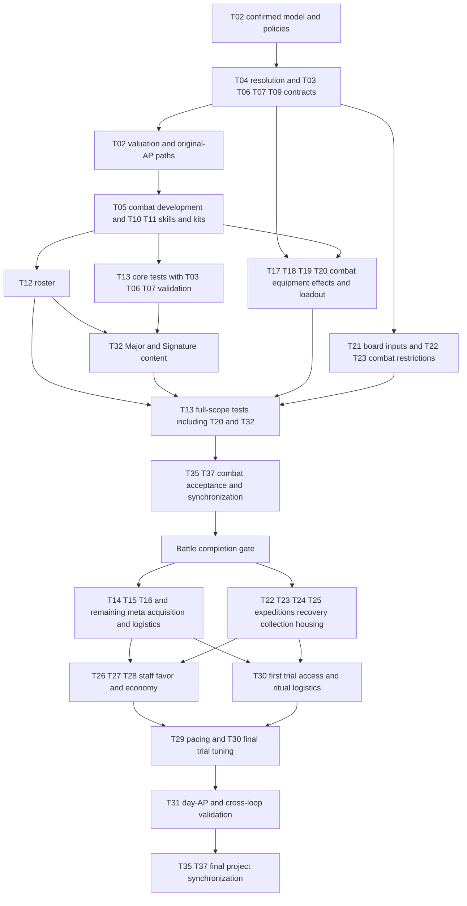

# Temporary Clarification List — Road of the Beasts

Central list of open design decisions and validation tasks from Battle, Monsters, Overworld and the central Skills GDD. **User priority (restated 2026-11-12): the Battle is the core and is finished first; the Overworld does not matter until the Battle stands and the user is satisfied with it, or until the user says otherwise. Overworld tasks stay listed here but are not worked on and do not constrain Battle decisions.** The sequence below organizes work; it does not approve new gameplay rules. **Branch and write scope follow [CLAUDE.md](../CLAUDE.md)** (GDD work: `docs/` on `main`, released by the user on 2026-11-12; the Godot battle implementation was released for `main` on 2026-11-11).

## Usage

- The GDDs describe the current working state; existing proposals and numbers are **not automatically approved** by moving open tasks here.
- Open questions, alternatives and review tasks are maintained exclusively here. The GDDs hold the current design, including labelled content drafts and prototype deviations needed to distinguish it from historical implementations. Use Git history to trace changes; do not maintain changelogs in the GDDs or this file. Keep the handoff current rather than appending a running change history.
- Prerequisites apply to the named deliverable, not automatically to the whole task. **D/K** contracts can precede pricing/content; **V** closes only after suitable executed tests. Do not make test inputs depend on the completion of their own validation. Independent work within the current priority may proceed in parallel; meta-only Overworld work is queued until the Battle gate.
- **Implementation:** open points of the Godot battle implementation live under [Implementation](#implementation). They decide no rule: a rule question found there is settled in the owning GDD section and task.
- **Session close:** refresh [Context Handoff](#context-handoff) after every session so another agent/computer can resume without chat history. Reusable instructions belong under [AI Prompts](#ai-prompts), not in the active task list.
- On completion: incorporate the decision into the specified GDD sections, synchronize affected companion files and check off the item here. For playtests, document measurements and results before changing rules if necessary.
- **Task fields:** every editable task carries **Status**, **Prerequisites**, **Sources**, the concrete gap/decision bullets and **Done when** (completion conditions). Status values: *Open* (no decision yet), *Partly drafted/decided* (working draft or partial decision exists, not validated), *Blocked* (named prerequisite or user decision missing). Completed tasks move to [Completed Tasks](#completed-tasks-ids-retained-for-references) with their IDs retained; IDs are never reused for other topics. Validation tasks close only with tests actually performed and documented.
- **D** = design decision, **V** = validation/balance, **K** = consistency correction. Sources refer to the current GDD section numbers unless explicitly labelled historical.
- **Central skill specification:** [gdd_skills.md](gdd_skills.md) is the single file for everything about monster skills: kit, construction kit, schema, execution profiles, effect contracts, costs, slot development, validation, Kin Strike/movement tables, passives, prior-draft species assignments and the concrete skill records. Battle describes generic runtime/board resolution; Overworld only meta integration, economy and its own tamer/loadout content; [gdd_monsters.md](gdd_monsters.md) keeps monster identity, stats, Kins, roster and growth. Do not maintain parallel monster-skill price lists or upgrade rules. Historical statements are not active specifications.

# Context Handoff

**Last updated: 2026-11-13 (Wellspring rules adopted as build standard and GDD working draft; stat prices and frames reset; Surge timer measured again; S013–S015).** Resume from current files, not chat history. Replace this handoff at session end; keep rules/prices in their owners.

## Current State and Immediate Next Step

- **Focus of the last session (2026-11-13):** the user reopened the battle design from its goals (deterministic, easy to learn, no defeats one can do nothing about, **square control as principle**, 3–7 rounds, 3v3, decisions with consequences, decided by tactics) and wants monster variety kept. Win condition stays “all enemy monsters defeated”. **Adopted by the user (working drafts in the GDDs, standard of the Godot build, bots only, not played):** (1) the **Wellspring rules** ([Battle §4.2](gdd_battle.md#42-wellsprings-surrounding-and-late-round-pressure)): three Wellsprings on the centre row, Wellspring and surround damage at the end of a round, last tie of the target: the holder chooses, late-round pressure only in rounds in which nobody holds one; **TPR counts from round 2** ([Battle §2.2](gdd_battle.md#22-initiative-rules)); (2) **new stat prices and four frames** ([Monsters §2.2](gdd_monsters.md#22-frame-budget-level-ups)): HP 2 per point from a base of 4, initiative 0.5, second turn 3; Bulwark, Skirmisher, Swift, Caster replace the six earlier frames; the nine reference monsters carry new stats (kit set `f4086ae48783`). **User direction:** stat and skill calculation are untested working values, found through gameplay; which skills exist and how they balance is as open as the stats. Dropped: one-time bonus squares (removed from the build), HP band, alternating activation.
- **Open user decisions:** (1) **the Surge timer** (the user asked for the test, S015 Part C): today's rule (two finished turns of any monster) gives 23 % of bot battles under 3 rounds and strong Surges (1.20 damage per cast); **three turns** 13 % and 0.88; a Surge at its caster's next turn 13 % and 0.53; a Surge that waits until every monster on it has had a turn (`fairsurge`) 8 % and 0.43 and the most level team types. All are switches or a number; none is applied. (2) Postponing a turn (`delay`): little effect with bots, not adopted. (3) What the build still lacks for the adopted rules: the input step for the holder's choice, a hint in the battle view who a Wellspring hits next, Wellsprings for 2v2/1v1. (4) Stat draft: every reference monster buys AP 3; sturdy against middle is lopsided (22 of 80); frames of the other stages are not derived; the overview screen of the parallel session (`godot/game/overview.gd`, untracked, not touched) still shows the old prices and shape names, and `MonsterDef.reference_shape` and the overworld `StatShape` still use the six old shapes.
- **Build rules of 2026-11-12 that still stand (user decisions after S011; working drafts in the GDDs):** ground laid during a battle lasts 2 rounds ([Battle §4.5](gdd_battle.md#45-lifecycles)); one trap per trap skill and monster, traps never lapse ([Skills §3](gdd_skills.md#surge)); no shield zone in a monster kit (Moss Turtle: Mire, Dusk Moth: Blink; the mechanic and the two veil skills still exist); the opponent AI walks up (`BattleExperiment.ai_hunt`, not a rule); target length 3–7 rounds for 3v3 ([Battle §1.2](gdd_battle.md#12-battle-design-pillars)). Not adopted: trap clock, back-row starts, Jab for 1 AP, faster Surges.
- **What the measurements say in short (S010–S015, bots only; figures in [simulation_log.md](simulation_log.md)):** permanent ground, markers and shield zones made waiting pay (11 rounds, 60 % ended by the collapse); with the ground clock, no shield zones and the Wellsprings battles end by fighting in about 3.5–4 rounds and none goes past 12. The open flank is the **short end** (8–25 % of battles under 3 rounds, depending on the Surge timer). HP was worth four to six times a point of initiative or Movement and a 2-HP monster fell to one Strike, hence the stat reset; with it the nine win rates lie between 41 and 57 % (before: 30–69 %). A threat-aware bot does not play the fragile monsters better and loses to the plain one.
- **Measured and dropped or left as switches:** HP band (the user wants variety), one-time bonus squares (shield: small effect, extra turn: harmful; removed from the build), back-row starts and an HP floor as rules, pressure without damage, Surges after 1 turn, lower HP. Switches kept for comparison are listed in [godot/README.md](../godot/README.md).
- **Immediate next step:** the user plays 3v3 in the draft sandbox on the new standard (Wellsprings and the new stats are on without a check box), then decides the Surge timer through AskUserQuestion; to try a variant first: `sim.gd --variant turns=3` / `castersurge` / `fairsurge`. After that: skills (which exist, how they balance) on the new rules.
- **Surge direction (user priority since 2026-11-12):** the user judged Surges too weak after S001; variants were measured (S002–S005, [simulation_log.md](simulation_log.md)). **User directions of 2026-11-12, now working drafts in the GDDs and the standard of the Godot build:** Surge and trap as two skill kinds: the Surge fires after 2 turns of any monster and may be cast under monsters, the trap stays until sprung, never lapses and may be set repeatedly; one marker per square, a Surge replaces trap squares; the board edge deals 1 to a pushed monster; spiky props deal 2; movement skills may displace on landing (test skills Headbutt, Quake Leap; plus Shove and the monster-only Ambush Rift). Written into Skills §3 and Battle §1.2/§2.2/§2.4/§4.3/§4.5/§4.9–§4.11/§5.2/§6.1–§6.5. **Evidence (S002–S007):** bots only; in S006 late-round pressure ends 85–95 % of 3v3 battles and without it the bots stand still; they show traps as a weak damage source and more collapse endings, and a short detonation timer as the strongest variant, but they cannot play traps with intent. Open points and the outdated price/record parts: T38, T02, T10.
- **Data and legacy clean-up (user decisions 2026-11-12):** the whole Godot game counts as an experiment and nothing old has to be kept. `godot/data/` is the only content folder, one sub-folder per kind; a monster is one file with species, reference stats and kit; no price or build folder exists (costs are a field of each resource, the old test builds and price records were deleted); skills and monsters carry `content_status` (`approved` / `draft` / `test` / `simulation` / `archived`). The legacy skill model of the overworld (`SkillDef`, `ZoneDef`, the skill evolution at the Evolution Pillar and its tests) was deleted; the Pillar stays as a structure without function until slot development (T05) is designed. `CLAUDE.md` now allows changes in all of `godot/`.
- **Focus rule (user, 2026-11-12, now in `CLAUDE.md`):** the Battle is the core; the Overworld does not matter and is not worked on until the Battle stands and the user is satisfied, or the user says otherwise.
- **Battle goals (user, 2026-11-12, now in [Battle §1.2](gdd_battle.md#12-battle-design-pillars)):** the player influences the battle and decisions have consequences; deterministic; short (about 15 rounds is already very long); tactical, no single-skill spam; every skill useful in some situation; defeats feel like the player's own mistake; simple to learn, no hidden abilities. `sim.gd` now reports uses per skill kind against the kit slots of that kind (compact columns), first measured in S009.
- **Simulation entries of these sessions:** S010 (rerun, length distribution, attacking against waiting), S011 (board fill, ground and trap clock, no shield zones, value of each skill kind), S012 (team types, HP band, Movement), S013 (Wellspring draft, round-1 defeats, turn postponing, Surge at the caster's turn, bonus squares), S014 (value of a stat point, threat-aware bot), S015 (adoption, stat sets, Surge timer). Conclusions sit under T03, T13, T38 and T39.
- **Build rules adopted by the user (2026-11-12, working drafts in the GDDs, standard of the Godot build):** Step 1 AP, movement skills 1 AP, shield/mend zones 2 AP, push/pull zones also move at cast, every Strike pushes 1 away, free rotation of placed shapes for everyone. **Test content added on user request:** board skills Set Gong (Golem) and Plant Bamboo (Wolf), props Vortex Urn (pulls neighbours in when destroyed) and Storm Drum (pushes orthogonal neighbours away at their turn end); catalogue rows in [Battle §4.10](gdd_battle.md#410-prop-catalogue-and-damage), no prices, no skill records (T02/T10). **S009 indication:** collapse endings 60–70 % in 3v3 with the standard bot (40–55 % aggressive), 11–12 rounds; the Jab slot in every kit is the least used slot and two veil zones dominate the activations (T13).
- **Project state (since 2026-11-11):** the Godot battle was rebuilt on the current GDDs (user release 2026-11-11: branch `main`, write scope `godot/`; three user decisions: implement on `main`, ship **test kits from Skills §10** as clearly marked test data, map overworld data **strictly to the GDD**). The historical v6.0 core (aspects, attunement, fixed 2 AP, targeted Strike) is gone. Layout, extension points and commands: [godot/README.md](../godot/README.md). HUD help texts are short token lines by user request (`godot/battle/ui/battle_text.gd`: at most three lines per skill card, the inspector shows only notable things).
- **Implemented from confirmed rules (headless core, `godot/battle/core`):** queue and ties, AP stat, Step and the movement presets, usage policies, Strike shapes with Kin twists and the body-relative push/retreat variants, Surge scheduling (extra turns, orphaned Surges), the payload order of Battle §6.2 incl. prop removal/aftermath/Gong push and same-category order, damage law with value reduction, Nullify and the survive effect, zones (landing table, levels, opposites), all ten ground types, Mountains, the 17-prop draft catalogue, air layer and 2×2 bodies, event-passive reactions, the seven confirmed tamer skills, late-round pressure, Draw, pre-battle placement, deterministic action log/replay and dry-run previews.
- **Open implementation points:** tracked under [Implementation](#implementation): readings the code had to choose (I01–I18), parts waiting for rules or content (I19–I31), overworld follow-ups of the strict mapping (I32–I39) and verification gaps (I40–I48). The readings that expose a real GDD gap are now also named in their tasks (T04: I10/I11/I15; T06: I02/I04/I05; T07: I06; T09: I07/I14/I18; T20: I13).
- **Next actions (Battle workstream):**
  0. **Play the new standard and decide the Surge timer** (see the bullets above). The bots cannot judge influence, fairness of defeats or learnability, they do not set up a surround, do not hit and run and do not push into traps or props on purpose. Then the open points of T38/T39 and the skills.
  1. **Next Battle discussion:** confirm or correct the implementation readings I01–I18 in their owner sections, starting with the ones that change outcomes: walking direction (I01), board-edge Strike legality (I02), Tail Sweep/Slam on multi-cell shapes (I04/I05), the 1×1 versus 2×2 end-of-turn `mend` order (I06), prop/aura layers (I07), total initiative (I11) and late-round start rounds for 2v2/5v5 (I15). Then the remaining T04 contracts (Draw result with T19/T23).
  2. **T10/T11 gap list** (unchanged): concrete records and legal 4-slot kits; the test kits show which prior-draft parts had to be dropped (see the `notes` of each kit in `godot/data/monsters`). Then the T20 remainder (Spatial Pull, Qi Suppression).
  3. T02 shared prices → T05 development mapping → T10/T11 records/kits → T12 roster and T32 late-game content, as before.
  4. T13 can run on a build that implements the current rules; plan the core pass (scenarios in T13) before any price or rule change.
  5. A small documentation session can clear the stale labels listed in T35 and the defects in T37 without any design decision.
- **Battle blockers (current, unchanged by the implementation):** T02 prices lack special-reaction/repeatable-event valuation and some spatial contracts; 2×2 variants remain unapproved; Relocate has only a provisional price; the `mend` magnitude has only a draft price (level-I basis); the **TPR price** is an open draft; T11/T12/T32 content does not exist; T13 has no executed gameplay or balance tests. Budget conflicts are not approved restrictions.
- **Queued meta work (not Battle blockers):** T14–T16, meta parts of T05/T17–T25/T30, T26–T31 and final T35/T37.
- **Git observation (end of the session of 2026-11-13):** branch `main`. Everything of the sessions of 2026-11-12/13 was committed on user request in one commit on top of `c35396a` (`feat: surge/trap kinds, displacement rules, one data folder, battle goals`); no fetch, branch switch, pull, push or reset. The commit also holds the work of a parallel session that was in the working tree and passes the tests with it: the overview screen (`godot/game/overview.*`, `godot/tests/game/test_overview.gd`), `game/main_menu.gd` and the field `MonsterDef.reference_shape`. That screen and the overworld `StatShape` still use the six earlier shapes and the old stat prices.
- **Checks run at the end of the session (Godot 4.6 headless on a `/tmp` copy of `godot/`):** the whole `tests` folder directly before the commit: 293 cases, only the two known failures outside the battle (I46: `test_reference_individuals_keep_their_fixed_stats`, `test_a_roamer_wanders_and_never_leaves_free_ground`); `tests/battle` 149/149, 15 of them in the new `test_battle_experiment.gd`; `tools/smoke_ui.gd -- 3v3 7` without script errors or refused clicks on the new standard; the first row of the new default equals the S013 draft row; a script check of every relative link and heading anchor in the files under `docs/`; `git diff --check`. **Not done:** no human play of any rule adopted since 2026-11-12; nobody looked at the battle view with fading ground or Wellsprings (it colours the square, has no hint who is hit next and no remaining-rounds display); the holder's choice for the last Wellspring tie is not built (roster order); 2v2 and 1v1 have no Wellsprings and were not rerun on the new standard; frames, ceilings and budgets of the stages other than Core Formation High are not derived; the price sections of Skills §5 still describe permanent ground; no price or balance evaluation.
- **Earlier checks, not repeated (audit and Surge sessions 2026-11-12):** *Audit part (documentation only):* complete read of the four GDDs and this file, script check of every relative link and heading anchor in the six files under `docs/`, recomputation of the reference individuals, Core frame totals and Skills §5 paper totals (all matched). *After the rules and data change:* gdUnit4 `tests/battle` 134/134; the whole `tests` folder ran through with two failures outside the battle (I46); `tools/smoke_ui.gd` in 1v1 and 2v2; hand-built cases for Headbutt into a trap, Quake Leap against the board edge and the monster-only trap. **Not checked then and still open:** no test covers `softpressure`, `Board.margin` or the bot's push term.
- **Earlier checks, not repeated (tool migration session 2026-11-11, Godot 4.6 headless on a copy of `godot/`):** the calculator and the build loader were compared with the Python originals before deletion: all 45 skill records at slot levels 1–3 (total, ceiling, fit) and all 15 builds (stat spend, slots, legality) identical; the only intended difference is TPR 2, which the battle core resolves. The JSON files were then replaced by Resource files (user order): the `.tres` version was compared with the JSON version in a scratch copy and gave the same prices, build reports and unit sheets, and for equal seeds the same `compare.gd` tables (four setups, all four bots, both board kinds) and the same `sim.gd` figures (four runs). gdUnit4 full run: 321 cases, `tests/battle` 131/131 and `tests/tools` 15/15 passed, the same three failures outside the battle as before; a changed rate in a scratch copy made the paper-total test fail as intended. `sim.gd` without options prints the same run blocks as the parallel session's version (three argument sets compared; only the optional kit list changed, to alphabetical order). **Not done:** any balance or price evaluation; the runs made were tool checks.
- **Earlier checks, not repeated (battle implementation session 2026-11-11, Godot 4.6 headless on a copy of `godot/`):** gdUnit4 `tests/battle` 131/131 passed (queue, turn flow, Strikes, Surges, board/props/zones, movement, 2×2/air, tamer skills, content and extensibility, request/adapter, determinism incl. replay of recorded actions, short HUD texts); `tests/shared`, `tests/overworld`, `tests/game` 175 cases with the same three failures as before the change (`test_qi_gathering_monsters_have_no_slots`, `test_reference_individuals_keep_their_fixed_stats`, `test_a_roamer_wanders_and_never_leaves_free_ground`; none touches the battle); every script and scene parses; `tools/smoke_ui.gd` played draft → placement → battle through the real controller in 1v1, 2v2 and 3v3; an overworld dungeon → battle scene → dungeon round trip wrote the result back. **Not done:** any play by a human in the editor, any balance or price evaluation, interactive checks of 2×2/air units in the 3D view (rules are covered by tests, no sandbox content fields them).
- **Tool state (user directions 2026-11-12):** the simulations exist to try things out: is the gameplay fun and sensible, and which skill prices will be needed. **Skill prices are not settled; simulation runs ignore them** and check no monster against a budget or price. [godot/tools](../godot/tools/README.md) holds `sim.gd` (bot runs on the game's monsters or on fixed teams of any monsters) and `compare.gd` (two monsters, side-swapped). **There is no price folder and no price calculator any more:** every skill, zone, ground and prop resource carries `internal_calc_cost`, the current working number from the Skills §5 drafts (−1 = not calculated, e.g. all Surges). The former test builds, their eleven reference skills, the price records, the calculator and both tool test suites were deleted. `godot/data/` has six folders (`monsters`, `skills`, `zones`, `grounds`, `props`, `tamer`); `content_status` = `approved` / `draft` / `test` / `simulation` / `archived` on skills and monsters, filtered in `ContentStatus.in_game` (called by `GameData.monster_ids()` and `BattleContent`). A test monster is a monster file with the status `simulation`; none exists at the moment. Results are kept in [simulation_log.md](simulation_log.md) (S001–S011). Bots `hunt` and `chase` (an `AiBrain` that walks up) and further run-only variants exist since S010/S011 ([godot/tools](../godot/tools/README.md)). Naive bots and unapproved content make every run flow evidence only. **Two things a later session must know:** the content fingerprint changes whenever game content or the content version changes (kit sets are listed in the log; the current one is `736eb4e604a6`); and `AiBrain` can stand still with Movement 1 on an exact diagonal (I42).

## Decisions Versus Drafts

| Class | Content (owner section holds the details) |
|-------|-------------------------------------------|
| Decided by the user (2026-11-10) | Rules are in the owning GDD sections linked by the tasks below; this row only names the topics: 2×2 bodies, air layer (recipients authored per effect, flyers ignore ground, flight movement, permanent air for Soul+ Winged), Mountain air rule, Chebyshev distance and ties, payload/board-operation order, execution-time legality, Surge scheduling, damage-modifier stacking, prop principles with the Field class removed, Hallowed blessed, Mossbed unlimited, `mend` scaling, zones independent of ground, Water/Swim removed, Voidscar reading, simultaneous damage ties, initiative-order displacement tie-break, line-footprint prop blocking, no further Cleanse source, Relocate contract, class-based prop catalogue with fixed aftermath and no chain reactions. Also confirmed: one skills file, body-relative variants ([Skills §3](gdd_skills.md#body-relative-damage-and-movement-variants)), [payload order](gdd_battle.md#62-surge-resolution-integration), [monster collision](gdd_battle.md#63-collision-fall--debris). |
| Earlier confirmed design / scope | [§2](gdd_skills.md#2-data-oriented-skill-construction-kit): one model and internal evaluation, independent activation/repetition fields, per-equipped-copy allowances, shared zones, no generic team filters or direct unit-targeted attacks. [§3](gdd_skills.md#3-skill-execution-profiles): concurrent Surges, spatial no-overlap. Skill rarity rejected; [shared-budget principles](gdd_skills.md#5-construction-points-and-ap-efficiency) and [slot-development policy](gdd_skills.md#6-slot-levels-development-replacement-and-upgrades) remain. No aspect/Attunement system (T01/T33/T34); no physical evolution/EP currency (T36); Mountain end state in [Battle §4.7](gdd_battle.md#47-ground--neutral-hazard-and-blessed) (reconfirmed by the user 2026-11-12; the GDD entry still lacks a date, T35); Staff model B and Favor + Standing principles with numbers open; Expedition HP/retreat is the working design. |
| User-selected calibration, not validated balance | [Shared standards](gdd_skills.md#shared-valuation-standards), [availability by activation and usage](gdd_skills.md#availability-by-activation-and-usage), [active round-limit calibration](gdd_skills.md#round-limited-availability-calibration). The event rate applies only when the authored usage policy supplies its round cap. |
| Drafts / proposals, not approved | Prop catalogue, HP and aftermath values ([Battle §4.10](gdd_battle.md#410-prop-catalogue-and-damage)); the class-based concept and its principles are chosen, the concrete entries are drafts. The [prop creation price drafts](gdd_skills.md#prop-creation-price-drafts) and the [price completion sketch](gdd_skills.md#price-completion-sketch-for-the-remaining-gaps) (Nullify, level-II residue, `mend`, air recipients, Relocate, 2×2 variants; user asked for a complete draft 2026-11-11). The body-relative variant cost drafts in [Skills §5](gdd_skills.md#strike-costs), other labelled §5 packages, [conditional-outcome costing](gdd_skills.md#ground-and-board-costs), the [Mountain-price candidate](gdd_skills.md#mountain-destruction-calibration-proposal), the six [records](gdd_skills.md#11-concrete-skill-records), [passives](gdd_skills.md#9-passives) and [species assignments](gdd_skills.md#10-species-skill-assignments-prior-draft). Day-AP values stay a proposal. Missing contracts/prices never mean zero. |
| Validation / tool boundary | [godot/tools](../godot/tools/README.md) (bot runs, monster comparison) are tools for trying things out, not rule sources or price authorities. Runs use crude bots on test content and give indications only; they ignore the unsettled skill prices (user, 2026-11-12). The `internal_calc_cost` field of the resources is an authoring note. No task closes from a numeric fit or a simulation run. |

- Preserve the [basic-Surge AP target](gdd_skills.md#combination-policy-and-basic-surge-target) and the [Strike damage contract](gdd_skills.md#81-strike-by-kin). New movement variants authorize neither direct-damage upgrades nor a damage/movement exchange.

## Working Practices

- Follow [CLAUDE.md](../CLAUDE.md) for branch and write scope, preserve user work, no unrequested Git actions. **An audit session writes only `docs/temp_todo.md`;** GDD corrections and calculator/simulation-tool work below are follow-up tasks, not permission to edit them during the audit (`docs/` and `godot/tools/` are otherwise in the write scope of CLAUDE.md). The earlier checker authorization covers only the temporary docs script, never engine/prototype implementation.
- Resume from the current tasks and linked owners, not prior chat. Use the existing Skills §2 fields/contracts and §5 rates, never a parallel model, copied price list or name-specific budget-fit exception. Skill content is edited only in [gdd_skills.md](gdd_skills.md).
- New recommendations/numbers need explicit status; general design changes need user decisions. Keep history in Git and replace stale handoff text rather than appending a log.

# Open Tasks

## Recommended Work Order

**Selected work priority: Battle first, Overworld second.** The task sections below are thematic groups, not execution phases; this table and the scoped prerequisites determine execution order. Parallel work stays within the Battle workstream unless the user changes priority.

| Order | Deliverable | Tasks | Boundary |
|-------|-------------|-------|----------|
| B1 — next | Deterministic battle rules, board interactions and legal monster inputs | T38 (Surge impact, decide first); T04 incl. the implementation readings I01–I18; D/K of T03/T06/T07/T09 | Start with T04; use the confirmed model, not completed pricing/tests. Combat T35/T37 corrections and authorized T02 tool repair can run alongside |
| B2 | Shared valuation, complete Surge comparisons and original-AP development paths | T02 | Relevant B1 contracts first; no budget-fit exceptions or reopening confirmed AP/damage principles |
| B3 | Battle-facing progression, concrete skills, passives, kits and roster | T05 battle deliverable; T10/T11/T12; T06 content | Decide reachable stat/skill/loadout states and development supply/mapping; defer XP duration, pill prices and ritual sites, not combat upgrade choices |
| B4 | All battle-facing external effects and request/result interfaces | Battle parts of T17–T21 and T22/T23 conflicts | Tamer skills, artifacts, medicine/array effects, loadout limits, swap/HP/defeat/Draw result and board inputs belong here even when their owner is Overworld. No full catalogue, economy or expedition prerequisite |
| B5 | Core tests, then Major/Signature content and full-scope interaction tests | T13 with T03/T06/T07/T20 V; T32 | Core tests can start with reference kits; use their findings for T32, then include late-game/equipment/loadout interactions in a final T13 pass |
| B6 | Battle acceptance and combat-source synchronization | Battle gate; battle deliverables of T35/T37 | Every in-scope combat feature needs complete contracts/content and documented suitable tests; no silent deferral |
| O1 — after Battle gate | Translate battle requirements into acquisition, progression execution and world systems | T14/T15/T16; meta parts of T05/T17–T25/T30 | Recipes/prices/availability, expeditions, injuries, catching, housing, ritual sites and replacement logistics follow the combat specification |
| O2 | Management, progression pacing and day economy | T26–T31; final T35/T37 | Use tested battle states and resource demands to tune supply/XP/day AP; run cross-loop checks rather than assume battle balance proves meta balance |

### Battle Completion Gate

**Status:** Open. A rules draft is not a validated Battle completion. This milestone does not close mixed Battle/Overworld tasks wholesale or authorize implementation.
**Prerequisites:** Battle deliverables in B1–B5 and their combat-source corrections; no completion of meta-only tasks.
**Sources:** [Battle §7](gdd_battle.md#7-technical--prototype), [Skills §6–§7](gdd_skills.md#6-slot-levels-development-replacement-and-upgrades), [Monsters §2](gdd_monsters.md#2-stats), [Overworld §6.4–§6.9](gdd_overworld.md#64-tamer-skills); detailed owning links remain under each task.
**Done when:** all four acceptance conditions below are met for the user-agreed combat scope; unresolved test failures or unapproved omissions keep the gate open.

- **Design ready:** T02–T07/T09–T12 combat deliverables, combat parts of T17–T23, T32 and related T35/T37 corrections specify legal battle inputs, actions, developed variants, passives, external effects, board generation, timing, preview and result outputs. Final intended battle scope must be explicit; a reduced roster, omitted items or deferred air/2×2/late-game mechanics need user approval, not an assumed shortcut.
- **Validated:** T13 executes and documents suitable current-design tests across the agreed scope, including developed/high-stage states, core and full loadouts, source-specific exceptions and T03/T06/T07/T20 V. The Godot battle (`godot/battle`, rebuilt 2026-11-11) implements the confirmed rules and can serve as the harness; an implementation and its rule tests are not the validation itself, and the HTML prototype and paper calculations do not satisfy this gate.
- **Handoff to Overworld:** record the accepted combat constraints and still-open **meta-only** questions against their existing IDs. Use finished test sheets/loadouts without simulating the whole economy; keep reachable state/slot/upgrade limits explicit. Acquisition frequency, XP pacing, recipes, ritual locations and day AP stay open for Overworld, not invented free/instant defaults.
- **Integration safeguard:** resolve T22/T23 restrictions that could alter in-battle healing, HP or fall prevention before acceptance; defer their run/recovery economy. Later meta tuning must respect accepted battle contracts; any proposed combat change needs an explicit decision and affected regression tests.

### Audit Coverage and Disposition

Every existing ID was reconciled with its owner; none was renumbered, merged or closed by arithmetic. Links and detailed acceptance criteria remain in the task entries.

| Tasks | Current disposition |
|-------|---------------------|
| T01, T08, T33, T34, T36 | Confirmed removals retained as reference IDs; remaining integration wording belongs to T35/T37, not new gameplay work |
| T02 | Partly decided/drafted; incomplete valuation and original-AP paths; prices are not settled and follow what simulations and play show (user, 2026-11-12); the price calculator was removed, working numbers sit in `internal_calc_cost` |
| T03, T06 | T03: open consistency conflicts and the TPR price draft. T06: Cleave, Beast Bite and Winged Dive are decided; open are shape access timing, the Scaled/Ancient/board-edge readings (I02/I04/I05) and the unexecuted comparative validation. Consistency work can start now |
| T04, T07, T09 | Partly decided; obsolete questions removed (Tree/Wall remnants, decided order/scheduling). Remaining: T04 Draw result (T19/T23), late-round start rounds for 2v2/5v5 and the total-initiative reading (I11/I15), label sync; T07 prices/tests and the 1×1 versus 2×2 end-of-turn `mend` order (I06); T09 air-capable definitions/prices and the layer readings I07/I14/I18 (the 2×2 mixed-ground landing check is closed) |
| T05 | Confirmed development/replacement principles; mapping, supply and logistics incomplete |
| T38 | New (2026-11-12): Surge impact; variants measured in S002, direction not chosen; it can change the Surge timing contract, so decide it before T02 prices and T10/T11 records are finalized |
| T10–T14 | Blocked for final content/tests/selection; six draft records and nine stat references are not complete skills/validated kits; T11 now lists the concrete roster/passive conflicts with decided rules |
| T15, T16 | Queued after the Battle gate; combat effect records are handled first under T17–T20, catalogue/acquisition details later |
| T17–T20 | Combat effects/slots/loadout promoted into Battle-first work; meta-only gear bonuses, acquisition and recipes follow later; T20-D precedes tests. New gaps: Draw in BattleResult (T19), Spatial Pull/Qi Suppression status (T20) |
| T21–T25 | Battle board/HP/healing/defeat interfaces first (incl. the Draw consequence in T23); expedition, acquisition, recovery and housing details after the gate; first-Pillar conflict retained for meta integration |
| T26–T31 | Confirmed staff/Favor principles amid open parameters, access conflicts, pacing and day-AP validation |
| T32 | Unfinished Major/Signature content/access/slot treatment, now required before full-scope Battle acceptance unless explicitly deferred by the user |
| T35, T37 | Open synchronization/editorial work; current migration left concrete duplicates and stale decision labels; the labels found stale on 2026-11-12 are listed in T35 |

## Battle Foundations — Resolution, Stats and Valuation

### [ ] T02 · Complete the Data Model, Point Calculation and AP Efficiency (D/K)
**Status:** Partly decided/drafted — internal authoring-only evaluation and two repetition policies confirmed; skill rarity removed. Active round-limited and event/explicit-once-per-round availability selected, still unvalidated; repeatable/other event valuation and remaining event-order/recursion and later-resolution contracts are unresolved. Integrated model/evaluation bindings and shared-standards extension selected by the user; numeric balance remains unvalidated. Affected paper references are synchronized, budget conflicts unresolved and special-reaction/event/utility-targeting coverage incomplete. A [price completion sketch](gdd_skills.md#price-completion-sketch-for-the-remaining-gaps) and [prop creation price drafts](gdd_skills.md#prop-creation-price-drafts) exist in Skills §5 (derived from existing rates, unvalidated). Skill-specific recalibration is deferred until the shared foundation is complete.
**Prerequisites:** T01 (decided); use the confirmed model now. Complete affected runtime/effect/geometry contracts from T04/T06/T07/T09 before their valuation, not full completion of those tasks. T05 follows the reference development paths; balance approval remains T13.
**Sources:** Skills [§1](gdd_skills.md#1-the-kit)–[§7](gdd_skills.md#7-validation-and-concrete-skill-records); Battle [§2.3](gdd_battle.md#23-action-points)/[§5.1](gdd_battle.md#51-monster-skills-central-specification); [Overworld §6.3.2](gdd_overworld.md#632-permanent-skill-slot-development-confirmed).

**Drafted and documented:**
- Shared model for all monster skills, central profiles/contracts and six references; no parallel skill sources or custom special structures. Designer-authored skills/upgrade choices instead of player construction.
- Shared ceilings, AP efficiency and damage prices are selected working drafts in [Skills §5](gdd_skills.md#5-construction-points-and-ap-efficiency), not validated balance. The avoidable-Surge damage factor applies to damage only; qualifying one-shot displacement has its separate selected timing standard. **No combination surcharges.**
- Draft tables for all Strikes/movement profiles, self/passive, zones/protection/healing and ground/board. Six references with initial totals, not yet full content/balance validation. Maintain prices only in [Skills §5](gdd_skills.md#5-construction-points-and-ap-efficiency), not duplicated here.
- Surge residue = delayed ground change; concrete profiles retain their authored ground types. Permanent aftermath uses the selected no-delay-discount standard in Skills §5. Basic Surges retain the 1-AP target; budget conflicts remain open.

**Order of work (user, 2026-11-12):** the prices in Skills §5 are working drafts and not fixed. First find out by simulation and play what is fun and sensible; then derive the prices that design needs. Do not block a simulation or a test monster on a missing or exceeded price.

**Current priority — complete the shared foundation before existing skills:** Skills §2's [evaluation contract](gdd_skills.md#evaluation-contract--one-definition-one-calculation) binds all 14 existing field groups to their costing responsibilities. Do not add a parallel price-input schema or duplicate Skills §4 mechanics. Complete the owning Skills §5 standards as one coordinated draft; existing skill comparisons/development paths follow afterward.

- Apply the user-selected [shared valuation standards](gdd_skills.md#shared-valuation-standards) and extensions in the owning movement/passive/board sections; balance remains unvalidated. Movement increments must not create different prices for identical resolved presets. Extra prop damage must not also be charged through a Kin package.
- **Sketch status:** Nullify, level-II residue start, `mend` at `min(2, level)` (priced at level I), air recipients for non-damage effects, Relocate and 2×2 variants have sketch rates in Skills §5 (not copied here); each needs confirmation or revision, none is validated. Still open there: the aura price versus the ground package (T13), repeatable/team-wide event availability, special prop reactions (no source has one yet) and the Beam-spawn analogy. Tamer skills have no construction points.
- Remaining coverage gaps: new coupled body-relative movement packages, authorized utility/layer/recipient contracts (not general area filters or direct-unit offensive displacement); event-driven/repeating/team-wide passive limits and availability; special prop reactions beyond extra on-hit damage; other rule permissions and non-covered movement patches. Mark missing rates separately from missing mechanic contracts; neither means zero cost or permission to invent a default.
- Existing shared standard drafts already cover active AP efficiency, basic selection/geometry, damage, ordinary displacement, current zone effects, movement presets, the limited self/passive references and listed board packages. Their numeric balance is not confirmed. The separate alternative Mountain price remains unapproved, not a general standard.


**Body-relative damage/movement foundations (T02/T04/T06/T09):**
- Confirmed geometry and variant options are owned by [Skills §3](gdd_skills.md#body-relative-damage-and-movement-variants), not repeated here. New variants are additional authored skills, not replacements for all Strikes or a freely adjustable damage/movement trade.
- Hit independence, attack-before-retreat, failed retreat, destination-only diagonal traversal, blocked upward movement, no voluntary fall damage and entry triggers are confirmed in [Skills §3](gdd_skills.md#body-relative-damage-and-movement-variants). Do not reopen or discount by hit probability. Retreat is self movement, not forced displacement: Battle §6.3 still damages monster/prop on blocked prop push. The earlier “like push” analogy grants no blanket collision-law change, prop damage or Mountain destruction; authored permissions remain binding.
- Access (Skills §3): push variants are no longer bound to Scaled (user, 2026-11-12), self-retreat variants stay Winged-only. Remaining reconciliation: Scaled's chosen push direction and Winged's existing retreat are not automatically replaced by the new coupled geometry. Preserve existing definitions/prices until explicitly decided; no transfer of all Kin packages to all skills.
- Calibrate AP/components together after the relevant contracts; existing cardinal rates are only anchors for the coupled-variant cost drafts, not content approval. Multi-target ordering and once-per-monster hits are decided (Battle §6.2); adjacent-only push, non-adjacent no-push, centre-derived retreat and 2×2 mappings are decided in Skills §3. Diagonal Cleave remains undefined (T06). No direction normalization, ambiguous-shape retreat, direct-damage reduction upgrade or distance increase is implied.
- The coupled eight-direction variants are priced only through the Scaled/Winged package rows of Skills §5; do not use cardinal examples as validation of diagonal behaviour.

**Calculation costs in the build (user decision 2026-11-12):** the GDScript price calculator, its price records and its test were removed, because prices are not settled and a second data set per skill is unwanted. Each skill, zone, ground and prop resource of the build carries `internal_calc_cost`: the Skills §5 paper total where one exists (movement presets, Strike shapes without a Kin package, the reference zones, Focus, Adaptive, Shove, ground packages, prop creation drafts, zone rates per cell and round), −1 otherwise (every Surge, Headbutt, Quake Leap, board skills). The field is an authoring note only: no rule or tool reads it, and Skills §5 stays the owner of the rates. When a rate changes, update the affected numbers by hand; a missing number never means zero.

**Shared repetition — decisions and remaining gaps (T02/T04/T05):**

- **Authoring/test boundary (clarified):** calculate from a complete authored definition before adding the skill to the game, like a script/test. No in-battle construction calculation, actual-destruction pricing or user-facing point system. Runtime triggers matter only as declared capability/conditions; no new positive-damage trigger rule or once-per-causal-chain restriction was approved.

- **Event valuation selected, unvalidated:** use the [availability table](gdd_skills.md#availability-by-activation-and-usage) derived from existing activation and repetition fields. The selected event rate requires an explicitly authored round cap and a resolved one-activation package; no probability credit or active availability discount. Repeatable event and team-wide availability remain unpriced; no automatic round cap or new skill class.
- **Shared repetition options confirmed:** use [Skills §2](gdd_skills.md#usage-and-repetition), not a passive-only workaround. No existing skill is silently assigned the round limit; active availability calibration is selected in Skills §5, and the event/explicit-once-per-round rate is selected; repeatable/other event availability remains open. Remaining dimensions:

| Existing model responsibility | Decision needed |
|---|---|
| `usage`: count and scope | Per-equipped-instance allowance and valid-activation consumption are confirmed in Skills §2. Invalid attempts consume neither AP nor allowance; later-resolution validity/cancellation still requires T04 |
| `usage`: reset boundary | Two options selected: repeatable under existing limits or once per global round. No owner-turn reset, multi-round lockout or additional count category is introduced; existing profile limits remain binding |
| `execution` / effect application | Distinguish recasting a zone from its existing effects applying again; passive activation count from recipient count; no automatic per-target/per-prop multiplication |
| `persistence` | Existing state/zone lifetime is separate from usage reset; reapplying/levelling/refreshing rules need consistent integration |
| `evaluation` | Derive authoring-time availability from these declared limits; no live counters or observed event probabilities in the price calculation |

Select the policy explicitly for future authored skills; do not assume all zones/passives share one limit or alter existing content without review. Recursion safety, remaining event-passive order and removal/swap dependencies still need T04; no causal-chain cap was approved. Preserve Battle §2.2's confirmed unit-bound termination and board-effect/Surge persistence on caster death. Apply the [selected active round-limit calibration](gdd_skills.md#round-limited-availability-calibration) only within its scope; it excludes ineffective caps and unresolved event-driven availability. Skill rarity is removed; monster rarity is unchanged.

**Cost-structure review (documentation only, not price approval):**

Reviewed Skills §5 price families and the three area-reference records (now in [gdd_skills.md](gdd_skills.md)) plus the non-area references' scope declarations. No demonstrated duplicate charge was found in the reviewed baseline formulas; unresolved prices and effect contracts prevent a blanket completeness claim. “One-time damage” was relabelled “One-shot damage” to distinguish event timing from flat-per-use pricing.

| Charging basis | Existing component families | Review result |
|---|---|---|
| Once at applicable use/availability scope | AP efficiency or passive availability; anchor/selection; complete marker; footprint direction; ground/air coverage | Structurally consistent. Selection alternatives are not cumulative; footprint direction and push direction are distinct permissions. |
| Potential effect cells, with explicit magnitude/duration where applicable | Damage; distant Strike cells; per-target Kin effects; displacement; zones; ground/height operations | Structurally consistent. The footprint is already priced; no second blanket area charge. Per-cell maxima still need legal coexistence under the conditional-outcome draft. |
| Authored non-area or object package | Movement preset; one retreat per Strike use; rotation permission; self-buff magnitude/duration; created/relocated prop | Structurally consistent, not an exception requiring universal cell pricing. A path is not an effect footprint; a prop package is per object, not an additional area fee. |
| Included consequences | Permanent ground's existing future occupant effects; ordinary offensive prop reactions; Mountain creation's coupled reset | Already bundled, not separately charged again. This does not settle special reactions or authorize missing effects. |

**Decisions still needed, rather than editorial inconsistencies:**
- **Decided working valuation:** shared one-shot displacement timing and permanent-ground treatment are selected, not a universal whole-skill multiplier. Runtime effect permissions remain unchanged; validate values later under T13.
- **Duration/repetition basis:** zones are priced by authored rounds; ground is a permanent per-cell package; self-buffs and the sample passive use their own lifetime/availability basis. The categories are coherent, but comparative value depends on unresolved recasts, stacking, triggers and healing loops (T04/T07/T13). No invented lifetime multiplier can resolve that contract gap.
- **Selection/coverage completeness:** remaining non-offensive utility target eligibility/LOS and authorized layer variants need resolved contracts before pricing. Offensive monster push/pull now uses spatial patterns; do not reopen or price a direct unit-targeted Shove. General ally-only/enemy-only area filters and generic direct unit-targeted damage are excluded by [Skills §2](gdd_skills.md#2-data-oriented-skill-construction-kit); do not maintain a filter-price task. Existing adjacent-anchor selection has a selected rate, not an unresolved price gap.
- **Board packages and reactions:** coupled Mountain creation/reset is one package; explicit destruction plus residue is confirmed additive. Special prop reactions and conditional-outcome valuation still require review with T04. Their absence is a pricing gap, not evidence of double-charging or zero value.
- **Calibration rather than structure:** movement alternatives, passive availability, Kin components and board packages still need comparative evidence. The Mountain candidate remains budget-derived and unapproved; large-Strike/healing conflicts are not solved by the confirmed cost structure.

**Still to do:**
- **Trap Surges (T38, 2026-11-12):** the Surge rates of Skills §5 (50 % telegraph timing, marker blocking, basic Surge cross-check, Surge calibration rows, the 50 % analogy of prop aftermath) describe the timed Surge. Draft trap rates and re-run the affected totals; until then they are not prices of trap Surges. The build stores no cost for any Surge (`internal_calc_cost` −1).
- Complete the scoped [1-AP Surge comparison](gdd_skills.md#basic-surge-profile-cross-check) only after the foundation gaps are resolved. Current arithmetic follows selected shared rates and exposes budget conflicts, not approved restrictions or unlocks. Conditional-outcome costing remains draft; collapse and residue stay additive, with collapse damage environmental rather than skill damage. Extra on-hit prop damage has a selected rate, but other reactions/combined outcomes and runtime order remain T04/T07; unsupported spatial cases remain T09.
- Review the [Mountain-destruction calibration proposal](gdd_skills.md#mountain-destruction-calibration-proposal): shared-component repricing affects Ancient Strike too; the separate candidate no longer fits the shown Rift subsets under current ground pricing and does not resolve full profile pricing.
- Resolve budget conflicts for large Strikes, healing and complex Surges specifically, without automatically changing budgets/AP/damage or introducing separate skill-type pools. No double-charging for area/flags/sources.
- Draft complete development paths at original AP, especially Jab; larger shapes retain existing AP until a new decision. No direct damage, AP-reduction or cast-range upgrades. Then T05.
- Complete missing footprints/anchors/orientations, visibility/target validity, effect values/caps, triggers/end conditions and interaction order. Explicitly define self/passive stacking, source groups, death/removal and repetition/recursion. The self-buff reference remains a draft; no new mechanic is authorized solely by a schema field.
- Review combinations and repetition as balance/contract questions, **not as an additional price category**. Include props, healing, air and 2×2 under T04/T07–T09. Validate numbers only through suitable tests; T13 remains open.
- **Decided:** costing structure and decimal-point handling are defined in [§5](gdd_skills.md#5-construction-points-and-ap-efficiency). This resolves the fractional-point policy gap, not the documented calibration conflicts above the working ceilings (large Strikes, mend zone, longer Slow zone, height-capable Surge); arithmetic consistency is not balance validation.
- **Done when:** simulations and play have shown which design the prices have to fit (user order of work, 2026-11-12), the `internal_calc_cost` numbers of the build agree with the redrafted Skills §5 rates, and (a) the scoped [1-AP Surge comparison](gdd_skills.md#basic-surge-profile-cross-check) is re-run without unresolved profile gaps; (b) each budget/calibration conflict is either resolved by an explicit user decision or documented as an accepted content restriction, with no hidden price, budget, AP or damage change; (c) same-AP development paths for Run, the Slowing Zone, a Surge with intended ground effect and Beast Jab are drafted and reviewed; (d) the footprint/anchor/orientation, effect-value, trigger, stacking contracts are decided or explicitly handed to T04/T07/T09; (e) [§5](gdd_skills.md#5-construction-points-and-ap-efficiency)/[§7](gdd_skills.md#7-validation-and-concrete-skill-records) are recalculated; (f) the sketch rates for Nullify, level-II residue, `mend`, air recipients, Relocate and 2×2 variants are confirmed, revised or explicitly kept provisional. Balance approval stays with T13.

### [ ] T03 · Review Stat Budgets, Frames and Progression Limits (V/K)
**Status:** Open — consistency conflicts remain; Core frame and roster arithmetic rechecked, no frame/budget gameplay tests.
**Prerequisites:** D/K review can start from current Monsters rules; relevant T02 costs/content for comparative testing. V closes with T13, not before T11 can supply test kits.
**Sources:** Monsters [§2.1](gdd_monsters.md#21-the-stats)–[§2.3](gdd_monsters.md#23-stat-ceilings-per-stage), [§5.3](gdd_monsters.md#53-monster-progression-the-18-steps); Overworld [§1.2](gdd_overworld.md#12-design-pillars), [§2.4](gdd_overworld.md#24-cultivation-loop).
- **Stat prices are untested initial values (user direction 2026-11-13);** first measurement in [simulation_log.md](simulation_log.md) S014 (bots only): HP is worth four to six win-rate points per price point, initiative and Movement about one, Reach and AP nothing to three and a half; a second turn is worth what its body is worth (+26 to +28 points on a sturdy or middle monster under the build rules, 10 on a 2-HP one; with TPR from round 2 and Wellsprings +5 to +12 and nothing). High initiative makes the 2-HP monster worse. User idea to test: **1 HP costs 2 or 3 points**; the figures support about 3 against initiative and Movement and about 2 against AP and Reach. A threat-aware bot does not lift the fragile monsters and loses to the plain one (43–45 %), so their weakness is not mainly bot play. Open: a frame with little HP and high Reach does not exist (Glass cannon is fixed at Reach 2); stat values depend on the kit (the Golem has no movement skill, its Movement stat does nothing).
- **Reset on 2026-11-13 (user request; working draft in [Monsters §2.2](gdd_monsters.md#22-frame-budget-level-ups), S015 Part B):** HP 2 per point from a base of 4 (no monster below 4 HP), initiative 0.5 per point, second turn 3, the rest unchanged; four frames (Bulwark, Skirmisher, Swift, Caster) replace the six; budget unchanged (16 at Core High). Of four simulated sets this one has the narrowest spread of win rates (41–57 % against 30–69 % before). Open: every reference monster buys AP 3; sturdy against middle (22 of 80); frames, ceilings and budgets of the other stages (the Qi HP ceiling of 4 equals the new base); a third turn and AP above 3 keep untested prices; overworld code and the overview screen still use the old shapes and prices.
- Check prices, budgets and all scaled frames; Reach costs 3 points per level and now affects all casts. Test Reach-2 individuals against current Surge footprints and Reach ceilings (the former “old Surge radius 3” reference no longer appears in any GDD).
- Init on roll: 1 point = 1.0; on level-up: 0.1. Equal points received do not necessarily mean equal resulting strength; compare freshly rolled and raised individuals.
- **Monster cap (decided, user 2026-11-11):** the player's **stage**, not the exact sub-tier ([Monsters §2.2](gdd_monsters.md#22-frame-budget-level-ups)); [§5.3](gdd_monsters.md#53-monster-progression-the-18-steps) sets no separate sub-tier cap.
- Some Overworld texts still limit spent points by the frame; the monster GDD limits only the roll by the frame.
- Step-only monsters: explicitly resolve random Movement points versus “stays at frame minimum”.
- **Reach stage scaling (decided, user 2026-11-11):** ratio (stage ceiling − 1) ÷ (Core ceiling − 1), round half up, written into the rule text of [Monsters §2.2](gdd_monsters.md#22-frame-budget-level-ups); the table is unchanged.
- **Arithmetic checked (re-run by script in the latest audit):** base total, all six Core frame ranges/headrooms and all nine Core High reference individuals (each 31 points, inside their frames, [Monsters §4.1](gdd_monsters.md#41-first-roster-draft--9-monsters)) match the listed prices/budget. The “unspent points” note includes Qi Balanced/Fragile correctly. The full all-stages table is reproducible using the alternative Reach ratio and round-half-up, but that is a diagnostic assumption, not an approved rule or balance test.
- **One AP ceiling (decided, user 2026-11-11, [Monsters §2.2](gdd_monsters.md#22-frame-budget-level-ups)):** every monster shares the stage AP ceiling of §2.3; the TPR/AP restrictions (TPR 2+ caps AP, AP 4–5 need TPR 1) are removed. **Open draft (D/V):** a TPR price that scales with actions per round (today 3/8/15 is additive: AP 3 + TPR 2 = 17 points for 6 AP/round versus AP 5 + TPR 1 = 24 points for 5 AP/round; with minimum other stats AP 4 + TPR 3 is exactly 35 points). The means to test it now exist (the battle core resolves extra turns; `godot/tools/compare.gd` plays two monsters side-swapped, T13), but no such run has been made and no formula is approved. Until then the unrestricted combinations are a known, untested gap.
- **Done when:** each finding above is resolved in its owning section (Monsters §2.2/§2.3/§5.3, Overworld §1.2/§2.6) or consciously deferred; the V part closes only after documented frame/price/budget/ceiling tests (shared with T13).

### [ ] T04 · Make Resolution Rules and Edge Cases Consistent (D/K)
**Status:** Partly decided — height-collapse result, payload/category order, collision, execution legality, Surge scheduling, damage-source ties, prop principles and the class-based prop catalogue concept are documented decisions; remaining runtime conflicts below need decisions or synchronization.
**Prerequisites:** T01 (decided) and the confirmed T02 model, not completion of its pricing. Coordinate source-specific contracts with T07/T09 and T20-D; no dependency on their later tests.
**Sources:** Battle [§2.1](gdd_battle.md#21-core-battle-loop)–[§2.4](gdd_battle.md#24-effect-timing-reference), [§4.1](gdd_battle.md#41-battlefield-generation), [§4.7](gdd_battle.md#47-ground--neutral-hazard-and-blessed), [§4.9](gdd_battle.md#49-props)–[§4.11](gdd_battle.md#411-prop-reactions), [§6.1](gdd_battle.md#61-the-damage-law)–[§6.5](gdd_battle.md#65-displacement); Skills [§4](gdd_skills.md#4-effect-and-board-operation-contracts), [§9](gdd_skills.md#9-passives); [Overworld §6.4](gdd_overworld.md#64-tamer-skills).
- **Superseded by the trap direction (2026-11-12, T38):** the Surge scheduling decisions of 2026-11-10/11 (detonation at the caster's next queue entry incl. extra turns, dead-caster detonation at the round start, the orphaned-Surge tie reference, “several due Surges of one caster”) no longer describe the design; Battle §2.2/§2.4/§6.2 now say that a Surge detonates when sprung. Where bullets and walkthrough 3 below still mention orphaned or due Surges, read them as history. Still valid: payload order, simultaneous resolution of Surges sprung together, legality at execution, caster death not removing a Surge. **New (decided as working draft, user 2026-11-12):** the board edge deals 1 to a monster pushed against it ([Battle §6.3](gdd_battle.md#63-collision-fall--debris)); spiky props deal 2 ([Battle §4.9](gdd_battle.md#49-props)).
- **Already decided, not fresh questions:** collision/blocked pull/multi-step stopping ([Battle §6.3](gdd_battle.md#63-collision-fall--debris)); payload/category order, same-event Surges, simultaneous damage, queue-based displacement ties, line-footprint prop blocking and execution legality ([§6.2](gdd_battle.md#62-surge-resolution-integration)); additive damage modifiers and zero-damage non-damage effects ([§6.1](gdd_battle.md#61-the-damage-law)). Keep source permissions and environmental versus skill damage distinct; Shockwave/retired collision bonuses remain unapproved.
- **Mountain:** explicit creation/destruction, environmental collapse, final ground, prop independence, Plain-reset/Voidscar exception and adjacent-air rule are decided in [Battle §4.7](gdd_battle.md#47-ground--neutral-hazard-and-blessed). Verify Raise Ground and each Surge profile against those source-specific permissions, not a generic height/ground reset. Ancient collapse is not extra Strike damage. No renewed Rubble-versus-hazard choice follows from an obsolete T04 marker. The user reconfirmed this end state on 2026-11-12 (skill-authored ground if the definition may change ground on Mountain squares, otherwise Rubble; 1 environmental collapse damage); only the missing date in Battle §4.7 remains (T35).
- **Source contracts:** [Skills §4](gdd_skills.md#4-effect-and-board-operation-contracts) confirms Relocate's restricted move/no-shatter contract; its price remains provisional. No monster Cleanse beyond the Mountain reset was approved. Preserve Slow/displacement caps and per-effect scaling instead of extrapolating from zone level.
- **Damage ceilings (decided, user 2026-11-11):** ceilings limit base damage only; increases add afterwards ([Battle §6.1](gdd_battle.md#61-the-damage-law)). **Tamer protection (decided, user 2026-11-11, [Battle §6.1](gdd_battle.md#61-the-damage-law)):** Nullify is an override after the damage sum, consumed by the first Surge hit of ≥1 (also a priced-high monster effect, Skills §4/§5); Life Thread (survive effect) triggers on the first lethal event from any source; Domain Glimpse never touches Voidscar, props, Mountains or Surge markers. **Still open:** other tamer exceptions with T20-D (Double Bind, Seal Mastery, waiting for T24) (Domain Glimpse footprint decided). Confirmed reduction stacking alone does not settle these.
- **Prop catalogue (working draft, concept chosen by the user 2026-11-11):** the Wall/Tree/Rock/Pillar set is replaced by a class-based catalogue in [Battle §4.10](gdd_battle.md#410-prop-catalogue-and-damage): Stone Lion, Clay Urn, Bamboo Stand, Paper Lantern, Peach Tree, Ancestor Tablet, Bronze Gong, Pagoda Column (+ Beam child) and the aura family Shrine/Totem/Banner/Wardstone. Decided principles: fixed, previewed, direction-independent aftermath; no chain reactions; every prop creatable by skill; no indestructible prop; aura props kept. Names, HP, patterns and ground left are drafts until T13.
- **Prop follow-ups (user-confirmed 2026-11-11):** aftermath ground in category (e), Gong push after (a), no ground change on Mountain/Voidscar squares, Beams as the only prop-spawning aftermath, and no prop-specific Surge exceptions are decided ([Battle §4.10](gdd_battle.md#410-prop-catalogue-and-damage), [Skills §3](gdd_skills.md#surge)). Open: (1) T02: prop creation price drafts now exist ([Skills §5](gdd_skills.md#prop-creation-price-drafts), derived from existing rates, unvalidated); a price completion sketch for Nullify, level-II residue, `mend`, air recipients, Relocate and 2×2 variants also exists; open remain the aura price versus the ground package and all tests; (2) T10: the Forge Golem draft names "Raise Prop (type open)" (the former Raise Wall); (3) T13 Wardstone cap check, prop interception strength and boards with ground-laying props.
- Field props (Sigil) are removed (user, 2026-11-10; [Battle §4.9](gdd_battle.md#49-props)), so no hit order for monsters on props is needed. The Skills §5 prop price row now lists Shrine only.
- **Remaining event gaps:** unit-targeted utility's moved/removed targets and source-specific cancellation; Passive reaction timing and non-recursion are decided (user, 2026-11-11, [Battle §2.4](gdd_battle.md#24-effect-timing-reference)). Surge square/operation legality and no-refund behaviour are already decided; do not reopen them as a generic target-validity question.
- **Board conflicts/timing:** Battle §6.2 fixes categories and (user, 2026-11-11) resolves same-category operations on one square sequentially in initiative-queue order with per-step legality; prop placement/relocation is category (d) between height and ground (user, 2026-11-11). Prop destruction timing is decided (user, 2026-11-11, [Battle §6.2](gdd_battle.md#62-surge-resolution-integration) step 4): 0-HP props block until category (a), then are removed simultaneously with aftermaths evaluated on the start-of-(a) snapshot. Environmental damage in (a) is one simultaneous round, then defeat, then (b)–(d) (user, 2026-11-11). No source-priority, snapshot or cast-order default is approved.
- **Queue and end state (decided, user 2026-11-11):** queue ties: same-side ties by slot order, equal total initiative → player side, no EXP tie-break ([Battle §2.2](gdd_battle.md#22-initiative-rules)). Orphaned-Surge tie reference: the new round's initiative is computed first for units; sources order by the dead caster's previous-round position, same caster by cast order (Battle §2.2). Battle-end check: after a fully resolved payload/phase, pending Surges lapse and simultaneous defeat is a Draw ([Battle §2.1](gdd_battle.md#21-core-battle-loop)). **Still open:** what “total initiative” sums (the build uses the effective initiative of each side's living monsters without extra-turn entries, I11); Draw's BattleResult handling stays with T19 (result schema) and T23 (injury/defeat consequence).
- **Late-round pressure start (gap):** [Battle §4.2](gdd_battle.md#42-wellsprings-surrounding-and-late-round-pressure) names start rounds only for 1v1 (round 6) and 3v3 (round 8), both tunable; 2v2 and 5v5 have none. The build uses rounds 7 and 10 as drafts (I15). Record draft values in Battle §4.2 before T13 measures them; the build's reading of which squares convert (I10) needs confirmation there too.
- **Modifier bounds (decided, user 2026-11-11, [Battle §3.1](gdd_battle.md#31-effective-stats)):** same source refreshes only, different sources add without cap, existing stat floors apply, N-round effects end at the round end of the N-th following round. Skills §4 and the Spirit Strike/Focus wording now reference this rule (T35 sync done); zone-specific refresh by AP-paid recast stays under the Skills §5 calibration.
- Legality is checked at execution per square/operation (illegal parts do nothing, the rest resolves, no refund; Battle §6.2). Unit-bound effects end with the unit; zones, ground, props and Surges outlive a dead caster (user, 2026-11-10, [Battle §2.2](gdd_battle.md#22-initiative-rules)). Surge scheduling is decided (user, 2026-11-10, [Battle §2.2](gdd_battle.md#22-initiative-rules)): the caster's next queue entry including extra turns, a dead caster's Surge at the next round start; “next caster turn” does not guarantee everyone else acts first. Multiple concurrent casts are allowed; several due Surges of one caster resolve phase by phase together (decided); living casters' Surges follow separate queue-entry events, while **orphaned Surges of different dead casters can be due together at round start** and use the same phase-wise rule. Do not infer cast-order resolution or simultaneous snapshot evaluation.
- Ties are decided for Voidscar selection (all equally far squares, Chebyshev distance) and exact-diagonal pulls (no movement) (user, 2026-11-10; Battle §4.1/§4.2/§6.5). The Voidscar reading is confirmed; damage-source ties are simultaneous without precedence; “free dodge squares” is dropped as a term (user, 2026-11-10). Push/pull destination ties: initiative-queue order ([Battle §6.2](gdd_battle.md#62-surge-resolution-integration)).
- **Prop symmetry (decided, user 2026-11-11):** props only as mirrored pairs (even counts), centre never a prop ([Battle §4.1](gdd_battle.md#41-battlefield-generation)); prop counts in the table are drafts. Central single objects other than props (Mountain on 3v3) are unchanged.
- **Walkthrough record (documentation check against current rules, not a gameplay test; drafts as noted):**
  1. *Lethal aftermath:* Clay Urn (1 HP) at B2, M (3 HP) at B3, N (1 HP) at C3. A Surge deals 2 to the Urn and M. Step 1: Urn 0 HP, M 1 HP; step 2 defeats monsters only, the Urn stays and blocks; step 4(a): Urn removed, ring-8 aftermath hits M and N simultaneously → both 0 → defeated after (a); (e) lays Plain. Result follows [Battle §6.2](gdd_battle.md#62-surge-resolution-integration).
  2. *Survive effect:* same board with Life Thread on M: at the defeat step after (a) M's HP becomes 1 and the effect is consumed; N still falls ([Battle §6.1](gdd_battle.md#61-the-damage-law)).
  3. *Same-category conflict:* two orphaned Surges lay Lava I and Thornbed I on one square in (e); sources order by their dead casters' previous-round queue position, the later one replaces the earlier ground → final ground is the later source's.
  4. *Queue ties:* player P1 (slot 1), P2 (slot 2) and enemy E1 all at equal effective and base initiative; the totals are equal → player side first, then alternation: P1, E1, P2 ([Battle §2.2](gdd_battle.md#22-initiative-rules)).
  5. *Simultaneous defeat:* in walkthrough 1 M and N are the last monsters of both sides → Draw; pending Surges lapse; BattleResult handling for Draw is still T19/T23.
  6. *Gong push:* a destroyed Bronze Gong pushes neighbours after (a) and before (b); a push into a Stone Lion stops (collision: 1 to the monster, 0 to the heavy prop); two monsters competing for one square follow queue order ([Battle §6.3](gdd_battle.md#63-collision-fall--debris)).
- **Implementation readings:** the Godot battle had to choose a reading where these rules are silent; the list is [Implementation](#implementation) I01–I18 (most belong to this task). Decide them here or in the named task, not in code.
- **Done when:** every remaining contract above has a deterministic owning rule and matching Skills §4/tamer interfaces; the implementation readings are confirmed or corrected; the prop catalogue/matrix and interim-rule status are explicit; stale T04 claims about already-decided order/scheduling are corrected under T35. Exercise documented edge-case walkthroughs for same-event board conflicts, lethal aftermath, complete queue ties and simultaneous defeat. Gameplay balance remains T13; the height-collapse result is already recorded and is not a new decision gate.

## Battle Content — Skills, Development and Monster Identity

### [ ] T05 · Complete Skill Improvements (D)
**Status:** Partly decided — principles confirmed (slot development granted at advancement steps, no EP currency, pill-based replacement, no damage/AP/range upgrades); step-to-level mapping, supply, deferral and respec rules open. Needs T02.
**Prerequisites:** T02 reference development paths for the Battle deliverable. Meta logistics follow the Battle gate with relevant T16/T25/T30/T31 outputs; they do not block specification/testing of developed skills.
**Sources:** [Skills §6](gdd_skills.md#6-slot-levels-development-replacement-and-upgrades) (slot development), [§5.1](gdd_monsters.md#51-monster-rarity)/[§5.3](gdd_monsters.md#53-monster-progression-the-18-steps) (step supply/progression draft); [Overworld §6.3.2](gdd_overworld.md#632-permanent-skill-slot-development-confirmed) (integration).
- **Decided (user, 2026-11-08):** permanent skill-slot development is granted only at advancement steps ([Monsters §5.3](gdd_monsters.md#53-monster-progression-the-18-steps): the five breakthroughs plus the listed later sub-tier steps) as an option to develop one slot; there is no EP currency, no purchase and no physical evolution. Each step directly grants a designer-authored, skill-dependent upgrade choice; no additional player point currency. Rarity sets steps per advancement (1 Normal/Rare, 2 Epic/Legendary, legacy values).
- **Decided:** replacing a skill from the unlocked species learnlist outside expeditions costs a valuable relearning pill. Slot development is preserved; suitable upgrades for the new skill are reselected within the existing development extent. No free re-slotting or step-paid swap path.

- **Battle deliverable first:** decide reachable upgrade choices, step supply/slot-level mapping, deferral, retained/reselected development and legal active/passive states. These constrain tested battle sheets. **Meta deliverable later:** pill acquisition/recipe/price, day AP and where development/replacement/respec happens; keep existing pill/advancement requirements, without assuming free respec or execution.
- **Next step:** draft the step model: steps per advancement, Normal's total of only two steps (Foundation and Core), how steps relate to slot levels 1–3 (ceilings 24/30/36), whether the choice may be deferred, and whether the Evolution Pillar keeps a role or the choice happens at the breakthrough (Trial Pillar). Check investment across multiple slots.
- **Decided:** slot levels 1–3 with increasing budget ceilings, no skill ratings. Define unlocks and possible intermediate development within these levels; do not assume another rank hierarchy.
- **Decided:** retain small fixed damage values. Slot upgrades do not increase direct damage, lower AP costs or increase cast range. Allowed improvement types: area, shape/orientation, duration, movement/displacement and explicitly designed additional effects, each with skill-dependent limits. Still check total impact through more targets or triggers.
- Design enough upgrade choices visible in advance, prerequisites, exclusions and caps for every skill; examine Shape, Size, Twist and Small value as candidates. Do not reintroduce removed legacy swap paths; replacement remains pill-based.
- Clarify how to handle slots with different numbers of legal upgrade offers, passive/passive-only slots and active/passive replacement. Do not lose slot investment on replacement.
- Still open: cost of reselecting existing upgrades of the same skill, refunding spent development steps and possible transfers between slots. Pill costs for upgrade respec are only a recommendation, not a decision.
- Specify the relearning pill: coordinate reliable acquisition, recipe, tier, price and day-AP with T16/T30/T31; deliberate replacement rather than constant rebuilding, without permanently penalizing experimentation.
- Distinguish generic Size maximum 4 from Strike shapes of up to 8 squares. Old conflicting Shape prices are obsolete; define concrete upgrade offers per step in the shared model.
- **Done when:** step supply (including the Normal rarity), step-to-level mapping, deferral, unlocks, upgrade offers per reference skill, passive-slot and active/passive replacement rules, same-skill respec/refund/transfer decisions, the Evolution Pillar's role and the relearning pill's acquisition path are decided; [Skills §6](gdd_skills.md#6-slot-levels-development-replacement-and-upgrades), [Monsters §5.1/§5.3](gdd_monsters.md#51-monster-rarity) and [Overworld §6.3.2](gdd_overworld.md#632-permanent-skill-slot-development-confirmed) are synchronized.

### [ ] T06 · Complete Strike Shapes and Kin Effects (D/V)
**Status:** Partly decided — Cleave (cardinal-only), Beast Bite (no effect) and the Winged Dive retreat are decided (user, 2026-11-11); shape access timing, the multi-cell wording of the Scaled and Ancient twists, board-edge legality and all comparative tests are open.
**Prerequisites:** Geometry/Kin-effect contract work can start now using Skills §3/§8.1; T02 costs, T03 D/K and T05 for development/access offers. V is executed with T13, not a prerequisite to its own test kits.
**Sources:** Skills [§3](gdd_skills.md#body-relative-damage-and-movement-variants), [§5](gdd_skills.md#strike-costs), [§8.1](gdd_skills.md#81-strike-by-kin).
- **Cleave (decided, user 2026-11-11):** cardinal-only (4 directions), like Thrust; no diagonal Cleave exists. Offsets are tabulated in [Skills §8.1](gdd_skills.md#81-strike-by-kin). Existing Winged retreat: see the Dive decision below; no further multi-target/tie rules are needed.
- Only Jab before Core: do interesting shapes arrive too late? Storm (4 AP) and the 5-AP shapes open at Immortal/Sovereign; since the AP restrictions on TPR were removed (Monsters §2.2), they are no longer tied to TPR-1 builds.
- Test Whirl (4 squares) against Arc (3) at the same battle AP (3; their construction prices in Skills §5 differ), and the value of Thrust's range. Naming is resolved: only “Thrust” remains in the GDDs.
- **Beast Bite (decided, user 2026-11-11):** no effect; Beast stays the unpriced baseline Kin. T13 checks whether Beast Strikes are chosen at all.
- **Winged Dive (decided, user 2026-11-11):** the Dive retreat is the centre-based retreat of Skills §3 (once per use, opposite the shape centre); the “farthest free neighbour” wording is gone from §8.1. Skills §5 Winged rows and the battle core (`StrikeShapes.retreat_dir`) already follow it.
- **Open readings (chosen by the build, not decisions):** I02: a Strike is legal only if its whole shape lies on the board, so symmetric shapes cannot be used next to the edge. I04: Tail Sweep on a multi-cell shape pushes every struck monster in the one chosen cardinal direction. I05: Slam destroys the Mountain only under struck monsters and struck props; an empty Mountain square inside the shape stays. [Skills §8.1](gdd_skills.md#81-strike-by-kin) words both twists for a single target (“the target”); decide the multi-cell wording there. The Skills §5 Strike note “Unresolved: Winged multi-target reference/ties/legal retreat” predates the Dive decision (label sync T35).
- **Displacement access (user decision 2026-11-12):** push variants (damage plus push, or the damage-free Shove) are **not bound to Scaled any more**; Skills §3 is updated. Still open: which Kins and species get which displacement tool through their learn lists (T11), whether movement with landing displacement (Headbutt, Quake Leap) gets a Kin rule, whether Beast push / Spirit swap (build switches) become Kin effects, and what then keeps the Scaled Strike (push with chosen direction) distinct.
- **Done when:** every Kin's Strike shape access across the AP/stage gates is decided (Beast Bite is already decided: no effect), the readings I02/I04/I05 are confirmed or corrected in Skills §8.1, the Whirl/Arc/Thrust checks are documented, and [§8.1](gdd_skills.md#81-strike-by-kin) and the Skills §5 Strike cost table (which takes its AP and hit cells from §8.1) agree; offsets and existing Kin-package resolution are explicit.

### [ ] T07 · Align Ground Interactions and Healing (D/V)
**Status:** Partly decided — zone/ground independence, Hallowed classification, `mend` scaling and unlimited Mossbed entries confirmed; prices/content choices and healing/hazard tests remain open.
**Prerequisites:** T01 (decided); use the confirmed T02 model for effect contracts now. Relevant T04 ordering and T02 prices for affected content; V closes with T13, not before it.
**Sources:** Battle [§4.6](gdd_battle.md#46-zones-effects-rules--opposites)–[§4.8](gdd_battle.md#48-no-attunement); Skills [§2](gdd_skills.md#2-data-oriented-skill-construction-kit), [§4](gdd_skills.md#4-effect-and-board-operation-contracts)–[§5](gdd_skills.md#5-construction-points-and-ap-efficiency).
- Permanent residue: does the board fill too quickly, making start-turn hazard placement overpowered?
- Measure hazard coverage on 7×7 by round 5 (T13). If needed, examine a higher AP price or a maximum of N hazard squares per monster as alternatives (the Field class no longer exists).
- Zone × ground is decided (user, 2026-11-10; [Battle §4.6](gdd_battle.md#46-zones-effects-rules--opposites)): zones and ground stay independent; the earlier suppress/invert drafts were dropped. Test in T13 whether the existing ground operations (Raise Ground, residue, Cleanse) are enough to counter permanent hazard ground; if not, prefer a targeted board operation over a zone effect.
- T01 removes Attunement and painting snowball. Instead review counters to permanent hazard ground and their accessibility.
- **Blessing (decided, user 2026-11-11):** keep the current price and 2 AP ([Skills §5](gdd_skills.md#5-construction-points-and-ap-efficiency)); no per-skill cell limit. T13 measures whether 3–4 permanent blessed squares and their counter accessibility are too strong; a change needs test evidence. Mossbed's lack of a per-turn/re-entry limit is decided, not an unanswered design choice.
- Zone `mend` heals `min(2, zone level)` and Mossbed has no re-entry/per-turn limit (user, 2026-11-10; [Battle §4.6](gdd_battle.md#46-zones-effects-rules--opposites)/[§4.7](gdd_battle.md#47-ground--neutral-hazard-and-blessed)); persistence grants no additional healing triggers. **Price (decided basis, user 2026-11-11):** priced at the level-I value like Slow/Quicken, level II by AP-paid recasting (3 cells, 2 rounds, 1 AP = 32 points, [Skills §5](gdd_skills.md#price-completion-sketch-for-the-remaining-gaps) draft). Still to check in T13: healing at HP 1–10, Mossbed loops and recast-driven healing 2 against the 1-AP cost.
- Level-II residue stays an **open upgrade candidate** (user, 2026-11-11, [Skills §6](gdd_skills.md#6-slot-levels-development-replacement-and-upgrades)); sketch price 8 per cell. Adoption as a slot upgrade waits for the T13 board-fill test; until then residue starts at level I. The former name “Deep Residue” and +1 AP are not confirmed rules.
- Hallowed is **blessed ground** (user, 2026-11-10); Battle §4.3 corrected.
- **End-of-turn order versus netting (new gap, I06):** [Battle §2.4](gdd_battle.md#24-effect-timing-reference) resolves end-turn ground damage before `mend`, so a 1×1 monster at 1 HP on Lava I inside a `mend` zone falls; [Battle §4.3](gdd_battle.md#43-the-square-stack-zones--ground) nets same-timing ground damage and `mend` for a 2×2 body, which survives the same case. Decide whether the difference by body size is intended or one order applies to both; no default is chosen here.
- **Done when:** the end-of-turn order question above is decided; the level-II-residue adoption is decided after T13; Blessing scope and the `mend` price basis are decided (draft prices); V documents hazard coverage, permanent-residue counter accessibility, blessed-square strength and healing/entry-loop measurements with T13. Consider limits only if new test evidence gives a reason; do not silently retract unlimited Mossbed entries.

### [ ] T09 · Specify the Air Layer and 2×2 Rules (D/K)
**Status:** Partly decided — basic 2×2 geometry/mixed-ground rules and flight are confirmed; remaining air/source interactions and concrete pricing block affected content/Beast Swap, not all board rules.
**Prerequisites:** Use the confirmed T02 schema now; affected T04/T07/T20-D interfaces before air content, T02 for valuation. No diagonal Cleave exists (decided under T06); no full-task T06/T07 validation prerequisite.
**Sources:** Battle [§4.3](gdd_battle.md#43-the-square-stack-zones--ground), [§6.3](gdd_battle.md#63-collision-fall--debris), [§5.1](gdd_battle.md#51-monster-skills-central-specification) (integration); Monsters [§3.1](gdd_monsters.md#31-kin-table); Skills [§2](gdd_skills.md#2-data-oriented-skill-construction-kit), [§3](gdd_skills.md#3-skill-execution-profiles), [§4](gdd_skills.md#4-effect-and-board-operation-contracts), [§7](gdd_skills.md#7-validation-and-concrete-skill-records).
- **Already decided:** eligible air-recipient effect families are listed in [Battle §4.3](gdd_battle.md#43-the-square-stack-zones--ground), authored per effect with no global `affects_air` flag/default. Existing recipients remain unchanged; concrete air-capable definitions and prices still need T02/T10. Counters are tested in T13; no additional Winged-counter guarantee is approved.
- **Air contracts (decided 2026-11-11, Battle §4.3/§4.10):** no landing effect; Wind Chime, Thunder Cloud, Gale Banner (air) and the both-layer Pagoda Bridge (confirmed as draft) are in the catalogue. Still open: air-capable zone/Surge definitions and prices (T02/T10). Preserve confirmed flight traversal and ground immunity; reconcile the broad stack/Kin immunity wording with the explicit Mountain and authored-air exceptions under T35.
- *Mountain air rule (decided 2026-11-10, owner [Battle §4.7](gdd_battle.md#47-ground--neutral-hazard-and-blessed)):* eight neighbours, delayed Surges fixed at cast, 2×2 needs all four squares on Mountain and uses nearest covered squares; it changes no skill price.
- **Several zones under a 2×2 (decided, user 2026-11-11, [Battle §4.3](gdd_battle.md#43-the-square-stack-zones--ground)):** each distinct zone applies once and different zones add; zone push/pull directions cancel or combine to one cardinal step, otherwise no movement. Healing, protection and adjacency under a 2×2 are decided as well (same section): once per source, no multiplication, one orthogonally adjacent covered square suffices. Test in T13.
- **2×2 baseline is decided, not generally missing:** distance, body legality, mixed ground, newly covered entry squares, net same-timing ground damage/healing and Mountain movement/bonuses belong to [Battle §4.3](gdd_battle.md#43-the-square-stack-zones--ground); blocking/collision/fall to [§6.3](gdd_battle.md#63-collision-fall--debris); shape-origin, partial overlap, recipient deduplication and body-relative push/pull/retreat to [Skills §3](gdd_skills.md#body-relative-damage-and-movement-variants). Preserve these conditions rather than selecting one worst ground square or per-cell hits. Remaining variant valuation/calculator coverage is T02, not evidence that the geometry is undecided.
- **Check (K/D) closed 2026-11-11 by documentation review:** a displaced 2×2 is already covered. Entry triggers use only the newly covered squares, each ground type once ([Battle §4.3](gdd_battle.md#43-the-square-stack-zones--ground)); a push/pull needs all newly covered squares unblocked, falls deal damage only if all four land lower, and climbing onto a Mountain is blocked as soon as one covered square would climb ([§6.3](gdd_battle.md#63-collision-fall--debris)). The label “Open: landing on mixed ground” was replaced by that reference; no worst-square rule. Anything still unexpected is a T13 finding, not a missing rule.
- **Open readings (chosen by the build, not decisions; I07/I14/I18):** (a) prop aftermath and auras reach only monsters on the prop's own layer; [Battle §4.10](gdd_battle.md#410-prop-catalogue-and-damage) states the layer for air props only. (b) One zone cast with mixed levels under a 2×2 applies its highest covered level; [Battle §4.3](gdd_battle.md#43-the-square-stack-zones--ground) excludes highest-level selection between distinct zones but is silent on mixed levels inside one cast group. (c) A Surge always has ground recipients and may add air, so an air-only Surge cannot be authored; Battle §4.3 requires explicit recipient layers without saying whether ground may be omitted. Confirm or correct each in Battle §4.3/§4.10.
- **Done when:** the three readings above are confirmed or corrected; remaining air-capable zone/Surge definitions and their prices have owning rules and matching Skills/tamer interfaces; affected air/2×2 records are priced with T02 or explicitly gated as deferred. Counter/balance tests remain T13; the obsolete “open mixed ground/Mountain air/entry” labels are gone.

### [ ] T10 · Build Concrete Skills in the Shared Schema (D)
**Status:** Blocked for complete approved content — six structural/calibration records exist, none has a complete development path or full validation.
**Prerequisites:** Relevant D/K deliverables of T02/T05/T06/T07/T09, not their unexecuted V closure; T08 is completed removal, not a pending gate.
**Sources:** Skills [§2](gdd_skills.md#2-data-oriented-skill-construction-kit)–[§7](gdd_skills.md#7-validation-and-concrete-skill-records); records live in [gdd_skills.md](gdd_skills.md).
- Create concrete skills as records in [gdd_skills.md](gdd_skills.md), exclusively in the shared schema [§2](gdd_skills.md#2-data-oriented-skill-construction-kit) and validate under [§7](gdd_skills.md#7-validation-and-concrete-skill-records); no new parallel blueprint/example table. Fully define effects, triggers, targeting, footprints, interactions, costs and authorized upgrade patches.
- Species-exclusive and Signature skills use the same schema; express differences through access, authorship and explicit rules. Earlier named ideas are not promised content. Select concrete skills and sufficiently deep upgrade choices only after budgets are confirmed.
- *New:* the prior-draft species assignments ([Skills §10](gdd_skills.md#10-species-skill-assignments-prior-draft)) name utility and prop skills (e.g. Lava Field, Shockwave, Raise Prop, Raise Ground, Bark Veil, Mire, Void Pull, Gale, Shade Veil, Thornbed) that have no central definition; each needs a complete record or removal. The same applies to Sanctify, Shove, Relocate and Raise Prop mentioned in the Kin tables.
- **Trap direction (T38):** Headbutt, Quake Leap, Shove and Ambush Rift exist only as test data of the build; they and the re-authored Delayed Burst need records under the trap profile of Skills §3 once T38 is settled.
- **Done when:** the first concrete skills are complete records in [gdd_skills.md](gdd_skills.md) under [§2](gdd_skills.md#2-data-oriented-skill-construction-kit)/[§7](gdd_skills.md#7-validation-and-concrete-skill-records) with upgrade choices, fit the confirmed ceilings and carry no unresolved contract.

### [ ] T11 · Revise Learnlists, Passives and Reference Roster (D)
**Status:** Blocked for final kits — nine prior-draft assignments exist; no legal revised reference kits/learnlists are complete.
**Prerequisites:** T03/T06 D/K results and T10 records; use draft test kits before T13 and keep their validation status explicit. T03/T06 V does not have to close first.
**Sources:** Skills [§1](gdd_skills.md#1-the-kit), [§9](gdd_skills.md#9-passives), [Skills §10](gdd_skills.md#10-species-skill-assignments-prior-draft); Monsters [§4.1](gdd_monsters.md#41-first-roster-draft--9-monsters), [§5.3](gdd_monsters.md#53-monster-progression-the-18-steps).
- Define learnable skills (current target roughly 8) and available passives for each species: distinguish species binding from individual binding; free themes are not an additional learning restriction. Revise or remove formerly aspect-dependent passives.
- The nine reference monsters currently have four active skills plus passives; reduce to four shared slots and handle the Epic+ additional slot separately.
- Resolve each species' Surge identity/constraint, concrete Strike shape and fixed Surge orientation. A distinct twist is an authoring goal to review, not permission to require more than one twist or to turn a baseline/no-twist draft into a decided mechanic.
- Check roster descriptions of weaker Surge variants against current damage and AP rules; descriptive wording grants no damage exception.
- **Concrete conflicts in the prior-draft roster/passives ([Skills §9](gdd_skills.md#9-passives)/[§10](gdd_skills.md#10-species-skill-assignments-prior-draft)), to resolve or remove:** (a) every legacy loadout lists movement + Strike + Surge + utility + passive = five items for four slots; (b) the Moss Turtle "Slow-burn" twist ("hits one turn later but harder") contradicts the fixed-damage and no-delayed-damage/range policy of [Skills §6](gdd_skills.md#6-slot-levels-development-replacement-and-upgrades); (c) the Thorn Mites twist name "Deep Residue" and its level-II thorns depend on the unapproved level-II residue start (T07/T02); (d) passives with AP discounts (First Blood, Vengeful, Pack Hunter), Momentum's damage bonus, Crashlander wording and automatic target selection are flagged unresolved in Skills §9 and touch the no-AP-reduction/damage-ceiling policy; (e) Native Ground, Painter, Trailblazer and Deep Roots are non-mechanical placeholders; (f) utility/prop skills named in the assignments have no record (T10).
- *New:* the Berserker frame text says it “escalates one Surge with Empower”, but no section defines Empower; define it through the shared model or remove the wording. *(Obsolete since 2026-11-13: the Berserker frame was removed with the frame reset, [Monsters §2.2](gdd_monsters.md#22-frame-budget-level-ups).)*
- **Done when:** learnlists and passives for the reference species are decided with legal 4-slot kits, each species has a one-sentence identity, and legacy passives and undefined names (see bullets) are redefined or removed.

### [ ] T12 · Select the Launch Roster (D)
**Status:** Blocked — T11 identities/coverage are not ready; candidate names alone are not launch selection.
**Prerequisites:** T11.
**Sources:** Monsters [§4.1](gdd_monsters.md#41-first-roster-draft--9-monsters)–[§4.2](gdd_monsters.md#42-additional-species-candidates).
- Without a mandatory Kin×aspect matrix, select a diverse roster from the nine reference monsters and additional name ideas (previous target about 15); prioritize free themes and distinct playstyles over category completeness.
- Check missing blueprint/movement coverage and distinct one-sentence identities.
- **Done when:** the launch roster is recorded in [Monsters §4](gdd_monsters.md#4-roster) with a documented coverage and identity review.

## Battle Validation and the Post-Battle Reshape Follow-up

### [ ] T13 · Plan and Evaluate Battle Tests with the Revised Rules (V)
**Status:** Open — **no gameplay or balance tests have been run**. The Godot battle now implements the current confirmed rules (2026-11-11) with rule-level automated tests; content is test data only (T10–T12).
**Prerequisites:** Core pass: relevant T02 pricing/content, T04 runtime, T07-D and T11 reference kits; T09-D for Soul/air/2×2. Full-scope pass: T12 roster, T17 combat artifacts, T18–T20 effects/loadout, T21 board inputs, T22/T23 combat-scope conflicts and T32 content. Execute T03/T06/T07/T20 V here; core results can inform T32 before the final pass. Neither full meta tasks nor test-dependent V closure are prerequisites to core tests.
**Sources:** Battle [§4.1](gdd_battle.md#41-battlefield-generation), [§7.2](gdd_battle.md#72-prototype--playtests); Monsters [§2.2](gdd_monsters.md#22-frame-budget-level-ups); Skills [§5](gdd_skills.md#included-behaviour-and-validation-limits), [§7](gdd_skills.md#7-validation-and-concrete-skill-records). Current Battle §8/Monsters §6 are tracking pointers, not historical test-result sections.
- **Simulation tools:** scope, test monsters, bots and limits: [godot/tools/README.md](../godot/tools/README.md). **Purpose and price rule (user, 2026-11-12):** the runs are for trying out what is fun and sensible and for finding the prices skills need; they ignore the current, unsettled prices and check no budget. Test monsters are monster files with the status `simulation` (none exists at the moment; the old test builds were deleted); anyone may add one with any stats and skills. The tools stay small. Tamer effects are not fielded by these tools.
- **Equal-cost indication run of the retired Python simulator (2026-11-11; historical: reduced rule set, no longer reproducible, and so are its two sub-bullets):** `python3 -I tools/simulator/compare.py --seeds 1,2,3 --pairs-per-seed 3 --sizes 5,7 --bot greedy`. Three seed blocks, each generating three distinct 64-bit seeds; every individual seed plays both side assignments with mirrored starts. One monster per build, no props/tamer, 18 games per row, **108 games total**. Both builds in each row have equal exact stat/skill spend and slot-level distribution. Score A = win 1 / Draw 0.5 / loss 0; SD/range describe the three seed-block mean scores, **not confidence intervals**.

  | Build A / Build B (`test_` prefix) | Board | Stat / skill spend each | A wins / B wins / Draws | Score A | Seed SD; range | Mean rounds |
  |---|---|---|---|---|---|---|
  | `golem_eruption` / `golem_rift` | 5×5 | 31 / 55 | 3 / 3 / 12 | 0.500 | 0.000; 0.500–0.500 | 11.33 |
  | `golem_eruption` / `golem_rift` | 7×7 | 31 / 55 | 0 / 0 / 18 | 0.500 | 0.000; 0.500–0.500 | 17.44 |
  | `tiger_eruption` / `golem_eruption` | 5×5 | 31 / 55 | 0 / 18 / 0 | 0.000 | 0.000; 0.000–0.000 | 2.44 |
  | `tiger_eruption` / `golem_eruption` | 7×7 | 31 / 55 | 0 / 18 / 0 | 0.000 | 0.000; 0.000–0.000 | 3.44 |
  | `tiger_shield` / `golem_shield` | 5×5 | 31 / 52 | 0 / 18 / 0 | 0.000 | 0.000; 0.000–0.000 | 4.56 |
  | `tiger_shield` / `golem_shield` | 7×7 | 31 / 52 | 0 / 18 / 0 | 0.000 | 0.000; 0.000–0.000 | 8.61 |

  No timeouts. **Findings for T02, not price recommendations:** high Draw rates make the apparent 50/50 Surge result weak evidence; different equal-cost stat allocations dominate the other pairings. They use shared skills, so these rows do not isolate a skill's marginal value. Zero observed seed-block SD is not proof of certainty. The Shield I3 geometry is an explicitly unapproved test fixture. Quicken/Shield both price equally but a complete comparison is refused because Quicken's levelled scaling is unresolved. Mend's executable example now uses the owning working GDD's level-I price rather than retaining the rejected cap-price variant. No prices, ceilings, AP values or rules were changed from these measurements.
  - **First indications (2026-11-11, naive bots, 1v1 on 5×5 and 3v3 on 7×7, reference stats of its docstring):** (1) on 5×5, 95–97 % of games have damage already in round 1 and last ~2.4 rounds, so the 7×7-scoped opening target (no Strike or Surge reaching the line in round 1) does not carry over to 5×5; on 7×7, rush bots deal damage in round 1 in about 10 % of games, on 9×9 in 0 %. (2) With perfectly mirrored stats the tie-break (player side first) decides almost every game (100 % for side A with rush bots); with random archetypes the first side still wins about 57 %. (3) Props placed away from the lines rarely matter to simple bots (≤3 % of games destroy one), so prop values cannot be judged from these runs; aura props shifted results only by a few points. Eruption and Rift are identical without Mountains. Needs better bots and prop-targeting behaviour before any conclusion.
  - **Second run (one-step lookahead bot `greedy` with a distance term over all own units, 3v3 on 7×7, brawler/caster/balanced per side, 300 games per row, 2 mirrored pairs of one prop type, 2026-11-11):** games last about 10–11 rounds; Voidscar and collapse still deal ~6 of ~27 damage per game, so stalling is reduced but not gone. With identical rosters the second side wins more often (no props: A 41 %, B 58 %), the opposite of the 1v1 5×5 mirror result; props move this toward 50/50 (Gong A 50 %, Banner A 49 %, others A 46–48 %). Only Clay Urn, Bamboo and Gong are destroyed regularly (0.4 / 0.4 / 1.4 per game); the others almost never (≤0.05, Stone Lion/Column ~0.01). Observable effects: Wardstone cuts Surge damage per game by ~12 % (10.3 versus 11.7); Gong shortens games (10.1 rounds) and adds collisions (0.6 damage). Aura props otherwise show no measurable effect. These bots do not target props deliberately, so low prop impact is partly a bot limit; aura prices and prop values stay untested. Sampling error per win rate is about ±3 points.
- **Tool check of `godot/tools/compare.gd` on the battle core (2026-11-11; the same three pairs, seed blocks 1,2,3 with 3 paired seeds, empty 5×5 and 7×7 boards, 18 games per row; a check of the tool, not a measurement series):** with `greedy` the scores equal the Python table above (0.500, 0.000, 0.000 on both sizes), but the two Movement-1 golems draw all 18 games on 5×5 at 17 rounds: they do not approach each other (I42). With `rush` the same pair fights (9 / 9 / 0, about 5 rounds) and the two Tiger pairings stay one-sided (score A 0.03–0.06 and 0.00). A 50/50 score between slow builds under `greedy` therefore says nothing about their skills. No price, ceiling or rule was changed.
- **Godot AI-vs-AI runs:** recorded as a dated series in [simulation_log.md](simulation_log.md) (format, metrics and kit sets there). Latest entry S001 (2026-11-11, 260 battles, uncommitted state): indications to check here are the share of late-round pressure in all damage (39–44 % in 3v3 and 1v1), the low Surge hit rate (under 0.7 damage per declared Surge), heavy recasting of shield zones, the win rates of high-HP against high-initiative kits and the second side's lead in 3v3. All of it comes from a naive AI on test kits; nothing was changed because of it.
- **Trap direction (S002–S005, 2026-11-12):** bots make traps a small damage source (0.25–0.57 damage per trap set, much of it on the owner's side) and late-round pressure decides more battles than before (arena share 41–55 % in 3v3); in the earlier variant runs only a short detonation timer raised Surge impact clearly. The bots neither plan traps nor push into them on purpose, so **human play of the build is the next test**, with these questions: do traps create decisions or stalling, does the board fill up, is trap-plus-push (5 damage for 3 AP) too strong, does late-round pressure start too early for this pace.
- **S006 (2026-11-12, trap build without a cap, faster bots):** late-round pressure ends 85–95 % of 3v3, 67 % of 2v2 and 43 % of 1v1 bot battles (collapse damage, not the Voidscar squares); later pressure only lengthens battles; with pressure out of reach most battles reach the 600-turn limit with 9–12 damage in total, so the bots stand still. About 5 of 6–7 traps per 3v3 battle lie unused. Open question for T38/T13: is the standstill a rule problem (attack costs more than defence, a trap threatens nobody who stays away) or a bot problem? Candidates named to the user: a second Surge profile that is cast on occupied squares and fires after 2 turns, next to the trap; a cheaper Step or basic Strike; an instant displacement tool in every kit; shield zones once per round.
- **Battle goals as test metrics (user, 2026-11-12; goals in [Battle §1.2](gdd_battle.md#12-battle-design-pillars)):** length (about 15 rounds is already very long; target length open), share of battles decided by fighting instead of the collapse, uses per skill kind against the kit slots of that kind, share of the most used skill, skills never used. The bots cannot measure influence, fairness of defeats or learnability: those need human play.
- **S009 (2026-11-12, kit set `736eb4e604a6`, bots only):** 3v3 lasts 11.2–12.1 rounds (8.9–10.0 aggressive bot) and 60–70 % end by collapse (40–55 %). Uses per fielded slot and battle: zone 3.4–4.0, Surge 1.3–1.7, movement 1.4–1.5, trap 1.4, board 0.8–0.9, Strike 0.30–0.33. **To examine:** (1) the Jab is in every kit and is the least used slot (2 AP for 2 damage and a push; bot evaluation or price?); (2) bark_veil is 14–15 % of all activations and shade_veil follows, which is the single-skill repetition the goals exclude (the repeated-protection check below; the fallback there is still open); (3) crucible, spring_burst, plant_bamboo and thornbed are hardly used (0.05–0.28 per battle) and Set Gong only by the standard bot; the one-step bot does not plan pushes into props or traps, so this is not yet a verdict on those skills; (4) Strike damage 1 or 0 instead of 2 changes the endings little.
- **Lead at pressure start (new metric, partial run 2026-11-12):** the side with more total HP when pressure begins won 19 of 24 (seed 1) and 21 of 27 (seed 2) decided 3v3 battles under the build rules. Confirmed by the full 3v3 series of S010 (per row the HP leader won about four of five battles that reached pressure): the collapse is mostly a clock that finishes a decided battle, less a coin flip; the battle length is the problem.
- **Length target and metrics for 3v3 (user, 2026-11-12, stated for the simulation session; to be written into [Battle §1.2](gdd_battle.md#12-battle-design-pillars) once confirmed there):** battles of 3–7 rounds, more than 10 rounds is a failure, not decided by the collapse alone; side goal: every skill kind viable and none deciding alone. `sim.gd` reports for it: the share of battles under 3, over 7 and over 10 rounds, the mean round of the first defeat, defeats before a monster's first own turn, endings and damage by source, uses per kit slot of each kind. Two further measures were introduced in S010/S011 and should stay standing metrics: the **attacker's share** (a bot that walks up against one that waits, both seatings; under 50 % means waiting pays) and the **value of a kind** (one side never uses the kind; share of wins of the side that keeps it).
- **S010/S011 (2026-11-12, 3v3, bots only; all figures in [simulation_log.md](simulation_log.md)):** under the build rules the length has two peaks (a defeat in round 1 in about 95 % of battles, then a standstill: 62 % of battles between two `AiBrain` sides pass 10 rounds), and walking up loses to waiting (40–44 %). With candidate R of T38 (board clock of 2 rounds for ground and traps, no shield zones) the mean falls to 4.5–5.2 rounds with the bots that walk up or plan, 86–94 % end before pressure and 3–9 % pass 10 rounds; two waiting `AiBrain` sides still need 6.9 rounds (22 % over 10). **To examine:** (1) **the opponent AI:** `AiBrain` waits; the switch `ai_hunt` makes it walk up and under R this is close to level against waiting (47 % instead of 40 %), so a better opponent is a task of its own (I42); (2) **the opening:** 10–24 % of bot battles end before round 3 and the first defeat falls in round 1 almost always, mostly a fragile fast monster that went in first; back-row starts together with an HP floor of 3 lower the share under 3 rounds (18 % → 12 % over eight seeds with the bot that walks up), single levers, one turn per round for everyone and once-per-round casting do not; in traces the early defeats come from cheap repeatable hits on 2-HP monsters that went in first (a push zone cast twice in a turn deals collision damage each time, the ring push of Quake Leap, a Jab); the side with the first defeat still wins only 63–68 %. Human play has to show whether people overextend like the bots; the unvalidated opening target of [Battle §4.1](gdd_battle.md#41-battlefield-generation) (no hit on the enemy line in round 1) is not met by the build with Step and movement skills at 1 AP; (3) **team make-up:** three slow sturdy monsters on both sides need 8.8 rounds even under R and no measured lever brings them under 7; against three fragile fast monsters they win 75–78 of 80 bot battles (T03 stat frames, T11 kits); (4) **kinds:** a side without its Strikes or its Surges wins 19–31 %, without movement skills 42–46 %, without traps, zones or board skills about 50 % (42–53 %): in bot hands the three board-shaping kinds are replaceable, which may be a bot limit (no planned pushes); the Jab is the least used slot and the most needed one; non-Jab Strike shapes at 3 AP are hardly used; (5) **1v1** ends before round 3 in 61–76 % of bot battles and side 1 wins 54–59 %, under the build rules as under R (cross-check only; not tuned by user decision). **S012 (same day, after the user made the S011 recommendation the standard):** the new build rules give 5.1 rounds with the game AI, 87 % ended before pressure, 7 % over 10 rounds, 14 % under 3 (four seeds). Team types: sturdy beats middle beats fragile (75, 63 and 73 of 80) and the order follows the HP sum; an HP band of 4–6 brings them close to level. The sturdy mirror lasts 9.0 rounds because of Movement 1–2, not HP (+1 Movement: 5.9; with the HP band 5.3–5.6, none over 10). The fragile mirror ends in about 2 rounds (70–90 % under 3) whatever the HP. Standing checks from this: the team-type matrix and the share under 3 rounds; the stat questions belong to T03/T12.
- First ensure that the tested build implements the draft under examination: `godot/battle` follows the current confirmed rules with the readings listed under [Implementation](#implementation); its kits are the Skills §10 test kits, so results describe those kits, not approved content. `godot/tools/sim.gd` (AI vs AI, prints run blocks for [simulation_log.md](simulation_log.md)) and `godot/tools/smoke_ui.gd` exist; the AI is naive, so its runs are indications only.
- **Prior-handoff-only evidence — HTML calculator/test suitability (read-only inspection reported earlier, not repeated in this audit):** [`battle-prototype-v5-zones-ground.html`](../tools/html_prototype/battle-prototype-v5-zones-ground.html) has no construction-budget evaluator/shared Skills §2 record. Its `SKILLS` records use aspect/range/cooldown fields (lines 390–407); `castSkill` writes cooldowns (550–568); `fireDue` uses old timing/height/Attunement outcomes (632–652); the UI prevents a second pending Surge (802). It cannot validate current construction arithmetic, round-limited event skills or current battle balance unchanged. (The GDScript price calculator that followed it was removed on 2026-11-12.) Adapting the battle harness remains a separate implementation task; no browser/playtest was run.
- Residue: do Surges indirectly hit even when dodged, or force meaningful routes? (Measurement only; no rule term such as “free dodge squares”.)
- Readable combos: Current → Surge/Lava, Pull → Strike; check Pull anchors and push direction.
- Strike from 2 AP: worthwhile or unused, melee too sticky?
- Check no-cooldown spam and repeated protection-zone casting (two 1-AP casts → level II, Shield 3). Fallback: level-up only once per turn and square.
- Test base/levelled zone Surge reduction against current damage, Hallowed and applicable passive stacking, including zero-damage non-damage effects. Attunement is removed, not a current test dimension.
- Check movement prices, Step-only viability and Movement cap 5.
- Three Surge types against Mountains; props as tactical resources rather than obstacles.
- 3v3/7×7: readability, round count, Collapse share and starting distances; test Reach 4 + Mountain = 5 against the promise of a safe opening.
- Test first-Surge-claims-square and initiative chains/focus fire. Fallback if dominant: make initiative more expensive.
- Compare Dusk Moth (historical 87% simulation win rate) with humans and AI; examine Native Ground/Wide/Blight separately.
- Evaluate stat/Strike/healing tests from T03/T06/T07 together; adjust prices only based on results.
- *New (K):* [Battle §4.1](gdd_battle.md#41-battlefield-generation) states an intended “5–6-row” start separation on 7×7, but back-two-row start areas give a minimum front-line distance of 4 rows (rows 2 and 6) and a maximum of 6. Correct the wording or the start areas, then test the “no hit on the enemy line in round 1” target against Reach 3–4.
- Test the damage-2/Thornbed profile's delayed one-square push with its **decided damage → displacement → residue order**: it does not enter residue created afterward by that same payload. Test entry into pre-existing hazards and later traversal separately. [Skills §5](gdd_skills.md#zone-protection-and-healing-costs)'s timing rate remains unvalidated; no second automatic timing discount.
- Include T03/T06/T07/T09/T20 scenarios and metrics explicitly: rolled versus raised stats, shape value, healing at HP 1–10, Mossbed re-entry loops, round-5 hazard coverage on 7×7, air/Mountain exceptions, 2×2 multi-zone interactions and per-instance repetition. Preserve resolved rules while collecting evidence.
- **Done when:** core and full-scope test passes are executed on a build implementing the agreed combat scope, including developed states and in-scope artifacts/items/tamer/Major/Signature interactions; results and remaining limitations are documented before any rule/price change, and [Battle §7.2](gdd_battle.md#72-prototype--playtests) is updated. Core-only success does not close T13 or the Battle gate.

### [ ] T38 · Raise the Impact of Surges (D/V)
**Status:** Working draft in the GDDs and standard of the Godot build (user directions 2026-11-12) — **Surge and trap as two separate skill kinds**: the Surge is cast on any squares and fires after 2 finished turns of any monster, the trap lies on free squares until sprung; a Surge replaces a trap square by square, a trap is laid only on marker-free squares. Also board-edge damage, spiky props and movement with landing displacement. Written into [Skills §3](gdd_skills.md#surge) and [gdd_battle.md](gdd_battle.md). **User principles (2026-11-12):** defence costs a little more than attack; no kit slot is reserved for displacement, many skills of every kind carry it. **Not validated:** only bot runs exist (S002–S011); prices are ignored for now by user decision; records and human play are open. **Candidate from S011, undecided:** a 2-round clock for ground and traps and no shield zones in kits (bullets below).
**Prerequisites:** none for the decision; a chosen variant then needs its rule text (T04), its price consequences (T02) and tests with a better bot or human play (T13).
**Sources:** [Skills §3 Surge](gdd_skills.md#surge), [Battle §2.2](gdd_battle.md#22-initiative-rules)/[§2.4](gdd_battle.md#24-effect-timing-reference)/[§6.1](gdd_battle.md#61-the-damage-law); measurements: [simulation_log.md](simulation_log.md) S001–S003; build state: [godot/README.md](../godot/README.md) (I49).
- **Finding:** under the confirmed rules a declared Surge deals 0.31–0.49 damage in 3v3 (nominal 2–3 per struck monster); between cast and detonation almost every monster acts, and one Step leaves any footprint.
- **Measured candidates (S002, indications only; details and limits there):**

  | Candidate | Indication in 3v3 | Open design points |
  |---|---|---|
  | Detonation after a number of turns of any monster (user idea; fixed N or living monsters − K) | strongest effect: 0.83–1.21 per Surge for 1–2 turns or monsters − 3/− 4; fewer collapse endings; monsters − 1 equals today | N per mode; with N = 1 often only one monster can react (pillar “every threat has a real answer”, the three-live-counters rule of Skills §5); interplay with initiative, extra turns and the queue preview; part of the gain is bot knowledge |
  | Edge damage 1 next to the footprint | more Surge damage through more casts, not more decisive battles | price of the edge squares against the 1-AP target; damage to the own side |
  | Larger footprint | 0.69–0.77 per Surge, most damage to the own side | size cap 4, prices, board fill by residue |
  | Line from the caster to the board edge | no gain with this bot | Reach loses its role for Surges |
  | Caster-detonated (held) Surge | no gain with this bot; not judged, the bot plans no push into it | hold limit, squares blocked by held Surges |
  | Shield zones once per round, later late-round pressure | little change alone | content and tuning questions (T13), not Surge rules |

- **Direction the user wants tested (2026-11-12; approval to test, not a rule decision):** square control stays the core; Surges, Strikes, zones and ground may all change.

  | Idea | User view | Reading used by the experiment switch (not a rule) |
  |---|---|---|
  | **Trap Surge:** a Surge stays until something triggers it | liked; triggers to define per Surge: a monster walks or is pushed in, a prop is placed or pushed in, a Mountain is created, certain zones; some Surges only by monsters | needs monster-free squares at cast; springs when a ground monster stands on a square (walk, push, pull, swap) or a prop/Mountain appears there; a walk ends on a trap square; no timer. (The switch allowed one pending Surge per skill slot; the user removed that cap on 2026-11-12.) Zone triggers and per-Surge trigger lists are **not** built |
  | **Board edge as void:** pushed against the edge = 1 damage | accepted | 1 collision damage, no move |
  | **Spiky props:** contact hurts | liked | a monster displaced into a listed prop takes 2 instead of 1 |
  | **Push over several squares / slide until blocked** | to be tested | Strike and Surge pushes and pulls repeat up to N squares or until blocked; zone pushes stay 1 |
  | **Swap places** as a displacement | liked | tested as the Spirit Strike effect (trades squares with one struck 1×1 monster) |
  | **More Kins displace with their Strike** | accepted | Beast pushes the target 1 away; Spirit swaps (above) |
  | **Current ground** (permanent ground that moves its occupant at turn end) | liked | **not built**: needs a ground with a direction per square and a source skill |

- **Measured (S003, planning bot, 20 battles per variant; indications only):** traps deal 0.15–0.19 damage per declared trap and the arena share rises to 44–50 %; the displacement payoffs raise collision + fall from 5 % to at most 10 % of all damage; the 2-turn timer keeps its lead (0.63 against 0.29 per Surge). The mechanic works in a hand-built case (trap 1 AP + pushing Strike 2 AP = 5 damage in one turn), but the bots almost never find it and the test kits hold no skill built for it. **The bots cannot judge this direction**; it needs kits designed for pushing into traps and human play.
- **Current design (GDD working draft = Godot build, user directions 2026-11-12):** every Surge is a trap (monster-free squares at cast; springs when a ground monster stands on a square or, unless the skill says monsters only, a prop or Mountain appears there; never lapses; a walk ends on a trap square). **The same Surge may be set repeatedly** (user, 2026-11-12: no cap per skill or monster; AP, the usage policy and the no-overlap rule limit it). The board edge deals 1 to a monster pushed against it; Bamboo Stand and Stone Lion are spiky (2 collision damage). Test skills of the build: Headbutt, Quake Leap (movement with landing displacement), Shove, Ambush Rift (monster-only trap); five monsters carry trap kits (kit set of S005), kits may hold several Surges. Still switches of the build only: pushes over 2 squares / sliding, Strike displacement for Beast and Spirit (swap). Dropped after measurement: the timer (strongest variant in bot runs), Surge edge damage, grown footprint, caster line, held Surges (results in S002–S004).
- **Two types and cost tests (S007, 2026-11-12):** the user decided to use both Surge types. The square rule is decided (user, 2026-11-12): one marker per square; a Surge replaces a trap on the squares it covers, a trap is laid only on free squares. Trap is its own skill kind and every skill file states its kind. In the test kits Crucible, Ambush Rift, Spring Burst and Bramble Tide are traps, all other Surges timed. Bot indication in 3v3: all-timed Surges cut collapse endings from about 90 % to 63 %; the mixed build stays at 90–100 %; shield zones at 2 AP or removed change almost nothing; Step for 1 AP helps a little, the Jab for 1 AP hardly; pushing Strikes alone do nothing; a more aggressive bot helps as much as any single rule change; without late-round pressure the bots still stand still. 2v2 and 1v1 end by fighting far more often. **User questions still open:** should attack get cheaper or defence dearer (indication: neither moves much; the Step more than the Strike), do shields stay (indication: they are not the cause), should every kit carry an instant displacement tool (via every Strike, tested without effect in bot play; or via one slot per kit, proposal table given to the user, two tools not built).
- **Prices of moving and defending, displacement (S008, 2026-11-12):** bot indication in 3v3: with Step 1 AP, movement skills 1 AP, shield/mend zones 2 AP, push/pull zones that also move at cast, pushing Strikes and a more aggressive bot, the collapse ends 45 % of battles instead of 90–98 % and most battles end before pressure (8.8 rounds); 2v2: 23 % instead of 62 %. Singly, cheap movement skills and zones that push at cast help most; dearer defence, a cheap Jab and a dearer Step or movement change little. Not yet run: the package without the aggressive bot. **Candidates for build rules, user to decide:** Step 1 AP; movement skills 1 AP; defence zones 2 AP (fits the principle “defence a little dearer than attack”); zones push at cast; every Strike pushes. Further displacement carriers named to the user and not built: zone push on entry / at turn start, radial zone push, longer zone push, current ground, a passive that pushes an attacker back.
- **Adopted and measured (S009, 2026-11-12):** the five S008 changes and free rotation are build rules by user decision (working drafts in Skills §3/§5 and Battle §6). With the standard bot the collapse ends 60–70 % of 3v3 battles, with the aggressive bot 40–55 %, with the planning bot 35–40 %; without rotation 78 % on one seed. Prop skills (Set Gong, Plant Bamboo) and the props Vortex Urn and Storm Drum are in the build as test content; the bots barely use the prop skills, so their value needs human play or a bot that plans displacement.
- **Candidates of 2026-11-12 measured (S010/S011, 3v3, bots only; figures in [simulation_log.md](simulation_log.md)):** no protection zones in kits shortens battles clearly once the board no longer fills up; pressure without damage shortens by the clock only and changes nothing once battles end before it; the 1-AP Jab, Surges after 1 turn and lower HP do not help and raise the share of battles that end before round 3 (the two last resorts are therefore not needed).
- **Board fill is what makes waiting pay (S011):** in long battles the middle of the board is covered with hazard ground and markers after four or five rounds; a bot that walks up loses to one that waits (40–44 %). **Candidate R (switches of the build, off by default; no rule):** (a) ground laid during a battle lasts 2 rounds, (b) an unsprung trap lapses after 2 rounds, (c) no shield zones in monster kits. Read as one sentence: *what a skill lays on the board lasts 2 rounds*, the clock zones already have. Weight of the parts: without (a) walking up loses again and the control runs without pressure stall, without (c) battles are about a round longer, (b) adds the least (0.3 rounds with bots that walk up; with waiting bots 6.9 instead of 7.9 rounds and 16 % instead of 29 % collapse endings). **Variants measured:** a clock of 3 rounds is weaker and one of 1 round no better; one trap per trap skill (`trap_cap=1`) does about the same as (b); shield zones at −1 Surge damage instead of none lie in between. **Open for a rule (user decision first):** (a) and (b) contradict the working draft that ground and traps have no clock ([Battle §4.5](gdd_battle.md#45-lifecycles); user direction of 2026-11-12: a trap never lapses and has no cap) and the wording of pillar 8; which ground follows the clock (the switch: everything laid by a skill, Surge residue or prop aftermath; not the starting board, not Rubble of a destroyed Mountain, not Voidscar), whether levelling renews it (the switch: yes), whether Field skills and blessed ground get a longer clock, how the remaining rounds are shown; prices of residue and Field skills (T02) fall with a clock. **Adopted by the user on 2026-11-12:** ground clock of 2 rounds, one trap per trap skill and monster (instead of the measured trap clock), no shield zone in a kit (Mire and Blink take the slots), the AI walks up; working drafts in [Battle §4.5](gdd_battle.md#45-lifecycles) and [Skills §3](gdd_skills.md#surge), standard of the build, measured as such in S012. Left open by the adoption: Field skills and blessed ground on the same clock (they are in the build), a view of the remaining rounds in the battle UI, the wording of pillar 8, the prices of permanent ground packages (T02), and the legality of a trap cast whose squares are all covered by the trap it would replace.
- **Open points of this direction:** (1) **T02 prices:** the 50 % telegraph rate and the marker fee have no trap equivalent; trigger variants (any / monsters only), landing displacement, spiky props and the retired Surge column of the movement presets are unpriced; the 1-AP basic Surge target must be re-read for a trap that can be set again and again. (2) **Board fill:** traps never lapse and can be repeated, and ground stays; in S011 this fill is what stalls bot battles (traces; candidate R above), so a clock or a limit is a user decision now, to be checked in human play. (3) **Counters:** the three-live-counters rule was reworded for traps (Skills §5) and is unchecked. (4) **Readings to confirm** (Skills §3): flyers neither block nor spring a ground trap; a prop or Mountain present at cast never springs it; a trap may be set directly behind a monster and sprung in the same turn (5 damage for 3 AP in the hand-built case). (5) **Kin and displacement (T06):** push variants are no longer Scaled-only (user, 2026-11-12); which Kin and species get which displacement tool, and whether swap becomes a displacement kind, is open. (6) **Not built:** current ground, zones as triggers, a per-Surge trigger list beyond the two variants. (7) **Major Surge:** whether it is a trap as well (T32). (8) **Records (T10):** the Delayed Burst record and the four test skills need records under the trap profile.
- **Parked by the user:** poison as a monster state and props/ground that damage neighbouring squares ([Potential Extensions](#potential-extensions-and-improvements)). **Not measured:** detonating a Surge by casting another on its squares; removing Surges entirely.
- **Done when:** the user has played the build and keeps, changes or replaces the trap direction; the open points above are decided in their owner sections; the outdated §5 rates and the §11 Surge record are redrafted (T02/T10); and T13 documents suitable tests beyond bots. If the direction is replaced, the GDD sections marked “working draft 2026-11-12” are rewritten again.

### [ ] T39 · Wellspring Draft: Square Control as the Way to Win by Defeat (D/V)

**Status:** Partly decided *(user decisions 2026-11-13: rules (1)–(4) and pressure only in rounds without a held Wellspring are working drafts in [Battle §4.2](gdd_battle.md#42-wellsprings-surrounding-and-late-round-pressure) / [§2.2](gdd_battle.md#22-initiative-rules) and the standard of the Godot build; bot runs S013–S015; not played. Open: the Surge timer, postponing a turn, the points under “Open”)*.
**Prerequisites:** none; it builds on the build rules of 2026-11-12 (T38).
**Sources:** [Battle §1.2](gdd_battle.md#12-battle-design-pillars), [§4.2](gdd_battle.md#42-wellsprings-surrounding-and-late-round-pressure), [§2.2](gdd_battle.md#22-initiative-rules); [simulation_log.md](simulation_log.md) S013.

- **User frame (2026-11-13):** the win condition stays “all enemy monsters defeated”; square control is the way there. Initiative order stays (no alternating activation), four free skill slots stay (no mandatory Strike), monsters keep their variety. Rejected by the user: extra damage against a monster that cannot evade, armour by facing, alternating activation, healing or AP Wellsprings for the start.
- **Draft rules (user decisions of the discussion):** (1) **three Wellsprings on the centre row**, an unchangeable ground type; no prop and no Mountain may stand on one; zones, Surges and traps may lie on it. (2) **At the end of a round** every Wellspring a monster **stands on** (flyers too) deals **1 damage to the nearest enemy**; ties: more HP, then more initiative, then **the holder chooses** (user decision 2026-11-13; the build takes roster order as a stand-in, a choice needs an input step). (3) **Surrounding:** a monster with two or more enemies on its eight neighbour squares takes 1 damage at the end of the round; resolved in one step with the Wellsprings. (4) **TPR counts from round 2:** in round 1 every monster has one turn. (5) **Late-round pressure:** to be decided from simulations; S013 measured “never”, “as today” and “only when nobody holds a Wellspring”.
- **Indications from S013 (bots only):** without any late-round pressure 160 battles end by fighting in 3.8 rounds on average (2 % over 10, longest 18, no timeout); the three pressure variants give the same figures, because pressure is never reached. Battles in which nobody goes for a Wellspring (waiting bots) still stall without pressure (8 timeouts in 160) and not with the “idle” form (none). Walking up now beats waiting (54 % against 47 % under the build rules). The **short end is the open flank:** 22 % of battles under 3 rounds (build rules 14 %); +1 HP for everyone with back-row starts gives 13 % and 4.1 rounds. The Wellsprings deal 14 % of the damage and the last blow in 27 % of battles. **Surrounding hardly ever happens with these bots** (0–1 % of the damage), so the runs say nothing about it. **Team types:** sturdy against middle is level (45 of 80, build rules 63), but the fragile trio still loses almost every battle against both (HP 2–3 at fixed damage).
- **Round-1 defeats (S013 Part E):** 143 of 160 bot battles lose a monster in round 1; 158 of the 227 victims have 2 HP, 218 had already taken their turn, and a Surge is the killing hit in 100 cases. The fast monsters act first, walk forward and cannot answer for the rest of the round; a Surge that counts turns of any monster cannot be left by a monster without a turn. Wellsprings and surrounding cause 18 of the 227. Options named to the user, none decided: a Surge fires at the caster's next turn again; a monster may delay its turn to the end of the queue; no damage before round 2; an HP floor.
- **Measured on user request (S013 Part F, switches `delay_turn` and `surge_at_caster`, both off by default):** a Surge that fires at its caster's next turn again takes the share under 3 rounds from 22 % to 14 %, with postponing a turn on top 11 % (postponing alone: no change with the bot's crude rule for it); round-1 defeats 227 to 135 in 160 battles, none by a Surge any more, the rest by Jab and pushes on 2-HP monsters. Price: Surges deal half as much (0.49 damage per cast, 19 % of the damage) and the sturdy mirror is long again (8.7 rounds, 25 % over 10). Not decided.
- **One-time bonus squares (user idea 2026-11-13; S013 Part G, switch `boon`, off by default):** four squares on the centre row that the first monster standing on them takes. A **shield** (ignores the next hit) lowers the share under 3 rounds a little (22 to 20 %; with the two rules above 11 to 7 %); **one more turn at the end of the round** raises it (39 and 27 %); both together lie in between. The fragile monsters neither take the squares more often nor win more: the first movers take a Wellspring instead. **Follow-up (Part H; the user dropped the extra turn, the square type was removed from the build):** shield squares nearer to the start rows (four layouts) are taken earlier but change neither the share under 3 rounds nor the round-1 defeats of 2-HP monsters nor the win rates of the fragile monsters; one shield takes one hit, and the second one still kills. Other bonus kinds (+1 max HP was named) are not built. Not decided.
- **Open:** the input step for the holder's choice; Wellspring count and squares per mode (even boards have no centre row: 2v2 is not covered); whether damage starts in round 1; the HP level and the fragile shapes (T03/T12); 2×2 bodies on a Wellspring; whether the board generator may put Mountains next to Wellsprings; the view (the square is coloured, no hint who is hit next).

**Done when:** the user has played the draft and decided rules (1)–(5); adopted rules stand in Battle §4 with the Wellspring as a ground type, the late-round pressure section is rewritten or removed, and T13 has measured the result on the adopted form.

### [ ] T14 · Safeguard Reshape Against Reroll Exploitation (D/V)
**Status:** Open — queued for post-Battle meta integration; reroll access/cost safeguards remain unvalidated.
**Prerequisites:** Battle gate, T03 and T13 results for legal stat states; relevant T16/T30/T31 economy/ritual inputs before declaring costs sufficient. T03 still checks rolled-versus-raised combat strength before the gate.
**Sources:** [Monsters §2.2](gdd_monsters.md#22-frame-budget-level-ups); Overworld [§2.6](gdd_overworld.md#26-action-catalog), [§7.5](gdd_overworld.md#75-materials-seeds-and-grades).
- Are a rare elixir and ritual costs sufficient, or is a cap/cooldown needed against repeated optimization rolls?
- **Done when:** the elixir/ritual cost is confirmed sufficient or a cap/cooldown is decided, backed by documented T13 results.

## Cross-Document Tasks — Combat Effects First, World Catalogues Later

### [ ] T15 · Define City Powers, Responsibilities and Content (D)
**Status:** Open — queued after the Battle gate by user priority; technically independent, not a combat blocker.
**Prerequisites:** no gameplay dependency on Battle; scheduling waits for its gate. Do not divert the current workstream into city design.
**Sources:** Overworld [§3.1](gdd_overworld.md#31-the-city)–[§3.2](gdd_overworld.md#32-the-powers-of-the-city), [§7.2](gdd_overworld.md#72-favor--faction).
- Define faction names, profiles and offerings for the three families.
- Confirm operators of Arena, Teleport Plaza and Business District: proposal is City Lord, City Lord, Guild.
- Clarify buildings/access for Rival Compounds and the purpose of the Slums; Black Stall remains an optional idea, not a promised feature.
- **Done when:** faction profiles, district operators, Rival Compound access and the Slums purpose are recorded in Overworld §3.1/§3.2/§7.2.

### [ ] T16 · Complete Material, Item and Recipe Catalogues (D)
**Status:** Open — catalogue/recipe/acquisition work queued after the Battle gate; combat effects are defined first under T17–T20.
**Prerequisites:** T01 (decided); Battle gate as scheduling prerequisite; relevant T10/T17–T20 outputs for battle-related products. Full recipes/material catalogues are not prerequisites to defining those combat effects.
**Sources:** Overworld [§6.6](gdd_overworld.md#66-pills--medicines)–[§6.8](gdd_overworld.md#68-arrays-artifacts-for-places), [§7.5](gdd_overworld.md#75-materials-seeds-and-grades)–[§7.8](gdd_overworld.md#78-acquisition-sources).
- Derive concrete materials, herbs, seeds, recipes, seals, scrolls and blueprints from patterns; determine counts, tiers and grades.
- Reconcile the legacy catalogue-count assumption (~40 pills, previously four tiers) with the current six-stage tier model, the §7.5 “ten families” wording, relearning pill and missing Sovereign XP value. Neither a full tier mapping nor a promised catalogue count is established.
- Check grade dependencies and acquisition sources against “money never buys exclusive power”; Legendary bloodline ingredients are currently described both as story-only and as boss/quest/auction rewards.
- Confirm Array recipes and the Forge route (Ore + Beast Parts); decide whether Upper Stones are currency only or also ritual materials. Align Bloodline requirements: Monsters §5.2 does not list the Upper-stone input in Overworld §7.5; do not adopt it from the optional ritual proposal.
- **Done when:** catalogue counts, tiers and grades are defined and the listed conflicts (pill count versus stages, Legendary sources, Upper-stone role, Array/Forge routes) are resolved in Overworld §6.6–§7.8.

### [ ] T17 · Define Artifact Rules and Stacking (D/K)
**Status:** Partly drafted — battle-facing slots/effects/stacking prioritized before the Battle gate; acquisition and meta-only gear bonuses remain later work.
**Prerequisites:** Relevant T03 stat rules, T11 passive definitions and T20 tamer interfaces for combat equipment; no full T16 catalogue prerequisite. T16/T25/T31 for later forging/acquisition, capacity and day-AP bonuses.
**Sources:** Overworld [§6.7](gdd_overworld.md#67-artifacts-equipment--socketed-passives), [§6.9](gdd_overworld.md#69-hard-caps), [§7.5](gdd_overworld.md#75-materials-seeds-and-grades); [Monsters §5.1](gdd_monsters.md#51-monster-rarity).
- **Battle deliverable:** legal equipment slots/Stage gates, effects/stat limits and passive stacking, including modifiers of tamer skills, must resolve into tested sheets/loadouts. **Meta deliverable:** forging/availability and day-AP/capacity/expedition-only bonuses follow after the gate; they remain open, not removed.
- Tamer: two or three slots, and when? Monster: second slot at Epic+, or additionally only from Core? Synchronize tables.
- Clarify passive OR stat modifier versus the schema “passive + small stat modifier”; limit duplicate passives and multiple artifacts.
- Check +1 AP/day, capacity and skill modifiers against day economy, Stage caps and the options-not-numbers rule.
- **Done when:** slot counts and unlock timing, the passive-versus-stat rule and stacking limits are decided and Overworld §6.3/§6.7/§6.9 agree.

### [ ] T18 · Specify Medicines and Arrays (D)
**Status:** Partly drafted — medicine and battle-array contracts/classification prioritized for the Battle gate; recipe and non-combat Array work stays open afterward.
**Prerequisites:** Relevant T07-D/T10 effect contracts for battle definitions, not completed healing tests or the T16 catalogue. T16 supplies recipes/acquisition later; T19 consumes resolved combat effects/costs.
**Sources:** Overworld [§6.6](gdd_overworld.md#66-pills--medicines), [§6.8](gdd_overworld.md#68-arrays-artifacts-for-places), [§7.5](gdd_overworld.md#75-materials-seeds-and-grades)–[§7.6](gdd_overworld.md#76-item-schema).
- **Battle deliverable:** concrete medicine/array/battle-prep effects, item classification, consumption/durability, placement and source-specific timing feed T19 and T13. **Meta deliverable:** recipes, purchase/crafting supply and Internal World/business-protection Array content follow after the gate.
- Determine Medicine effects, recipes, item kind and distinction from pills. Protection/healing/board effects need their own source, consumption and timing contracts in the shared data model; monster-effect contracts do not automatically approve items.
- Which Arrays are consumable, and which reusable? Define durability, placement and battle effects.
- Confirm pre-battle Arrays as a limited exception to a neutral/point-symmetric start; review the three listed battle Array drafts and separately define the claimed Internal World/business-protection scope; no additional Array record is currently supplied.
- *New:* the battle-prep pills Swift (+1 initiative next battle) and Ward (first-hit immunity next battle) in [Overworld §7.5](gdd_overworld.md#75-materials-seeds-and-grades) are neither medicines nor arrays; decide their item treatment, timing and effect contract. “Immunity” sits against the shared protection model (reduction, no generic immunity) in [Skills §4](gdd_skills.md#4-effect-and-board-operation-contracts); Warding Array (“first Surge damage −1”) and Spirit Shield (“next Surge damage is 0”) use different wording again. Also reconcile “pre-battle modifiers (pills, arrays)” in the Battle request ([Overworld §8](gdd_overworld.md#8-technical-notes-overworld--development-phases)) with the loadout categories.
- **Done when:** Medicine/Array item kinds, effects, recipes, consumption and timing contracts are specified in the shared model, and the Swift/Ward pill classification is decided.

### [ ] T19 · Complete Battle Loadout and Timing (D)
**Status:** Partly drafted — visibility, pre-battle selection and BattleResult consumption fields exist; counts, activation windows and source handling remain blocked by T18 effects/costs.
**Prerequisites:** T18 combat effects and Battle-AP/consumption contracts, not recipes or market prices; coordinate T17/T20 loadout interfaces. Complete before full-scope T13.
**Sources:** [Battle §5.2](gdd_battle.md#52-tamer-skills-and-battle-loadout) (integration); Overworld [§2.1](gdd_overworld.md#21-battle-loop), [§7.9](gdd_overworld.md#79-inventory-and-loadout), [§8](gdd_overworld.md#8-technical-notes-overworld--development-phases).
- Define Medicine/Array counts, activation windows (own turn or anytime), AP costs and consumption.
- Apply the same rules to human opponents; specify visibility, preview, pre-battle locking and reporting consumed items in BattleResult.
- **Result schema (new gap):** [Battle §2.1](gdd_battle.md#21-core-battle-loop) decides that simultaneous defeat is a **Draw**, but [Overworld §2.1](gdd_overworld.md#21-battle-loop) lists only winner, HP left and kills. Define how a Draw is reported (no winner; per-monster HP/defeat facts); its meta consequence (rewards, XP, injury, Arena) is T23/meta and must not be assumed. The result line of [Overworld §8](gdd_overworld.md#8-technical-notes-overworld--development-phases) (winner, remaining HP, kills, used-up loadout items) does not name the Draw either; kill attribution is also undefined (I29).
- Dependency is directional: item combat effects/Battle-AP costs first, then loadout limits; no dependency on spirit-stone prices/recipes or mutual blocking. Acquisition frequency is tuned later against the accepted per-battle limits.
- **Done when:** loadout counts, activation windows, AP costs, consumption, human-opponent visibility, BattleResult reporting (including the Draw outcome) are specified in Overworld §7.9/§8 and Battle §5.2.

### [ ] T20 · Validate Tamer Skills Including Beast Swap (D/V)
**Status:** Partly drafted — baseline summary table exists; *proposal* rows are unconfirmed. D can proceed on missing source contracts; V waits for the matching T13 tests.
**Prerequisites:** D uses existing shared contracts and only affected T09/T18/T19 interfaces; coordinate tamer exceptions with T04 now. V requires testable definitions/loadout timing and T13 execution, not a blanket T13 prerequisite to design.
**Sources:** [Overworld §6.4](gdd_overworld.md#64-tamer-skills); [Battle §5.2](gdd_battle.md#52-tamer-skills-and-battle-loadout) (integration).
- **Battle deliverable:** slots/Stage gates, in-battle effects, activation windows, swap/queue/HP/defeat handling and their T13 tests. Catching-only skills still need explicit loadout-slot/usage/output contracts; their seal supply/acquisition tuning follows with T24. Scroll availability/learning costs and permanent-loss logistics follow the gate, without changing combat permissions.
- Swap Places, Urgent Order, the activation window and Beast Swap runtime rules are confirmed (Battle §5.2, 2026-11-11). Second Wind and Life Thread are confirmed (2026-11-11, incl. Deadly-dungeon protection for Life Thread). Double Bind and Seal Mastery stay proposals until the catching rules (T24) are decided; T01 removed Attune. Explicitly define tamer sources in the shared effect model without transferring monster-skill permissions or AP classes.
- **Unconfirmed table rows (new gap):** Spatial Pull ("move an own monster to any empty square") and Qi Suppression ("an enemy monster −2 initiative next round") in [Overworld §6.4](gdd_overworld.md#64-tamer-skills) have no runtime contract in [Battle §5.2](gdd_battle.md#52-tamer-skills-and-battle-loadout). Decide confirm/change/reject; check Spatial Pull against Swap Places and Beast Swap (few uniform rules), its legality (range/LOS, body size, ground entry, layers, Surge markers), Qi Suppression against the stat-modifier rule ([Battle §3.1](gdd_battle.md#31-effective-stats): same source refreshes, N-round end) and its initiative timing within the recalculated-every-round queue, and the artifact variant ("−3 instead of −2", [Overworld §6.7](gdd_overworld.md#67-artifacts-equipment--socketed-passives)).
- Spirit Shield/Life Thread rules are decided (Battle §6.1); test them against each other and Urgent Order against initiative; define usage timing for free skills.
- Beast Swap: HP, queue, Surges and body-size rules are confirmed (Battle §5.2); injury interaction (T23) and the spatial-space capacity/logistics remain open.
- Scrolls teach skills earlier; Beast Swap may only be slotted from Soul: preserve this explicit gate. Define whether other early-learned later-stage skills may also be used early; do not silently extend the Beast Swap exception to all skills or waive it.
- *New:* Domain Glimpse is fully specified (Overworld §6.4: any tetromino, any orientation, anywhere on the board, Voidscar/props/Mountains/Surge markers unaffected); its test belongs to T13.
- **Reading and pointers (K):** the build forbids swapping out the monster whose turn is running (I13); [Battle §5.2](gdd_battle.md#52-tamer-skills-and-battle-loadout) is silent on it. Battle §5.2's list of confirmed tamer rules names neither Spirit Shield (rule in [Battle §6.1](gdd_battle.md#61-the-damage-law)) nor Domain Glimpse (rule in Overworld §6.4); add pointers under T35 so that the seven confirmed skills are findable from the integration section.
- **Done when:** each tamer skill is confirmed, changed or rejected, the I13 reading is confirmed or corrected, tamer sources exist in the shared effect model, and Beast Swap and Domain Glimpse rules are specified and tested against the listed interactions.

## Battle Interfaces and Post-Battle Expeditions, Collection and Housing

### [ ] T21 · Define the Dungeon Node ↔ Board Generator Contract (D)
**Status:** Open — board-generation/BattleRequest contract prioritized for Battle; dungeon-node content and healthy-team availability follow afterward.
**Prerequisites:** T04 board rules for generator inputs now; T12 for final opponent/roster coverage tests. No full dungeon/loot/capacity design prerequisite to the board contract.
**Sources:** [Overworld §3.3](gdd_overworld.md#33-dungeons); [Battle §4.1](gdd_battle.md#41-battlefield-generation).
- **Battle deliverable:** finish the allowed board-generation inputs, mode/team-size constraints and deterministic placement responsibility before final T13; test requests can supply these without a whole dungeon run. **Meta deliverable:** populate dungeon nodes and check healthy-team/capacity access after the gate.
- Node-owned mode and wild-monster count are already the working design in Overworld §3.3. Define the remaining parameters: theme/ground families, prop-count ranges, start areas and seed/placement responsibility. Point-symmetric generation remains Battle §4.1's constraint; assigning all these parameters to the node is only a proposal.
- Check encounter access against required team size and available healthy monsters.
- **Done when:** the node ↔ generator contract is recorded in Overworld §3.3 and Battle §4.1.

### [ ] T22 · Complete Expeditions and Loot Tables (D/V)
**Status:** Partly drafted — persistent HP/free retreat with loot remain working design; run depth/rewards and healing-scope conflict unresolved. Final tuning waits for T16/T19/T21.
**Prerequisites:** Resolve the run-healing restriction's **in-battle** scope with T07/T20 before the Battle gate; do not wait for full expeditions to settle that conflict. Run/reward/supply tuning follows the gate with T16/T19/T21.
**Sources:** Overworld [§2.2](gdd_overworld.md#22-expedition-loop), [§7.8](gdd_overworld.md#78-acquisition-sources).
- Determine floors/battles per run, deeper entry (1/2 day-AP), retreat and reward tables per floor/boss.
- HP persistence and free retreat with loot are already the working state; do not reopen them without cause. Build open edge cases on that basis.
- Clarify “Healing Pill is the only healing during a run” against Mend/Mossbed, healing passives and Second Wind: outside battles only, or also during battles?
- **Done when:** floors/battles per run, deeper entry, retreat edge cases, reward tables and the run-healing scope are decided in Overworld §2.2/§6.6/§7.8.

### [ ] T23 · Align Injury and Deadly Dungeons (D/V)
**Status:** Open — combat fall-prevention/HP/defeat interfaces needed before Battle acceptance; recovery/pricing/Deadly-dungeon tuning queued afterward.
**Prerequisites:** Combat fall-prevention/HP/defeat-output interfaces with T04/T20 before the Battle gate, without deciding the Deadly-dungeon launch scope implicitly. Recovery/permanent-loss logistics and prices follow the gate with T16/T20/T22.
**Sources:** Overworld [§5.2](gdd_overworld.md#52-defeat-and-injury), [§6.6](gdd_overworld.md#66-pills--medicines).
- Review two nights of downtime, Revival price and Deadly loot bonus; confirm or defer optional Deadly dungeons for launch.
- Recovery Spring already halves downtime to one night; define a minimum for the additional −1-night adjacency bonus.
- Define healing on return/overnight for uninjured monsters and HP after recovery; check Soul Tether/Life Thread against permanent loss.
- **Life Thread versus Soul Tether:** Life Thread is confirmed including its Deadly-dungeon protection ([Battle §5.2](gdd_battle.md#52-tamer-skills-and-battle-loadout)), while [Overworld §5.2](gdd_overworld.md#52-defeat-and-injury) still calls it a “proposed own-monster fall-prevention tamer skill” (label sync T35). Open here: which of the two is consumed first when both protect the same monster, and the death/injury details Battle §5.2 hands to this task.
- **Draw consequence (new gap):** decide whether monsters defeated in a simultaneous-defeat Draw ([Battle §2.1](gdd_battle.md#21-core-battle-loop)) are Injured/lost in expeditions and Deadly dungeons and what Arena/expedition flow follows; the result schema itself is T19.
- **Done when:** injury downtime, Revival price, Deadly-dungeon scope, the Draw consequence and the healing-on-return rules are decided in Overworld §5.2, with the adjacency minimum coordinated with T25.

### [ ] T24 · Specify Binding, Eggs, Breeding and Hive (D/V)
**Status:** Open — blocked by T12, T16, T20, T22.
**Prerequisites:** T12, T16, T20, T22.
**Sources:** Overworld [§5.1](gdd_overworld.md#51-obtaining-monsters), [§7.5](gdd_overworld.md#75-materials-seeds-and-grades).
- Balance seal prices/grades and the **proposed** second binding (Double Bind, T20); keep deterministic post-win binding and player Stage cap. Seal Mastery is a proposal, not permission to exceed that player cap.
- Define breeding/Hive/hatching times per rarity and incubation conditions; clarify same species versus “species of one parent”.
- Preserve the current division: egg fixes species/rarity, hatching rolls shape; clarify visibility before purchase/hatching and when the egg's fixed data are generated. Do not reopen shape-at-hatch as if wholly unspecified. Define Hive offspring species/rarity/stage and its dependency on a housed/assigned Swarm; the current larva timer alone supplies no output contract.
- *New:* eggs are not an item kind in the [item schema](gdd_overworld.md#76-item-schema) although they are found, bought and traded; decide whether eggs are items or monster-side records.
- **Done when:** seal grades, proposed second binding, breeding/Hive output contracts and timers, egg visibility/generation timing and egg representation are decided in Overworld §5.1/§7.6, preserving the confirmed acquisition/roll boundaries.

### [ ] T25 · Internal World: Capacity, Buildings, Adjacency (D/V)
**Status:** Partly drafted — queued after the Battle gate; first-Trial-Pillar access conflict retained, not needed to construct legal combat test sheets.
**Prerequisites:** Battle gate as scheduling prerequisite. First-breakthrough access/Evolution Pillar role use T05/T30 interfaces without waiting for all collection/economy tuning. Final sizing/adjacency needs T09/T16/T23/T24; none blocks Battle's body/swap legality contracts.
**Sources:** Overworld [§4.2](gdd_overworld.md#42-building-system)–[§4.4](gdd_overworld.md#44-capacity-and-growth).
- Confirm grid/capacity curve, footprints, unlocks and new structures.
- Define housing capacity bonus, Mood/Loyalty and their concrete benefits, or remove an unnecessary system.
- Define hatching at full capacity, rented monsters and bench size.
- Trial Pillar unlocks only at Foundation but is needed to reach it; clarify access to the first breakthrough.
- Adjacency bonuses: minimum times, multiple neighbours and stacking limits; recovery must not silently become zero nights. The old aspect-matched Furnace AP bonus has been removed (§4.3), so it is not an active −1-AP contradiction; retain the general free-planning/paid-execution check under T31.
- Staff remain excluded from the interior for now. Reconsider only for concrete benefits; no implementation merely because it is possible.
- **Done when:** grid/capacity, footprints, unlocks, Mood/Loyalty, hatching at full capacity, Trial Pillar access and adjacency limits are decided in Overworld §4.2–§4.4.

## After Battle — Economy, Progression and Day Balance

### [ ] T26 · Draft Staff Traits and Numbers (D/V)
**Status:** Open — **user decision pending:** Ambitious poaching Standing comparison (whose Standing, against what, which direction); model B itself is chosen.
**Prerequisites:** Battle gate as scheduling prerequisite; no technical combat dependency for the Ambitious decision. T15/T16 for faction-specific wages/output/production tuning. Keep this independent question queued rather than parallel to the current Battle work.
**Sources:** [Overworld §7.1.1](gdd_overworld.md#711-staff-model-b-chosen).
- Model B is selected: visible Skill/Loyalty values plus one trait. Do not choose between models A/B/C again.
- Define trait list, wages, output, Loyalty changes, dismissal, poaching and counteroffers.
- Ambitious poaching offers: resolve the previously contradictory Standing condition in [Overworld §7.1.1](gdd_overworld.md#711-staff-model-b-chosen). Specify whose Standing is compared, the faction/reference it is compared against, and the comparison direction. No comparison condition is selected yet.
- Treat hidden Deception at most as a later scripted story idea, not for random hires.
- **Done when:** trait list, wages, output, Loyalty changes, dismissal and poaching rules are drafted, and the Ambitious comparison is decided by the user and recorded in Overworld §7.1.1.

### [ ] T27 · Align Favor/Standing and Request Pools (D/V)
**Status:** Open — blocked by T15, T16, T26; Favor + Standing model selected, numbers unvalidated.
**Prerequisites:** T15, T16, T26.
**Sources:** [Overworld §7.2](gdd_overworld.md#72-favor--faction).
- Favor + lifetime Earned Total/Standing is the selected model; test numbers, request sizes, durations and thresholds.
- Confirm the rivalry rule (Allied with one family caps the other at Trusted).
- Own family: calculate concrete progression through strength/Arena.
- Standing unlocks access, but the table additionally lists licences/recruitment/invitations as Favor expenses: distinguish access requirements from purchase prices clearly.
- Define request pools per faction and Stage, repeat limits and rewards.
- **Done when:** access requirements and purchase prices are cleanly separated, numbers/request pools/rival rule are tested or reviewed, and Overworld §7.2 has no conflicting drafts.

### [ ] T28 · Balance the Market, Properties and Businesses (D/V)
**Status:** Open — blocked by T16, T22, T26, T27 (catalogues first).
**Prerequisites:** T16, T22, T26, T27.
**Sources:** Overworld [§3.1.5](gdd_overworld.md#315-business-district), [§7.1](gdd_overworld.md#71-businesses), [§7.5](gdd_overworld.md#75-materials-seeds-and-grades)–[§7.8](gdd_overworld.md#78-acquisition-sources).
- Only after the catalogues: determine price fluctuation model, base prices, buying/selling and safeguards against endless arbitrage.
- Compare property costs, licences, facility output, queue duration, sale quantities and staff automation with dungeon income.
- Deal covers many activities: one activity per AP or several in one Deal? Distinguish free Queue from immediate Work production.
- Specify Monster Hall sales, Dojo and Dungeon Company as data configurations.
- **Done when:** the price model, arbitrage safeguards, Deal scope and business configurations are decided, with property/facility economics compared against dungeon income.

### [ ] T29 · Review XP Curves and Cultivation Pacing (V)
**Status:** Open — blocked by T05, T22, T25, T28; no XP or pacing tests run.
**Prerequisites:** Battle gate and T05's battle-facing state/step-supply model, T22/T25/T28 meta outputs. Do not require T05's final day-AP/logistics values before pacing; T31 uses these pacing results to finalize those costs.
**Sources:** [Monsters §5.3](gdd_monsters.md#53-monster-progression-the-18-steps); [Overworld §2.4](gdd_overworld.md#24-cultivation-loop).
- Check the initial 18-step XP curve, pill XP, win XP, Training/Cultivate and idle XP; determine player values separately if necessary.
- Check the target of 3–6 focused days per sub-tier against farm/purchase/staff income; do not treat old prototype numbers as confirmation.
- **Done when:** the XP curve, pill XP, win XP and idle XP are checked with documented calculations/tests, not prototype numbers, and the 3–6 day pacing target is confirmed or revised.

### [ ] T30 · Complete Breakthrough Trials and Rituals (D/V)
**Status:** Open — blocked by T20, T25, T27, T29; trial draft contains confirmed conflicts.
**Prerequisites:** Battle gate before meta trial/ritual design. First-access/logistics use T25's first-Pillar and T16 acquisition interfaces without waiting for all T29 pacing. Full trial tuning uses T20 combat results, T25/T27/T29 outputs; trial encounters must obey accepted Battle contracts.
**Sources:** [Overworld §6.3.1](gdd_overworld.md#631-breakthrough-trials); [Monsters §5.2](gdd_monsters.md#52-rarity-ascension).
- Review the first trial draft against current game flow; prototype quantities are historical inputs, not validation. Confirm material quantities and pill effect, including which trial penalties exist beyond the listed guardian battle.
- “Player starts at half HP”/“player on the winning team” conflicts with the non-combatant tamer role: which monster/team is meant?
- Define player/monster trials, repetition, failure costs and trial access; synchronize rarity-ascension ingredients/site/acquisition with T16. The proposal requires **next-tier materials before breakthrough**, while ordinary dungeons/monster access are Stage-gated: specify how those materials and guardian/new-stage trial encounters are reached without silently removing caps.
- **Done when:** trial requirements, player-versus-monster wording, repetition/failure costs, first-Trial-Pillar and next-tier-material/encounter access, rarity-ascension ingredients/site and relevant test results are explicit in Overworld §6.3.1 and Monsters §5.2; prototype quantities do not substitute for tests.

### [ ] T31 · Finalize Day-AP and Action Costs (D/V)
**Status:** Open — blocked by T22, T25, T28–T30; day-AP curve is a proposal only.
**Prerequisites:** T22, T25, T28–T30.
**Sources:** Overworld [§2.3](gdd_overworld.md#23-day-loop), [§2.6](gdd_overworld.md#26-action-catalog).
- Review proposed 3/4/4/5/5/6 AP per Stage and Arena price per tournament round.
- Balance expeditions, cultivation, story and work against each other; account for staff reducing the workload.
- Keep free decisions/queuing/rearranging consistent with paid execution. Decide whether AP reaching 0 immediately ends the day (§2.3) or still permits free healing/harvesting/queueing/planning before night; do not assume one from UI convenience. Include dependency-aware night resolution (production inputs, hatching capacity, recovery and idle XP), not an undefined simultaneous write order.
- **Done when:** day-end/free-action boundary and dependency-aware night resolution are explicit, and the day-AP curve/every action cost in [Overworld §2.6](gdd_overworld.md#26-action-catalog) are compared with documented current-design economy/pacing tests. No arithmetic-only balance closure.

## Battle Late-Game Content and Cross-Project Completion

### [ ] T32 · Design Major Surges and Signatures (D)
**Status:** Open — part of Battle completion, not postponed until after Overworld economy; content/access/slot treatment unresolved.
**Prerequisites:** Relevant T02/T05/T09 contracts and T12 roster/access decisions; use initial T13 core results for calibration, then test this content in the full-scope T13 pass. No T29–T31 or complete T13 prerequisite before drafting.
**Sources:** Monsters [§3.1](gdd_monsters.md#31-kin-table), [§5.3](gdd_monsters.md#53-monster-progression-the-18-steps); Skills [§1](gdd_skills.md#1-the-kit) (access), [§2](gdd_skills.md#2-data-oriented-skill-construction-kit), [§3](gdd_skills.md#3-skill-execution-profiles) (Surge profiles), [§6](gdd_skills.md#6-slot-levels-development-replacement-and-upgrades); [Battle §5.1](gdd_battle.md#51-monster-skills-central-specification) (integration only).
- Determine concrete shapes, area, range and Signature slot treatment; retain existing Major 2-AP/once-per-battle working baseline until explicitly revised, and review the half-board draft. Major access is Ancient at Sovereign in Skills §1, not an automatic grant to every Legendary.
- Resolve legacy Ancient-versus-Legendary access wording explicitly; do not treat the older task phrase “Ancient AND Legendary” as an approved Major grant. Distinguish an Ancient's Major at Sovereign from Legendary Signatures of other Kins, including their unresolved slot treatment.
- **Done when:** Major Surge shapes/range/access and Signature access are decided and the Ancient/Legendary wording agrees in Monsters §3.1 / Skills §1 / Monsters §5.3 and Overworld §6.3.

### [ ] T35 · Update GDD Synchronization and Implementation Plan (K)
**Status:** Open — combat-source synchronization is required at the Battle gate; whole-project synchronization closes last.
**Prerequisites:** Affected decisions and T37 editorial outputs. Battle deliverable does not wait for unfinished meta-only tasks; overall completion remains after T01–T34, T36 and T37.
**Sources:** [Battle §2](gdd_battle.md#2-battle-flow)/[§7](gdd_battle.md#7-technical--prototype), [Monsters §1](gdd_monsters.md#1-overview)/[§3.1](gdd_monsters.md#31-kin-table)/[§5.3](gdd_monsters.md#53-monster-progression-the-18-steps), [Skills §2–§4](gdd_skills.md#2-data-oriented-skill-construction-kit)/[§10](gdd_skills.md#10-species-skill-assignments-prior-draft), [Overworld §6.3](gdd_overworld.md#63-stage-unlock-table)/[§8](gdd_overworld.md#8-technical-notes-overworld--development-phases).
- **Battle deliverable:** synchronize accepted combat rules, developed sheets/content, source-specific Overworld interfaces and actual test coverage before the gate. **Final deliverable:** reconcile remaining Overworld systems/roadmap afterward; leave this mixed task open until both are complete.
- Clearly distinguish decided rules, proposals, the existing prototype and later features.
- Synchronize tables, schema fields and section references without manual version promises. Battle §7.1 already labels mandatory Surge/utility as historical and explicitly excludes it from current kit rules; that documentation conflict is resolved, not evidence that current code was fixed. Overworld §8 still needs species-passive versus slot-bound learnlist reconciliation.
- Update development phases based on clarified dependencies; do not mix implementation tasks with open design decisions.
- Keep change history in Git, not in the GDDs or this task list. Maintain a current handoff and preserve only prototype comparisons needed to distinguish implementation from the current design.
- *New:* reconcile the Overworld §6.3 “Monster unlock” column with [Monsters §5.3](gdd_monsters.md#53-monster-progression-the-18-steps) (it lists a second artifact slot at Epic+ and a historical “Dual-aspect unlock removed” note for Immortal that Monsters §5.3 does not carry); keep historical removal notes out of active tables unless needed to delimit the current design.
- *New (K, 2026-11-09 editorial pass):* [Overworld §6.9](gdd_overworld.md#69-hard-caps) still says “No gear, pill or evolution raises Surge damage…”, although physical evolution was removed (T36); decide whether the word should read slot development or be dropped. Not edited, because it could change the rule's scope.
- **Stale decision labels:** the audit list was corrected on 2026-11-11 in Battle §3.1/§4.3/§4.7/§4.9/§4.10/§6.1/§6.3, Skills §2/§3/§4 (`mend` cap, Water/Swim, 2×2, concurrent casts) and Overworld §2.1 (Draw interface). Re-verify during the final T35 pass; the Focus removal/death caveats and differing zone-source aggregation stay genuinely open (T09).
- **Source-specific wording / navigation:** corrected 2026-11-11 (Skills §3 Flood push, Monsters §3.1 Winged wording and §1.3 Major link, Overworld subtitle/§5/§6.3 owner links). Remaining: Skills §10's embedded “6.2 Additional Species Candidates” is a migration duplicate, not a real §6 subchapter (deduplication T37). Do not generalize Ancient collapse or no-retreat-collision to unrelated sources.
- **Stale or missing labels found in the 2026-11-12 audit (not edited; the audit writes only this file):**
  - Battle: §4.7 Mountain destruction is marked “user decision” without a date (reconfirmed 2026-11-12, add the date); §4.6 `mend` still says “zone-level price still open” although the price basis is a decided draft (Skills §5); the §4.10 data model says `price_ref: TBD … not defined` and §4.3 lists the prices of air coverage and air props as open although drafts exist in Skills §5 (status should read draft/unvalidated); §2.4 round end still lists “burning props burn down” (I47); §5.2 lacks pointers to Spirit Shield and Domain Glimpse (T20); §7.2 Tools omits `compare.gd` and `price.gd`.
  - Skills: §3 Movement (“layer change/landing remain T09”) and the retreat-traversal bullet (“Layer/air restrictions remain T09”) predate the no-landing/permanent-air decision of Battle §4.3; the §5 Strike note “Unresolved: Winged multi-target reference/ties/legal retreat” predates the Dive decision; the §5 component sheet says “2×2 variant prices remain T02/T09” although the completion sketch gives a draft (+0); §4 `heal` still calls Second Wind “the proposed tamer heal”.
  - Overworld: §5.2 (“proposed … fall-prevention tamer skill”) and §6.6 (“proposed tamer direct healing”) predate the confirmation of Life Thread and Second Wind; the §8 result line lacks the Draw (T19).
  - Monsters: the §6 pointer “T07–T09” includes the completed T08.
  - After the trap rewrite of 2026-11-12: Skills §5 (Surge rates, cross-check, calibration rows) and the §11 Delayed Burst record still describe the timed Surge and are marked as such in Skills “Scope and Status”; Skills §2/§3 keep the words “telegraph/charging” in the generic field descriptions; Overworld was not touched and may still describe the timed Surge or the harmless board edge. Re-check all of this when T38 is settled.
- **Done when:** all other tasks are closed or consciously deferred, tables/schema fields/references are synchronized, the development phases are updated and prototype comparisons are limited to what distinguishes implementation from design.

### [ ] T37 · Editorial Deduplication Pass (K)
**Status:** Open — earlier cleanup is present, but the Skills migration left exact duplicate paragraphs/catalogues and stale ownership/numbering; not editorially complete.
**Prerequisites:** none for proven duplicates; prioritize combat-critical ownership/status/readability alongside Battle, with unrelated Overworld polishing after its gate. Coordinate with T35; contradictions require the owning D task, not an editorial choice.
**Sources:** [Skills §2–§4](gdd_skills.md#2-data-oriented-skill-construction-kit), [§10](gdd_skills.md#10-species-skill-assignments-prior-draft), [§11](gdd_skills.md#11-concrete-skill-records); [Monsters §4.2](gdd_monsters.md#42-additional-species-candidates); [Battle §4](gdd_battle.md#4-battlefield)/[§6](gdd_battle.md#6-damage--displacement); [Overworld §6.3](gdd_overworld.md#63-stage-unlock-table).
- **Verified existing cleanup:** Slowing Zone has one field-by-field baseline plus separate paper checks/candidates; Strike AP/hit-cell table is owned by Skills §8.1. Preserve those distinctions, not new parallel definitions.
- **Proven duplicates:** Skills §10 repeats the identical “Coverage gaps in the reference roster” paragraph **three times** and embeds a second full species-candidate catalogue matching Monsters §4.2 (including the stray §6.2 heading). Keep roster candidates in Monsters and link from Skills; preserve skill-specific gaps exactly once.
- Strike “max 2 damage” still appears in Battle §6.1 (law) and Skills §8.1/§3/§4/§7 (restatements at profile and reference level); kept as interface statements unless the user wants links only.
- Skills §2 spatial contracts (layer occupancy, fixed bindings) still overlap Battle §4.3/§4.4/§6.5, and the Surge prop/height table in Skills §3 overlaps Battle §4.7/§4.10/§4.11 (recipient rules and interaction-field rows are already merged).
- Slot development is summarized in Skills §6 and Overworld §2.6/§4.3/§6.3.2; stage gains appear in Monsters §5.3 and Overworld §6.3 (the “Monster unlock” column still partly differs from Monsters §5.3; reconcile under T35); pill XP in Monsters §5.3 and Overworld §7.5 is already linked.
- Repeated per-statement “unresolved Tnn” disclaimers (mostly Skills §2–§4) could become one section status each, as CLAUDE.md prefers.
- **Readability measured in this audit:** one table cell exceeds 450 characters (Skills §2 `usage`, 478 including markup); the earlier “none” claim is stale. Do not fragment precise contracts just to meet a length target. Compare actual character counts and preserve conditions/exceptions/status when shortening; no German prose outside the preserved AI prompts was identified by the full read.
- **Small defects seen in the 2026-11-12 read (not edited):** Battle §1.2 pillar 4 ends in a broken clause (“… [§6.1] themselves”); Skills §6 has the bold heading “Confirmed construction budget and AP policy” directly followed by “Superseded prices and legacy reconciliation”, so the confirmed policy bullets sit under the wrong heading; the Skills §8.1 Tail Sweep row carries input wording (“direction chosen with WASD”) inside a rule table. The three identical “Coverage gaps” paragraphs and the stray “6.2 Additional Species Candidates” copy in Skills §10 are still present.
- **Done when:** each candidate is merged into one owning section with links elsewhere, or consciously kept; a before/after information check (conditions, exceptions, status) and the link check pass.

## Completed Tasks (IDs Retained for References)

IDs stay valid for references in the GDDs and this file. Removal decisions were verified against the current four GDDs; residual editorial wording is tracked under T35/T37, not mistaken for undone gameplay decisions or completed balance tests.

### [x] T01 · Confirm the Aspect System (D/V)
**Status:** Decided removal, incorporated; no balance validation implied.
**Prerequisites:** none.
**Sources:** [Monsters §5.3](gdd_monsters.md#53-monster-progression-the-18-steps); Battle [§3.2](gdd_battle.md#32-monster-identity--skill-access), [§4.8](gdd_battle.md#48-no-attunement).
- **Decided:** remove the triangle and fixed monster aspects; no fixed replacement elements. Monsters receive free descriptive themes; deliberately designed species learnlists determine their allowed abilities.
- Remove Attunement. Concrete skills, ground types and Surge behaviour remain available in the construction kit, without fixed aspect binding or mandatory sets of three variants.
- Incorporated across the current four GDDs. New ground interactions are addressed under T07; concrete learnlists and roster under T10–T12. This does not validate the balance of the remaining mechanics.

### [x] T36 · Define Physical Evolution (D) — decided: removed
**Status:** Decided by the user (2026-11-08): physical evolution does not exist. It was a relic of the former per-skill evolutions. EP as a spendable currency is removed; slot development is granted only at advancement steps ([Monsters §5.3](gdd_monsters.md#53-monster-progression-the-18-steps)) as an option to develop one skill slot. Removal is reflected across the four GDDs; the Evolution Pillar's remaining role and same-skill reversal/respec logistics are open under T05/T25. The old “take back physical evolutions” action is gone, not a still-existing action to price.
**Prerequisites:** none.
**Sources:** [Skills §6](gdd_skills.md#6-slot-levels-development-replacement-and-upgrades), [§5.1](gdd_monsters.md#51-monster-rarity), [§5.3](gdd_monsters.md#53-monster-progression-the-18-steps); Overworld [§2.6](gdd_overworld.md#26-action-catalog), [§6.3.2](gdd_overworld.md#632-permanent-skill-slot-development-confirmed).
- Removed: “physical evolution”, the shared EP pool, “Paths offered per evolution”, “physical Size path”, the “Take back physical evolutions” action. Historical prototype mentions remain only as prototype notes in Overworld §8.
- Rarity now sets development steps per advancement (1 for Normal/Rare, 2 for Epic/Legendary; legacy working values) next to slots and maximum stage.

### [x] T08 · Define Water and Swim (D) — decided: removed
**Status:** Decided by the user (2026-11-10): Water ground and the Swim movement mode are removed from the current design. Reason: protected Water that skills can influence would need a second parallel ground set (hazard/blessed variants), which contradicts "few uniform rules"; Rubble and Mountain already cover movement-cost terrain. Applied in Battle §4.7 and Skills §3/§5/§8.2/§10. Re-introduction is only tracked under [Potential Extensions](#potential-extensions-and-improvements).
**Prerequisites:** none.
**Sources:** Battle [§4.7](gdd_battle.md#47-ground--neutral-hazard-and-blessed); Skills [§3](gdd_skills.md#3-skill-execution-profiles), [§8.2](gdd_skills.md#82-movement-by-kin).
- Not affected: Overworld building adjacency tags ("water" for Qi Spring/Spirit Pond, Immortal-city layout) are a separate meta concept and still need an explicit decision if Water is dropped from the whole game (see Potential Extensions).

### [x] T33 · Legendary Aspect Change Removed (D)
**Status:** Replaced by T01's confirmed removal; no replacement system approved.
**Prerequisites:** T01 (decided); T11/T30 are no longer gates for a removed mechanic.
**Sources:** [Monsters §5.1](gdd_monsters.md#51-monster-rarity).
- Removed by T01: without fixed aspects, there is no aspect change. No replacement feature approved; other Legendary development remains part of existing progression tasks.

### [x] T34 · Dual-Aspect System Removed (D)
**Status:** Replaced by T01's confirmed removal; residual active-table history is T35.
**Prerequisites:** T01 (decided); T09/T13 are no longer gates for a removed mechanic.
**Sources:** [Monsters §5.3](gdd_monsters.md#53-monster-progression-the-18-steps); [Overworld §6.3](gdd_overworld.md#63-stage-unlock-table).
- Removed by T01: no dual aspects or corresponding Immortal unlock. Multiple free themes require no separate unlock or special mechanic.

## Potential Extensions and Improvements

Parked ideas that are **not** part of the current design and not approved; they carry no prerequisites for any task. Add an idea here instead of keeping it in a GDD.

| Idea | Origin | Notes for a later revisit |
|------|--------|---------------------------|
| Water ground and Swim movement | T08 (removed 2026-11-10) | Last draft: neutral ground, move cost 2, generator origin plus skill creation; Water protected from residue/hazard/blessed ground (user leaning); Swim = walk preset, Water cost 1, otherwise Run (draft 7 CP, unapproved), Kin access via Skills §8.2. Open problem: skills that influence Water would need a second ground set parallel to hazard/blessed ground. Possible lighter variant: generator-only static Water without skill interaction. |
| Additional monster Cleanse sources (Plain reset / zone removal) | T04 (not adopted 2026-11-10) | Former placeholder prices 3×C / 4×C removed from Skills §5. Revisit if T13 shows permanent hazard ground lacks counters (see T07). |
| Status effects on monsters (e.g. poison: damage over several rounds) | T38 discussion (parked by the user 2026-11-12) | Deterministic, but a new unit-bound state system with its own bookkeeping at HP 1–10; revisit only if the displacement and trap direction of T38 leaves too little damage. |
| Props or ground that damage neighbouring squares (on touch, or every N turns/rounds without being destroyed) | T38 discussion (parked by the user 2026-11-12) | Would be damage nobody cast with its own clock; touches “zones never deal damage” and the fixed, previewed prop aftermath. A larger hazard ground or a spiky prop (T38) covers most of the intent. |
| Ground that displaces (Ice: a monster pushed or pulled onto it slides 1 square further in the same direction if that square is free) | T38 discussion (parked by the user 2026-11-12) | Not now: the build just gained many displacement sources (every Strike, zones at cast and at turn end, movement with landing displacement, pushing Surges and traps, Gong, Vortex Urn, Storm Drum) and nobody has played them; landings must stay easy to foresee; ground is permanent and has two clear roles so far (hazard, blessed). Ice is the smallest candidate because it only extends an existing displacement and needs no direction per square. Revisit if play shows that displacement falls one square short too often. Not recommended: Current ground (pushes at turn end; overlaps the push zones, needs a direction per square) and spring ground (throws whoever enters it; makes voluntary paths hard to plan). |
| Overworld "water" tags | T08 follow-up | Qi Spring ("counts as water"), Spirit Pond ("water for adjacency") and the Immortal-city "mountains and water" layout in [Overworld](gdd_overworld.md) are meta-world tags independent of battle ground; keep unless the user decides to remove water from the whole game. |

## Dependency Overview



Arrows summarize scoped deliverables and the selected **Battle → Overworld** schedule, not blanket whole-task dependencies. T03/T06/T07/T20 V is executed within T13; its core pass informs T32, and its full-scope pass tests the resulting content. Battle-facing T05/T17–T23 outputs do not require final meta prices/recipes/XP/world systems. Combat T35/T37 corrections can start alongside the first contracts; their gate review is shown after tests. All unresolved meta parts remain open after the Battle gate; final project synchronization is separate.

# Implementation

Open points of the Godot battle implementation (`godot/battle`, rebuilt 2026-11-11 on `main`; layout, extension points and commands: [godot/README.md](../godot/README.md)). This section tracks what the code still lacks or had to assume; **it decides no rule.** A rule question is decided in its owning GDD section under the named task; the code and its test in `godot/tests/battle` follow. IDs (`I..`) are stable and never reused; a point is removed once the code, its test and the owner section agree.

## Readings to Confirm

**Status:** Open — each row is the literal or existing-tool reading the code follows today, kept in one place; none is a decision.
**Done when:** every row is confirmed or corrected in the owner section and the matching test is adjusted.

| ID | Reading in the code | Owner / task | Where |
|----|---------------------|--------------|-------|
| I01 | Walk and free paths (Step, Run, Phase, Glide, Burrow) step orthogonally; a line (Leap) uses the eight directions; teleport range (Blink) uses board distance. The GDDs fix the distance measure, not whether walking may step diagonally | Skills §3 Movement · T04 | `BattleMoves.WALK_DIRS` |
| I02 | A Strike is legal only if its whole shape lies on the board (area contract, Jab record), so symmetric shapes cannot be used next to the edge | Skills §2/§8.1 · T06 | `Battle.strike_error` |
| I03 | The four-neighbour ring footprint is illegal at the board edge for the same reason | Skills §3 Surge constraints · T04 | `BattleCasting.error` |
| I04 | Scaled Tail Sweep on a multi-cell shape pushes every struck monster in the one chosen cardinal direction | Skills §8.1 · T06 | `BattlePayload._phase_displacement` |
| I05 | Ancient Slam: "the Mountain under the target" = squares of struck monsters and struck props; an empty Mountain square inside the shape stays | Skills §8.1 · T06 | `BattlePayload._phase_board` |
| I06 | End of turn at 1 HP: a 1×1 follows ground damage → defeat → `mend` (Battle §2.4); a 2×2 nets `mend` with its ground triggers (Battle §4.3). The two differ on Lava inside a `mend` zone | Battle §2.4/§4.3 · T04/T07 | `BattleTurn.end_turn` |
| I07 | Prop aftermath and auras reach monsters on the prop's own layer only; the GDD states the layer only for air props | Battle §4.10 · T04/T09 | `BattleBoardOps.units_in_reach_of`, aura `FieldEffect` layers |
| I08 | Residue on the square of a prop that intercepted and was destroyed by the same payload: the prop's ground-left is laid first in category (e), the skill's residue afterwards | Battle §6.2 step 4 · T04 | `BattlePayload._phase_board` |
| I09 | A prop reduced to 0 HP by a collision of the Gong push is removed in a further removal step with its own aftermath | Battle §4.10/§6.2 · T04 | `BattlePayload._phase_board` (removal loop) |
| I10 | Late-round pressure converts squares without a monster on either layer and without a ground-layer prop; height and zones of a converted square stay | Battle §4.2 · T04 | `BattleTurn._late_pressure` |
| I11 | "Total initiative" of the first tie = sum of the effective initiative of each side's living monsters; extra-turn entries are not counted | Battle §2.2 · T04 | `BattleQueue.build` |
| I12 | A Strike retreat may end on a Surge square and springs it; Skills §3 says so for every movement, not explicitly for the retreat | Skills §3 · T38 | `BattleMoves.retreat` |
| I13 | Beast Swap cannot swap out the monster whose turn is running | Battle §5.2 · T20 | `BattleTamer.error` |
| I14 | Mixed levels of one zone cast under a 2×2: the highest covered level applies | Battle §4.3 · T09 | `BattleStats.zones_under` |
| I15 | Late-round pressure starts in round 7 on 2v2 and round 10 on 5v5 (drafts; the GDD gives 1v1 and 3v3 only) | Battle §4.2 · T13 | `BattleBoards.MODES` |
| I16 | A monster that falls during its own turn ends that turn at once, without end-of-turn effects | Battle §2.4 · T04 | `Battle.apply` |
| I17 | The player picks a movement destination; the route is chosen automatically (least net entry harm, then cheapest). The Run record names a selected path | Skills §3/§11 · T04 | `BattleMoves._walk` |
| I18 | A Surge always has ground recipients and may add air (`surge_hits_air`); an air-only Surge cannot be authored | Battle §4.3 · T09 | `BattleSkillDef`, `BattlePayload._collect_surge` |

## Waiting for Rules or Content

**Status:** Blocked by the named tasks — nothing here is implemented beyond the last column; no default stands in for a missing rule.
**Done when:** the owning task supplies the contract or content and the row is implemented with tests.

| ID | Not implemented | Blocked by | Already in place |
|----|-----------------|------------|------------------|
| I19 | Major Surge and Signature skills | T02/T32 | the `once_per_battle` usage policy |
| I20 | Tamer skills Spatial Pull and Qi Suppression | T20 (status open) | one resolver per effect in `BattleTamer` |
| I21 | Tamer skills Double Bind and Seal Mastery | T24 (catching) | — |
| I22 | Medicines and arrays in the battle loadout | T18/T19 | the request carries tamer skills, bench, start squares and a board seed only |
| I23 | Artifacts (extra passive or +1 stat) | T17 | passives are ordinary kit skills; the unit sheet has no artifact slot |
| I24 | Slot development and upgrade choices on battle sheets | T05 | nothing: the legacy skill evolution was removed (2026-11-12), every individual fights with its species kit |
| I25 | Approved kits, learn lists and passives as content; Kin lock-outs and access checks | T10/T11/T12 | nine test kits inside the monster files (`godot/data/monsters`; five are trap kits of T38); generic passive fields with test fixtures; two shipped passives (Immovable, Adaptive reference) |
| I26 | Event-driven passives beyond one event | T02/T04/T11 | the reaction order of Battle §2.4 with one event type (prop destroyed within Reach → heal) |
| I27 | A skill source for Relocate | T02 (price), T10 | `BattleBoardOps.relocate_prop` with its test |
| I28 | Board generator contract; start-square choice of the enemy side | T21 | fixed test layouts (seed 0) and a seeded draft generator under the symmetry rules; enemy starts are the mirrored default squares |
| I29 | Draw consequences and the final result schema (kill attribution, used-up items) | T19/T23 | `BattleResult.draw`, HP and alive per monster, used tamer skills |
| I30 | Content for 2×2 bodies and air-capable zones/Surges; their prices | T09/T02/T10 | rules and tests; no kit fields a 2×2; only Winged at Soul+ fly (through the adapter) |
| I31 | A source of `expose` | reserved (Battle §4.6) | the vocabulary entry is resolved if authored |

## Overworld Follow-ups

**Status:** Queued after the Battle gate (meta integration); the overworld code is unchanged and still runs the pre-revision monster model. The battle maps its data strictly to the GDD (user decision 2026-11-11).
**Done when:** the overworld adopts the current monster/skill model and the adapter rule of the row can be deleted.

| ID | Gap | Current battle behaviour | Owner / task |
|----|-----|--------------------------|--------------|
| I32 | The monster model has no AP stat | every rolled individual fights with AP 2, the GDD base value (`UnitSheets.BASE_AP`); reference individuals use the Monsters §4.1 sheet stored in their monster file | Monsters §2 · T03 |
| I33 | Reach 1–3 and the stage ceilings in `shared/stage.gd` / `stat_shape.gd` are pre-revision | Reach below 2 is raised to 2; other stats are taken as they are | Monsters §2.3 · T03 |
| I34 | No slot development: the legacy evolution system was deleted with the legacy skill model (2026-11-12) | the Evolution Pillar is a structure without function; old saves lose their evolution picks | Skills §6 · T05 |
| I35 | The dungeon screen still announces an ambush bonus | `BattleRequest.ambush_side` is ignored; `Battle.AMBUSH_BONUS` exists only for that text | Overworld §2.2 · T35 |
| I36 | A Draw has no overworld meaning | reported as a fact; the overworld treats it like any non-win | T19/T23 |
| I37 | Aspects remain in species data, materials and structures | ignored by the rules; the 3D view uses the aspect colour as a look hint only | T01 (removed) · T35 |
| I39 | The overworld never fills the loadout, bench, start-square or board-seed fields of the request | only the draft sandbox does (test loadout) | T19/T21 |

## Verification and Code Follow-ups

**Status:** Open — no design decision needed.
**Done when:** each point is done or consciously dropped.

| ID | Point |
|----|-------|
| I40 | No human has played the build in the editor window; every check so far was headless (rule tests, `tools/smoke_ui.gd`, one dungeon → battle → dungeon round trip) |
| I41 | 2×2 and air units are covered by rule tests only; the 3D view and the controller were never exercised with them because no sandbox content fields them |
| I42 | The AI is a naive one-step evaluator: it uses no tamer skills, makes no placement choice and many of its battles end through late-round pressure. Its closeness term (`AiBrain.evaluate`) uses board distance while walking is cardinal (I01), so one step on an exact diagonal gains nothing: a monster with Movement 1 stands still there (seen in a trace of two Movement-1 test builds from the 1v1 corner squares; the `rush` / `kite` bots of `godot/tools` rank movement by walking distance instead). Its runs are flow evidence, not balance evidence Since 2026-11-12 the dry runs of the bots skip the repeated legality check and path search (`Battle.apply(a, true)`), the evaluation reads a 1×1 monster's square directly, zones are only tried on a monster and traps only next to an enemy; about twice as fast, but not the same play as before (S006). **S010/S011 (2026-11-12):** the waiting is the larger problem: two `AiBrain` sides stall where bots that walk up finish; the switch `BattleExperiment.ai_hunt` (bot `hunt`; `ai_hunt_behind` = bot `chase`; draft check box “Enemy walks up”) makes it walk toward the nearest enemy instead of ending a turn with AP left. Under the build rules this loses to waiting (40 % of 640 battles), under candidate R of T38 it is close to level (47 %). Making it the standard of the opponent is open. |
| I43 | 5v5 is not offered in the draft sandbox (nine species cannot fill both sides); board and setup exist and are tested |
| I44 | `UnitSheet.problems()` is checked in tests but `BattleSetup` does not refuse an illegal sheet |
| I45 | `BattleContent.VERSION` is bumped by hand; only `fingerprint()` is derived from the definitions. Since 2026-11-11 it orders ids alphabetically (`BattleContent.sorted_ids`); before, the value depended on what else was loaded, because `Array.sort()` does not order StringNames by their text or the same way in every run. The same nine kits therefore print `6b9b5b7805d5` now, not the `c0610a49270f` of [simulation_log.md](simulation_log.md) entry S001. `BattleDamage.ground_effects` still sorts ground ids with `Array.sort()`; that can only reorder same-timing ground events of a 2×2 body on mixed ground (no content fields one) |
| I46 | Two tests outside the battle fail and were not investigated: `test_reference_individuals_keep_their_fixed_stats` and `test_a_roamer_wanders_and_never_leaves_free_ground` (a third, `test_qi_gathering_monsters_have_no_slots`, was deleted with the legacy evolution) |
| I47 | [Battle §7](gdd_battle.md#7-technical--prototype) still carries the historical v6.0 implementation notes and simulation figures, and the round-end row of [Battle §2.4](gdd_battle.md#24-effect-timing-reference) still lists "burning props burn down" although no prop of the catalogue burns (T35/T37) |
| I49 | The trap direction of T38 is implemented and matches the GDD working drafts of 2026-11-12: Surge and trap as two skill kinds (`BattleSkillDef.kind` surge / trap, square rule in `Battle._declare_surge` and `BattleCasting`, `BattleTurn.tick_timers` / `spring_traps`, `PendingSurge`), board-edge damage 1 and spiky props (`BattleDisplace`, `PropDef.spiky`), movement with landing displacement (`BattleSkillDef.impact_push`), monster-only traps (`trap_trigger`); tests in `tests/battle`. **Build only, not in the GDDs:** the switches of `BattleExperiment` (longer pushes, Beast/Spirit displacement, every Strike pushes, push/pull zones that move at cast, Step, Jab and movement cost, aggressive AI; no tests). Not adapted: the cast preview shows a trap's effect as “when sprung” without naming what springs it; `AiBrain` and the `plan` bot only value monsters next to a trap; no Surge has a calculation cost (T02) |
| I50 | **Switches added for S011, off by default, no GDD rule** (`BattleExperiment`; T38): `ground_rounds` (`BoardCell.ground_until`, set in `BattleBoardOps.lay_ground`, cleared in `BattleTurn._fade`; part of `Battle.snapshot`), `trap_rounds` (`_fade`, event `surge_lapsed`), `trap_cap` (`Battle._declare_surge`), `no_shield_zones` (`Battle.usage_error`), `start_back` (`BattleSetup.build`), `ai_no_kind` (`AiBrain.candidates`). Tests: `tests/battle/test_battle_experiment.gd` (not for `start_back` and the AI switches). **Known gaps:** the battle UI shows no remaining rounds for ground or traps; with `trap_cap` the legality check of a trap cast does not yet count the squares of the trap it would replace as free; the draft check box “Board clears after 2 rounds” sets both clocks to 2. |
| I48 | No T13 scenario has been run on the build beyond the AI-vs-AI indication runs in [simulation_log.md](simulation_log.md); the Python `tools/simulator` is retired, build comparisons run on the build itself ([godot/tools](../godot/tools/README.md)) |

# AI Prompts

## Godot-Battle anhand der aktuellen GDDs implementieren

```text
Du sollst das Battle-System dieses Godot-Projekts auf den Stand der aktuellen Game Design Documents bringen. Arbeite direkt im Repository und setze die erforderlichen Änderungen vollständig um.

Umfang und maßgebliche Quellen:
- Dieser Prompt beschreibt einen späteren Implementierungsauftrag. Vor dem Start müssen der Arbeitsbranch und der Schreibbereich für Godot-Code ausdrücklich freigegeben sein, falls die dann geltenden Repository-Anweisungen weiterhin nur Dokumentationsarbeit erlauben. Der gespeicherte Prompt allein hebt diese Beschränkungen nicht auf.
- Beschränke deine Arbeit auf das Battle-System und dessen notwendige Anbindung. Die Overworld soll funktional unverändert bleiben.
- Lies zuerst die Repository-Anweisungen, docs/temp_todo.md (Context Handoff, offene Battle-Aufgaben und Battle Completion Gate), die aktuellen GDDs und den bestehenden Battle-Code. Maßgeblich sind docs/gdd_battle.md, docs/gdd_monsters.md und docs/gdd_skills.md sowie die Battle-Schnittstellen in docs/gdd_overworld.md. Bestehender Code kann veraltet sein.
- Unterscheide bestätigte Regeln, gekennzeichnete Entwürfe und offene Entscheidungen. Ein GDD-Entwurf ist keine automatische Freigabe. Wenn zentrale Regeln widersprüchlich oder ungeklärt sind, frage gezielt nach und arbeite an unabhängigen Teilen weiter, statt eine Spielregel zu erfinden.
- Du darfst den Battle-Code umfassend refactoren oder ersetzen. Bewahre vorhandene Implementierungen dort, wo sie zur neuen Spezifikation und Architektur passen. Erhalte unbeteiligte Nutzeränderungen.
- Implementiere keine zusätzlichen Spielmechaniken außerhalb der GDDs. Keine Commits oder sonstigen eingreifenden Git-Aktionen ohne ausdrücklichen Auftrag.

Architektur und Erweiterbarkeit:
- Das Battle soll deterministisch, gut nachvollziehbar und leicht erweiterbar sein. Verwende klare Verantwortlichkeiten, geeignete Klassen und explizite Verträge für Monster, Skills, Props, Ground und ihre Interaktionen. Nutze zu Godot und der verwendeten Sprache passende Mittel, etwa Resources, Komposition und gemeinsame Basistypen.
- Trenne Definitionen (Daten zu Monstern, Skills, Props, Ground und Effekten), Battle-Zustand (veränderliche Daten einer Begegnung), Regelauswertung (Validierung und deterministische Auflösung) sowie Darstellung und Eingabe (Szenen, Animationen, UI, Audio und Steuerung).
- Die Regelauswertung darf nicht von Animationen, Framerate, Szenenbaum-Timing oder UI-Zuständen abhängen. Die Darstellung bildet die Ergebnisse der Simulation ab.
- Modelliere gemeinsame Mechaniken über wiederverwendbare Regeln, Effekte und Fähigkeiten. Vermeide verstreute Abfragen nach konkreten Monster-, Skill-, Prop- oder Ground-IDs. Kapsle tatsächlich einzigartige Mechaniken hinter klaren Erweiterungspunkten.
- Baue keine unnötig abstrakte Universal-Engine oder eigene Regelsprache. Wähle die einfachste Architektur, die die aktuellen GDDs sauber abbildet und absehbare Inhaltserweiterungen ermöglicht. Neue Inhalte mit bestehenden Mechaniken sollen meist nur Daten brauchen; neue Mechaniken dürfen neuen Code brauchen.

Konkretes Erweiterungsziel:
- Ein zusätzlicher Ground-Typ soll sich über eine neue Definition und gegebenenfalls wiederverwendbare Verhaltenselemente ergänzen lassen, ohne Änderungen in zahlreichen unabhängigen Systemen zu benötigen.
- Wasser ist dafür nur ein hypothetisches Architekturbeispiel, kein Implementierungsauftrag und keine Wiederaufnahme der entfernten Water/Swim-Mechanik. Eigenschaften und Interaktionen bestimmen ausschließlich die aktuellen bestätigten Regeln.
- Dasselbe Prinzip gilt für Monster, Skills und Props: Bestehende Mechaniken sollen durch neue Daten kombinierbar sein. Neue Mechaniken sollen einen klaren, möglichst lokalen Erweiterungspunkt haben.

Determinismus:
- Gleicher initialer Battle-Zustand, gleiche versionierte Inhaltsdefinitionen, gleicher Seed und gleiche geordnete Aktionen müssen zum gleichen Ergebnis führen.
- Verwende ausschließlich kontrollierte Zufallsquellen innerhalb der Simulation, soweit die GDDs überhaupt Zufall vorsehen.
- Definiere eine stabile Reihenfolge für Aktionen, Effekte, Trigger und Gleichstände entsprechend den GDDs.
- Vermeide Abhängigkeiten von unbestimmter Iterationsreihenfolge, Echtzeit oder Darstellungsabläufen.
- Stelle Battle-Ergebnisse und relevante Zustandsänderungen so bereit, dass sie unabhängig von der Darstellung geprüft und nachvollzogen werden können.

Arbeitsweise:
1. Prüfe GDDs und Implementierung. Erstelle eine knappe Bestandsaufnahme mit Abweichungen, offenen Regelfragen und betroffenen Battle-Systemen.
2. Leite daraus einen konkreten Implementierungsplan und eine passende Zielarchitektur ab. Verknüpfe wesentliche Anforderungen mit ihren GDD-Quellen. Offene Designentscheidungen bleiben sichtbar und werden nicht durch technische Standardwerte entschieden.
3. Setze den Plan um. Bleibe nicht bei Analyse oder Architekturvorschlägen stehen. Frage nur nach, wenn eine ungeklärte Entscheidung die korrekte Umsetzung tatsächlich blockiert; bearbeite unabhängige Teile weiter.
4. Prüfe die Umsetzung mit geeigneten automatisierten Tests für Battle-Regeln, Effektinteraktionen, stabile Auflösungsreihenfolgen und Determinismus. Nutze nach Möglichkeit Tests ohne grafische Oberfläche und überprüfe konkrete erwartete Ergebnisse, nicht nur die Wiederholbarkeit.
5. Prüfe zusätzlich die spielbare Battle-Anbindung in Godot sowie die bestehenden Übergänge zur Overworld. Fehlende Meta-Systeme dürfen nicht durch erfundene Erwerbs-, Wirtschafts- oder Fortschrittsregeln ersetzt werden; nötige Battle-Testdaten klar als Testdaten kennzeichnen.
6. Dokumentiere kurz, wo neue Monster, Skills, Props und Ground-Typen ergänzt werden und wann neue Verhaltenslogik nötig ist.

Abnahmekriterien:
- Die Battle-Regeln entsprechen den aktuellen bestätigten GDDs; verbleibende Lücken und noch nicht freigegebene Inhalte werden konkret benannt. Keine stillschweigende Verkleinerung des vereinbarten Battle-Umfangs.
- Battle-Simulation und Darstellung sind voneinander getrennt.
- Determinismus ist durch reproduzierbare Tests belegt.
- Gemeinsames Verhalten wird wiederverwendet; inhaltsspezifische Sonderfälle sind lokal gekapselt.
- Neue Inhalte mit bestehenden Mechaniken lassen sich ohne Änderungen an der zentralen Battle-Auflösung hinzufügen.
- Das Battle ist in Godot spielbar und korrekt angebunden.
- Die Overworld bleibt funktional unverändert.
- Behaupte keinen vollständigen Battle-Abschluss, solange erforderliche Regeln, Inhalte oder tatsächlich ausgeführte Prüfungen fehlen. Das aktuelle Battle Completion Gate bleibt maßgeblich.

Berichte abschließend knapp, was umgesetzt wurde, welche Prüfungen tatsächlich bestanden haben und welche konkreten Punkte gegebenenfalls noch offen sind.
```

Reusable German chat prompts and subsection titles are an explicit exception to the English documentation rule. These are instructions, not design rules or an execution log. Copy the relevant prompt into a new agent session; the agent must read current files rather than assume the prompt embeds the latest state.

## Alle GDDs prüfen und Aufgabenliste aktualisieren

```text
Analysiere alle GDDs von Road of the Beasts und aktualisiere docs/temp_todo.md passend zum aktuellen Projektstand. Verlasse dich nicht auf frühere Chatverläufe.

Sicherheit und Umfang:
- Lies CLAUDE.md. Prüfe zuerst Branch und Git-Status: nur auf main arbeiten; andernfalls anhalten und nachfragen, nicht selbst wechseln.
- Erhalte Nutzeränderungen. Bearbeite für diese Prüfung ausschließlich docs/temp_todo.md; keine Spielimplementierung und keine GDD-Änderungen. Keine Commits, Branchwechsel, Pulls, Pushes, Resets oder automatische Synchronisierung.
- Chat Deutsch, Dokumentation Englisch. Ausnahme: wiederverwendbare Chat-Prompts samt Unterüberschriften unter AI Prompts bleiben Deutsch. Nutze kompakte thematische Stichpunkte und hilfreiche Übersichtstabellen; bewahre Bedingungen, Ausnahmen, Negationen, Einheiten und Entscheidungsstatus. Kein Changelog.

Projektfokus und Reihenfolge — Battle als Kern des Spiels:
- Battle zuerst abschließen; danach die Overworld auf den ausgearbeiteten und getesteten Kampf ausrichten. Prüfe trotzdem alle vier GDDs vollständig und erhalte offene Meta-Aufgaben; Battle-first begrenzt die Arbeitsreihenfolge, nicht den Analyseumfang.
- Battle umfasst mehr als gdd_battle.md: auch Monster-Stats und zulässige Entwicklungsstände, Skills, Passives, Upgrade-Pfade, Slotentwicklung, Roster und Major-/Signature-Inhalte sowie direkte Kampfeinflüsse aus dem Overworld-GDD (Tamer-Skills, Artefakte, Medicines/Arrays, Loadout, Board-Eingaben und HP-/Niederlagen-Schnittstellen).
- Trenne bei gemischten Aufgaben die Battle-Ergebnisse von der späteren Meta-Integration. Kampfauswirkungen, Entwicklungsumfang und legale Test-Sheets/Loadouts zuerst definieren und prüfen; Erwerb, XP-Tempo, Rezepte, Preise, Ritualorte, Gebäude, Wirtschaft und Tages-AP danach darauf abstimmen. Fehlende Meta-Details sind weder kostenlose/sofortige Standardannahmen noch pauschale Blocker für Battle. Bereits beschlossene Mechanikentfernungen nicht durch die neue Priorität rückgängig machen.
- Erhalte die Battle-first-Reihenfolge in Recommended Work Order, Aufgaben-Voraussetzungen, Dependency Overview und Context Handoff. Unabhängige Battle-Arbeit darf parallel laufen; reine Overworld-Themen bleiben bis zum Battle-Abschluss zurückgestellt, sofern der Nutzer die Priorität nicht ausdrücklich ändert. Keine Zyklen erzeugen: notwendige Definitionen vor ihren Tests, nicht abgeschlossene Validierung als Voraussetzung ihrer eigenen Testeingaben.
- Gleiche den Battle-Abschluss mit dem aktuellen Battle Completion Gate ab: vollständige Regeln/Inhalte/Schnittstellen im ausdrücklich vereinbarten Umfang und tatsächlich durchgeführte geeignete Tests mit dokumentierten Ergebnissen. Ein Regelentwurf, Budget-Fit, Rechenprüfer oder historischer Prototyp reicht nicht. Keine stillschweigende Verkleinerung des Rosters oder Auslassung von Items, Air/2×2 oder Late-Game-Inhalten; dafür wäre eine ausdrückliche Nutzerentscheidung nötig. Gemischte Aufgaben bleiben für ihre offenen Meta-Anteile offen.

Lesen und analysieren:
1. Lies die gesamte aktuelle temp_todo.md, besonders Context Handoff, danach alle aktuellen GDDs vollständig: docs/gdd_battle.md, docs/gdd_monsters.md, docs/gdd_overworld.md und die zentrale Skill-Spezifikation docs/gdd_skills.md. Große Dateien abschnittsweise lesen; eine Gliederungsübersicht allein ist keine vollständige Prüfung.
2. Gleiche jede vorhandene Aufgabe mit den zuständigen GDD-Abschnitten ab: noch offen, teilweise bearbeitet, nachweislich abgeschlossen, ersetzt, doppelt oder blockiert. Bestehende Aufgabenformulierungen und Arbeitswerte sind nicht automatisch Beschlüsse; GDD-Texte sind nicht automatisch validiert.
3. Prüfe fehlende Regeln, Widersprüche, offene Alternativen, Zuständigkeiten, doppelte Definitionen, veraltete Verweise, Sprache/Lesbarkeit, quellenspezifische Ausnahmen und den Status als Entwurf/Beschluss/Historie. Prüfe gegebenenfalls Rechensummen; Rechenproben und Prototypergebnisse sind keine Gameplay-/Balancevalidierung.
4. Entscheide keine offenen Gameplayvarianten, erfinde keine Standardannahmen und öffne bestätigte Prinzipien nicht ohne neuen Anlass. Der Endzustand nach einem Höhenbruch ist entschieden (Battle §4.7; vom Nutzer am 2026-11-12 bestätigt) und wird nicht ohne neuen Anlass geöffnet. Unklarheiten benennen, nicht stillschweigend eine Variante bestätigen.

Aufgabenliste aktualisieren:
- Überarbeite oder erstelle temp_todo.md erst neu, nachdem du ihren Bestand mit allen vier aktuellen GDDs abgeglichen hast. Erhalte alle weiterhin relevanten Entscheidungen, Einschränkungen, ausschließlich in der Übergabe enthaltenen Informationen und offenen Fragen. Nicht aus dem Gedächtnis ersetzen oder Punkte nur deshalb streichen, weil sie im GDD fehlen.
- Erhalte Context Handoff und AI Prompts als Hauptabschnitte, einschließlich dieser wiederverwendbaren Prompts. Vorhandene Aufgaben-IDs und gültige Abhängigkeiten möglichst bewahren; bei Zusammenlegung/Ersatz Nachvollziehbarkeit erhalten und alle betroffenen Verweise/Diagrammkanten innerhalb dieser Datei aktualisieren. IDs nie für sachfremde Themen wiederverwenden.
- Eindeutig ersetzte oder abgeschlossene Arbeit erst nach Prüfung ihrer restlichen Informationen und Abschlussbedingungen aus dem aktiven Backlog entfernen. Validierungsaufgaben brauchen tatsächlich durchgeführte geeignete Tests mit dokumentierten Ergebnissen; andernfalls offen lassen.
- Jede bearbeitbare Aufgabe erhält Status, zuständige Quellenlinks, konkrete Lücke/Entscheidung, Voraussetzungen und Abschlussbedingungen. Zusammengehöriges bündeln und eine Battle-first-Reihenfolge mit getrennten Battle-/Meta-Ergebnissen festlegen; unabhängige Battle-Arbeit darf parallel bleiben. Neue Lücken ohne doppelte Aufgaben ergänzen.
- Regeln, Preise und vollständige Referenzrechnungen bleiben in den zuständigen GDDs: verlinken statt kopieren. Vorgeschlagene GDD-Korrekturen als Aufgaben erfassen, nicht als unbestätigte neue Regeln.
- Veraltete Übergabe durch einen knappen aktuellen Stand ersetzen: Fokus, Beschlüsse gegenüber Entwürfen, Blocker, nächste konkrete Aktion/Fragen, betroffene Quellen, beobachteter Git-Stand und tatsächlich erfolgte Prüfungen. Zum Sessionende aktualisieren.

Prüfung und Antwort:
- Fokussierten Diff auf Informationsverlust und unbeabsichtigte Entscheidungsänderungen prüfen; relative Links, Aufgabenverweise, Abhängigkeiten und durchgeführte Rechnungen kontrollieren. git diff --check ausführen.
- Auf Deutsch berichten: tatsächlich geprüfter Umfang, wichtigste Befunde, Aufgabenänderungen, offene Entscheidungen, erfolgte Prüfungen und empfohlene nächste Battle-Besprechung. Benenne Battle-Blocker und später folgende Meta-Aufgaben getrennt. Bei unvollständiger Analyse genau benennen, was fehlt; keine vollständige Prüfung behaupten.
```

## Mit anderem Agent oder Rechner weiterarbeiten

```text
Setze die Dokumentationsarbeit an Road of the Beasts fort, ohne frühere Chatverläufe vorauszusetzen. Lies CLAUDE.md, prüfe Branch/Git-Status und halte an, falls nicht main aktiv ist. Keine eigenständigen Branchwechsel oder automatische Synchronisierung; lokale Nutzeränderungen erhalten.

Lies in docs/temp_todo.md Usage, Context Handoff und die betroffenen offenen Aufgaben; danach die zuständigen GDD-Abschnitte und verlinkten Schnittstellen. Aktueller ausdrücklicher Nutzerauftrag hat Vorrang vor älteren Übergabeanweisungen. Chat Deutsch, Dokumentation Englisch; wiederverwendbare Chat-Prompts samt Unterüberschriften unter AI Prompts bleiben Deutsch. Nur in docs/ arbeiten; keine Implementierung oder unaufgeforderten Git-Eingriffe.

Fasse Fokus und nächsten Schritt kurz zusammen. Belegte redaktionelle Korrekturen direkt bearbeiten; grundlegende Gameplayentscheidungen vorher klären. Entwürfe, Budget-Fit oder historisches Prototypverhalten nicht als bestätigte Regeln behandeln. Zum Abschluss Context Handoff mit tatsächlichem Ergebnis, Blockern, nächstem Schritt, beobachtetem Git-Stand und Validierung aktualisieren; veralteten Text ersetzen statt Historie anzuhängen.
```

## Session abschließen und Kontextübergabe aktualisieren

```text
Aktualisiere ausschließlich docs/temp_todo.md für die Übergabe dieser Dokumentationssession. Lies CLAUDE.md, prüfe Branch/Git-Status (main) und erhalte Nutzeränderungen. Nutze die aktuellen Dateien und ausdrücklichen Entscheidungen dieser Session; Empfehlungen sind keine Freigaben.

Aktualisiere Context Handoff: Fokus, Beschlüsse gegenüber Vorschlägen, offene Fragen/Blocker, genaue nächste Schritte/Quellenlinks, beobachteter Git-/Commit-Stand und tatsächlich erfolgte oder noch fehlende Prüfungen. Aufgabenstatus nur bei erfüllten Abschlussbedingungen ändern. AI Prompts und unbeteiligte Aufgaben erhalten. Keine Regel-/Preiskopien oder laufende Historie; veralteten Kontext ersetzen. Dokumentation Englisch, Antwort Deutsch; wiederverwendbare Chat-Prompts samt Unterüberschriften unter AI Prompts bleiben Deutsch. git diff --check ausführen; ohne ausdrücklichen Auftrag weder committen noch synchronisieren.
```

## GDDs redaktionell refactoren (Duplikate und Fließtext)

```text
Refactore die GDDs von Road of the Beasts redaktionell gemäß CLAUDE.md. Verlasse dich nicht auf frühere Chatverläufe.

Sicherheit und Umfang:
- Lies CLAUDE.md. Prüfe zuerst Branch und Git-Status: nur auf main arbeiten; andernfalls anhalten und nachfragen, nicht selbst wechseln.
- Erhalte Nutzeränderungen. Schreibe nur in docs/ (docs/gdd_battle.md, docs/gdd_monsters.md, docs/gdd_overworld.md, docs/gdd_skills.md; docs/temp_todo.md nur für Verweise und Übergabe). Keine Spielimplementierung, keine Commits, Branchwechsel, Pulls, Pushes oder Resets ohne ausdrücklichen Auftrag.
- Chat Deutsch; alle Dokumentation unter docs/ bleibt Englisch (Ausnahme: Chat-Prompts samt Unterüberschriften unter AI Prompts). Deutsche Bestandsabschnitte ins Englische übersetzen, ohne Regeln oder Entscheidungsstatus zu ändern.

Analyse zuerst:
1. Lies docs/temp_todo.md (Context Handoff, offene Aufgaben) und danach alle vier aktuellen GDDs (Battle, Monsters, Overworld, Skills) vollständig, abschnittsweise. Eine Gliederungsübersicht allein genügt nicht.
2. Erstelle vor dem Bearbeiten eine Befundliste: (a) Spielmechaniken, Regeln, Formeln, Preislisten oder Datenstrukturen, die an mehreren Stellen definiert oder fast wortgleich wiederholt werden; (b) lange Fließtext-Absätze und überlange Tabellenzellen; (c) deutsche Reste; (d) Verweise, die nach Umbauten brechen würden. Lege die Liste dem Nutzer kurz vor, wenn du mehr als nur eindeutige Duplikate zusammenführen willst.

Refactoring-Ziele (in dieser Priorität):
1. Keine doppelten oder mehrfachen Definitionen: Jede Regel, Formel, Preisliste und Datenstruktur hat genau einen zuständigen Abschnitt (Zuständigkeiten laut CLAUDE.md, Tabelle „Dokumentzuständigkeiten“). Alle anderen Stellen verlinken per relativem Markdown-Link und beschreiben nur ihre eigene Schnittstelle, keine Regelkopien. Beispiele und Referenzrechnungen folgen den zentralen Regeln und bilden keine zweite Regelversion. Allgemeine Regeln beschreiben Effekt-/Skillklassen statt Namenslisten; Skill-Ausnahmen nie auf ganze Klassen übertragen.
2. Keine Fließtext-Absätze: Längeren Fließtext in thematische Stichpunktlisten umwandeln, zusammengehörige Aussagen bündeln (nicht jeden Satz einzeln aufzählen), Unterlisten nur für echte Unterstruktur, Abläufe nummerieren, Vergleiche und Referenzwerte in kompakten Tabellen. Kurze Überblicks- und Begründungssätze dürfen bleiben.
3. Sprache: Englisch, einheitliche GDD-Terminologie und Bezeichner.

Harte Grenzen:
- Reines Refactoring: keine Regel, Zahl, Bedingung, Ausnahme, Negation, Einheit und kein Entscheidungsstatus (beschlossen / Arbeitsentwurf / nicht validiert) darf sich ändern. Keine neuen Mechaniken, keine Standardannahmen, offene Alternativen nicht entscheiden. Widersprüche nicht still auflösen, sondern als Aufgabe in docs/temp_todo.md erfassen.
- Informationserhalt prüfen: tatsächlichen Zeichenumfang vergleichen, mehr Zeilen sind keine Kürzung. Beim Zusammenführen von Duplikaten die vollständigste Fassung behalten und nur wirklich redundante Teile entfernen; Bedingungen nur in einer Quelle nicht verlieren.
- Überschriften stabil halten; nach Verschiebungen oder Umbenennungen alle Links, Abschnittsnummern und Anker in allen GDDs und in temp_todo.md aktualisieren. Aufgaben-IDs in temp_todo.md bleiben erhalten.
- Arbeite in kleinen, thematisch geschlossenen Schritten (ein Kapitel oder eine Mechanik pro Schritt) und prüfe jeden Schritt, bevor du fortfährst.

Prüfung und Antwort:
- Prüfe Diff auf Informationsverlust und unbeabsichtigte Entscheidungsänderungen, alle relativen Links und Anker (per Skript), Rechensummen, verbliebene doppelte Definitionen (gezielte Suche nach Schlüsselbegriffen) und `git diff --check`.
- Aktualisiere Context Handoff in docs/temp_todo.md auf den tatsächlichen Stand (Fokus, Blocker, nächster Schritt, Git-Stand, erfolgte Prüfungen).
- Berichte auf Deutsch: geprüfter Umfang, zusammengeführte Duplikate (mit zuständigem Abschnitt), umgewandelte Fließtexte, gefundene Widersprüche und neue Aufgaben, durchgeführte Prüfungen, offene Punkte. Keine vollständige Prüfung behaupten, wenn etwas fehlt.
```

# anschauen

Nicht angefasst: docs/gdd_battle.md §4.4 enthält einen jsonc-Codeblock, der den Brettzustand illustriert. Das ist GDD-Inhalt und keine Werkzeugdatei; sag Bescheid, wenn er auch weg soll.
