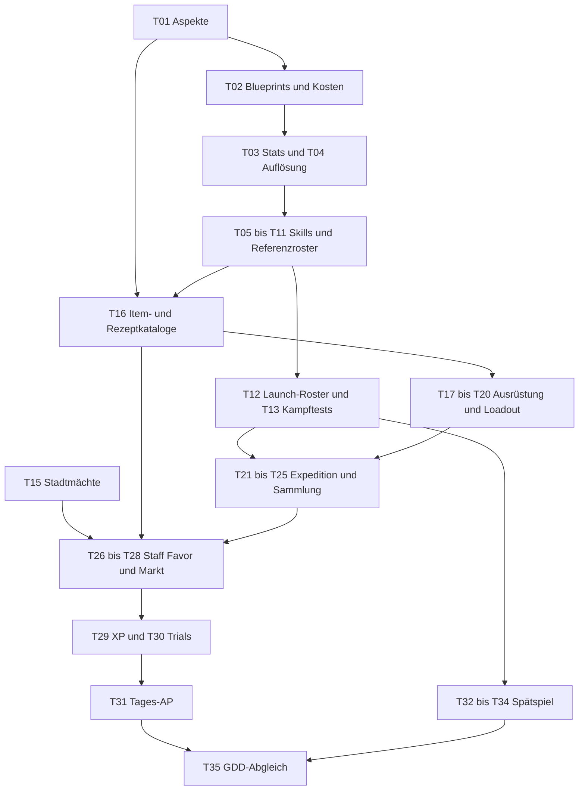

# Temporäre Klärungsliste — Road of the Beasts

Zentrale Liste der offenen Designentscheidungen und Validierungen aus den drei GDDs. Die Reihenfolge unten ist eine vorgeschlagene Arbeitsreihenfolge, keine neue Spielregel. **Nur im Ordner `docs` und auf `main` arbeiten.**

## Verwendung

- Die GDDs beschreiben den aktuellen Arbeitsstand; vorhandene Vorschläge und Zahlen sind durch diese Auslagerung **nicht automatisch beschlossen**.
- Offene Fragen, Alternativen und Prüfaufträge werden ausschließlich hier gepflegt. Inhaltliche Entwürfe, historische Changelogs und dokumentierte Prototyp-Abweichungen bleiben in den GDDs erhalten.
- Erst die unter „Voraussetzung“ genannten Punkte abschließen, dann das Thema entscheiden. Unabhängige Punkte derselben Phase können parallel bearbeitet werden.
- Nach Abschluss: Entscheidung in die angegebenen GDD-Abschnitte übernehmen, betroffene Begleitdateien synchronisieren und den Punkt hier abhaken. Bei Playtests erst Messung und Ergebnis dokumentieren, dann gegebenenfalls Regeln ändern.
- **D** = Designentscheidung, **V** = Validierung/Balance, **K** = Konsistenzkorrektur. Quellen beziehen sich auf die weiterhin gültigen Abschnittsnummern der GDDs.
- **Zentrale Skill-Spezifikation:** `gdd_monsters.md` Kapitel 4. Dort werden Kit, Baukasten, Schema, Validierung, Zugang und Slotentwicklung definiert. Battle beschreibt die generische Laufzeit-/Board-Auflösung; Overworld nur Meta-Integration, Ökonomie und eigene Tamer-/Loadout-Inhalte. Keine parallelen Monster-Skillpreislisten oder Upgrade-Regeln pflegen. Historische Angaben sind keine aktive Spezifikation.

## Übergabe / Wiedereinstieg — Stand 2026-11-07

### Arbeitsauftrag und Zusammenarbeit

- **Ausschließlich `docs/` bearbeiten, auf `main` bleiben.** Keine Implementierung, keine Änderungen an Code oder anderen Ordnern; nicht ungefragt committen oder Branches anlegen. Vorhandene Änderungen erhalten.
- Gemeinsam mit dem Nutzer entscheiden: gezielte kurze Fragerunden, konkrete Optionen und eine begründete Empfehlung anbieten. Ein AskUser-Tool verwenden, falls verfügbar; andernfalls im Chat fragen. Nicht für jedes bereits beschlossene Prinzip erneut Zustimmung einholen.
- Neue Zahlen und Mechaniken erst als **Entwurf** kennzeichnen. Nach Bestätigung zentral dokumentieren, betroffene Verweise synchronisieren und diese Liste nachführen. Nicht allein durch ein generisches Schema bisher unzulässige Kombinationen freigeben.

### Wo der aktuelle Stand steht

- **`gdd_monsters.md` Kapitel 4 ist die zentrale Monster-Skill-Spezifikation:** §4.1 Kit/Zugang, §4.2 Baukasten/Effektverträge/Kostenmodell, §4.3 Validierung, §4.4 Surge-Constraints, §4.5 gemeinsames Schema und Referenzentwürfe, §4.6 Speziesexklusivität/Signatures, §4.7 Slotentwicklung/Wechsel/Upgrades.
- §7.1 verweist nur noch auf §4.7. Kin-Daten, passive Contentideen, Roster und Fortschrittstabellen bleiben in ihren Fachkapiteln; sie bilden kein zweites Skillsystem.
- `gdd_battle.md` behält die generische Laufzeit-/Board-Auflösung. `gdd_overworld.md` behält Meta-Integration, Ökonomie, Tamer und Loadout. Parallele Monster-Skillpreislisten, insbesondere „Unique = 1 AP“, wurden entfernt.
- Alte Blueprint-/Skill-Beispieltabelle, benannter Twist-Katalog, Unique-Ideenlisten und redundante Upgrade-Beispiele wurden aus der aktiven Skilldefinition entfernt. Nicht wieder als fundamentale Bausteine einführen. Historische Changelogs und explizite Prototypabweichungen sind keine aktuellen Regeln.

### Bestätigte Entscheidungen — nicht erneut grundsätzlich aufrollen

1. **Keine festen Monster-Aspekte, kein Dreieck, kein Attunement und keine festen Elemente als Ersatz.** Freie Themen beschreiben Monster; bewusst entworfene Spezies-Lernlisten bestimmen Skillzugang. T01 abgeschlossen; Aspektwechsel und Dual-Aspekte entfallen (T33/T34).
2. Designer erstellen fertige Skills und Upgrade-Auswahlen. Der Blueprint ist ein **modulares Datenmodell**, kein Skillkatalog und kein freier Spieler-Skilleditor. Zielauswahl, Platzierung, Empfänger, Fläche, Effekte, Trigger, Dauer und Boardoperationen sind getrennt.
3. Blueprint-Punkte dienen **intern** zur Bewertung und AP-Kalkulation: Basispreise plus definierte Kombinationszuschläge und harte Grenzen. Noch keine endgültigen Punktwerte oder Budgetschwellen beschlossen.
4. Erlaubtes Budget = Grundbudget der AP-Klasse + Entwicklungsbonus des Slots. Jeder Skill braucht einen vollständigen Entwicklungspfad zum ursprünglichen AP-Preis. Größere Erweiterungen mit klar ausgewiesenem AP-Aufpreis sind optional.
5. Slot-Upgrades erhöhen keinen direkten Schaden, reduzieren keine AP-Kosten und erhöhen keine Cast-Reichweite. Verbesserbar sind begrenzte Fläche/Form/Dauer, Bewegung/Verschiebung und entworfene Zusatzeffekte; bestehende harte Profilgrenzen gelten weiterhin.
6. **Entwicklung gehört zum Skillslot des individuellen Monsters.** Körperliche Evolution und Slotentwicklung verwenden einen gemeinsamen EP-Pool. Ein bezahlter Slotentwicklungsschritt gewährt direkt eine skillabhängige Upgrade-Auswahl; keine zusätzliche Spielerwährung.
7. Skillwechsel außerhalb von Expeditionen aus der freigeschalteten Spezies-Lernliste kostet eine wertvolle **Umlernpille**. Slotentwicklung bleibt erhalten; für den Ersatzskill werden passende Upgrades im bestehenden Umfang neu gewählt, nicht alle Upgrades gleichzeitig vergeben.
8. **Surge = angekündigte, verzögerte Ausführung.** Bodenrückstand ist optional, explizit in `board_changes` und separat zu bewerten. Konkrete Eruption/Flood/Rift-Profile behalten ihre definierten Rückstände. Kein automatischer Bodenwechsel/Hallowed-Verbrauch bei rückstandsfreien Surges.

### Unmittelbar als Nächstes: T02 anhand der Referenzen konkretisieren

1. Zuerst `gdd_monsters.md` Kapitel 4, besonders **§4.5 und §4.7**, sowie T02/T05 hier lesen. Dort stehen bereits drei Vergleichsentwürfe: **Slow-Zone, Jab-Strike und rückstandsfreier Surge**. Nicht wieder bei der grundsätzlichen Blueprint-Struktur anfangen.
2. Die drei Referenzen kurz gegenüberstellen: Grundwirkung, AP, Fläche, Ausführung/Verzögerung, Dauer, Empfänger, Einschränkungen und mögliche Upgrade-Patches. Bestehende Regeln von vorgeschlagenen Kalibrierungswerten unterscheiden.
3. **Ersten nachvollziehbaren Zahlenentwurf** für Komponentenpreise, AP-Grundbudgets, Slotentwicklungsboni und wenige konkrete Kombinationszuschläge erstellen und mit dem Nutzer besprechen. Zahlen nicht als validierte Balance darstellen. Erst an diesen Referenzen prüfen, dann auf Schutz/Heilung/Bewegung/Boardänderungen erweitern.
4. **Besonders offen: vollständiger gleich teurer Jab-Entwicklungspfad.** Größere Strike-Formen kosten bisher mehr AP; diese Regel nicht stillschweigend ändern. Sinnvolle Verbesserungen im ursprünglichen Preisrahmen mit dem Nutzer erarbeiten. Auch Upgrade-Tiefe und Portabilität zwischen verschiedenen Skills prüfen.
5. Optionalen Rückstand getrennt bewerten; Kombination Schaden + Verschiebung + Gefahrenboden benötigt eigene Bewertung/Grenzen. Kein pauschales „Twist kostet immer +1 AP“ oder „jedes Upgrade wird teurer“ reaktivieren.
6. Wenn die Bewertung tragfähig ist, T05 konkretisieren: EP-Vergabe und Preise gemeinsam für körperliche Evolution und mehrere Slots, Entwicklungsschritte sowie eventuelle Ränge. Danach gemäß Abhängigkeiten weiterarbeiten. T02/T05 bleiben bis dahin offen.

### Noch nicht entschieden / wichtige Stolperstellen

- Drei Ränge wurden diskutiert, **aber nicht beschlossen**. Rangzahl, Schwellen, Zwischenverbesserungen, Maximalentwicklung und Stage-Gates sind offen. Ränge wären abgeleitete Meilensteine, kein separater Kauf.
- Alte EP-Mengen passen nicht automatisch: Normal hätte bisher insgesamt nur 2 EP. Keine vollständige Slotentwicklung voraussetzen, ohne Vergabe und konkurrierende Evolutionen anzupassen.
- Noch offen: Neuwahl bestehender Upgrades desselben Skills, EP-Rücknahme/Übertragung, Aktiv-/Passivwechsel und Entwicklung passiver Slots. Eine Pillenpflicht für Same-Skill-Respec war nur Empfehlung, keine Entscheidung.
- Umlernpillen-Rezept, Preis, Tier, Beschaffung sowie Tages-AP für Wechsel/Slotentwicklung sind offen. Monster-Battle-AP, Tages-AP und EP nicht vermischen.
- Konkrete Effekt-Caps, Heilungswiederholung, Kollisionswidersprüche, Flood-/Tail-Sweep-Reihenfolge, Pull-Gleichstände, Zielverlust, Luft und 2×2 bleiben unter T02/T04/T07–T09 offen. Nicht beim Ausfüllen des Schemas beiläufig entscheiden.
- Major-Surge-Zugang Ancient-only vs. Legendary-Formulierungen und Signature-Slotbehandlung sind ebenfalls nicht geklärt. Roster-/Passivideen sind unvalidiert, keine freigegebenen Ausnahmen zu Damage-/AP-Regeln.

### Validierungsstand

- Die letzte Arbeit betraf nur Dokumentation in den vier vorhandenen Dateien unter `docs/`. `git diff --check` war zuletzt erfolgreich.
- Referenzfälle wurden auf Dokumentebene/Papier geprüft. **Keine Engine-Tests oder Balance-Playtests**, keine validierten Komponentenpreise. T13 bleibt erforderlich.
- Diese Übergabe ist eine Einstiegshilfe; die Detailaufgaben und Voraussetzungen unten bleiben maßgeblich.

## Phase 1 — Grundlagen und widersprüchliche Regeln klären

### [x] T01 · Aspekt-System bestätigen (D/V)
**Voraussetzung:** keine.
**Quelle:** `gdd_monsters.md` §7.4; `gdd_battle.md` §3.2, §4.8.
- **Beschlossen:** Dreieck und feste Monster-Aspekte entfallen; keine festen Elemente als Ersatz. Monster erhalten freie beschreibende Themen, ihre erlaubten Fähigkeiten bestimmen bewusst entworfene Spezies-Lernlisten.
- Attunement entfällt. Konkrete Skills, Böden und Surge-Verhalten bleiben als Baukasten erhalten, ohne feste Aspektbindung oder verpflichtende Dreifachvarianten.
- In allen drei GDDs übernommen. Neue Bodeninteraktionen werden unter T07 geklärt; konkrete Lernlisten und Roster unter T10–T12. Die Balance der verbleibenden Mechaniken ist dadurch noch nicht validiert.

### [ ] T02 · Blueprint-Vertrag und AP-Preise vereinheitlichen (D/K)
**Voraussetzung:** T01.
**Quelle:** `gdd_monsters.md` §4.1–§4.7 (zentrale Spezifikation); `gdd_battle.md` §2.3, §5 (Runtime-Verweise); `gdd_overworld.md` §2.1, §6.3.2 (Meta-Integration).
- **Beschlossen:** Designer entwerfen fertige Skills und Upgrade-Auswahlen. Blueprint-Punkte dienen intern zur Budgetierung und AP-Kalkulation, nicht als zweite Spielerwährung oder freier Spieler-Skillbaukasten.
- **Beschlossen:** Erlaubtes Blueprint-Budget = Grundbudget der AP-Klasse + Entwicklungsbonus des Slots. Jeder Skill bietet einen vollständigen Entwicklungspfad zum ursprünglichen AP-Preis; größere Erweiterungen mit klar ausgewiesenem AP-Aufpreis sind optional. Keine AP-Kostenreduktion durch Upgrades.
- **Beschlossen:** Gemeinsame Baustein-Basispreise plus ausdrücklich definierte Kombinationszuschläge und harte Grenzen statt einer rein additiven Universalformel. Synergien wie Fläche × Schaden × Verschiebung bzw. wiederholte Trigger gemeinsam bewerten; problematische Kombinationen dürfen unabhängig vom Budget ausgeschlossen werden.
- **Beschlossen und dokumentiert:** Der Blueprint ist ein datenorientierter Baukasten mit getrennten Dimensionen für Metadaten, Ausführung, Zielauswahl, Platzierung, Fläche, Effekte, Trigger, Dauer, Boardänderungen, Interaktionen und Nutzungslimits. Strike/Surge/Zone liefern verbindliche Regelprofile; benannte Wirkungspakete sind Katalogvorlagen, keine fundamentalen Bausteine. Upgrades ändern autorisierte Felder desselben Modells.
- **Kapitel 4 konsolidiert:** Alte konkrete Skill-Beispieltabelle, benannter Twist-Katalog und Unique-Ideenlisten entfernt; §4.3 beschreibt jetzt Validierung, §4.4 Surge-Constraints und §4.6 Spezieszugang/Autorschaft. Ein gemeinsames Schema mit einem Slow-Zone-Referenzentwurf bleibt. Roster-Ideen außerhalb des Kapitels sind weiterhin unvalidiert und unter T10–T12 zu überarbeiten.
- **Dokumentiert:** Legacy-Blueprint-Tabelle entfernt. `damage`, `displacement` und `stat_change` sind als datenorientierte Effektverträge mit Quellen, Pflichtparametern, Empfängern, Triggern und bestehenden Grenzen beschrieben; keine neuen Mechaniken dadurch freigegeben.
- **Dokumentiert:** Ergänzende Verträge für Schutz, Heilung, Eigenbewegung sowie Boden-, Höhen-, Prop- und quellenspezifische Cleanse-Operationen stehen in `gdd_monsters.md` §4.2/§4.5. Bestehende Quellen und Regeln begrenzen die Kombinationen; keine generische Heilung, Immunität, Teleportation oder Boardlöschung freigegeben.
- **Dokumentiert:** Räumliche und zeitliche Verträge in §4.2/§4.5 trennen Zielauswahl, Platzierung und Effektempfänger sowie Ausführungsverzögerung, Effekttrigger und Lebensdauer. Flächen werden durch eindeutige Zell-Offsets, Anker und Orientierung beschrieben; bestehende Rand-/Blockierungsregeln bleiben erhalten.
- Räumliche Definitionen vervollständigen: genaue Footprints/Ankermappings und Orientierungen erstellen, fehlende Sichtgeometrie und Zielregeln abstimmen. Zeitliche Definitionen benötigen konkrete Ereignisse und Lebensdauerbedingungen; keine impliziten Zusatztrigger oder Zielverfolgung.
- Effektverträge vervollständigen: erlaubte Werte und Zonenlevel-Skalierung, fehlende Caps/Floors für Initiative/Reach/haste, direkte Verschiebungsziele und Luft-Interaktion, konkrete Zusatzeffekt-Trigger (z. B. Ash Snare), zeitliche Statuseffekte und Siphon-Stacking/Refresh klären. Zonenlevel, Effektstärke und Dauer getrennt halten; T07 für Boden-/Heilungsinteraktionen hinzuziehen.
- **Beschlossen:** Surge bezeichnet angekündigte, verzögerte Ausführung. Bodenrückstand ist ein optionaler, expliziter und separat bewerteter `board_changes`-Baustein. Bestehende Eruption/Flood/Rift-Profile behalten ihre definierten Rückstände; keine automatische Rückstands-/Hallowed-Verbrauchsregel für jeden Surge.
- **Referenzdurchläufe dokumentiert:** §4.5 enthält Slow-Zone, einfachen Jab-Strike und rückstandsfreien Surge im selben Schema mit vorgeschlagenen Upgrade-Auswahlen. Bestehende Regeln und neue Kalibrierungswerte sind getrennt; keine endgültigen Punkt-/EP-Preise oder Balancefreigabe. Vollständigen gleich teuren Jab-Entwicklungspfad noch entwerfen, ohne die bisherigen Strike-Formpreise stillschweigend zu ändern. Papierprüfungen ersetzen keine Engine-/Balance-Tests.
- **Als Nächstes:** Die drei Referenzen gegenüberstellen und erste Komponentenpreise, Kombinationszuschläge, AP-Grundbudgets und Slotentwicklungsboni als Zahlenentwurf ableiten. Optionale Rückstände einschließlich Schaden-plus-Verschiebung-plus-Boden gesondert bewerten.
- **Nächster Schritt:** Bausteine, erlaubte Werte, Pflichtfelder, Effektdefinitionen und Profil-Constraints vervollständigen; alte Katalogvorlagen anhand des neuen Schemas übertragen. Bestehende Kampfregeln nicht allein durch ausdrückbare Feldkombinationen erweitern. Danach an einem einfachen Strike, einer zeitlich begrenzten Zone und einem verzögerten Surge Grundbudgets, Entwicklungsboni, Bausteinpreise und harte Grenzen entwerfen. Zahlen erst als Entwurf kennzeichnen und gemeinsam bestätigen. Bestehende pauschale Surge-/Size-/Twist-Aufpreise mit der neuen Regel abgleichen; nicht jede Verbesserung darf automatisch teurer werden.
- Datenmodell, Effektbausteine, Tags und Interaktionsfelder prüfen; festen Preis für das Umlegen eines Flags festlegen oder bewusst darauf verzichten. Einheitliche Kalkulation für Grundskills und Upgrades ausarbeiten; Entwicklungsfortschritt und Kampf-AP getrennt behandeln.
- **Dokumentübergreifend konsolidiert:** Kapitel 4 ist die zentrale Monster-Skillquelle; Slotentwicklung aus §7.1 nach §4.7 verschoben. Battle-/Overworld-Aktionspreisduplikate einschließlich „Unique = 1 AP“ entfernt. Bestehende Laufzeit- und Fortschrittsregeln verweisen auf die zentrale Definition.
- Alte automatische Twist-/Size-Aufpreise sind nicht mehr aktive universelle Regeln. Konkrete Kombinationen anhand des Budgets kalibrieren; Nutzbarkeit teurer Varianten durch AP-2-Monster berücksichtigen, keine Vergrößerung doppelt berechnen.
- Bestehende Basis-AP-Werte in §4.2 gegen Komponentenbewertung prüfen. Speziesexklusivität ist keine eigene Kostenklasse; keine neue parallele Preistabelle erstellen.
- Frühere Damage-/Range-Twist- und Passivideen sind keine freigegebenen Upgrade-Ausnahmen. Beibehaltene Grundskill-/Passivkonzepte unter T10/T11 explizit prüfen.

### [ ] T03 · Stat-Budget, Frames und Progressionsgrenzen prüfen (V/K)
**Voraussetzung:** T02.
**Quelle:** `gdd_monsters.md` §2.1–§2.3, §7.4; `gdd_overworld.md` §1.2, §2.4.
- Preise, Budgets und alle skalierten Frames prüfen; Reichweite kostet 3 Punkte pro Stufe und betrifft nun alle Casts. Reach-2-Individuen gegen den alten Surge-Radius 3 testen.
- Init beim Roll 1 Punkt = 1.0, beim Level-up = 0.1: gleiche erhaltene Punkte bedeuten nicht zwingend gleiche resultierende Stärke; frisch gerollte und hochgezogene Individuen vergleichen.
- Stage vs. genauer Sub-Tier als Monster-Cap vereinheitlichen (§7.4 nennt den Schritt, andere Texte nur die Stage).
- Overworld-Texte begrenzen ausgegebene Punkte teils noch durch den Frame; Monster-GDD begrenzt nur den Roll durch den Frame.
- Step-only-Monster: zufällige Movement-Punkte gegenüber „bleibt am Frame-Minimum“ eindeutig regeln.

### [ ] T04 · Auflösungsregeln und Sonderfälle konsistent machen (D/K)
**Voraussetzung:** T01, T02.
**Quelle:** `gdd_battle.md` §2.2, §4.1, §4.4, §4.8, §4.10, §6.1–§6.3; `gdd_monsters.md` §5.
- Kollision: Schadensgesetz nennt Monster-Kollisionen, Detailregel sagt kein Schaden. Crashlander dagegen abgleichen. Shockwaves bisherigen Kollisionsbonus +1 gegen das feste Ereignisschadensgesetz prüfen; bislang keine beschlossene Ausnahme.
- Auflösungsreihenfolge für Flood-Schaden/Rückstand/Push und Tail-Sweep-Schaden/Push festlegen; Pull-Gleichstände und Verhalten bei bereits belegtem Anker explizit definieren.
- Schutzquellen: Stacking, Reihenfolge und Verbrauch bei auf 0 reduziertem Schaden festlegen; Ward, Veil und Hallowed unterscheiden. Tamer-Ausnahmen mit T20 abstimmen.
- Kombinierte Boardoperationen: Reihenfolge von Collapse, Debris, Residue und Cleanse festlegen; Relocate-Distanz, Pfad, legale Ziele und Reaktionen konkretisieren. Keine freien Defaults aus Datenfeld-Reihenfolge ableiten.
- Attunement-/Elevated-Konflikt durch T01 entfallen; verbleibende Kombinationen aus Höhe und konkretem Boden prüfen.
- Zonenwerte ohne Attunement: harte Caps für Slow (2) und Push/Pull (1) sowie Level-Skalierung konsistent halten.
- Sigil ist betretbar; Prop-Regel sagt „Prop nimmt Schaden, Monster dort nicht“. Trefferreihenfolge für Monster auf Field-Props definieren.
- Zielgültigkeit bei Auflösung klären: bewegtes, gefallenes oder entferntes Einheiten-/Propziel und ungültig gewordene Platzierung. Kein implizites Tracking, Retargeting oder frei erfundener Abbruch-/Erstattungsdefault. Gleichzeitige Ereignisse und Ablauf-/Trigger-Reihenfolge deterministisch festlegen.
- Surge bei mehreren Turns pro Runde, geänderter Initiative oder totem Caster präzisieren: „nächster Caster-Turn“ garantiert nicht, dass alle anderen vorher handeln.
- Deterministische Gleichstände bei Voidscar-Auswahl sowie Push/Pull-Ziel und freien Ausweichfeldern definieren.
- Punktsymmetrische Generierung gegen ungerade Prop-Anzahlen prüfen; zulässige zentrale Einzelobjekte je Boardgröße festlegen.

## Phase 2 — Skills, Entwicklung und Monster-Identität

### [ ] T05 · Skill-Verbesserungen abschließen (D)
**Voraussetzung:** T02.
**Quelle:** `gdd_monsters.md` §4.7 (Slotentwicklung), §7.2/§7.4 (EP-/Fortschrittsentwurf); `gdd_overworld.md` §6.3.2 (Integration).
- **Beschlossen:** Permanente Skillslotentwicklung ist eine zusätzliche Evolutionsmöglichkeit des individuellen Monsters. Körperliche Evolution und Slotentwicklung verwenden denselben EP-Pool. Ein bezahlter Slotentwicklungsschritt gewährt direkt eine von Designern entworfene, skillabhängige Upgrade-Auswahl; keine zusätzliche Spieler-Punktwährung.
- **Beschlossen:** Skillwechsel aus der freigeschalteten Spezies-Lernliste außerhalb von Expeditionen kostet eine wertvolle Umlernpille statt EP. Slotentwicklung bleibt erhalten; passende Upgrades für den neuen Skill werden im bestehenden Entwicklungsumfang neu gewählt. Kein kostenloses Re-Slotting, kein EP-bezahlter Swap-Pfad.
- **Nächster Schritt:** Gemeinsames EP-Budget und Preise für körperliche Evolution und Slotentwicklung entwerfen. Alte Vergabe von 1 EP für Normal/Rare bzw. 2 EP für Epic/Legendary ist unvalidiert; Normal hätte bisher insgesamt nur 2 EP. Zielinvestitionen über mehrere Slots und Konkurrenz zu körperlichen Entwicklungen prüfen.
- Anzahl der Slotentwicklungsschritte, eventuelle Ränge und deren Schwellen festlegen. Ränge wären abgeleitete Meilensteine, kein separater Kauf; drei Ränge sind noch nicht fest beschlossen. Weiterentwicklung innerhalb eines Rangs prüfen.
- **Beschlossen:** Kleine feste Schadenswerte bleiben erhalten. Slot-Upgrades erhöhen keinen direkten Schaden, senken keine AP-Kosten und erhöhen keine Cast-Reichweite. Erlaubte Verbesserungsarten: Fläche, Form/Orientierung, Dauer, Bewegung/Verschiebung und ausdrücklich entworfene Zusatzeffekte; jeweils mit skillabhängigen Grenzen. Gesamtauswirkung durch mehr Ziele oder Trigger trotzdem prüfen.
- Für jeden Skill ausreichend viele vorab sichtbare Upgrade-Auswahlen, Voraussetzungen, Ausschlüsse und Caps entwerfen; Shape, Size, Twist und Small value als Kandidaten prüfen. Die entfernten Legacy-Swap-Pfade nicht wieder einführen; Wechsel bleibt pillenbasiert.
- Klären, wie Slots mit unterschiedlich vielen legalen Upgrade-Angeboten behandelt werden und wie passive bzw. passive-only Slots sowie Aktiv/Passiv-Wechsel funktionieren. Keine Slotinvestition beim Wechsel verlieren lassen.
- Noch offen: Kosten der Neuwahl bestehender Upgrades desselben Skills, Rücknahme von EP-Investitionen und eventuelle Übertragung zwischen Slots. Pillenkosten für Upgrade-Respec sind bislang nur Empfehlung, nicht beschlossen.
- Umlernpille konkretisieren: verlässliche Beschaffung, Rezept, Tier, Preis und Tages-AP mit T16/T30/T31 abstimmen; bewusster Wechsel statt ständigem Umbau, ohne Experimentieren dauerhaft zu bestrafen.
- Generisches Size-Maximum 4 gegen Strike-Formen bis 8 Felder abgrenzen. Die alten widersprüchlichen Shape-Preise sind überholt; konkrete Upgrade-Angebote und EP-Schrittpreise im gemeinsamen Modell festlegen.

### [ ] T06 · Strike-Formen und Kin-Effekte abschließen (D/V)
**Voraussetzung:** T02, T03, T05.
**Quelle:** `gdd_monsters.md` §3.2.
- Vor Core nur Jab: kommen interessante Formen zu spät? Storm/5-AP-Formen erreichen nur späte TPR-1-Builds.
- Whirl (4 Felder) gegen Arc (3) zum selben Preis sowie Nutzen der Thrust-Reichweite testen. Die alte Frage nennt „Skewer“, die Tabelle „Thrust“: Bezeichnung vereinheitlichen.
- Beast Bite: eigenen Effekt ohne Verletzung der Schadensobergrenze geben oder fehlenden Effekt bewusst akzeptieren.

### [ ] T07 · Bodeninteraktionen und Heilung abstimmen (D/V)
**Voraussetzung:** T01, T02, T04.
**Quelle:** `gdd_battle.md` §4.6–§4.8; `gdd_monsters.md` §4.2, §4.4–§4.5.
- Permanente Residuen: füllt sich das Board zu schnell, wird Rift/Blight dadurch übermächtig?
- Hazard-Anteil auf 7×7 bis Runde 5 messen. Falls nötig: Field 2 AP oder maximal N Field-Felder pro Monster als Alternativen prüfen.
- Ohne Dreieck festlegen, ob und wie Zonen vorhandene Böden verändern; keine automatische Überlegenheit aus Monsterthemen ableiten.
- Attunement und Painting-Snowball entfallen durch T01. Stattdessen Gegenmittel gegen permanente Gefahrenböden und deren Zugänglichkeit prüfen.
- Blessing: 2 AP für permanente 3–4 Felder angemessen? Mossbed pro Turn begrenzen?
- Boon/`mend`: Heilung bei HP 1–10 prüfen; darf das Zonenlevel die Heilung erhöhen oder bleibt sie fest bei 1? Numerischen Heilungs-Cap und Mossbed-Wiedereintritt/per-Turn-Limit explizit definieren; Persistenz gewährt keine zusätzlichen Heiltrigger.
- Level-II-Rückstand als konkrete Erweiterung bewerten; der frühere Name „Deep Residue“ und +1 AP sind keine bestätigte universelle Regel.

### [ ] T08 · Wasser und Swim definieren (D)
**Voraussetzung:** T02, T07.
**Quelle:** `gdd_battle.md` §4.7, §5.5; `gdd_monsters.md` §3.3.
- Wo entsteht Wasser: nur Generator oder auch Skills? Dürfen erzeugte Gefahren- oder Segensböden Wasser ersetzen?
- Welche Kins erhalten Swim? Kostenprofil und Flag-Ausnahmen gegen die allgemeine Bewegungstabelle prüfen.

### [ ] T09 · Luft-Ebene und 2×2-Regeln spezifizieren (D/K)
**Voraussetzung:** T02, T04, T06, T07.
**Quelle:** `gdd_battle.md` §4.3, §5.5–§5.6; `gdd_monsters.md` §3.1, §4.2, §4.7.
- Welche Skills außer Strike erhalten `affects_air`? Mindestens ausreichend lesbare Gegenmittel gegen Winged ab Soul sicherstellen.
- Flugbewegung, Besetzung und Interaktion mit Props/Boden konkretisieren. Für 2×2 zusätzlich Distanzursprung, Flächenüberschneidung, Empfänger-Deduplizierung sowie Eintritts-/Austrittsauswertung über mehrere Felder definieren; das generische Flächenmodell entscheidet diese Fälle nicht.
- Ergänzend bei der Analyse gefunden: 2×2 ist angekündigt, aber Flächentreffer, Schadensmultiplikation, Platzierung, Bewegung und Displacement sind nicht ausreichend definiert. Mehrfach belegte Felder dürfen keine implizite Mehrfachschadensregel erzeugen.

### [ ] T10 · Konkrete Skills aus Blueprints neu aufbauen (D)
**Voraussetzung:** T05–T09.
**Quelle:** `gdd_monsters.md` §4.2–§4.6.
- Konkrete Skills ausschließlich im gemeinsamen Schema §4.5 erstellen und nach §4.3 validieren; keine neue parallele Blueprint-/Beispieltabelle. Effekte, Trigger, Zielwahl, Footprints, Interaktionen, Kosten und autorisierte Upgrade-Patches vollständig definieren.
- Speziesexklusive und Signature-Skills verwenden dasselbe Schema; Unterschiede über Zugang, Urheberschaft und explizite Regeln darstellen. Frühere benannte Ideen sind kein zugesagter Content. Konkrete Skills und ausreichend tiefe Upgrade-Auswahlen erst nach bestätigten Budgets auswählen.

### [ ] T11 · Lernlisten, Passives und Referenzroster überarbeiten (D)
**Voraussetzung:** T03, T06, T10.
**Quelle:** `gdd_monsters.md` §4.4, §5, §6.1, §7.4.
- Für jede Spezies lernbare Skills (derzeit Ziel ungefähr 8) und verfügbare Passives definieren: Spezies- und Individualbindung unterscheiden; freie Themen sind keine zusätzliche Lernbeschränkung. Ehemals aspektabhängige Passive überarbeiten oder streichen.
- Die neun Referenzmonster haben aktuell vier aktive Skills plus Passive; auf vier gemeinsame Slots reduzieren, Epic+-Zusatzslot gesondert behandeln.
- Jede Spezies erhält einen Species-Twist statt des gemeinsamen Platzhalters sowie eine konkrete Strike-Form und feste Surge-Orientierung.
- Beschreibungen wie „weak Flood“/„weaker Rift“ mit den geltenden Schadens- und AP-Regeln abgleichen.

### [ ] T12 · Launch-Roster auswählen (D)
**Voraussetzung:** T11.
**Quelle:** `gdd_monsters.md` §6.1–§6.2.
- Ohne Kin×Aspekt-Pflichtmatrix aus den neun Referenzmonstern und weiteren Namensideen ein vielfältiges Roster auswählen (bisher Ziel etwa 15); freie Themen und eigenständige Spielweisen statt Kategorienvollständigkeit priorisieren.
- Fehlende Blueprint-/Movement-Abdeckung und unterscheidbare Ein-Satz-Identitäten prüfen.

## Phase 3 — Kampf validieren, bevor die Meta Zahlen festschreibt

### [ ] T13 · Kampftests mit dem überarbeiteten Regelstand planen und auswerten (V)
**Voraussetzung:** T04, T07, T11; T08/T09 für Wasser-/Soul-Tests.
**Quelle:** `gdd_battle.md` §7.2; ehemalige §8; `gdd_monsters.md` §2.2, ehemalige §8.
- Erst sicherstellen, dass der getestete Build den untersuchten Entwurf umsetzt: dokumentierter Godot-Stand ist v6.0, nicht v6.3. Codeänderungen sind nicht Teil dieser Docs-Aufgabe.
- Residuen: treffen Surges indirekt auch beim Ausweichen oder erzwingen sie sinnvolle Wege?
- Lesbare Kombos: Current → Surge/Lava, Pull → Strike; Pull-Anker und Push-Richtung prüfen.
- Strike ab 2 AP: lohnend oder ungenutzt, Nahkampf zu klebrig?
- No-Cooldown-Spam und Double Veil (2 AP → Level II, Shield 3) prüfen. Fallback: Level-up nur einmal pro Turn und Feld.
- Veil Shield 2, Level/Attunement und Surge 3 auf echte Gegenmittel prüfen.
- Bewegungspreise, Step-only-Viabilität und Movement-Cap 5 prüfen.
- Drei Surge-Typen gegen Elevated; Props als taktische Ressourcen statt Hindernisse.
- 3v3/7×7: Lesbarkeit, Rundenzahl, Collapse-Anteil und Startdistanzen; Reach 4 + Elevated = 5 gegen das Versprechen eines sicheren Openings prüfen.
- First-Surge-claims-square und Initiative-Ketten/Fokusfeuer prüfen. Fallback bei Dominanz: Initiative teurer machen.
- Dusk Moth (historisch 87 % Sim-Winrate) mit Menschen und KI vergleichen; Native Ground/Wide/Blight getrennt betrachten.
- Stat-/Strike-/Heilungs-Tests aus T03/T06/T07 gemeinsam auswerten; Preise erst anhand der Ergebnisse nachjustieren.

### [ ] T14 · Reshape gegen Reroll-Ausnutzung absichern (D/V)
**Voraussetzung:** T03, T13.
**Quelle:** `gdd_monsters.md` §2.2; `gdd_overworld.md` §2.6, §7.5.
- Genügen seltenes Elixier und Ritualkosten oder braucht es Cap/Cooldown gegen wiederholtes Optimierungs-Rollen?

## Phase 4 — Welt, Kataloge und Ausrüstung (teilweise parallel zu Phase 2/3)

### [ ] T15 · Stadtmächte, Zuständigkeiten und Inhalte festlegen (D)
**Voraussetzung:** keine; parallel zum Kampfdesign möglich.
**Quelle:** `gdd_overworld.md` §3.1–§3.2, §7.2.
- Fraktionsnamen, Profile und Angebote der drei Familien festlegen.
- Betreiber von Arena, Teleport Plaza, Business District bestätigen: Vorschlag City Lord, City Lord, Guild.
- Gebäude/Zugang der Rival Compounds und Zweck der Slums klären; Black Stall bleibt eine optionale Idee, kein zugesagtes Feature.

### [ ] T16 · Material-, Item- und Rezeptkataloge vervollständigen (D)
**Voraussetzung:** T01; T10 für kampfbezogene Produkte.
**Quelle:** `gdd_overworld.md` §6.6–§6.8, §7.5–§7.8.
- Aus Mustern konkrete Materialien, Kräuter, Seeds, Rezepte, Seals, Scrolls und Blueprints ableiten; Anzahl, Stufen und Grade bestimmen.
- Mengenannahme „vier Tiers/~40 Pills“ gegen sechs Kultivierungsstufen und fehlende Sovereign-XP-Werte abgleichen.
- Grade-Abhängigkeiten und Bezugsquellen gegen „Geld kauft niemals exklusive Macht“ prüfen; Legendary-Blutlinien-Zutaten sind derzeit zugleich nur Story und bei Boss/Quest/Auktion verortet.
- Array-Rezepte und Forge-Weg (Ore + Beast Parts) bestätigen; festlegen, ob Upper Stones reine Währung oder auch Ritualmaterial sind.

### [ ] T17 · Artefakt-Regeln und Stapelung festlegen (D/K)
**Voraussetzung:** T03, T11, T16.
**Quelle:** `gdd_overworld.md` §6.7, §6.9, §7.5; `gdd_monsters.md` §7.2.
- Tamer: zwei oder drei Slots, und wann? Monster: zweiter Slot bei Epic+ oder erst zusätzlich ab Core? Tabellen synchronisieren.
- Passive ODER Stat-Mod gegenüber Schema „Passive + kleiner Stat-Mod“ klären; doppelte Passive und mehrere Artefakte begrenzen.
- +1 AP/Tag, Kapazitäts- und Skill-Mods gegen Tagesökonomie, Stage-Caps und die Options-statt-Zahlen-Regel prüfen.

### [ ] T18 · Medicines und Arrays spezifizieren (D)
**Voraussetzung:** T07, T10, T16.
**Quelle:** `gdd_overworld.md` §6.6, §6.8, §7.5–§7.6.
- Medicine-Effekte, Rezepte, Item-Kind und Abgrenzung zu Pills bestimmen. Schutz-/Heilungs-/Boardeffekte benötigen eigene Quellen-, Verbrauchs- und Timingverträge im gemeinsamen Datenmodell; Monster-Effektverträge erteilen keine automatische Item-Freigabe.
- Welche Arrays sind verbrauchbar, welche wiederverwendbar? Haltbarkeit, Platzierung und Effekte im Kampf definieren.
- Pre-battle-Arrays als begrenzte Ausnahme von neutralem/punktsymmetrischem Start bestätigen; vier bisherige Array-Entwürfe prüfen.

### [ ] T19 · Battle-Loadout und Timing abschließen (D)
**Voraussetzung:** T18.
**Quelle:** `gdd_battle.md` §5.8; `gdd_overworld.md` §2.1, §7.9, §8.
- Anzahl Medicines/Arrays, Aktivierungsfenster (eigener Turn oder jederzeit), AP-Kosten und Verbrauch festlegen.
- Dieselben Regeln für menschliche Gegner; Sichtbarkeit, Vorschau, Pre-battle-Fixierung und Rückgabe verbrauchter Items im BattleResult präzisieren.
- Abhängigkeit ist gerichtet: erst Item-Effekte/Kosten, dann Loadout-Limits; nicht beide gegenseitig blockieren lassen.

### [ ] T20 · Tamer-Skills einschließlich Beast Swap validieren (D/V)
**Voraussetzung:** T09, T13, T19.
**Quelle:** `gdd_overworld.md` §6.4; `gdd_battle.md` §5.8.
- Vorschläge Swap Places, Urgent Order, Second Wind, Life Thread, Double Bind und Seal Mastery bestätigen/ändern/verwerfen; Attune ist durch T01 entfallen. Tamer-Quellen im gemeinsamen Effektmodell ausdrücklich definieren, ohne Monster-Skillrechte oder AP-Klassen zu übertragen.
- Life Thread gegen Spirit Shield und Urgent Order gegen Initiative testen; Nutzungstiming der kostenlosen Skills festlegen.
- Beast Swap: HP, Verletzung, Warteschlange, eigene ladende Surges, 2×2-Platzbedarf und Nachrück-Regeln definieren.
- Scrolls lehren Skills früher, Beast Swap darf erst ab Soul geslottet werden: Lernen vs. Nutzen und Stage-Gates eindeutig trennen.

## Phase 5 — Expedition, Sammlung und räumliche Welt

### [ ] T21 · Dungeon-Node ↔ Board-Generator-Vertrag festlegen (D)
**Voraussetzung:** T04, T08, T12.
**Quelle:** `gdd_overworld.md` §3.3; `gdd_battle.md` §4.1.
- Was fixiert der Node, was generiert der Generator? Vorschlag: Node bestimmt Modus, Thema/Bodenfamilien und Prop-Anzahlbereich; Generator setzt alles punktsymmetrisch.
- Encounter-Zugang gegen notwendige Teamgröße und verfügbare gesunde Monster prüfen.

### [ ] T22 · Expeditionen und Loot-Tabellen abschließen (D/V)
**Voraussetzung:** T16, T19, T21.
**Quelle:** `gdd_overworld.md` §2.2, §7.8.
- Floors/Kämpfe pro Run, tieferer Einstieg (1/2 Tages-AP), Rückzug und Reward-Tabellen je Floor/Boss bestimmen.
- HP-Persistenz und kostenloser Rückzug mit Loot sind bereits Arbeitsstand, nicht erneut grundlos öffnen; offene Detailfälle daran anschließen.
- „Healing Pill ist einzige Heilung im Run“ gegen Mend/Mossbed, Heilpassives und Second Wind präzisieren: außerhalb oder auch innerhalb der Kämpfe gemeint?

### [ ] T23 · Verletzung und Deadly-Dungeons abstimmen (D/V)
**Voraussetzung:** T16, T20, T22.
**Quelle:** `gdd_overworld.md` §5.2, §6.6.
- Zwei Nächte Ausfall, Revival-Preis und Deadly-Lootbonus prüfen; optionale Deadly-Dungeons für Launch bestätigen oder zurückstellen.
- Recovery Spring halbiert bereits auf eine Nacht; zusätzlicher −1-Nacht-Nachbarschaftsbonus: Minimum festlegen.
- Heilung nach Rückkehr/nachts für nicht verletzte Monster und HP nach Genesung festlegen; Verhältnis Soul Tether/Life Thread zu permanentem Verlust prüfen.

### [ ] T24 · Binding, Eier, Zucht und Hive konkretisieren (D/V)
**Voraussetzung:** T12, T16, T20, T22.
**Quelle:** `gdd_overworld.md` §5.1, §7.5.
- Seal-Preise/Grade und zweite Bindung balancieren; Seal Mastery gegen Spieler-Stage-Cap prüfen.
- Zucht-/Hive-/Schlupfzeiten je Rarity sowie Brutbedingungen definieren; gleiche Spezies vs. „Spezies eines Elternteils“ präzisieren.
- Ei-Rarity, Spezies-Sichtbarkeit und Zufallszeitpunkt eindeutig machen.

### [ ] T25 · Internal World: Kapazität, Gebäude, Nachbarschaft (D/V)
**Voraussetzung:** T09, T16, T23, T24.
**Quelle:** `gdd_overworld.md` §4.2–§4.4.
- Grid-/Kapazitätskurve, Footprints, Unlocks und neue Strukturen bestätigen.
- Housing-Kapazitätsbonus, Mood/Loyalty und deren konkreten Nutzen festlegen oder unnötiges System streichen.
- Schlupf bei voller Kapazität, gemietete Monster und Bench-Größe regeln.
- Trial Pillar öffnet erst Foundation, wird aber für den Weg dorthin gebraucht; Zugang zum ersten Durchbruch klären.
- Nachbarschaftsboni: Mindestzeiten, Mehrfachnachbarn und Stapelgrenzen; Furnace −1 AP bis 0 gegen „Ausführung kostet AP“ abgleichen.
- Staff bleiben innen vorerst ausgeschlossen. Nur bei konkretem Nutzen neu entscheiden; keine Implementierung allein wegen der Möglichkeit.

## Phase 6 — Ökonomie, Fortschritt und Tagesbalance

### [ ] T26 · Staff-Traits und Zahlen ausarbeiten (D/V)
**Voraussetzung:** T15, T16.
**Quelle:** `gdd_overworld.md` §7.1.1.
- Modell B ist gewählt: sichtbare Skill-/Loyalty-Werte plus ein Trait. Nicht erneut Modelle A/B/C auswählen.
- Trait-Liste, Löhne, Output, Loyalty-Änderung, Kündigung, Abwerbung und Gegenangebote definieren.
- Verdeckte Deception höchstens als spätere geskriptete Story-Idee behandeln, nicht für zufällige Hires.

### [ ] T27 · Favor/Standing und Request-Pools abstimmen (D/V)
**Voraussetzung:** T15, T16, T26.
**Quelle:** `gdd_overworld.md` §7.2.
- Modell Favor + lebenslanges Earned Total/Standing ist gewählt; Zahlen, Request-Größen, Laufzeiten und Schwellen testen.
- Rivalenregel (Allied bei einer Familie begrenzt die andere auf Trusted) bestätigen.
- Eigene Familie: Fortschritt über Stärke/Arena konkret berechnen.
- Standing schaltet Zugang frei, Tabelle nennt Lizenzen/Recruitment/Einladungen zusätzlich als Favor-Ausgabe: Zugangsvoraussetzung und Kaufpreis sauber trennen.
- Request-Pools pro Faktion und Stage, Wiederholungsgrenzen und Belohnungen definieren.

### [ ] T28 · Markt, Properties und Businesses balancieren (D/V)
**Voraussetzung:** T16, T22, T26, T27.
**Quelle:** `gdd_overworld.md` §3.1.5, §7.1, §7.5–§7.8.
- Erst nach den Katalogen: Preisfluktuationsmodell, Basispreise, Kauf/Verkauf und Schutz vor endloser Arbitrage bestimmen.
- Property-Kosten, Lizenzen, Facility-Output, Queue-Dauer, Verkaufsmengen und Staff-Automatisierung mit Dungeon-Erträgen vergleichen.
- Deal umfasst viele Tätigkeiten: eine Tätigkeit pro AP oder mehrere in einem Deal? Gratis Queue gegen sofortige Work-Produktion abgrenzen.
- Monster-Hall-Verkauf, Dojo und Dungeon Company als Datenkonfigurationen konkretisieren.

### [ ] T29 · XP-Kurven und Kultivierungs-Pacing prüfen (V)
**Voraussetzung:** T05, T22, T25, T28.
**Quelle:** `gdd_monsters.md` §7.4; `gdd_overworld.md` §2.4.
- Erste 18-Schritte-XP-Kurve, Pill-XP, Win-XP, Training/Cultivate und Idle-XP prüfen; Spielerwerte ggf. getrennt bestimmen.
- Ziel 3–6 fokussierte Tage je Sub-Tier gegen Farm-/Kauf-/Staff-Einkommen prüfen; nicht anhand alter Prototypzahlen als bestätigt behandeln.

### [ ] T30 · Breakthrough-Trials und Rituale abschließen (D/V)
**Voraussetzung:** T20, T25, T27, T29.
**Quelle:** `gdd_overworld.md` §6.3.1; `gdd_monsters.md` §7.3.
- Ersten Trial-Entwurf mit Prototyp/Spielablauf prüfen; Materialmengen und Pill-Effekt bestätigen.
- „Spieler startet bei halben HP“/„Spieler im Gewinnerteam“ widerspricht der Rolle als nicht kämpfender Tamer: welches Monster/Team ist gemeint?
- Spieler-/Monster-Trials, Wiederholung, Failure-Kosten und Trial-Zugang festlegen; Rarity-Ascension-Zutaten und Beschaffungswege synchronisieren.

### [ ] T31 · Tages-AP und Aktionskosten final abstimmen (D/V)
**Voraussetzung:** T22, T25, T28–T30.
**Quelle:** `gdd_overworld.md` §2.3, §2.6.
- Vorschlag 3/4/4/5/5/6 AP je Stage und Arena-Preis pro Turnierrunde prüfen.
- Expedition, Kultivierung, Story und Arbeit gegeneinander balancieren; staffbedingte Entlastung berücksichtigen.
- Gratis Entscheiden/Queue/Umstellen gegen kostenpflichtiges Ausführen konsistent halten.

## Phase 7 — Spätes Spiel und Abschluss

### [ ] T32 · Major Surges und Signatures gestalten (D)
**Voraussetzung:** T09, T12, T13.
**Quelle:** `gdd_battle.md` §5.4; `gdd_monsters.md` §3.1, §4.2, §4.6, §7.4.
- Konkrete Formen, Fläche und Reichweite bestimmen; halbes Board/2 AP/einmal pro Kampf prüfen.
- Zugang Ancient UND Legendary ab Sovereign gegen teilweise nur „Ancient“ in Tabellen synchronisieren; Signatures anderer Legendary-Kins abgrenzen.

### [x] T33 · Legendary-Aspektwechsel entfällt (D)
**Voraussetzung:** T01, T11, T30.
**Quelle:** `gdd_monsters.md` §7.2.
- Durch T01 gestrichen: Ohne feste Aspekte gibt es keinen Aspektwechsel. Kein Ersatzfeature beschlossen; sonstige Legendary-Entwicklung bleibt Gegenstand der bestehenden Progressionsaufgaben.

### [x] T34 · Dual-Aspekt-System entfällt (D)
**Voraussetzung:** T01, T09, T13.
**Quelle:** `gdd_monsters.md` §7.4; `gdd_overworld.md` §6.3.
- Durch T01 gestrichen: keine Dual-Aspekte und kein entsprechender Immortal-Unlock. Mehrere freie Themen benötigen keine eigene Freischaltung oder Sondermechanik.

### [ ] T35 · GDD-Synchronisierung und Umsetzungsplan aktualisieren (K)
**Voraussetzung:** jeweils die betroffenen Entscheidungen; Gesamtabschluss nach T01–T34.
**Quelle:** alle drei GDDs, besonders technische Notizen und Development Phases.
- Beschlossene Regeln, Vorschläge, vorhandenen Prototyp und spätere Features eindeutig unterscheiden.
- Tabellen, Schemafelder, Abschnittsverweise und Versionsstände synchronisieren. Technischer Validator fordert derzeit Surge/Utility, obwohl offene Kits beides nicht vorschreiben; Species-Passive vs. slotgebundene Lernliste abgleichen.
- Entwicklungsphasen anhand der geklärten Abhängigkeiten aktualisieren; Implementierungsaufgaben nicht mit offenen Designentscheidungen vermischen.
- Historische Changelogs nicht nachträglich als aktuelle Spezifikation umschreiben.

## Abhängigkeitsübersicht

Die Detailvoraussetzungen je Punkt sind maßgeblich; das Diagramm fasst nur die großen Arbeitsstränge zusammen.
