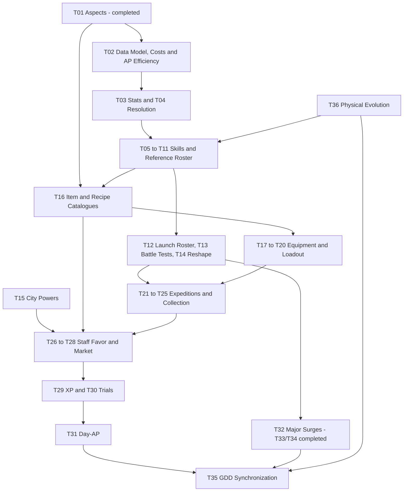

# Temporary Clarification List — Road of the Beasts

Central list of open design decisions and validation tasks from the three GDDs. The order below is a proposed work sequence, not a new game rule. **Work only in `docs/` and on `docs/update_gdd`.**

## Usage

- The GDDs describe the current working state; existing proposals and numbers are **not automatically approved** by moving open tasks here.
- Open questions, alternatives and review tasks are maintained exclusively here. The GDDs hold the current design, including labelled content drafts and prototype deviations needed to distinguish it from historical implementations. Use Git history to trace changes; do not maintain changelogs in the GDDs or this file. Keep the handoff current rather than appending a running change history.
- Complete the items listed under “Prerequisites” before deciding the topic. Independent items in the same phase may be worked on in parallel.
- **Session close:** refresh [Context Handoff](#context-handoff) after every session so another agent/computer can resume without chat history. Reusable instructions belong under [AI Prompts](#ai-prompts), not in the active task list.
- On completion: incorporate the decision into the specified GDD sections, synchronize affected companion files and check off the item here. For playtests, document measurements and results before changing rules if necessary.
- **Task fields:** every editable task carries **Status**, **Prerequisites**, **Sources**, the concrete gap/decision bullets and **Done when** (completion conditions). Status values: *Open* (no decision yet), *Partly drafted/decided* (working draft or partial decision exists, not validated), *Blocked* (named prerequisite or user decision missing). Completed tasks move to [Completed Tasks](#completed-tasks-ids-retained-for-references) with their IDs retained; IDs are never reused for other topics. Validation tasks close only with tests actually performed and documented.
- **D** = design decision, **V** = validation/balance, **K** = consistency correction. Sources refer to the current GDD section numbers unless explicitly labelled historical.
- **Central skill specification:** [Monsters chapter 4](gdd_monsters.md#4-skills). It defines the kit, construction kit, schema, validation, access and slot development. Battle describes generic runtime/board resolution; Overworld only meta integration, economy and its own tamer/loadout content. Do not maintain parallel monster-skill price lists or upgrade rules. Historical statements are not active specifications.

# Context Handoff

**Last updated: 2026-11-08.** Read this section when changing agents or computers; do not rely on earlier chat history. **Update it at the end of every session**, replacing stale context rather than appending a log. Keep rules and prices in their owning GDDs.

## Current State and Immediate Next Step

- **Focus:** the full review of all three GDDs against this backlog was run on 2026-11-08. The backlog now carries a status and completion conditions per task, a recommended work order, the new task T36, and new findings in T02/T03/T10/T11/T13/T18/T20/T24/T35. Completed tasks (T01/T33/T34) moved to [Completed Tasks](#completed-tasks-ids-retained-for-references). **No GDD was changed and no gameplay decision was made.**
- **Next action (ask the user, in this order):**
  1. The post-collapse end state (Rubble, hazard ground such as Blight, or another outcome) — T04 / [Monsters §4.3](gdd_monsters.md#43-skill-execution-profiles). It is **undecided**: Rubble was only recommended in chat, and no current file documents a later approval.
  2. Whether physical evolution exists and what it does — T36 (new gap; T05 depends on it).
  3. Then resume the T02 sequence: Surge cross-check → same-AP development paths (Run, Slowing Zone, Surge with ground effect, Jab) → shared EP economy (T05).
  Small independent decision: the Ambitious Standing comparison (T26).
- **Blockers:** user decisions above; T13 has no executed tests and the documented Godot build is the historical v6.0 ruleset.
- **Git state observed at session end:** branch `docs/update_gdd`, HEAD `116494b`, three commits ahead of its remote-tracking branch (local observation, not a freshness guarantee). `CLAUDE.md` and `docs/temp_todo.md` were already modified before this session (user work, preserved); this session edited only `docs/temp_todo.md`. No commits, pulls, pushes, resets or branch changes. Recheck Git on every machine.
- **Checks actually performed:** all three GDDs and this file read in full; every relative link and anchor in the four files checked by script (0 broken); recomputed by script or by hand: all 66 Strike construction totals, the calibration examples, the 1-AP Surge subtotals (23/27, 25/30, 27/33), movement/self-buff totals, the nine reference individuals (each 31 points, inside their frames), the stage-scaled frame ranges (see T03 findings) and the Core frame totals. **Not performed:** any gameplay, balance, XP or engine test; arithmetic agreement is not validation.

## Decisions Versus Drafts

| Class | Content (owner section holds the details) |
|-------|-------------------------------------------|
| Confirmed | No fixed aspects, triangle or Attunement ([T01](#completed-tasks-ids-retained-for-references)); one shared skill model with designer-authored skills and upgrades, no free player construction; shared upper-bound budget without ratings, minimums or random budgets; **no combination surcharges**; permanent slot development in a shared EP pool with pill-based replacement that keeps slot progress; full development at the original AP, no direct-damage/AP-reduction/cast-range upgrades ([Monsters §4.5](gdd_monsters.md#45-construction-points-and-ap-efficiency)/[§4.6](gdd_monsters.md#46-slot-levels-development-replacement-and-upgrades)); Staff model B and the Favor + Standing model (numbers open); HP persistence and free retreat with loot on expeditions (working state, do not reopen without cause) |
| Selected working values (unvalidated) | Ceilings 24/30/36 for slot levels 1/2/3; AP efficiency 12/6/3/1/0; damage factor ×2 with 50% only for telegraphed, avoidable Surge damage; Run's 6-point movement component; day-AP proposal 3/4/4/5/5/6 |
| Designer drafts (not user-approved prices) | Delayed hazard residue at 1 point/cell (the direction “cheaper, no combination costs” was approved, not this exact price); other movement packages; Spirit/Swarm/Ancient Strike components; self-buff/passive, zone/protection/healing and ground/board price packages; the scoped delayed-push rate; conditional-outcome costing |
| Open | Everything in the task list; notably the collapse end state, prop redesign, effect caps/stacking, EP economy, physical evolution, air/2×2, tamer/loadout contracts |

- **Basic Surges stay at 1 Battle-AP including their intended ground effect.** Do not raise everything to 2 AP: movement already costs 2 and the initial AP stat is 2, which would impoverish action choices. Resolve budget conflicts by calibration, not by silent price, AP or damage changes.
- Strike still deals 2 HP damage per monster hit; numbers in cost columns are construction points. Hit multiplication for 2×2 stays open and is not introduced implicitly.

## Working Practices

- Rules in [CLAUDE.md](../CLAUDE.md) apply (branch, `docs/` only, language, no unrequested Git actions). Draft related cost proposals together and mark new numbers as drafts; this authorizes no fundamental gameplay change.
- [Monsters §4.5](gdd_monsters.md#45-construction-points-and-ap-efficiency) is already consolidated; do not expand it with repetition. Monsters chapter 4 is the single skill source; do not re-plan the consolidation.
- All monster skills, including passives, self-buffs and signatures, use the same 14 field groups ([§4.2](gdd_monsters.md#42-data-oriented-skill-construction-kit)): no custom/`unique` structure, no global `affects_ground`/`affects_air` inputs, no 0-AP active passives. Representability or pricing is not content approval.
- Editorial presentation (compact thematic lists, general rules by effect/skill class rather than named lists) is complete as a presentation change; it did not complete T02/T05/T13 or any validation. Change history lives in Git.

# Open Tasks

## Recommended Work Order (2026-11-08 review)

The order is a proposal, not a rule. Statuses and prerequisites below are authoritative per task.

| Step | Work | Tasks | Reason |
|------|------|-------|--------|
| 1 | Decide the post-collapse end state with the user | T04 (part) | Unblocks the height-capable Surge price in T02 and the combined-order work in T04/T07 |
| 2 | Finish the Surge cross-check, then draft same-AP development paths (Run, Slowing Zone, Surge with ground effect, Jab) | T02 | Established sequence; do not reopen budget/AP/damage principles |
| 3 | Decide whether and how physical evolution exists, then draft the shared EP economy | T36 → T05 | T05 cannot price a pool whose physical half is undefined |
| 4 | Editorial and consistency corrections that need no gameplay decision | T03 (K findings), T06 naming, T13 wording | Can run in parallel; report each fix |
| 5 | Remaining resolution contracts | T04, T07, T08, T09 | Prerequisites for T10–T13 |
| Parallel | City powers and non-battle catalogues | T15, T16 (non-battle part) | Independent of monster-skill work |
| Parallel | Ambitious Standing comparison | T26 (user decision) | Small, independent decision |
| Later | Skills/roster, battle tests, then meta numbers | T10–T14, T17–T35 | Follow the prerequisites in each task |

## Phase 1 — Clarify Foundations and Conflicting Rules

### [ ] T02 · Complete the Data Model, Point Calculation and AP Efficiency (D/K)
**Status:** Partly drafted — calculation drafts in Monsters §4.5/§4.7 are documented but unvalidated; the height-capable Surge part is blocked by the T04 collapse/ground end-state decision.
**Prerequisites:** T01.
**Sources:** Monsters [§4.1](gdd_monsters.md#41-the-kit)–[§4.7](gdd_monsters.md#47-complete-references-and-validation); Battle [§2.3](gdd_battle.md#23-action-points)/[§5.1](gdd_battle.md#51-monster-skills-central-specification); [Overworld §6.3.2](gdd_overworld.md#632-permanent-skill-slot-development-confirmed).

**Drafted and documented:**
- Shared model for all monster skills, central profiles/contracts and six references; no parallel skill sources or custom special structures. Designer-authored skills/upgrade choices instead of player construction.
- Shared budget ceilings 24/30/36, AP efficiency 12/6/3/1/0, damage factor 2 and 50% exclusively for telegraphed, avoidable Surge damage as selected working drafts. **No combination surcharges.**
- Draft tables for all Strikes/movement profiles, self/passive, zones/protection/healing and ground/board. Six references with initial totals, not yet full content/balance validation. Maintain prices only in [Monsters §4.5](gdd_monsters.md#45-construction-points-and-ap-efficiency), not duplicated here.
- Surge residue = delayed ground change; concrete profiles retain their authored ground types. New designer test price of 1 point/square for delayed hazard residue (immediate Field 4/square); basic Surges should be possible at 1 AP including ground effects.

**Still to do:**
- Complete the scoped [1-AP Surge comparison](gdd_monsters.md#basic-surge-profile-cross-check): the profile-specific delayed-push test rate resolves the scoped two-cell displacement conflict, pending validation. Conditional-outcome costing is drafted, but the height-changing profile needs an explicit collapse/ground final-state decision (T04) before applying it; its priced subset remains over the base ceiling. Special prop reactions remain unpriced; runtime order stays T04/T07 and unsupported spatial cases T09. No implicit defaults or automatic skill approval.
- Resolve budget conflicts for large Strikes, healing and complex Surges specifically, without automatically changing budgets/AP/damage or introducing separate skill-type pools. No double-charging for area/flags/sources.
- Draft complete development paths at original AP, especially Jab; larger shapes retain existing AP until a new decision. No direct damage, AP-reduction or cast-range upgrades. Then T05/EP.
- Complete missing footprints/anchors/orientations, visibility/target validity, effect values/caps, triggers/end conditions and interaction order. Explicitly define self/passive stacking, source groups, death/removal and repetition/recursion. The self-buff reference remains a draft; no new mechanic is authorized solely by a schema field.
- Review combinations and repetition as balance/contract questions, **not as an additional price category**. Include props, healing, air and 2×2 under T04/T07–T09. Validate numbers only through suitable tests; T13 remains open.
- *New (2026-11-08 review):* no rounding rule exists for fractional point totals (e.g. the 3-round Slow zone calculation of 27.5 in [§4.5](gdd_monsters.md#calibration-examples)); decide or avoid fractions. Documented calibration conflicts above the 24/30/36 ceilings (large Strikes, mend zone, longer Slow zone, height-capable Surge) stay conflicts until decided; all arithmetic in §4.5 was recomputed in this review and is consistent, which is not balance validation.
- **Done when:** (a) the T04 collapse/ground end state is applied and the scoped [1-AP Surge comparison](gdd_monsters.md#basic-surge-profile-cross-check) is re-run without unresolved profile gaps; (b) each budget/calibration conflict is either resolved by an explicit user decision or documented as an accepted content restriction, with no hidden price, budget, AP or damage change; (c) same-AP development paths for Run, the Slowing Zone, a Surge with intended ground effect and Beast Jab are drafted and reviewed; (d) the footprint/anchor/orientation, effect-value, trigger, stacking and fractional-point contracts are decided or explicitly handed to T04/T07/T09; (e) [§4.5](gdd_monsters.md#45-construction-points-and-ap-efficiency)/[§4.7](gdd_monsters.md#47-complete-references-and-validation) are recalculated. Balance approval stays with T13.

### [ ] T03 · Review Stat Budgets, Frames and Progression Limits (V/K)
**Status:** Open — consistency findings confirmed by the 2026-11-08 review (see bullets marked *new*); no frame/budget playtests run.
**Prerequisites:** T02.
**Sources:** Monsters [§2.1](gdd_monsters.md#21-the-stats)–[§2.3](gdd_monsters.md#23-stat-ceilings-per-stage), [§7.4](gdd_monsters.md#74-monster-progression-the-18-steps); Overworld [§1.2](gdd_overworld.md#12-design-pillars), [§2.4](gdd_overworld.md#24-cultivation-loop).
- Check prices, budgets and all scaled frames; Reach costs 3 points per level and now affects all casts. Test Reach-2 individuals against current Surge footprints and Reach ceilings (the former “old Surge radius 3” reference no longer appears in any GDD).
- Init on roll: 1 point = 1.0; on level-up: 0.1. Equal points received do not necessarily mean equal resulting strength; compare freshly rolled and raised individuals.
- Unify Stage versus exact sub-tier as the monster cap ([Monsters §7.4](gdd_monsters.md#74-monster-progression-the-18-steps) names the step, other texts only the Stage).
- Some Overworld texts still limit spent points by the frame; the monster GDD limits only the roll by the frame.
- Step-only monsters: explicitly resolve random Movement points versus “stays at frame minimum”.
- *New (K):* the stage-scaling text in [Monsters §2.2](gdd_monsters.md#22-frame-budget-level-ups) says Reach scales with *stage ceiling ÷ Core ceiling*, but the all-stages table is reproduced only with a ratio of (ceiling − 1) ÷ (Core ceiling − 1) and round-half-up (e.g. Reach 2 becomes 3 at Soul+); the literal text gives Reach 2 and lowers the Soul+ ranges by up to 3 points. Rounding is unspecified. Fix either the rule text or the table.
- *New (K):* the “unspent points” note lists only Qi Anvil; by the table maxima Balanced and Fragile (max 20 against Qi High 21) also leave 1 point unspent at Qi High.
- *New (D/K):* “TPR 2+ frames cap AP at 2” versus “TPR 2+ caps AP at 3”: clarify whether a TPR 2 body may spend level-up points on AP 3 from Core.
- **Done when:** each finding above is resolved in its owning section (Monsters §2.2/§2.3/§7.4, Overworld §1.2/§2.6) or consciously deferred; the V part closes only after documented frame/price/budget/ceiling tests (shared with T13).

### [ ] T04 · Make Resolution Rules and Edge Cases Consistent (D/K)
**Status:** Open — **user decision pending:** end state after a height collapse (Rubble versus hazard ground such as Blight, or another outcome). Rubble was only a chat recommendation and is not approved; current files document no later explicit approval.
**Prerequisites:** T01, T02.
**Sources:** Battle [§2.2](gdd_battle.md#22-initiative-rules), [§4.1](gdd_battle.md#41-battlefield-generation), [§4.4](gdd_battle.md#44-square-data-model), [§4.8](gdd_battle.md#48-no-attunement), [§4.10](gdd_battle.md#410-damage-shatter--prop-types), [§6.1](gdd_battle.md#61-the-damage-law)–[§6.3](gdd_battle.md#63-collision-fall--debris); [Monsters §5](gdd_monsters.md#5-passives).
- Collision: the damage law includes monster collisions, but the detailed rule says no damage. Cross-check Crashlander. Check Shockwave's existing +1 collision bonus against the fixed event-damage law; no exception has been approved.
- Define the resolution order for Surge damage/residue/displacement and Strike damage/displacement; explicitly define Pull ties and behaviour when the anchor is already occupied. Preserve each source's explicit permissions.
- Protection sources: define stacking, order and consumption when damage is reduced to 0; distinguish passive-, zone- and ground-based protection sources without transferring permissions between them. Coordinate tamer exceptions with T20.
- Combined board operations: define the order of Collapse, Debris, Residue and Cleanse. For Rift on Elevated, explicitly decide whether collapse leaves Rubble or subsequent Blight replaces it; current wording does not establish mutually exclusive outcomes. Specify Relocate distance, path, legal targets and reactions. Do not derive free defaults from data-field order.
- T01 removes the Attunement/Elevated conflict; check remaining combinations of height and concrete ground types.
- Zone values without Attunement: keep hard caps for Slow (2) and Push/Pull (1) consistent with level scaling.
- **Prop revision:** shared impact/reaction contracts; define broadly destructible props and concrete exceptions/resistances. Destruction type determines splinter/fall effects and residue instead of identical Shatter every time. A tree may split; initially use falling effects plus ground/visual residue, not separately movable halves. Predict fall direction, hit squares, damage and resulting state deterministically. Impact categories, prop catalogue, HP/damage matrix, chain reactions and event order remain open. Existing numbers are interim, with no new blanket hit permissions. For pricing, ordinary prop damage is provisionally a shared baseline without surcharge ([Monsters §4.5](gdd_monsters.md#45-construction-points-and-ap-efficiency)); review special advantages and costs after the redesign.
- Sigil is enterable; the prop rule says “the prop takes damage, not the monster there”. Define hit order for monsters on field props.
- Clarify target validity on resolution: moved, fallen or removed unit/prop targets and placements that have become invalid. No implicit tracking, retargeting or invented cancellation/refund defaults. Define simultaneous events and expiry/trigger order deterministically.
- Specify Surge behaviour with multiple turns per round, changed initiative or a dead caster: “next caster turn” does not guarantee everyone else acts first.
- Define deterministic ties for Voidscar selection, Push/Pull destinations and free dodge squares.
- Check point-symmetric generation against odd prop counts; define legal central single objects for each board size.
- **Done when:** the user's end-state decision is recorded in [Monsters §4.3](gdd_monsters.md#43-skill-execution-profiles) and Battle §4.7/§4.9; every contract listed above has a deterministic rule in Battle §2.4/§4/§6 with the Monsters §4.4 interfaces updated; the interim prop rules are replaced or explicitly kept; no resolved item still carries a T04 marker in the GDDs.

## Phase 2 — Skills, Development and Monster Identity

### [ ] T05 · Complete Skill Improvements (D)
**Status:** Partly decided — principles confirmed (shared EP pool, pill-based replacement, no damage/AP/range upgrades); EP supply, prices, unlocks and respec rules open. Needs T02 and T36.
**Prerequisites:** T02; T36 (what physical evolution is) for the shared-pool pricing.
**Sources:** [Monsters §4.6](gdd_monsters.md#46-slot-levels-development-replacement-and-upgrades) (slot development), [§7.2](gdd_monsters.md#72-monster-rarity)/[§7.4](gdd_monsters.md#74-monster-progression-the-18-steps) (EP/progression draft); [Overworld §6.3.2](gdd_overworld.md#632-permanent-skill-slot-development-confirmed) (integration).
- **Decided:** permanent skill-slot development is an additional evolution option for the individual monster. Physical evolution and slot development use the same EP pool. A paid slot-development step directly grants a designer-authored, skill-dependent upgrade choice; no additional player point currency.
- **Decided:** replacing a skill from the unlocked species learnlist outside expeditions costs a valuable relearning pill instead of EP. Slot development is preserved; suitable upgrades for the new skill are reselected within the existing development extent. No free re-slotting or EP-paid swap path.
- **Next step:** draft a shared EP budget and prices for physical evolution and slot development. Old awards of 1 EP for Normal/Rare or 2 EP for Epic/Legendary are unvalidated; Normal would currently have only 2 EP in total. Check target investments across multiple slots and competition with physical development.
- **Decided:** slot levels 1–3 with increasing budget ceilings, no skill ratings. Define EP prices, unlocks and possible intermediate development within these levels; do not assume another rank hierarchy.
- **Decided:** retain small fixed damage values. Slot upgrades do not increase direct damage, lower AP costs or increase cast range. Allowed improvement types: area, shape/orientation, duration, movement/displacement and explicitly designed additional effects, each with skill-dependent limits. Still check total impact through more targets or triggers.
- Design enough upgrade choices visible in advance, prerequisites, exclusions and caps for every skill; examine Shape, Size, Twist and Small value as candidates. Do not reintroduce removed legacy swap paths; replacement remains pill-based.
- Clarify how to handle slots with different numbers of legal upgrade offers, passive/passive-only slots and active/passive replacement. Do not lose slot investment on replacement.
- Still open: cost of reselecting existing upgrades of the same skill, refunding EP investments and possible transfers between slots. Pill costs for upgrade respec are only a recommendation, not a decision.
- Specify the relearning pill: coordinate reliable acquisition, recipe, tier, price and day-AP with T16/T30/T31; deliberate replacement rather than constant rebuilding, without permanently penalizing experimentation.
- Distinguish generic Size maximum 4 from Strike shapes of up to 8 squares. Old conflicting Shape prices are obsolete; define concrete upgrade offers and EP step prices in the shared model.
- **Done when:** EP supply (including the Normal rarity), step prices, unlocks, upgrade offers per reference skill, passive-slot and active/passive replacement rules, same-skill respec/refund/transfer decisions and the relearning pill's acquisition path are decided; [Monsters §4.6/§7.2/§7.4](gdd_monsters.md#46-slot-levels-development-replacement-and-upgrades) and [Overworld §6.3.2](gdd_overworld.md#632-permanent-skill-slot-development-confirmed) are synchronized.

### [ ] T36 · Define Physical Evolution (D)
**Status:** Open — new task from the 2026-11-08 review; user decision needed before T05 can price a shared EP pool.
**Prerequisites:** none; T02 helps. T05 depends on it.
**Sources:** [Monsters §1.1](gdd_monsters.md#11-species-and-individual), [§4.6](gdd_monsters.md#46-slot-levels-development-replacement-and-upgrades), [§7.2](gdd_monsters.md#72-monster-rarity), [§7.4](gdd_monsters.md#74-monster-progression-the-18-steps); Overworld [§2.6](gdd_overworld.md#26-action-catalog), [§6.3](gdd_overworld.md#63-stage-unlock-table), [§8](gdd_overworld.md#8-technical-notes-overworld--development-phases).
- **Gap:** all three GDDs refer to “physical evolution” (shared EP pool, “physical evolution picks” in the save record, “Take back physical evolutions”, “physical Size path” at Core, “Paths offered per evolution 2/3/3/all”), but no section defines what physical evolutions are or offer. Size, Shape, Twist and Small value in §4.6 are skill-slot upgrade families; the prototype Evolution Pillar “has no Size path” is historical.
- **Decide with the user (nothing assumed):** does physical evolution still exist as a mechanic; what it changes (stats, body size such as 2×2, kit, other); how it relates to stat points, the Foundation/Core gates, the Evolution Pillar and the take-back action (prototype: 1 AP + 4 materials); what the “paths offered” and EP-per-step columns mean afterwards.
- **Done when:** the user decides whether physical evolution exists; if so it is defined once in Monsters §7 (options, EP role, reversal) and the wording in all three GDDs and the take-back action is synchronized; if not, the wording and the shared-pool language are removed and T05 is adjusted.

### [ ] T06 · Complete Strike Shapes and Kin Effects (D/V)
**Status:** Open.
**Prerequisites:** T02, T03, T05.
**Sources:** [Monsters §3.2](gdd_monsters.md#32-strike-by-kin).
- Only Jab before Core: do interesting shapes arrive too late? Storm/5-AP shapes only reach late TPR-1 builds.
- Test Whirl (4 squares) against Arc (3) at the same battle AP (3; their construction prices in §4.5 differ), and the value of Thrust's range. Naming is resolved: only “Thrust” remains in the GDDs.
- Beast Bite: give it its own effect without violating the damage ceiling, or deliberately accept the lack of an effect.
- **Done when:** every Kin's Strike shape access across the AP/stage gates and the Beast Bite effect question are decided, the Whirl/Arc/Thrust checks are documented, and [§3.2](gdd_monsters.md#32-strike-by-kin) and the §4.5 Strike table agree.

### [ ] T07 · Align Ground Interactions and Healing (D/V)
**Status:** Open — ordering questions wait for T04.
**Prerequisites:** T01, T02, T04.
**Sources:** Battle [§4.6](gdd_battle.md#46-zones-effects-rules--opposites)–[§4.8](gdd_battle.md#48-no-attunement); Monsters [§4.2](gdd_monsters.md#42-data-oriented-skill-construction-kit), [§4.4](gdd_monsters.md#44-effect-and-board-operation-contracts)–[§4.5](gdd_monsters.md#45-construction-points-and-ap-efficiency).
- Permanent residue: does the board fill too quickly, making start-turn hazard placement overpowered?
- Measure hazard coverage on 7×7 by round 5. If needed, examine Field at 2 AP or a maximum of N Field squares per monster as alternatives.
- Without the triangle, define whether and how zones change existing ground; do not infer automatic superiority from monster themes.
- T01 removes Attunement and painting snowball. Instead review counters to permanent hazard ground and their accessibility.
- Blessing: is 2 AP appropriate for 3–4 permanent squares? Limit Mossbed per turn?
- Zone `mend` (formerly “Boon”): check healing at HP 1–10; may zone level increase healing, or does it stay fixed at 1? Explicitly define the numerical healing cap and Mossbed re-entry/per-turn limit; persistence grants no additional healing triggers.
- Evaluate level-II residue as a concrete extension; the former name “Deep Residue” and +1 AP are not confirmed universal rules.
- **Done when:** the zone × ground rule is decided or explicitly deferred, the healing cap, `mend` scaling and Mossbed loop limits are decided, and hazard coverage is measured (with T13).

### [ ] T08 · Define Water and Swim (D)
**Status:** Open — water origin and Swim access undecided.
**Prerequisites:** T02, T07.
**Sources:** Battle [§4.7](gdd_battle.md#47-ground--neutral-hazard-and-blessed), [§5.1](gdd_battle.md#51-monster-skills-central-specification) (integration); Monsters [§3.3](gdd_monsters.md#33-movement-by-kin), [§4.3](gdd_monsters.md#43-skill-execution-profiles) (movement profiles).
- Where does water originate: generator only, or skills too? May generated hazard/blessed ground replace water?
- Which Kins receive Swim? Check its cost profile and flag exceptions against the general movement table.
- **Done when:** Water origin and Swim access are decided in Battle §4.7 and Monsters §3.3/§4.3, and the Swim price row is confirmed or removed.

### [ ] T09 · Specify the Air Layer and 2×2 Rules (D/K)
**Status:** Open — blocks Winged air content, 2×2 content and Beast Swap.
**Prerequisites:** T02, T04, T06, T07.
**Sources:** Battle [§4.3](gdd_battle.md#43-the-square-stack-zones--ground), [§5.1](gdd_battle.md#51-monster-skills-central-specification) (integration); Monsters [§3.1](gdd_monsters.md#31-kin-table), [§4.2](gdd_monsters.md#42-data-oriented-skill-construction-kit), [§4.3](gdd_monsters.md#43-skill-execution-profiles), [§4.4](gdd_monsters.md#44-effect-and-board-operation-contracts), [§4.7](gdd_monsters.md#47-complete-references-and-validation).
- Which effects besides Strike may have air recipients? Define layers per effect, not as a global `affects_air` authoring flag. Ensure at least sufficiently readable counters to Winged from Soul onward.
- Specify flight movement, occupancy and interaction with props/ground. For 2×2, also define distance origin, area overlap, recipient deduplication and entry/exit evaluation across multiple squares; the generic area model does not decide these cases.
- Additional analysis finding: 2×2 is announced, but area hits, damage multiplication, placement, movement and displacement are insufficiently defined. Occupying multiple squares must not create an implicit multiple-damage rule.
- **Done when:** air-layer and 2×2 contracts are specified in Battle §4.3 and Monsters §4.2–§4.4, or air/2×2 content is explicitly gated as deferred.

### [ ] T10 · Build Concrete Skills in the Shared Schema (D)
**Status:** Open — blocked until T05–T09 are decided.
**Prerequisites:** T05–T09.
**Sources:** Monsters [§4.2](gdd_monsters.md#42-data-oriented-skill-construction-kit)–[§4.7](gdd_monsters.md#47-complete-references-and-validation).
- Create concrete skills exclusively in the shared schema [§4.2](gdd_monsters.md#42-data-oriented-skill-construction-kit) and validate under [§4.7](gdd_monsters.md#47-complete-references-and-validation); no new parallel blueprint/example table. Fully define effects, triggers, targeting, footprints, interactions, costs and authorized upgrade patches.
- Species-exclusive and Signature skills use the same schema; express differences through access, authorship and explicit rules. Earlier named ideas are not promised content. Select concrete skills and sufficiently deep upgrade choices only after budgets are confirmed.
- *New:* the reference roster ([Monsters §6.1](gdd_monsters.md#61-first-roster-draft--9-monsters)) names utility and prop skills (e.g. Lava Field, Shockwave, Raise Wall, Raise Ground, Bark Veil, Mire, Void Pull, Gale, Shade Veil, Thornbed) that have no central definition; each needs a complete record or removal. The same applies to Sanctify, Shove and Relocate mentioned in the Kin tables.
- **Done when:** the first concrete skills are complete records under [§4.2](gdd_monsters.md#42-data-oriented-skill-construction-kit)/[§4.7](gdd_monsters.md#47-complete-references-and-validation) with upgrade choices, fit the confirmed ceilings and carry no unresolved contract.

### [ ] T11 · Revise Learnlists, Passives and Reference Roster (D)
**Status:** Open — blocked by T03, T06, T10.
**Prerequisites:** T03, T06, T10.
**Sources:** Monsters [§4.1](gdd_monsters.md#41-the-kit), [§5](gdd_monsters.md#5-passives), [§6.1](gdd_monsters.md#61-first-roster-draft--9-monsters), [§7.4](gdd_monsters.md#74-monster-progression-the-18-steps).
- Define learnable skills (current target roughly 8) and available passives for each species: distinguish species binding from individual binding; free themes are not an additional learning restriction. Revise or remove formerly aspect-dependent passives.
- The nine reference monsters currently have four active skills plus passives; reduce to four shared slots and handle the Epic+ additional slot separately.
- Give every species a Species Twist instead of the shared placeholder, plus a concrete Strike shape and fixed Surge orientation.
- Check roster descriptions of weaker Surge variants against current damage and AP rules; descriptive wording grants no damage exception.
- *New:* the Berserker frame text says it “escalates one Surge with Empower”, but no section defines Empower; define it through the shared model or remove the wording.
- **Done when:** learnlists and passives for the reference species are decided with legal 4-slot kits, each species has a one-sentence identity, and legacy passives and undefined names (see bullets) are redefined or removed.

### [ ] T12 · Select the Launch Roster (D)
**Status:** Open — blocked by T11.
**Prerequisites:** T11.
**Sources:** Monsters [§6.1](gdd_monsters.md#61-first-roster-draft--9-monsters)–[§6.2](gdd_monsters.md#62-additional-species-candidates).
- Without a mandatory Kin×aspect matrix, select a diverse roster from the nine reference monsters and additional name ideas (previous target about 15); prioritize free themes and distinct playstyles over category completeness.
- Check missing blueprint/movement coverage and distinct one-sentence identities.
- **Done when:** the launch roster is recorded in [Monsters §6](gdd_monsters.md#6-roster) with a documented coverage and identity review.

## Phase 3 — Validate Battle Before the Meta Fixes Numbers

### [ ] T13 · Plan and Evaluate Battle Tests with the Revised Rules (V)
**Status:** Open — blocked; **no battle tests have been run** and the documented Godot build is the historical v6.0 ruleset, not the current design.
**Prerequisites:** T04, T07, T11; T08/T09 for water/Soul tests.
**Sources:** [Battle §7.2](gdd_battle.md#72-prototype--playtests); historical Battle §8; [Monsters §2.2](gdd_monsters.md#22-frame-budget-level-ups), historical Monsters §8.
- First ensure that the tested build implements the draft under examination: the documented Godot baseline is the historical battle v6.0 ruleset, not the current GDD design. Code changes are outside this documentation task.
- Residue: do Surges indirectly hit even when dodged, or force meaningful routes?
- Readable combos: Current → Surge/Lava, Pull → Strike; check Pull anchors and push direction.
- Strike from 2 AP: worthwhile or unused, melee too sticky?
- Check no-cooldown spam and repeated protection-zone casting (two 1-AP casts → level II, Shield 3). Fallback: level-up only once per turn and square.
- Test zone-based Surge reduction 2, level/Attunement and Surge damage 3 for genuine counters. Attunement is a historical test reference, removed by T01; do not reintroduce it.
- Check movement prices, Step-only viability and Movement cap 5.
- Three Surge types against Elevated; props as tactical resources rather than obstacles.
- 3v3/7×7: readability, round count, Collapse share and starting distances; test Reach 4 + Elevated = 5 against the promise of a safe opening.
- Test first-Surge-claims-square and initiative chains/focus fire. Fallback if dominant: make initiative more expensive.
- Compare Dusk Moth (historical 87% simulation win rate) with humans and AI; examine Native Ground/Wide/Blight separately.
- Evaluate stat/Strike/healing tests from T03/T06/T07 together; adjust prices only based on results.
- *New (K):* [Battle §4.1](gdd_battle.md#41-battlefield-generation) states an intended “5–6-row” start separation on 7×7, but back-two-row start areas give a minimum front-line distance of 4 rows (rows 2 and 6) and a maximum of 6. Correct the wording or the start areas, then test the “no hit on the enemy line in round 1” target against Reach 3–4.
- Test the profile-specific delayed one-square push of the damage-2/Thornbed Surge profile together with the entry hazard ([Monsters §4.5](gdd_monsters.md#zone-protection-and-healing-costs)); budget fit does not validate the reduced rate, and no further automatic timing discount applies.
- **Done when:** a test plan is executed on a build that implements the drafts under test, results are documented before any rule or price change, and [Battle §7.2](gdd_battle.md#72-prototype--playtests) is updated.

### [ ] T14 · Safeguard Reshape Against Reroll Exploitation (D/V)
**Status:** Open — blocked by T03, T13.
**Prerequisites:** T03, T13.
**Sources:** [Monsters §2.2](gdd_monsters.md#22-frame-budget-level-ups); Overworld [§2.6](gdd_overworld.md#26-action-catalog), [§7.5](gdd_overworld.md#75-materials-seeds-and-grades).
- Are a rare elixir and ritual costs sufficient, or is a cap/cooldown needed against repeated optimization rolls?
- **Done when:** the elixir/ritual cost is confirmed sufficient or a cap/cooldown is decided, backed by documented T13 results.

## Phase 4 — World, Catalogues and Equipment (Partly Parallel to Phase 2/3)

### [ ] T15 · Define City Powers, Responsibilities and Content (D)
**Status:** Open — independent of battle design; can start now.
**Prerequisites:** none; may run in parallel with battle design.
**Sources:** Overworld [§3.1](gdd_overworld.md#31-the-city)–[§3.2](gdd_overworld.md#32-the-powers-of-the-city), [§7.2](gdd_overworld.md#72-favor--faction).
- Define faction names, profiles and offerings for the three families.
- Confirm operators of Arena, Teleport Plaza and Business District: proposal is City Lord, City Lord, Guild.
- Clarify buildings/access for Rival Compounds and the purpose of the Slums; Black Stall remains an optional idea, not a promised feature.
- **Done when:** faction profiles, district operators, Rival Compound access and the Slums purpose are recorded in Overworld §3.1/§3.2/§7.2.

### [ ] T16 · Complete Material, Item and Recipe Catalogues (D)
**Status:** Open — can start for non-battle products; battle-related products wait for T10.
**Prerequisites:** T01; T10 for battle-related products.
**Sources:** Overworld [§6.6](gdd_overworld.md#66-pills--medicines)–[§6.8](gdd_overworld.md#68-arrays-artifacts-for-places), [§7.5](gdd_overworld.md#75-materials-seeds-and-grades)–[§7.8](gdd_overworld.md#78-acquisition-sources).
- Derive concrete materials, herbs, seeds, recipes, seals, scrolls and blueprints from patterns; determine counts, tiers and grades.
- Reconcile the quantity assumption “four tiers/~40 pills” with six cultivation stages and missing Sovereign XP values.
- Check grade dependencies and acquisition sources against “money never buys exclusive power”; Legendary bloodline ingredients are currently described both as story-only and as boss/quest/auction rewards.
- Confirm Array recipes and the Forge route (Ore + Beast Parts); decide whether Upper Stones are currency only or also ritual materials.
- **Done when:** catalogue counts, tiers and grades are defined and the listed conflicts (pill count versus stages, Legendary sources, Upper-stone role, Array/Forge routes) are resolved in Overworld §6.6–§7.8.

### [ ] T17 · Define Artifact Rules and Stacking (D/K)
**Status:** Open — blocked by T03, T11, T16; slot-access conflict between Overworld §6.3 and §6.7 is unresolved.
**Prerequisites:** T03, T11, T16.
**Sources:** Overworld [§6.7](gdd_overworld.md#67-artifacts-equipment--socketed-passives), [§6.9](gdd_overworld.md#69-hard-caps), [§7.5](gdd_overworld.md#75-materials-seeds-and-grades); [Monsters §7.2](gdd_monsters.md#72-monster-rarity).
- Tamer: two or three slots, and when? Monster: second slot at Epic+, or additionally only from Core? Synchronize tables.
- Clarify passive OR stat modifier versus the schema “passive + small stat modifier”; limit duplicate passives and multiple artifacts.
- Check +1 AP/day, capacity and skill modifiers against day economy, Stage caps and the options-not-numbers rule.
- **Done when:** slot counts and unlock timing, the passive-versus-stat rule and stacking limits are decided and Overworld §6.3/§6.7/§6.9 agree.

### [ ] T18 · Specify Medicines and Arrays (D)
**Status:** Open — blocked by T07, T10, T16.
**Prerequisites:** T07, T10, T16.
**Sources:** Overworld [§6.6](gdd_overworld.md#66-pills--medicines), [§6.8](gdd_overworld.md#68-arrays-artifacts-for-places), [§7.5](gdd_overworld.md#75-materials-seeds-and-grades)–[§7.6](gdd_overworld.md#76-item-schema).
- Determine Medicine effects, recipes, item kind and distinction from pills. Protection/healing/board effects need their own source, consumption and timing contracts in the shared data model; monster-effect contracts do not automatically approve items.
- Which Arrays are consumable, and which reusable? Define durability, placement and battle effects.
- Confirm pre-battle Arrays as a limited exception to a neutral/point-symmetric start; review the four existing Array drafts.
- *New:* the battle-prep pills Swift (+1 initiative next battle) and Ward (first-hit immunity next battle) in [Overworld §7.5](gdd_overworld.md#75-materials-seeds-and-grades) are neither medicines nor arrays; decide their item treatment, timing and effect contract. “Immunity” sits against the shared protection model (reduction, no generic immunity) in [Monsters §4.4](gdd_monsters.md#44-effect-and-board-operation-contracts); Warding Array (“first Surge damage −1”) and Spirit Shield (“next Surge damage is 0”) use different wording again. Also reconcile “pre-battle modifiers (pills, arrays)” in the Battle request ([Overworld §8](gdd_overworld.md#8-technical-notes-overworld--development-phases)) with the loadout categories.
- **Done when:** Medicine/Array item kinds, effects, recipes, consumption and timing contracts are specified in the shared model, and the Swift/Ward pill classification is decided.

### [ ] T19 · Complete Battle Loadout and Timing (D)
**Status:** Open — blocked by T18 (item effects/costs first, then loadout limits).
**Prerequisites:** T18.
**Sources:** [Battle §5.2](gdd_battle.md#52-tamer-skills-and-battle-loadout) (integration); Overworld [§2.1](gdd_overworld.md#21-battle-loop), [§7.9](gdd_overworld.md#79-inventory-and-loadout), [§8](gdd_overworld.md#8-technical-notes-overworld--development-phases).
- Define Medicine/Array counts, activation windows (own turn or anytime), AP costs and consumption.
- Apply the same rules to human opponents; specify visibility, preview, pre-battle locking and reporting consumed items in BattleResult.
- Dependency is directional: item effects/costs first, then loadout limits; do not let them block each other mutually.
- **Done when:** loadout counts, activation windows, AP costs, consumption, human-opponent visibility and BattleResult reporting are specified in Overworld §7.9/§8 and Battle §5.2.

### [ ] T20 · Validate Tamer Skills Including Beast Swap (D/V)
**Status:** Open — blocked by T09, T13, T19; tamer rows marked *proposal* are unconfirmed.
**Prerequisites:** T09, T13, T19.
**Sources:** [Overworld §6.4](gdd_overworld.md#64-tamer-skills); [Battle §5.2](gdd_battle.md#52-tamer-skills-and-battle-loadout) (integration).
- Confirm/change/reject proposed Swap Places, Urgent Order, Second Wind, Life Thread, Double Bind and Seal Mastery; T01 removed Attune. Explicitly define tamer sources in the shared effect model without transferring monster-skill permissions or AP classes.
- Test Life Thread against Spirit Shield and Urgent Order against initiative; define usage timing for free skills.
- Beast Swap: define HP, injury, queue, own charging Surges, 2×2 space requirements and replacement-entry rules.
- Scrolls teach skills earlier; Beast Swap may only be slotted from Soul: clearly distinguish learning from use and Stage gates.
- *New:* Domain Glimpse (not marked as proposal) has no specification: footprint family/orientation, range, and whether it affects Voidscar, props, Elevated or charging Surge markers. Monsters §4.4 states there is no generic cleanse of Voidscar and calls the combined zone-removal/Plain reset a tamer-source operation, but §6.4 does not exclude Voidscar. Coordinate with T04.
- **Done when:** each tamer skill is confirmed, changed or rejected, tamer sources exist in the shared effect model, and Beast Swap and Domain Glimpse rules are specified and tested against the listed interactions.

## Phase 5 — Expeditions, Collection and the Spatial World

### [ ] T21 · Define the Dungeon Node ↔ Board Generator Contract (D)
**Status:** Open — blocked by T04, T08, T12.
**Prerequisites:** T04, T08, T12.
**Sources:** [Overworld §3.3](gdd_overworld.md#33-dungeons); [Battle §4.1](gdd_battle.md#41-battlefield-generation).
- What does the node fix, and what does the generator generate? Proposal: node determines mode, theme/ground families and prop-count range; generator places everything point-symmetrically.
- Check encounter access against required team size and available healthy monsters.
- **Done when:** the node ↔ generator contract is recorded in Overworld §3.3 and Battle §4.1.

### [ ] T22 · Complete Expeditions and Loot Tables (D/V)
**Status:** Open — blocked by T16, T19, T21; HP persistence and free retreat with loot are the working state.
**Prerequisites:** T16, T19, T21.
**Sources:** Overworld [§2.2](gdd_overworld.md#22-expedition-loop), [§7.8](gdd_overworld.md#78-acquisition-sources).
- Determine floors/battles per run, deeper entry (1/2 day-AP), retreat and reward tables per floor/boss.
- HP persistence and free retreat with loot are already the working state; do not reopen them without cause. Build open edge cases on that basis.
- Clarify “Healing Pill is the only healing during a run” against Mend/Mossbed, healing passives and Second Wind: outside battles only, or also during battles?
- **Done when:** floors/battles per run, deeper entry, retreat edge cases, reward tables and the run-healing scope are decided in Overworld §2.2/§6.6/§7.8.

### [ ] T23 · Align Injury and Deadly Dungeons (D/V)
**Status:** Open — blocked by T16, T20, T22.
**Prerequisites:** T16, T20, T22.
**Sources:** Overworld [§5.2](gdd_overworld.md#52-defeat-and-injury), [§6.6](gdd_overworld.md#66-pills--medicines).
- Review two nights of downtime, Revival price and Deadly loot bonus; confirm or defer optional Deadly dungeons for launch.
- Recovery Spring already halves downtime to one night; define a minimum for the additional −1-night adjacency bonus.
- Define healing on return/overnight for uninjured monsters and HP after recovery; check Soul Tether/Life Thread against permanent loss.
- **Done when:** injury downtime, Revival price, Deadly-dungeon scope and the healing-on-return rules are decided in Overworld §5.2, with the adjacency minimum coordinated with T25.

### [ ] T24 · Specify Binding, Eggs, Breeding and Hive (D/V)
**Status:** Open — blocked by T12, T16, T20, T22.
**Prerequisites:** T12, T16, T20, T22.
**Sources:** Overworld [§5.1](gdd_overworld.md#51-obtaining-monsters), [§7.5](gdd_overworld.md#75-materials-seeds-and-grades).
- Balance seal prices/grades and the second binding; check Seal Mastery against the player Stage cap.
- Define breeding/Hive/hatching times per rarity and incubation conditions; clarify same species versus “species of one parent”.
- Make egg rarity, species visibility and timing of randomization explicit.
- *New:* eggs are not an item kind in the [item schema](gdd_overworld.md#76-item-schema) although they are found, bought and traded; decide whether eggs are items or monster-side records.
- **Done when:** seal grades, second binding, breeding/Hive/hatching times, egg visibility/randomization and egg representation are decided in Overworld §5.1.

### [ ] T25 · Internal World: Capacity, Buildings, Adjacency (D/V)
**Status:** Open — blocked by T09, T16, T23, T24; Trial Pillar access conflict confirmed.
**Prerequisites:** T09, T16, T23, T24.
**Sources:** Overworld [§4.2](gdd_overworld.md#42-building-system)–[§4.4](gdd_overworld.md#44-capacity-and-growth).
- Confirm grid/capacity curve, footprints, unlocks and new structures.
- Define housing capacity bonus, Mood/Loyalty and their concrete benefits, or remove an unnecessary system.
- Define hatching at full capacity, rented monsters and bench size.
- Trial Pillar unlocks only at Foundation but is needed to reach it; clarify access to the first breakthrough.
- Adjacency bonuses: minimum times, multiple neighbours and stacking limits; reconcile Furnace −1 AP down to 0 with “execution costs AP”.
- Staff remain excluded from the interior for now. Reconsider only for concrete benefits; no implementation merely because it is possible.
- **Done when:** grid/capacity, footprints, unlocks, Mood/Loyalty, hatching at full capacity, Trial Pillar access and adjacency limits are decided in Overworld §4.2–§4.4.

## Phase 6 — Economy, Progression and Day Balance

### [ ] T26 · Draft Staff Traits and Numbers (D/V)
**Status:** Open — **user decision pending:** Ambitious poaching Standing comparison (whose Standing, against what, which direction); model B itself is chosen.
**Prerequisites:** T15, T16.
**Sources:** [Overworld §7.1.1](gdd_overworld.md#711-staff-model-b-chosen).
- Model B is selected: visible Skill/Loyalty values plus one trait. Do not choose between models A/B/C again.
- Define trait list, wages, output, Loyalty changes, dismissal, poaching and counteroffers.
- Ambitious poaching offers: resolve the previously contradictory Standing condition in [Overworld §7.1.1](gdd_overworld.md#711-staff-model-b-chosen). Specify whose Standing is compared, the faction/reference it is compared against, and the comparison direction. No comparison condition is selected yet.
- Treat hidden Deception at most as a later scripted story idea, not for random hires.
- **Done when:** trait list, wages, output, Loyalty changes, dismissal and poaching rules are drafted, and the Ambitious comparison is decided by the user and recorded in Overworld §7.1.1.

### [ ] T27 · Align Favor/Standing and Request Pools (D/V)
**Status:** Open — blocked by T15, T16, T26; Favor + Standing model selected, numbers unvalidated.
**Prerequisites:** T15, T16, T26.
**Sources:** [Overworld §7.2](gdd_overworld.md#72-favor--faction).
- Favor + lifetime Earned Total/Standing is the selected model; test numbers, request sizes, durations and thresholds.
- Confirm the rivalry rule (Allied with one family caps the other at Trusted).
- Own family: calculate concrete progression through strength/Arena.
- Standing unlocks access, but the table additionally lists licences/recruitment/invitations as Favor expenses: distinguish access requirements from purchase prices clearly.
- Define request pools per faction and Stage, repeat limits and rewards.
- **Done when:** access requirements and purchase prices are cleanly separated, numbers/request pools/rival rule are tested or reviewed, and Overworld §7.2 has no conflicting drafts.

### [ ] T28 · Balance the Market, Properties and Businesses (D/V)
**Status:** Open — blocked by T16, T22, T26, T27 (catalogues first).
**Prerequisites:** T16, T22, T26, T27.
**Sources:** Overworld [§3.1.5](gdd_overworld.md#315-business-district), [§7.1](gdd_overworld.md#71-businesses), [§7.5](gdd_overworld.md#75-materials-seeds-and-grades)–[§7.8](gdd_overworld.md#78-acquisition-sources).
- Only after the catalogues: determine price fluctuation model, base prices, buying/selling and safeguards against endless arbitrage.
- Compare property costs, licences, facility output, queue duration, sale quantities and staff automation with dungeon income.
- Deal covers many activities: one activity per AP or several in one Deal? Distinguish free Queue from immediate Work production.
- Specify Monster Hall sales, Dojo and Dungeon Company as data configurations.
- **Done when:** the price model, arbitrage safeguards, Deal scope and business configurations are decided, with property/facility economics compared against dungeon income.

### [ ] T29 · Review XP Curves and Cultivation Pacing (V)
**Status:** Open — blocked by T05, T22, T25, T28; no XP or pacing tests run.
**Prerequisites:** T05, T22, T25, T28.
**Sources:** [Monsters §7.4](gdd_monsters.md#74-monster-progression-the-18-steps); [Overworld §2.4](gdd_overworld.md#24-cultivation-loop).
- Check the initial 18-step XP curve, pill XP, win XP, Training/Cultivate and idle XP; determine player values separately if necessary.
- Check the target of 3–6 focused days per sub-tier against farm/purchase/staff income; do not treat old prototype numbers as confirmation.
- **Done when:** the XP curve, pill XP, win XP and idle XP are checked with documented calculations/tests, not prototype numbers, and the 3–6 day pacing target is confirmed or revised.

### [ ] T30 · Complete Breakthrough Trials and Rituals (D/V)
**Status:** Open — blocked by T20, T25, T27, T29; trial draft contains confirmed conflicts.
**Prerequisites:** T20, T25, T27, T29.
**Sources:** [Overworld §6.3.1](gdd_overworld.md#631-breakthrough-trials); [Monsters §7.3](gdd_monsters.md#73-rarity-ascension).
- Check the first trial draft against prototype/game flow; confirm material quantities and pill effect.
- “Player starts at half HP”/“player on the winning team” conflicts with the non-combatant tamer role: which monster/team is meant?
- Define player/monster trials, repetition, failure costs and trial access; synchronize rarity-ascension ingredients and acquisition routes.
- **Done when:** trial requirements, player-versus-monster wording, repetition/failure costs, Trial Pillar access and rarity-ascension ingredients/site are decided in Overworld §6.3.1 and Monsters §7.3.

### [ ] T31 · Finalize Day-AP and Action Costs (D/V)
**Status:** Open — blocked by T22, T25, T28–T30; day-AP curve is a proposal only.
**Prerequisites:** T22, T25, T28–T30.
**Sources:** Overworld [§2.3](gdd_overworld.md#23-day-loop), [§2.6](gdd_overworld.md#26-action-catalog).
- Review proposed 3/4/4/5/5/6 AP per Stage and Arena price per tournament round.
- Balance expeditions, cultivation, story and work against each other; account for staff reducing the workload.
- Keep free decisions/queuing/rearranging consistent with paid execution.
- **Done when:** the day-AP curve and every action cost in [Overworld §2.6](gdd_overworld.md#26-action-catalog) are balanced against each other with documented checks.

## Phase 7 — Late Game and Completion

### [ ] T32 · Design Major Surges and Signatures (D)
**Status:** Open — blocked by T09, T12, T13.
**Prerequisites:** T09, T12, T13.
**Sources:** Monsters [§3.1](gdd_monsters.md#31-kin-table), [§4.1](gdd_monsters.md#41-the-kit) (access), [§4.2](gdd_monsters.md#42-data-oriented-skill-construction-kit), [§4.3](gdd_monsters.md#43-skill-execution-profiles) (Surge profiles), [§4.6](gdd_monsters.md#46-slot-levels-development-replacement-and-upgrades), [§7.4](gdd_monsters.md#74-monster-progression-the-18-steps); [Battle §5.1](gdd_battle.md#51-monster-skills-central-specification) (integration only).
- Determine concrete shapes, area and range; review half-board/2 AP/once per battle.
- Synchronize access for Ancient AND Legendary from Sovereign against tables sometimes saying only “Ancient”; distinguish Signatures of other Legendary Kins.
- **Done when:** Major Surge shapes/range/access and Signature access are decided and the Ancient/Legendary wording agrees in Monsters §3.1/§4.1/§7.4 and Overworld §6.3.

### [ ] T35 · Update GDD Synchronization and Implementation Plan (K)
**Status:** Open — ongoing; closes last.
**Prerequisites:** the respective affected decisions; overall completion after T01–T34 and T36.
**Sources:** all three GDDs, especially technical notes and Development Phases.
- Clearly distinguish decided rules, proposals, the existing prototype and later features.
- Synchronize tables, schema fields, section references and version states. The technical validator currently requires Surge/Utility, although open kits require neither; reconcile species passives with slot-bound learnlists.
- Update development phases based on clarified dependencies; do not mix implementation tasks with open design decisions.
- Keep change history in Git, not in the GDDs or this task list. Maintain a current handoff and preserve only prototype comparisons needed to distinguish implementation from the current design.
- *New:* keep the [Battle §7.1](gdd_battle.md#71-technical-notes-battle) legacy validator note consistent with the open kit rule; synchronize “physical Size path” wording (Overworld §6.3) after T36.
- **Done when:** all other tasks are closed or consciously deferred, tables/schema fields/references are synchronized, the development phases are updated and prototype comparisons are limited to what distinguishes implementation from design.

## Completed Tasks (IDs Retained for References)

IDs stay valid for references in the GDDs and this file; completion was verified against the current text of all three GDDs.

### [x] T01 · Confirm the Aspect System (D/V)
**Prerequisites:** none.
**Sources:** [Monsters §7.4](gdd_monsters.md#74-monster-progression-the-18-steps); Battle [§3.2](gdd_battle.md#32-monster-identity--skill-access), [§4.8](gdd_battle.md#48-no-attunement).
- **Decided:** remove the triangle and fixed monster aspects; no fixed replacement elements. Monsters receive free descriptive themes; deliberately designed species learnlists determine their allowed abilities.
- Remove Attunement. Concrete skills, ground types and Surge behaviour remain available in the construction kit, without fixed aspect binding or mandatory sets of three variants.
- Incorporated into all three GDDs. New ground interactions are addressed under T07; concrete learnlists and roster under T10–T12. This does not validate the balance of the remaining mechanics.

### [x] T33 · Legendary Aspect Change Removed (D)
**Prerequisites:** T01, T11, T30.
**Sources:** [Monsters §7.2](gdd_monsters.md#72-monster-rarity).
- Removed by T01: without fixed aspects, there is no aspect change. No replacement feature approved; other Legendary development remains part of existing progression tasks.

### [x] T34 · Dual-Aspect System Removed (D)
**Prerequisites:** T01, T09, T13.
**Sources:** [Monsters §7.4](gdd_monsters.md#74-monster-progression-the-18-steps); [Overworld §6.3](gdd_overworld.md#63-stage-unlock-table).
- Removed by T01: no dual aspects or corresponding Immortal unlock. Multiple free themes require no separate unlock or special mechanic.

## Dependency Overview



The detailed prerequisites per task are authoritative; the diagram summarizes only the main work streams.

# AI Prompts

Reusable German chat prompts and subsection titles are an explicit exception to the English documentation rule. These are instructions, not design rules or an execution log. Copy the relevant prompt into a new agent session; the agent must read current files rather than assume the prompt embeds the latest state.

## Alle GDDs prüfen und Aufgabenliste aktualisieren

```text
Analysiere alle GDDs von Road of the Beasts und aktualisiere docs/temp_todo.md passend zum aktuellen Projektstand. Verlasse dich nicht auf frühere Chatverläufe.

Sicherheit und Umfang:
- Lies CLAUDE.md. Prüfe zuerst Branch und Git-Status: nur auf docs/update_gdd arbeiten; andernfalls anhalten und nachfragen, nicht selbst wechseln.
- Erhalte Nutzeränderungen. Bearbeite für diese Prüfung ausschließlich docs/temp_todo.md; keine Spielimplementierung und keine GDD-Änderungen. Keine Commits, Branchwechsel, Pulls, Pushes, Resets oder automatische Synchronisierung.
- Chat Deutsch, Dokumentation Englisch. Ausnahme: wiederverwendbare Chat-Prompts samt Unterüberschriften unter AI Prompts bleiben Deutsch. Nutze kompakte thematische Stichpunkte und hilfreiche Übersichtstabellen; bewahre Bedingungen, Ausnahmen, Negationen, Einheiten und Entscheidungsstatus. Kein Changelog.

Lesen und analysieren:
1. Lies die gesamte aktuelle temp_todo.md, besonders Context Handoff, danach alle drei GDDs vollständig: docs/gdd_battle.md, docs/gdd_monsters.md und docs/gdd_overworld.md. Große Dateien abschnittsweise lesen; eine Gliederungsübersicht allein ist keine vollständige Prüfung.
2. Gleiche jede vorhandene Aufgabe mit den zuständigen GDD-Abschnitten ab: noch offen, teilweise bearbeitet, nachweislich abgeschlossen, ersetzt, doppelt oder blockiert. Bestehende Aufgabenformulierungen und Arbeitswerte sind nicht automatisch Beschlüsse; GDD-Texte sind nicht automatisch validiert.
3. Prüfe fehlende Regeln, Widersprüche, offene Alternativen, Zuständigkeiten, doppelte Definitionen, veraltete Verweise, Sprache/Lesbarkeit, quellenspezifische Ausnahmen und den Status als Entwurf/Beschluss/Historie. Prüfe gegebenenfalls Rechensummen; Rechenproben und Prototypergebnisse sind keine Gameplay-/Balancevalidierung.
4. Entscheide keine offenen Gameplayvarianten, erfinde keine Standardannahmen und öffne bestätigte Prinzipien nicht ohne neuen Anlass. Der Endzustand Rubble oder Gefahrenboden nach einem Höhenbruch ist offen, sofern die aktuellen Dateien keine spätere ausdrückliche Freigabe dokumentieren. Unklarheiten benennen, nicht stillschweigend eine Variante bestätigen.

Aufgabenliste aktualisieren:
- Überarbeite oder erstelle temp_todo.md erst neu, nachdem du ihren Bestand mit allen drei GDDs abgeglichen hast. Erhalte alle weiterhin relevanten Entscheidungen, Einschränkungen, ausschließlich in der Übergabe enthaltenen Informationen und offenen Fragen. Nicht aus dem Gedächtnis ersetzen oder Punkte nur deshalb streichen, weil sie im GDD fehlen.
- Erhalte Context Handoff und AI Prompts als Hauptabschnitte, einschließlich dieser wiederverwendbaren Prompts. Vorhandene Aufgaben-IDs und gültige Abhängigkeiten möglichst bewahren; bei Zusammenlegung/Ersatz Nachvollziehbarkeit erhalten und alle betroffenen Verweise/Diagrammkanten innerhalb dieser Datei aktualisieren. IDs nie für sachfremde Themen wiederverwenden.
- Eindeutig ersetzte oder abgeschlossene Arbeit erst nach Prüfung ihrer restlichen Informationen und Abschlussbedingungen aus dem aktiven Backlog entfernen. Validierungsaufgaben brauchen tatsächlich durchgeführte geeignete Tests mit dokumentierten Ergebnissen; andernfalls offen lassen.
- Jede bearbeitbare Aufgabe erhält Status, zuständige Quellenlinks, konkrete Lücke/Entscheidung, Voraussetzungen und Abschlussbedingungen. Zusammengehöriges bündeln, Prioritäten und eine sinnvolle nächste Reihenfolge festlegen; unabhängige Arbeit darf parallel bleiben. Neue Lücken ohne doppelte Aufgaben ergänzen.
- Regeln, Preise und vollständige Referenzrechnungen bleiben in den zuständigen GDDs: verlinken statt kopieren. Vorgeschlagene GDD-Korrekturen als Aufgaben erfassen, nicht als unbestätigte neue Regeln.
- Veraltete Übergabe durch einen knappen aktuellen Stand ersetzen: Fokus, Beschlüsse gegenüber Entwürfen, Blocker, nächste konkrete Aktion/Fragen, betroffene Quellen, beobachteter Git-Stand und tatsächlich erfolgte Prüfungen. Zum Sessionende aktualisieren.

Prüfung und Antwort:
- Fokussierten Diff auf Informationsverlust und unbeabsichtigte Entscheidungsänderungen prüfen; relative Links, Aufgabenverweise, Abhängigkeiten und durchgeführte Rechnungen kontrollieren. git diff --check ausführen.
- Auf Deutsch berichten: tatsächlich geprüfter Umfang, wichtigste Befunde, Aufgabenänderungen, offene Entscheidungen, erfolgte Prüfungen und empfohlene nächste Besprechung. Bei unvollständiger Analyse genau benennen, was fehlt; keine vollständige Prüfung behaupten.
```

## Mit anderem Agent oder Rechner weiterarbeiten

```text
Setze die Dokumentationsarbeit an Road of the Beasts fort, ohne frühere Chatverläufe vorauszusetzen. Lies CLAUDE.md, prüfe Branch/Git-Status und halte an, falls nicht docs/update_gdd aktiv ist. Keine eigenständigen Branchwechsel oder automatische Synchronisierung; lokale Nutzeränderungen erhalten.

Lies in docs/temp_todo.md Usage, Context Handoff und die betroffenen offenen Aufgaben; danach die zuständigen GDD-Abschnitte und verlinkten Schnittstellen. Aktueller ausdrücklicher Nutzerauftrag hat Vorrang vor älteren Übergabeanweisungen. Chat Deutsch, Dokumentation Englisch; wiederverwendbare Chat-Prompts samt Unterüberschriften unter AI Prompts bleiben Deutsch. Nur in docs/ arbeiten; keine Implementierung oder unaufgeforderten Git-Eingriffe.

Fasse Fokus und nächsten Schritt kurz zusammen. Belegte redaktionelle Korrekturen direkt bearbeiten; grundlegende Gameplayentscheidungen vorher klären. Entwürfe, Budget-Fit oder historisches Prototypverhalten nicht als bestätigte Regeln behandeln. Zum Abschluss Context Handoff mit tatsächlichem Ergebnis, Blockern, nächstem Schritt, beobachtetem Git-Stand und Validierung aktualisieren; veralteten Text ersetzen statt Historie anzuhängen.
```

## Session abschließen und Kontextübergabe aktualisieren

```text
Aktualisiere ausschließlich docs/temp_todo.md für die Übergabe dieser Dokumentationssession. Lies CLAUDE.md, prüfe docs/update_gdd und erhalte Nutzeränderungen. Nutze die aktuellen Dateien und ausdrücklichen Entscheidungen dieser Session; Empfehlungen sind keine Freigaben.

Aktualisiere Context Handoff: Fokus, Beschlüsse gegenüber Vorschlägen, offene Fragen/Blocker, genaue nächste Schritte/Quellenlinks, beobachteter Git-/Commit-Stand und tatsächlich erfolgte oder noch fehlende Prüfungen. Aufgabenstatus nur bei erfüllten Abschlussbedingungen ändern. AI Prompts und unbeteiligte Aufgaben erhalten. Keine Regel-/Preiskopien oder laufende Historie; veralteten Kontext ersetzen. Dokumentation Englisch, Antwort Deutsch; wiederverwendbare Chat-Prompts samt Unterüberschriften unter AI Prompts bleiben Deutsch. git diff --check ausführen; ohne ausdrücklichen Auftrag weder committen noch synchronisieren.
```
