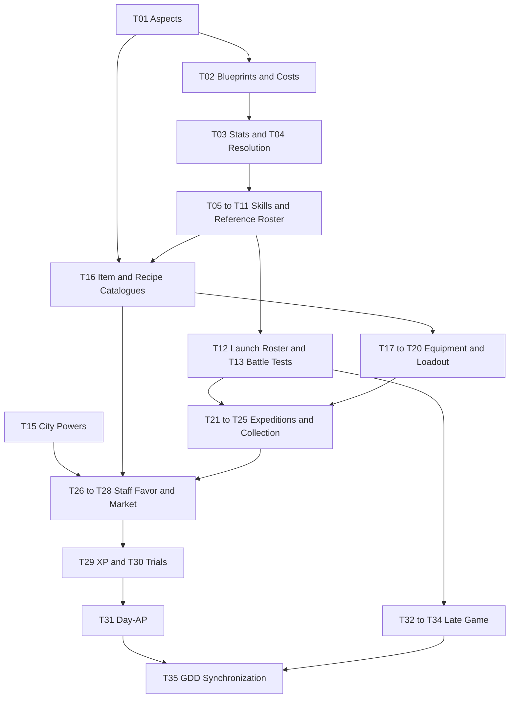

# Temporary Clarification List — Road of the Beasts

Central list of open design decisions and validation tasks from the three GDDs. The order below is a proposed work sequence, not a new game rule. **Work only in `docs/` and on `docs/update_gdd`.**

## Usage

- The GDDs describe the current working state; existing proposals and numbers are **not automatically approved** by moving open tasks here.
- Open questions, alternatives and review tasks are maintained exclusively here. The GDDs hold the current design, including labelled content drafts and prototype deviations needed to distinguish it from historical implementations. Use Git history to trace changes; do not maintain changelogs in the GDDs or this file. Keep the handoff current rather than appending a running change history.
- Complete the items listed under “Prerequisites” before deciding the topic. Independent items in the same phase may be worked on in parallel.
- On completion: incorporate the decision into the specified GDD sections, synchronize affected companion files and check off the item here. For playtests, document measurements and results before changing rules if necessary.
- **D** = design decision, **V** = validation/balance, **K** = consistency correction. Sources refer to the current GDD section numbers unless explicitly labelled historical.
- **Central skill specification:** [Monsters chapter 4](gdd_monsters.md#4-skills). It defines the kit, construction kit, schema, validation, access and slot development. Battle describes generic runtime/board resolution; Overworld only meta integration, economy and its own tamer/loadout content. Do not maintain parallel monster-skill price lists or upgrade rules. Historical statements are not active specifications.

## Handoff / Re-entry — Current State 2026-11-08

This handoff supersedes earlier conversation histories and calculation checks. Tasks T01–T35 below remain authoritative. **T02, T05 and T13 remain open; no balance approval.**

### Working Practices and Ownership

- **Stay within `docs/`, on `docs/update_gdd`.** No implementation, commits, branch changes, pulls or resets without instruction. Preserve staged/unstaged user changes; check Git state before editing. Do not synchronize automatically.
- **Language:** write and maintain all documentation under `docs/` in English, including this task list; chat communication remains German. Translate existing German sections when revising them, preserving rules and decision status.
- The user wants the agent to **draft related cost proposals together**, rather than asking for approval of every number. This does not authorize fundamental gameplay changes; explain recommendations and mark new values as drafts.
- **Readability is explicitly important:** prefer thematically grouped lists and bullets over long prose where this makes the same information easier to scan. Bundle related statements into compact bullets; use sublists/labels only for genuine substructure. Keep short overview/rationale sentences, numbered steps for sequences and tables for comparisons/reference values. Check actual character counts as well as information preservation; adding lines is not shortening. Preserve all conditions, exceptions, negations, units and decision status; do not shorten away rules. [Monsters §4.5](gdd_monsters.md#45-construction-points-and-ap-efficiency) has already been consolidated; do not expand it with repetition again. Conversation context belongs here; prices belong only in the central GDD section.
- **Monsters chapter 4 is the central skill source:** [§4.1 kit/access](gdd_monsters.md#41-the-kit), [§4.2 shared model](gdd_monsters.md#42-data-oriented-skill-construction-kit), [§4.3 execution profiles](gdd_monsters.md#43-skill-execution-profiles), [§4.4 effect/board contracts](gdd_monsters.md#44-effect-and-board-operation-contracts), [§4.5 costs](gdd_monsters.md#45-construction-points-and-ap-efficiency), [§4.6 slot development](gdd_monsters.md#46-slot-levels-development-replacement-and-upgrades), [§4.7 references/validation](gdd_monsters.md#47-complete-references-and-validation). Battle owns general battle/board resolution; Overworld owns meta, tamer and loadout content. Do not re-plan the completed consolidation.
- All monster skills, including passives/self-buffs/signatures, use the same 14 field groups. No custom/`unique` special structure, artificial areas for non-area skills, global `affects_ground`/`affects_air` authoring inputs or 0-AP active passives. Layers belong to effects; ground changes belong in `board_changes`. Representability/pricing is not content approval.

### Confirmed Principles and Selected Working Values

- No aspects, triangles, Attunement or fixed replacement elements. Free themes and designed species learnlists; T01/T33/T34 completed.
- Designers create finished skills/upgrades; no free player construction. Construction points are internal evaluation data, not damage, EP, player currency or Overworld blueprint items.
- **Shared budget ceilings of 24/30/36 for slot levels 1/2/3**, with no ratings, minimum values, random budgets or separate pools/AP-class budgets. Skill type alone has no flat price; mechanics/contracts are evaluated.
- **AP efficiency:** 1/2/3/4/5 Battle-AP cost 12/6/3/1/0 construction points. High AP grants no negative credits. Do not automatically change existing Battle-AP.
- **Damage component:** damage × potential hit squares × 2. Immediate damage counts at 100%, with no flat immediate-damage surcharge; telegraphed, avoidable Surge damage counts at 50% of this damage component only. Do not automatically halve other components. Hit squares are not guaranteed hits.
- **Strike still deals 2 HP damage per monster hit.** Numbers such as 32 in a cost column are construction points! Label tables clearly. Hit multiplication for 2×2 remains open; do not introduce it implicitly.
- Board anchoring within Reach without LOS costs +2 in total; meaningful Strike direction selection costs +2, symmetric shapes with unchanged hit squares +0. Ground/air damage coverage costs +2 per damage effect. Normal Surge marker blocking costs +1 per complete marker.
- Fixed non-Strike shapes have no flat shape surcharge. **Strike exception:** +2 per hit square outside the adjacent 8-square ring; for 1×1, `max(abs(dx), abs(dy)) > 1`, not Manhattan Reach.
- Kin effects count toward the shared budget. Scaled push costs +2 per potential hit square; Winged retreat costs +3 once per use. Normal prop damage from offensive skills currently has no general surcharge; no new damage permissions for support/movement.
- Full development at the original AP price is required. No direct damage, AP-reduction or cast-range upgrades; higher AP only as optional visible branches. Slot progress is individual, with an EP pool shared with physical evolution. Pill-based skill replacement outside expeditions preserves slot progress; EP/pill economy remains open.

### Latest Decisions — Resume Here

1. **Combination surcharges are removed entirely**, including within a skill. Total price = actual mechanical components + AP efficiency or passive availability. Do not reintroduce previously added synergy surcharges. Existing `combination_cost` fields remain 0. Still test interactions; if problems arise, review the responsible components/rules.
2. **“Residue” means the ground change after Surge execution**, not props. The [concrete profile definitions](gdd_monsters.md#surge) specify the resulting ground and height/prop exceptions. This ground effect belongs to those profiles; the general Surge lifecycle does not automatically require it. The residue-free reference does not replace these profiles.
3. **Usable basic Surges, including their intended ground effect, should be possible at 1 Battle-AP.** Do not raise everything to 2 AP: movement already costs 2, and the initial AP stat is 2; that would impoverish action choices.
4. Delayed Surge hazard residue now has an **agent-drafted price of 1 construction point/square**, rather than 4 for immediate hazard placement. No further 50% discount, second cast anchor or second AP-efficiency charge. The user approved the direction “cheaper, no combination costs”, **not this exact individual price separately**.

The changes are in [Monsters §4.5](gdd_monsters.md#45-construction-points-and-ap-efficiency)/[§4.7](gdd_monsters.md#47-complete-references-and-validation); the Overworld tracking reference is synchronized. No gameplay AP or damage values changed. Old calculations of 42 points for the three-square residue Surge have been deleted/replaced; do not use them as current findings.

### Already Drafted by the Agent — Test Drafts, Not Validated Equivalence

Complete prices/assumptions belong exclusively in [Monsters §4.5](gdd_monsters.md#45-construction-points-and-ap-efficiency); this is orientation only:

| Area | Current state |
|------|---------------|
| Strikes | 11 shapes × 6 Kins tabulated; Spirit/Swarm/Ancient each +2 per potential hit square. Swarm/Ancient are especially provisional pending the prop/height revision. |
| Movement | Fixed profile prices rather than per square travelled: Run 6, Leap/Glide/Burrow 8, Phase 7, Blink 10; each adds +6 AP efficiency at 2 Battle-AP. Swim is planned (7 + assumed 6); Step is slot-free/outside the skill budget. No free flag upgrades. |
| Self/Passive | Self-bound initiative modifier and equipped rotation-permission references are costed centrally. Both remain drafts; passive availability initially covers a continuous self-bound boolean permission, not all passives. |
| Zones/Protection/Healing | Rates for stat modifiers, displacement, zone-based Surge reduction and healing; normal AP-paid levelling/refresh is included in base rates. This does not decide allowed values/caps/healing triggers. |
| Ground/Board | Package prices for permanent hazard/blessed ground, coupled height/reset, collapse and provisional prop creation/relocation. Do not charge permanent effects again as immediate damage/zones. Additional Cleanse sources are price placeholders only, not approval. |

All six [central reference cases](gdd_monsters.md#47-complete-references-and-validation) have initial calculations. No complete three-level development paths or content/balance approval.

### Current Cross-check and Remaining Conflicts

The [scoped 1-AP Surge comparison](gdd_monsters.md#basic-surge-profile-cross-check) includes the displacement-bearing profile's test price. It is not a complete-profile approval: special prop reactions and the collapse/ground final-state contract remain unresolved. The scoped two-cell displacement conflict is resolved by a designer price proposal, not user-selected balance or permission for other sources. The height-capable subset still exceeds the base ceiling; all three-cell subtotals exceed it. The table does not approve two-cell-only basic skills.

Small support zones, healing and the largest legacy Strikes also retain the calibration conflicts documented in [Monsters §4.5](gdd_monsters.md#45-construction-points-and-ap-efficiency). Do not hide price/budget changes merely to obtain a fitting result.

### Next Agent: Concrete Gameplay Assignment

- First read this handoff and [Monsters §4.5](gdd_monsters.md#45-construction-points-and-ap-efficiency); consult [§4.3](gdd_monsters.md#43-skill-execution-profiles)/[§4.4](gdd_monsters.md#44-effect-and-board-operation-contracts)/[§4.7](gdd_monsters.md#47-complete-references-and-validation) as needed. **Do not reopen** budget/AP/damage principles, props or removed combination costs as fundamental choices.
- **First clarify the collapse/ground final-state contract with the user (T04 below).** Do not treat the conditional-cost draft as a runtime decision. Then reconcile the remaining height-capable Surge budget conflict and special prop-reaction valuation without advancing the full prop redesign. The profile-specific delayed-push test rate needs interaction validation, not another automatic timing discount. Damage/ground/displacement and collapse/residue ordering remain T04/T07; preserve damage/AP/budgets.
- Then draft a few complete **same-AP development paths**: Run, a simple zone, Surge with intended ground effects, and Jab. Check budget limits, meaningful improvements and allowed patches. Jab needs meaningful development without damage/AP/range upgrades. Present unsolved legacy conflicts clearly for a decision rather than bypassing fundamental principles.
- Only afterwards draft shared EP awards/costs for physical and slot development (T05). Do not mark T02 complete before full calculation/contract review; T13 requires actual tests.

### Keep Open / Validation Status

- **Fundamentally revise props later (T04):** the concrete impact × prop determines destructibility and reaction; splinters/falls can cause visible damage, and a tree can split or burn differently. Initially use falling effects plus ground/visual residue, not movable tree halves. Everything must be deterministically predictable. [Battle §4.9](gdd_battle.md#49-props) contains this direction; old blanket Shatter rules are interim only. Do not bring the detailed discussion forward.
- Effect caps/stacking/refresh across sources, death/removal, passive triggers/frequency/recursion, self-modifier refresh/content values, protection consumption, combined damage/displacement order, Pull ties, collision, target loss, air/2×2 and Major/Signature access remain domain tasks. Price placeholders resolve none of them.
- EP amounts/unlocks, passive slot development/active-passive replacement, same-skill respec, EP refunds/transfers, relearning pill recipe/price and day-AP remain open; the old Normal award yields only 2 EP in total and is unverified.
- Documentation only. Calculation sums (including 66 Strike totals and movement/buff/residue examples) and `git diff --check` were checked in earlier work; no engine/balance playtests. The earlier prototype does not automatically implement the current GDD state.

### Editorial Progress — Gameplay Sequence Unchanged

- The current editorial direction is to use precise effect/skill classes in general rules, not repeated named-skill examples. Specific profiles, necessary content references and scoped reference calculations retain names; source-specific permissions remain unchanged. Documentation is English; longer prose in the three GDDs is organized into thematic bullets while short overviews, tables, headings and structured data remain intact. Topic ownership and reference examples are consolidated, and historical/provisional status is explicit. This is a presentation change, not a rule or decision-status change. The three GDD changelogs and manual GDD version/synchronization headers are removed. Their removal required no transfer of current rules; applicable information was already present in the owning sections. Necessary prototype comparisons remain explicitly historical.
- Change tracking uses Git history, not this handoff or a separate changelog. Keep this handoff current. The Ambitious Standing comparison remains unresolved under T26; no editorial cleanup selects a design variant.
- T35 remains open for ongoing synchronization and the eventual implementation-plan update. Existing decisions, working values, task IDs/checkmarks and dependencies are unchanged. Resume gameplay work in the same order: Surge cross-checks → same-AP development paths → shared EP economy. Editorial completion is not completion of T02/T05/T13 or gameplay/balance validation.

## Phase 1 — Clarify Foundations and Conflicting Rules

### [x] T01 · Confirm the Aspect System (D/V)
**Prerequisites:** none.
**Sources:** [Monsters §7.4](gdd_monsters.md#74-monster-progression-the-18-steps); Battle [§3.2](gdd_battle.md#32-monster-identity--skill-access), [§4.8](gdd_battle.md#48-no-attunement).
- **Decided:** remove the triangle and fixed monster aspects; no fixed replacement elements. Monsters receive free descriptive themes; deliberately designed species learnlists determine their allowed abilities.
- Remove Attunement. Concrete skills, ground types and Surge behaviour remain available in the construction kit, without fixed aspect binding or mandatory sets of three variants.
- Incorporated into all three GDDs. New ground interactions are addressed under T07; concrete learnlists and roster under T10–T12. This does not validate the balance of the remaining mechanics.

### [ ] T02 · Complete the Data Model, Point Calculation and AP Efficiency (D/K)
**Prerequisites:** T01.
**Sources:** Monsters [§4.1](gdd_monsters.md#41-the-kit)–[§4.7](gdd_monsters.md#47-complete-references-and-validation); Battle [§2.3](gdd_battle.md#23-action-points)/[§5.1](gdd_battle.md#51-monster-skills-central-specification); [Overworld §6.3.2](gdd_overworld.md#632-permanent-skill-slot-development-confirmed).

**Drafted and documented:**
- Shared model for all monster skills, central profiles/contracts and six references; no parallel skill sources or custom special structures. Designer-authored skills/upgrade choices instead of player construction.
- Shared budget ceilings 24/30/36, AP efficiency 12/6/3/1/0, damage factor 2 and 50% exclusively for telegraphed, avoidable Surge damage as selected working drafts. **No combination surcharges.**
- Draft tables for all Strikes/movement profiles, self/passive, zones/protection/healing and ground/board. Six references with initial totals, not yet full content/balance validation. Maintain prices only in [Monsters §4.5](gdd_monsters.md#45-construction-points-and-ap-efficiency), not duplicated here.
- Surge residue = delayed ground change; concrete profiles retain their authored ground types. New designer test price of 1 point/square for delayed hazard residue (immediate Field 4/square); basic Surges should be possible at 1 AP including ground effects.

**Still to do:**
- Complete the scoped [1-AP Surge comparison](gdd_monsters.md#basic-surge-profile-cross-check): the profile-specific delayed-push test rate resolves the scoped two-cell displacement conflict, pending validation. Conditional-outcome costing is drafted, but the height-changing profile needs an explicit collapse/ground final-state decision (T04) before applying it; its priced subset remains over the base ceiling. Special prop reactions remain unpriced; runtime order stays T04/T07 and unsupported spatial cases T09. No implicit defaults or automatic skill approval.
- Resolve budget conflicts for large Strikes, healing and complex Surges specifically, without automatically changing budgets/AP/damage or introducing separate skill-type pools. No double-charging for area/flags/sources.
- Draft complete development paths at original AP, especially Jab; larger shapes retain existing AP until a new decision. No direct damage, AP-reduction or cast-range upgrades. Then T05/EP.
- Complete missing footprints/anchors/orientations, visibility/target validity, effect values/caps, triggers/end conditions and interaction order. Explicitly define self/passive stacking, source groups, death/removal and repetition/recursion. The self-buff reference remains a draft; no new mechanic is authorized solely by a schema field.
- Review combinations and repetition as balance/contract questions, **not as an additional price category**. Include props, healing, air and 2×2 under T04/T07–T09. Validate numbers only through suitable tests; T13 remains open.

### [ ] T03 · Review Stat Budgets, Frames and Progression Limits (V/K)
**Prerequisites:** T02.
**Sources:** Monsters [§2.1](gdd_monsters.md#21-the-stats)–[§2.3](gdd_monsters.md#23-stat-ceilings-per-stage), [§7.4](gdd_monsters.md#74-monster-progression-the-18-steps); Overworld [§1.2](gdd_overworld.md#12-design-pillars), [§2.4](gdd_overworld.md#24-cultivation-loop).
- Check prices, budgets and all scaled frames; Reach costs 3 points per level and now affects all casts. Test Reach-2 individuals against the old Surge radius 3.
- Init on roll: 1 point = 1.0; on level-up: 0.1. Equal points received do not necessarily mean equal resulting strength; compare freshly rolled and raised individuals.
- Unify Stage versus exact sub-tier as the monster cap ([Monsters §7.4](gdd_monsters.md#74-monster-progression-the-18-steps) names the step, other texts only the Stage).
- Some Overworld texts still limit spent points by the frame; the monster GDD limits only the roll by the frame.
- Step-only monsters: explicitly resolve random Movement points versus “stays at frame minimum”.

### [ ] T04 · Make Resolution Rules and Edge Cases Consistent (D/K)
**Prerequisites:** T01, T02.
**Sources:** Battle [§2.2](gdd_battle.md#22-initiative-rules), [§4.1](gdd_battle.md#41-battlefield-generation), [§4.4](gdd_battle.md#44-square-data-model), [§4.8](gdd_battle.md#48-no-attunement), [§4.10](gdd_battle.md#410-damage-shatter--prop-types), [§6.1](gdd_battle.md#61-the-damage-law)–[§6.3](gdd_battle.md#63-collision-fall--debris); [Monsters §5](gdd_monsters.md#5-passives).
- Collision: the damage law includes monster collisions, but the detailed rule says no damage. Cross-check Crashlander. Check Shockwave's existing +1 collision bonus against the fixed event-damage law; no exception has been approved.
- Define the resolution order for Surge damage/residue/displacement and Strike damage/displacement; explicitly define Pull ties and behaviour when the anchor is already occupied. Preserve each source's explicit permissions.
- Protection sources: define stacking, order and consumption when damage is reduced to 0; distinguish passive-, zone- and ground-based protection sources without transferring permissions between them. Coordinate tamer exceptions with T20.
- Combined board operations: define the order of Collapse, Debris, Residue and Cleanse. For Rift on Elevated, explicitly decide whether collapse leaves Rubble or subsequent Blight replaces it; current wording does not establish mutually exclusive outcomes. Specify Relocate distance, path, legal targets and reactions. Do not derive free defaults from data-field order.
- T01 removes the Attunement/Elevated conflict; check remaining combinations of height and concrete ground types.
- Zone values without Attunement: keep hard caps for Slow (2) and Push/Pull (1) consistent with level scaling.
- **Prop revision:** shared impact/reaction contracts; define broadly destructible props and concrete exceptions/resistances. Destruction type determines splinter/fall effects and residue instead of identical Shatter every time. A tree may split; initially use falling effects plus ground/visual residue, not separately movable halves. Predict fall direction, hit squares, damage and resulting state deterministically. Impact categories, prop catalogue, HP/damage matrix, chain reactions and event order remain open. Existing numbers are interim, with no new blanket hit permissions. For pricing, ordinary prop damage is provisionally a shared baseline without surcharge ([Monsters §4.5](gdd_monsters.md#45-construction-points-and-ap-efficiency)); review special advantages and costs after the redesign.
- Sigil is enterable; the prop rule says “the prop takes damage, not the monster there”. Define hit order for monsters on field props.
- Clarify target validity on resolution: moved, fallen or removed unit/prop targets and placements that have become invalid. No implicit tracking, retargeting or invented cancellation/refund defaults. Define simultaneous events and expiry/trigger order deterministically.
- Specify Surge behaviour with multiple turns per round, changed initiative or a dead caster: “next caster turn” does not guarantee everyone else acts first.
- Define deterministic ties for Voidscar selection, Push/Pull destinations and free dodge squares.
- Check point-symmetric generation against odd prop counts; define legal central single objects for each board size.

## Phase 2 — Skills, Development and Monster Identity

### [ ] T05 · Complete Skill Improvements (D)
**Prerequisites:** T02.
**Sources:** [Monsters §4.6](gdd_monsters.md#46-slot-levels-development-replacement-and-upgrades) (slot development), [§7.2](gdd_monsters.md#72-monster-rarity)/[§7.4](gdd_monsters.md#74-monster-progression-the-18-steps) (EP/progression draft); [Overworld §6.3.2](gdd_overworld.md#632-permanent-skill-slot-development-confirmed) (integration).
- **Decided:** permanent skill-slot development is an additional evolution option for the individual monster. Physical evolution and slot development use the same EP pool. A paid slot-development step directly grants a designer-authored, skill-dependent upgrade choice; no additional player point currency.
- **Decided:** replacing a skill from the unlocked species learnlist outside expeditions costs a valuable relearning pill instead of EP. Slot development is preserved; suitable upgrades for the new skill are reselected within the existing development extent. No free re-slotting or EP-paid swap path.
- **Next step:** draft a shared EP budget and prices for physical evolution and slot development. Old awards of 1 EP for Normal/Rare or 2 EP for Epic/Legendary are unvalidated; Normal would currently have only 2 EP in total. Check target investments across multiple slots and competition with physical development.
- **Decided:** slot levels 1–3 with increasing budget ceilings, no skill ratings. Define EP prices, unlocks and possible intermediate development within these levels; do not assume another rank hierarchy.
- **Decided:** retain small fixed damage values. Slot upgrades do not increase direct damage, lower AP costs or increase cast range. Allowed improvement types: area, shape/orientation, duration, movement/displacement and explicitly designed additional effects, each with skill-dependent limits. Still check total impact through more targets or triggers.
- Design enough upgrade choices visible in advance, prerequisites, exclusions and caps for every skill; examine Shape, Size, Twist and Small value as candidates. Do not reintroduce removed legacy swap paths; replacement remains pill-based.
- Clarify how to handle slots with different numbers of legal upgrade offers, passive/passive-only slots and active/passive replacement. Do not lose slot investment on replacement.
- Still open: cost of reselecting existing upgrades of the same skill, refunding EP investments and possible transfers between slots. Pill costs for upgrade respec are only a recommendation, not a decision.
- Specify the relearning pill: coordinate reliable acquisition, recipe, tier, price and day-AP with T16/T30/T31; deliberate replacement rather than constant rebuilding, without permanently penalizing experimentation.
- Distinguish generic Size maximum 4 from Strike shapes of up to 8 squares. Old conflicting Shape prices are obsolete; define concrete upgrade offers and EP step prices in the shared model.

### [ ] T06 · Complete Strike Shapes and Kin Effects (D/V)
**Prerequisites:** T02, T03, T05.
**Sources:** [Monsters §3.2](gdd_monsters.md#32-strike-by-kin).
- Only Jab before Core: do interesting shapes arrive too late? Storm/5-AP shapes only reach late TPR-1 builds.
- Test Whirl (4 squares) against Arc (3) at the same price, and the value of Thrust's range. The old question says “Skewer”, the table “Thrust”: unify the name.
- Beast Bite: give it its own effect without violating the damage ceiling, or deliberately accept the lack of an effect.

### [ ] T07 · Align Ground Interactions and Healing (D/V)
**Prerequisites:** T01, T02, T04.
**Sources:** Battle [§4.6](gdd_battle.md#46-zones-effects-rules--opposites)–[§4.8](gdd_battle.md#48-no-attunement); Monsters [§4.2](gdd_monsters.md#42-data-oriented-skill-construction-kit), [§4.4](gdd_monsters.md#44-effect-and-board-operation-contracts)–[§4.5](gdd_monsters.md#45-construction-points-and-ap-efficiency).
- Permanent residue: does the board fill too quickly, making start-turn hazard placement overpowered?
- Measure hazard coverage on 7×7 by round 5. If needed, examine Field at 2 AP or a maximum of N Field squares per monster as alternatives.
- Without the triangle, define whether and how zones change existing ground; do not infer automatic superiority from monster themes.
- T01 removes Attunement and painting snowball. Instead review counters to permanent hazard ground and their accessibility.
- Blessing: is 2 AP appropriate for 3–4 permanent squares? Limit Mossbed per turn?
- Boon/`mend`: check healing at HP 1–10; may zone level increase healing, or does it stay fixed at 1? Explicitly define the numerical healing cap and Mossbed re-entry/per-turn limit; persistence grants no additional healing triggers.
- Evaluate level-II residue as a concrete extension; the former name “Deep Residue” and +1 AP are not confirmed universal rules.

### [ ] T08 · Define Water and Swim (D)
**Prerequisites:** T02, T07.
**Sources:** Battle [§4.7](gdd_battle.md#47-ground--neutral-hazard-and-blessed), [§5.1](gdd_battle.md#51-monster-skills-central-specification) (integration); Monsters [§3.3](gdd_monsters.md#33-movement-by-kin), [§4.3](gdd_monsters.md#43-skill-execution-profiles) (movement profiles).
- Where does water originate: generator only, or skills too? May generated hazard/blessed ground replace water?
- Which Kins receive Swim? Check its cost profile and flag exceptions against the general movement table.

### [ ] T09 · Specify the Air Layer and 2×2 Rules (D/K)
**Prerequisites:** T02, T04, T06, T07.
**Sources:** Battle [§4.3](gdd_battle.md#43-the-square-stack-zones--ground), [§5.1](gdd_battle.md#51-monster-skills-central-specification) (integration); Monsters [§3.1](gdd_monsters.md#31-kin-table), [§4.2](gdd_monsters.md#42-data-oriented-skill-construction-kit), [§4.3](gdd_monsters.md#43-skill-execution-profiles), [§4.4](gdd_monsters.md#44-effect-and-board-operation-contracts), [§4.7](gdd_monsters.md#47-complete-references-and-validation).
- Which effects besides Strike may have air recipients? Define layers per effect, not as a global `affects_air` authoring flag. Ensure at least sufficiently readable counters to Winged from Soul onward.
- Specify flight movement, occupancy and interaction with props/ground. For 2×2, also define distance origin, area overlap, recipient deduplication and entry/exit evaluation across multiple squares; the generic area model does not decide these cases.
- Additional analysis finding: 2×2 is announced, but area hits, damage multiplication, placement, movement and displacement are insufficiently defined. Occupying multiple squares must not create an implicit multiple-damage rule.

### [ ] T10 · Rebuild Concrete Skills from Blueprints (D)
**Prerequisites:** T05–T09.
**Sources:** Monsters [§4.2](gdd_monsters.md#42-data-oriented-skill-construction-kit)–[§4.7](gdd_monsters.md#47-complete-references-and-validation).
- Create concrete skills exclusively in the shared schema [§4.2](gdd_monsters.md#42-data-oriented-skill-construction-kit) and validate under [§4.7](gdd_monsters.md#47-complete-references-and-validation); no new parallel blueprint/example table. Fully define effects, triggers, targeting, footprints, interactions, costs and authorized upgrade patches.
- Species-exclusive and Signature skills use the same schema; express differences through access, authorship and explicit rules. Earlier named ideas are not promised content. Select concrete skills and sufficiently deep upgrade choices only after budgets are confirmed.

### [ ] T11 · Revise Learnlists, Passives and Reference Roster (D)
**Prerequisites:** T03, T06, T10.
**Sources:** Monsters [§4.1](gdd_monsters.md#41-the-kit), [§5](gdd_monsters.md#5-passives), [§6.1](gdd_monsters.md#61-first-roster-draft--9-monsters), [§7.4](gdd_monsters.md#74-monster-progression-the-18-steps).
- Define learnable skills (current target roughly 8) and available passives for each species: distinguish species binding from individual binding; free themes are not an additional learning restriction. Revise or remove formerly aspect-dependent passives.
- The nine reference monsters currently have four active skills plus passives; reduce to four shared slots and handle the Epic+ additional slot separately.
- Give every species a Species Twist instead of the shared placeholder, plus a concrete Strike shape and fixed Surge orientation.
- Check roster descriptions of weaker Surge variants against current damage and AP rules; descriptive wording grants no damage exception.

### [ ] T12 · Select the Launch Roster (D)
**Prerequisites:** T11.
**Sources:** Monsters [§6.1](gdd_monsters.md#61-first-roster-draft--9-monsters)–[§6.2](gdd_monsters.md#62-additional-species-candidates).
- Without a mandatory Kin×aspect matrix, select a diverse roster from the nine reference monsters and additional name ideas (previous target about 15); prioritize free themes and distinct playstyles over category completeness.
- Check missing blueprint/movement coverage and distinct one-sentence identities.

## Phase 3 — Validate Battle Before the Meta Fixes Numbers

### [ ] T13 · Plan and Evaluate Battle Tests with the Revised Rules (V)
**Prerequisites:** T04, T07, T11; T08/T09 for water/Soul tests.
**Sources:** [Battle §7.2](gdd_battle.md#72-prototype--playtests); historical Battle §8; [Monsters §2.2](gdd_monsters.md#22-frame-budget-level-ups), historical Monsters §8.
- First ensure that the tested build implements the draft under examination: the documented Godot baseline is the historical battle v6.0 ruleset, not the current GDD design. Code changes are outside this documentation task.
- Residue: do Surges indirectly hit even when dodged, or force meaningful routes?
- Readable combos: Current → Surge/Lava, Pull → Strike; check Pull anchors and push direction.
- Strike from 2 AP: worthwhile or unused, melee too sticky?
- Check no-cooldown spam and repeated protection-zone casting (2 AP → level II, Shield 3). Fallback: level-up only once per turn and square.
- Test zone-based Surge reduction 2, level/Attunement and Surge damage 3 for genuine counters. Attunement is a historical test reference, removed by T01; do not reintroduce it.
- Check movement prices, Step-only viability and Movement cap 5.
- Three Surge types against Elevated; props as tactical resources rather than obstacles.
- 3v3/7×7: readability, round count, Collapse share and starting distances; test Reach 4 + Elevated = 5 against the promise of a safe opening.
- Test first-Surge-claims-square and initiative chains/focus fire. Fallback if dominant: make initiative more expensive.
- Compare Dusk Moth (historical 87% simulation win rate) with humans and AI; examine Native Ground/Wide/Blight separately.
- Evaluate stat/Strike/healing tests from T03/T06/T07 together; adjust prices only based on results.

### [ ] T14 · Safeguard Reshape Against Reroll Exploitation (D/V)
**Prerequisites:** T03, T13.
**Sources:** [Monsters §2.2](gdd_monsters.md#22-frame-budget-level-ups); Overworld [§2.6](gdd_overworld.md#26-action-catalog), [§7.5](gdd_overworld.md#75-materials-seeds-and-grades).
- Are a rare elixir and ritual costs sufficient, or is a cap/cooldown needed against repeated optimization rolls?

## Phase 4 — World, Catalogues and Equipment (Partly Parallel to Phase 2/3)

### [ ] T15 · Define City Powers, Responsibilities and Content (D)
**Prerequisites:** none; may run in parallel with battle design.
**Sources:** Overworld [§3.1](gdd_overworld.md#31-the-city)–[§3.2](gdd_overworld.md#32-the-powers-of-the-city), [§7.2](gdd_overworld.md#72-favor--faction).
- Define faction names, profiles and offerings for the three families.
- Confirm operators of Arena, Teleport Plaza and Business District: proposal is City Lord, City Lord, Guild.
- Clarify buildings/access for Rival Compounds and the purpose of the Slums; Black Stall remains an optional idea, not a promised feature.

### [ ] T16 · Complete Material, Item and Recipe Catalogues (D)
**Prerequisites:** T01; T10 for battle-related products.
**Sources:** Overworld [§6.6](gdd_overworld.md#66-pills--medicines)–[§6.8](gdd_overworld.md#68-arrays-artifacts-for-places), [§7.5](gdd_overworld.md#75-materials-seeds-and-grades)–[§7.8](gdd_overworld.md#78-acquisition-sources).
- Derive concrete materials, herbs, seeds, recipes, seals, scrolls and blueprints from patterns; determine counts, tiers and grades.
- Reconcile the quantity assumption “four tiers/~40 pills” with six cultivation stages and missing Sovereign XP values.
- Check grade dependencies and acquisition sources against “money never buys exclusive power”; Legendary bloodline ingredients are currently described both as story-only and as boss/quest/auction rewards.
- Confirm Array recipes and the Forge route (Ore + Beast Parts); decide whether Upper Stones are currency only or also ritual materials.

### [ ] T17 · Define Artifact Rules and Stacking (D/K)
**Prerequisites:** T03, T11, T16.
**Sources:** Overworld [§6.7](gdd_overworld.md#67-artifacts-equipment--socketed-passives), [§6.9](gdd_overworld.md#69-hard-caps), [§7.5](gdd_overworld.md#75-materials-seeds-and-grades); [Monsters §7.2](gdd_monsters.md#72-monster-rarity).
- Tamer: two or three slots, and when? Monster: second slot at Epic+, or additionally only from Core? Synchronize tables.
- Clarify passive OR stat modifier versus the schema “passive + small stat modifier”; limit duplicate passives and multiple artifacts.
- Check +1 AP/day, capacity and skill modifiers against day economy, Stage caps and the options-not-numbers rule.

### [ ] T18 · Specify Medicines and Arrays (D)
**Prerequisites:** T07, T10, T16.
**Sources:** Overworld [§6.6](gdd_overworld.md#66-pills--medicines), [§6.8](gdd_overworld.md#68-arrays-artifacts-for-places), [§7.5](gdd_overworld.md#75-materials-seeds-and-grades)–[§7.6](gdd_overworld.md#76-item-schema).
- Determine Medicine effects, recipes, item kind and distinction from pills. Protection/healing/board effects need their own source, consumption and timing contracts in the shared data model; monster-effect contracts do not automatically approve items.
- Which Arrays are consumable, and which reusable? Define durability, placement and battle effects.
- Confirm pre-battle Arrays as a limited exception to a neutral/point-symmetric start; review the four existing Array drafts.

### [ ] T19 · Complete Battle Loadout and Timing (D)
**Prerequisites:** T18.
**Sources:** [Battle §5.2](gdd_battle.md#52-tamer-skills-and-battle-loadout) (integration); Overworld [§2.1](gdd_overworld.md#21-battle-loop), [§7.9](gdd_overworld.md#79-inventory-and-loadout), [§8](gdd_overworld.md#8-technical-notes-overworld--development-phases).
- Define Medicine/Array counts, activation windows (own turn or anytime), AP costs and consumption.
- Apply the same rules to human opponents; specify visibility, preview, pre-battle locking and reporting consumed items in BattleResult.
- Dependency is directional: item effects/costs first, then loadout limits; do not let them block each other mutually.

### [ ] T20 · Validate Tamer Skills Including Beast Swap (D/V)
**Prerequisites:** T09, T13, T19.
**Sources:** [Overworld §6.4](gdd_overworld.md#64-tamer-skills); [Battle §5.2](gdd_battle.md#52-tamer-skills-and-battle-loadout) (integration).
- Confirm/change/reject proposed Swap Places, Urgent Order, Second Wind, Life Thread, Double Bind and Seal Mastery; T01 removed Attune. Explicitly define tamer sources in the shared effect model without transferring monster-skill permissions or AP classes.
- Test Life Thread against Spirit Shield and Urgent Order against initiative; define usage timing for free skills.
- Beast Swap: define HP, injury, queue, own charging Surges, 2×2 space requirements and replacement-entry rules.
- Scrolls teach skills earlier; Beast Swap may only be slotted from Soul: clearly distinguish learning from use and Stage gates.

## Phase 5 — Expeditions, Collection and the Spatial World

### [ ] T21 · Define the Dungeon Node ↔ Board Generator Contract (D)
**Prerequisites:** T04, T08, T12.
**Sources:** [Overworld §3.3](gdd_overworld.md#33-dungeons); [Battle §4.1](gdd_battle.md#41-battlefield-generation).
- What does the node fix, and what does the generator generate? Proposal: node determines mode, theme/ground families and prop-count range; generator places everything point-symmetrically.
- Check encounter access against required team size and available healthy monsters.

### [ ] T22 · Complete Expeditions and Loot Tables (D/V)
**Prerequisites:** T16, T19, T21.
**Sources:** Overworld [§2.2](gdd_overworld.md#22-expedition-loop), [§7.8](gdd_overworld.md#78-acquisition-sources).
- Determine floors/battles per run, deeper entry (1/2 day-AP), retreat and reward tables per floor/boss.
- HP persistence and free retreat with loot are already the working state; do not reopen them without cause. Build open edge cases on that basis.
- Clarify “Healing Pill is the only healing during a run” against Mend/Mossbed, healing passives and Second Wind: outside battles only, or also during battles?

### [ ] T23 · Align Injury and Deadly Dungeons (D/V)
**Prerequisites:** T16, T20, T22.
**Sources:** Overworld [§5.2](gdd_overworld.md#52-defeat-and-injury), [§6.6](gdd_overworld.md#66-pills--medicines).
- Review two nights of downtime, Revival price and Deadly loot bonus; confirm or defer optional Deadly dungeons for launch.
- Recovery Spring already halves downtime to one night; define a minimum for the additional −1-night adjacency bonus.
- Define healing on return/overnight for uninjured monsters and HP after recovery; check Soul Tether/Life Thread against permanent loss.

### [ ] T24 · Specify Binding, Eggs, Breeding and Hive (D/V)
**Prerequisites:** T12, T16, T20, T22.
**Sources:** Overworld [§5.1](gdd_overworld.md#51-obtaining-monsters), [§7.5](gdd_overworld.md#75-materials-seeds-and-grades).
- Balance seal prices/grades and the second binding; check Seal Mastery against the player Stage cap.
- Define breeding/Hive/hatching times per rarity and incubation conditions; clarify same species versus “species of one parent”.
- Make egg rarity, species visibility and timing of randomization explicit.

### [ ] T25 · Internal World: Capacity, Buildings, Adjacency (D/V)
**Prerequisites:** T09, T16, T23, T24.
**Sources:** Overworld [§4.2](gdd_overworld.md#42-building-system)–[§4.4](gdd_overworld.md#44-capacity-and-growth).
- Confirm grid/capacity curve, footprints, unlocks and new structures.
- Define housing capacity bonus, Mood/Loyalty and their concrete benefits, or remove an unnecessary system.
- Define hatching at full capacity, rented monsters and bench size.
- Trial Pillar unlocks only at Foundation but is needed to reach it; clarify access to the first breakthrough.
- Adjacency bonuses: minimum times, multiple neighbours and stacking limits; reconcile Furnace −1 AP down to 0 with “execution costs AP”.
- Staff remain excluded from the interior for now. Reconsider only for concrete benefits; no implementation merely because it is possible.

## Phase 6 — Economy, Progression and Day Balance

### [ ] T26 · Draft Staff Traits and Numbers (D/V)
**Prerequisites:** T15, T16.
**Sources:** [Overworld §7.1.1](gdd_overworld.md#711-staff-model-b-chosen).
- Model B is selected: visible Skill/Loyalty values plus one trait. Do not choose between models A/B/C again.
- Define trait list, wages, output, Loyalty changes, dismissal, poaching and counteroffers.
- Ambitious poaching offers: resolve the previously contradictory Standing condition in [Overworld §7.1.1](gdd_overworld.md#711-staff-model-b-chosen). Specify whose Standing is compared, the faction/reference it is compared against, and the comparison direction. No comparison condition is selected yet.
- Treat hidden Deception at most as a later scripted story idea, not for random hires.

### [ ] T27 · Align Favor/Standing and Request Pools (D/V)
**Prerequisites:** T15, T16, T26.
**Sources:** [Overworld §7.2](gdd_overworld.md#72-favor--faction).
- Favor + lifetime Earned Total/Standing is the selected model; test numbers, request sizes, durations and thresholds.
- Confirm the rivalry rule (Allied with one family caps the other at Trusted).
- Own family: calculate concrete progression through strength/Arena.
- Standing unlocks access, but the table additionally lists licences/recruitment/invitations as Favor expenses: distinguish access requirements from purchase prices clearly.
- Define request pools per faction and Stage, repeat limits and rewards.

### [ ] T28 · Balance the Market, Properties and Businesses (D/V)
**Prerequisites:** T16, T22, T26, T27.
**Sources:** Overworld [§3.1.5](gdd_overworld.md#315-business-district), [§7.1](gdd_overworld.md#71-businesses), [§7.5](gdd_overworld.md#75-materials-seeds-and-grades)–[§7.8](gdd_overworld.md#78-acquisition-sources).
- Only after the catalogues: determine price fluctuation model, base prices, buying/selling and safeguards against endless arbitrage.
- Compare property costs, licences, facility output, queue duration, sale quantities and staff automation with dungeon income.
- Deal covers many activities: one activity per AP or several in one Deal? Distinguish free Queue from immediate Work production.
- Specify Monster Hall sales, Dojo and Dungeon Company as data configurations.

### [ ] T29 · Review XP Curves and Cultivation Pacing (V)
**Prerequisites:** T05, T22, T25, T28.
**Sources:** [Monsters §7.4](gdd_monsters.md#74-monster-progression-the-18-steps); [Overworld §2.4](gdd_overworld.md#24-cultivation-loop).
- Check the initial 18-step XP curve, pill XP, win XP, Training/Cultivate and idle XP; determine player values separately if necessary.
- Check the target of 3–6 focused days per sub-tier against farm/purchase/staff income; do not treat old prototype numbers as confirmation.

### [ ] T30 · Complete Breakthrough Trials and Rituals (D/V)
**Prerequisites:** T20, T25, T27, T29.
**Sources:** [Overworld §6.3.1](gdd_overworld.md#631-breakthrough-trials); [Monsters §7.3](gdd_monsters.md#73-rarity-ascension).
- Check the first trial draft against prototype/game flow; confirm material quantities and pill effect.
- “Player starts at half HP”/“player on the winning team” conflicts with the non-combatant tamer role: which monster/team is meant?
- Define player/monster trials, repetition, failure costs and trial access; synchronize rarity-ascension ingredients and acquisition routes.

### [ ] T31 · Finalize Day-AP and Action Costs (D/V)
**Prerequisites:** T22, T25, T28–T30.
**Sources:** Overworld [§2.3](gdd_overworld.md#23-day-loop), [§2.6](gdd_overworld.md#26-action-catalog).
- Review proposed 3/4/4/5/5/6 AP per Stage and Arena price per tournament round.
- Balance expeditions, cultivation, story and work against each other; account for staff reducing the workload.
- Keep free decisions/queuing/rearranging consistent with paid execution.

## Phase 7 — Late Game and Completion

### [ ] T32 · Design Major Surges and Signatures (D)
**Prerequisites:** T09, T12, T13.
**Sources:** Monsters [§3.1](gdd_monsters.md#31-kin-table), [§4.1](gdd_monsters.md#41-the-kit) (access), [§4.2](gdd_monsters.md#42-data-oriented-skill-construction-kit), [§4.3](gdd_monsters.md#43-skill-execution-profiles) (Surge profiles), [§4.6](gdd_monsters.md#46-slot-levels-development-replacement-and-upgrades), [§7.4](gdd_monsters.md#74-monster-progression-the-18-steps); [Battle §5.1](gdd_battle.md#51-monster-skills-central-specification) (integration only).
- Determine concrete shapes, area and range; review half-board/2 AP/once per battle.
- Synchronize access for Ancient AND Legendary from Sovereign against tables sometimes saying only “Ancient”; distinguish Signatures of other Legendary Kins.

### [x] T33 · Legendary Aspect Change Removed (D)
**Prerequisites:** T01, T11, T30.
**Sources:** [Monsters §7.2](gdd_monsters.md#72-monster-rarity).
- Removed by T01: without fixed aspects, there is no aspect change. No replacement feature approved; other Legendary development remains part of existing progression tasks.

### [x] T34 · Dual-Aspect System Removed (D)
**Prerequisites:** T01, T09, T13.
**Sources:** [Monsters §7.4](gdd_monsters.md#74-monster-progression-the-18-steps); [Overworld §6.3](gdd_overworld.md#63-stage-unlock-table).
- Removed by T01: no dual aspects or corresponding Immortal unlock. Multiple free themes require no separate unlock or special mechanic.

### [ ] T35 · Update GDD Synchronization and Implementation Plan (K)
**Prerequisites:** the respective affected decisions; overall completion after T01–T34.
**Sources:** all three GDDs, especially technical notes and Development Phases.
- Clearly distinguish decided rules, proposals, the existing prototype and later features.
- Synchronize tables, schema fields, section references and version states. The technical validator currently requires Surge/Utility, although open kits require neither; reconcile species passives with slot-bound learnlists.
- Update development phases based on clarified dependencies; do not mix implementation tasks with open design decisions.
- Keep change history in Git, not in the GDDs or this task list. Maintain a current handoff and preserve only prototype comparisons needed to distinguish implementation from the current design.

## Dependency Overview

The detailed prerequisites per item are authoritative; the diagram summarizes only the main work streams.
