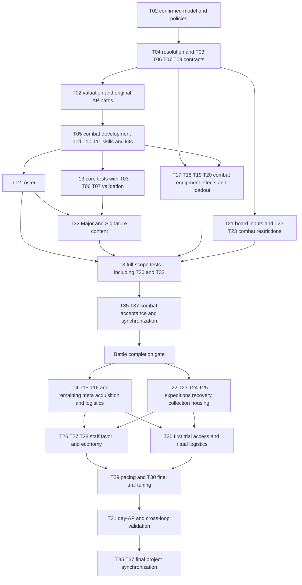

# Temporary Clarification List — Road of the Beasts

Central list of open design decisions and validation tasks from Battle, Monsters, Overworld and the central Skills GDD. **User priority: finish Battle first, then adapt the Overworld to its requirements.** The sequence below organizes work; it does not approve new gameplay rules. **Work only in `docs/` and on `docs/update_gdd`.**

## Usage

- The GDDs describe the current working state; existing proposals and numbers are **not automatically approved** by moving open tasks here.
- Open questions, alternatives and review tasks are maintained exclusively here. The GDDs hold the current design, including labelled content drafts and prototype deviations needed to distinguish it from historical implementations. Use Git history to trace changes; do not maintain changelogs in the GDDs or this file. Keep the handoff current rather than appending a running change history.
- Prerequisites apply to the named deliverable, not automatically to the whole task. **D/K** contracts can precede pricing/content; **V** closes only after suitable executed tests. Do not make test inputs depend on the completion of their own validation. Independent work within the current priority may proceed in parallel; meta-only Overworld work is queued until the Battle gate.
- **Session close:** refresh [Context Handoff](#context-handoff) after every session so another agent/computer can resume without chat history. Reusable instructions belong under [AI Prompts](#ai-prompts), not in the active task list.
- On completion: incorporate the decision into the specified GDD sections, synchronize affected companion files and check off the item here. For playtests, document measurements and results before changing rules if necessary.
- **Task fields:** every editable task carries **Status**, **Prerequisites**, **Sources**, the concrete gap/decision bullets and **Done when** (completion conditions). Status values: *Open* (no decision yet), *Partly drafted/decided* (working draft or partial decision exists, not validated), *Blocked* (named prerequisite or user decision missing). Completed tasks move to [Completed Tasks](#completed-tasks-ids-retained-for-references) with their IDs retained; IDs are never reused for other topics. Validation tasks close only with tests actually performed and documented.
- **D** = design decision, **V** = validation/balance, **K** = consistency correction. Sources refer to the current GDD section numbers unless explicitly labelled historical.
- **Central skill specification:** [gdd_skills.md](gdd_skills.md) is the single file for everything about monster skills: kit, construction kit, schema, execution profiles, effect contracts, costs, slot development, validation, Kin Strike/movement tables, passives, prior-draft species assignments and the concrete skill records. Battle describes generic runtime/board resolution; Overworld only meta integration, economy and its own tamer/loadout content; [gdd_monsters.md](gdd_monsters.md) keeps monster identity, stats, Kins, roster and growth. Do not maintain parallel monster-skill price lists or upgrade rules. Historical statements are not active specifications.

# Context Handoff

**Last updated: 2026-11-11 (GDD audit, retirement of the arithmetic checker, simulator extension; session ended on token limit).** Resume from current files, not chat history. Replace this handoff at session end; keep rules/prices in their owners.

## Current State and Immediate Next Step

- **Focus/result:** (1) all four GDDs were read in full and reconciled with every task (no task closed; no GDD rule changed; new gaps: Draw result T19/T23, tamer rows Spatial Pull/Qi Suppression T20, roster/passive conflicts T11, stale labels T35). (2) Tooling: `docs/temp_kalkscript.py` was replaced by [tools/simulator/pricing.py](../tools/simulator/pricing.py); skill records and monster test sheets are now JSON; the simulator executes Strikes, movement presets and one Surge profile from them. The simulator is not a prerequisite for GDD work.
- **Battle-first state:** B1 stays the entry point. Prop catalogue, tamer protection, air/2×2 contracts and queue/defeat rules are decided in the owning GDD sections; their prices, content and tests are not.
- **Next actions (Battle workstream):**
  1. **T04 close-out:** only the Draw result (T19/T23) and a last label check (T35) remain. Then T03/T06/T07/T09 contracts (step 2), T10 Raise Prop type, T20 remainder (Beast Swap injury link, Life Thread in Deadly dungeons, Spatial Pull/Qi Suppression status; Double Bind/Seal Mastery wait for T24).
  2. Finish remaining T03/T06/T07 contracts and T20-D interfaces (air-capable zone/Surge definitions, T07 healing contracts outside 2×2, level-II-residue price check). Several-zones-under-2×2 and air/landing/air-prop scope are decided (Battle §4.3/§4.10). Preserve confirmed geometry, flight, mixed-ground triggers and unlimited Mossbed entries; no extra Winged-counter guarantee was approved.
  3. T02 shared prices (sketch exists, unvalidated), complete Surge checks and original-AP paths → T05 battle-facing development mapping/supply/choices → T10/T11 records/kits → T12 roster and T32 late-game battle content. Include T17–T20 combat effects/loadout and T21 board inputs before their final tests; do not wait for recipes, shops or XP pacing.
  4. Execute T13 in core and full-scope passes, including relevant T03/T06/T07/T20 V and T32 content; check the [Battle Completion Gate](#battle-completion-gate). Only then resume T14/T15/T16, meta parts of split tasks, expeditions, housing, staff, economy, XP/trials and day AP. No independent Overworld topic is scheduled in parallel.
- **Battle blockers (current):** T02 prices still lack special-reaction/repeatable-event valuation and some spatial contracts; 2×2 variants remain unapproved; Relocate has a confirmed contract but only a provisional price; the changed `mend` magnitude has only a sketch price; T11/T12/T32 content does not exist; T13 has no executed current-design battle tests and no matching harness; the new price calculator covers only listed subsets. Budget conflicts are not approved restrictions.
- **Queued meta work (not Battle blockers):** T14–T16, meta parts of T05/T17–T25/T30, T26–T31 and final T35/T37. Their missing details are neither free defaults nor Battle blockers.
- **Height-collapse end state:** [Battle §4.7](gdd_battle.md#47-ground--neutral-hazard-and-blessed) labels the rule (Rubble unless the destroying skill authors a ground change) a *user decision*, undated in the files (introduced with the Mountain rules, commit `17f4e9a`, 2026-11-08); [Skills §3](gdd_skills.md#surge)/[§4](gdd_skills.md#4-effect-and-board-operation-contracts) follow it. The 2026-11-10 handoff note cited earlier no longer exists in any file. Treated as documented, not reopened; an optional one-line reconfirmation by the user would close the date gap. Interaction/order gaps remain T04.
- **Git observation:** branch `docs/update_gdd`; `HEAD 1ea635d` ("sim"), ahead of `origin/docs/update_gdd` by 4 commits (no fetch). **Uncommitted at session end:** CLAUDE.md, docs/gdd_skills.md (3 link edits), docs/temp_todo.md, deleted docs/temp_kalkscript.py, and in tools/simulator/: README.md, battle_sim.py (modified); .gitignore, pricing.py, monsters.py, data/ (skills, monsters, golden.json) (new). No commit was made; a commit is planned via the simulator prompt below. No branch switch, pull/push/reset or synchronization.
- **Checks this session:** branch/status; full read of the four GDDs and this file; stdlib arithmetic recheck of Monsters §2.2 and Skills §5 subtotals; relative links/anchors of this file and gdd_skills.md (0 broken, approximating slug checker); `pricing.py --self-test` and `monsters.py --self-test` OK (golden cases, kit legality, engine shape geometry = priced cells); smoke runs of `battle_sim.py` (legacy and `--mon-a/--mon-b`); `git diff --check` clean. **Not done:** gameplay/balance conclusions, a simulator regression test of the legacy mode against earlier numbers (only a rough 42/58 reproduction), link audit of the GDDs themselves.
- **Tool state (user decision 2026-11-11):** price calculator [pricing.py](../tools/simulator/pricing.py) (rate table mirroring Skills §5, JSON records in `tools/simulator/data/skills/`, expected totals in `data/golden.json`), builder [monsters.py](../tools/simulator/monsters.py) (test sheets in `data/monsters/`, no roster claims), engine [battle_sim.py](../tools/simulator/battle_sim.py) (`--mon-a/--mon-b`). Remaining simulator work, in order: zones/protection/healing, self buffs, passives (only resolved contracts), tamer intervention (only confirmed rows: Spirit Shield, Life Thread, Second Wind, Swap Places, Urgent Order, Domain Glimpse), side-balanced equal-cost comparisons, then results into T13 as indications. Hand-off prompt: [AI Prompts](#simulator-fertigstellen-und-committen).

## Decisions Versus Drafts

| Class | Content (owner section holds the details) |
|-------|-------------------------------------------|
| Decided by the user (2026-11-10) | Rules are in the owning GDD sections linked by the tasks below; this row only names the topics: 2×2 bodies, air layer (recipients authored per effect, flyers ignore ground, flight movement, permanent air for Soul+ Winged), Mountain air rule, Chebyshev distance and ties, payload/board-operation order, execution-time legality, Surge scheduling, damage-modifier stacking, prop principles with the Field class removed, Hallowed blessed, Mossbed unlimited, `mend` scaling, zones independent of ground, Water/Swim removed, Voidscar reading, simultaneous damage ties, initiative-order displacement tie-break, line-footprint prop blocking, no further Cleanse source, Relocate contract, class-based prop catalogue with fixed aftermath and no chain reactions. Also confirmed: one skills file, body-relative variants ([Skills §3](gdd_skills.md#body-relative-damage-and-movement-variants)), [payload order](gdd_battle.md#62-surge-resolution-integration), [monster collision](gdd_battle.md#63-collision-fall--debris). |
| Earlier confirmed design / scope | [§2](gdd_skills.md#2-data-oriented-skill-construction-kit): one model and internal evaluation, independent activation/repetition fields, per-equipped-copy allowances, shared zones, no generic team filters or direct unit-targeted attacks. [§3](gdd_skills.md#3-skill-execution-profiles): concurrent Surges, spatial no-overlap. Skill rarity rejected; [shared-budget principles](gdd_skills.md#5-construction-points-and-ap-efficiency) and [slot-development policy](gdd_skills.md#6-slot-levels-development-replacement-and-upgrades) remain. No aspect/Attunement system (T01/T33/T34); no physical evolution/EP currency (T36); Mountain end state in [Battle §4.7](gdd_battle.md#47-ground--neutral-hazard-and-blessed); Staff model B and Favor + Standing principles with numbers open; Expedition HP/retreat is the working design. |
| User-selected calibration, not validated balance | [Shared standards](gdd_skills.md#shared-valuation-standards), [availability by activation and usage](gdd_skills.md#availability-by-activation-and-usage), [active round-limit calibration](gdd_skills.md#round-limited-availability-calibration). The event rate applies only when the authored usage policy supplies its round cap. |
| Drafts / proposals, not approved | Prop catalogue, HP and aftermath values ([Battle §4.10](gdd_battle.md#410-prop-catalogue-and-damage)); the class-based concept and its principles are chosen, the concrete entries are drafts. The [prop creation price drafts](gdd_skills.md#prop-creation-price-drafts) and the [price completion sketch](gdd_skills.md#price-completion-sketch-for-the-remaining-gaps) (Nullify, level-II residue, `mend`, air recipients, Relocate, 2×2 variants; user asked for a complete draft 2026-11-11). The body-relative variant cost drafts in [Skills §5](gdd_skills.md#strike-costs), other labelled §5 packages, [conditional-outcome costing](gdd_skills.md#ground-and-board-costs), the [Mountain-price candidate](gdd_skills.md#mountain-destruction-calibration-proposal), the six [records](gdd_skills.md#11-concrete-skill-records), [passives](gdd_skills.md#9-passives) and [species assignments](gdd_skills.md#10-species-skill-assignments-prior-draft). Day-AP values stay a proposal. Missing contracts/prices never mean zero. |
| Validation / tool boundary | [tools/simulator](../tools/simulator/README.md) (bot simulator and [price calculator](../tools/simulator/pricing.py)) are authorized tools, not engine changes or price authorities. The calculator's table must be kept in step with Skills §5 (T02); the simulator models a reduced rule set and gives indications only. No task closes from a numeric fit or a simulator run. |

- Preserve the [basic-Surge AP target](gdd_skills.md#combination-policy-and-basic-surge-target) and the [Strike damage contract](gdd_skills.md#81-strike-by-kin). New movement variants authorize neither direct-damage upgrades nor a damage/movement exchange.

## Working Practices

- Follow [CLAUDE.md](../CLAUDE.md): only `docs/update_gdd`, preserve user work, no unrequested Git actions. **An audit session writes only `docs/temp_todo.md`;** GDD corrections and calculator/simulator work below are follow-up tasks, not permission to edit them during the audit (`docs/` and `tools/simulator/` are otherwise in the write scope of CLAUDE.md). The earlier checker authorization covers only the temporary docs script, never engine/prototype implementation.
- Resume from the current tasks and linked owners, not prior chat. Use the existing Skills §2 fields/contracts and §5 rates, never a parallel model, copied price list or name-specific budget-fit exception. Skill content is edited only in [gdd_skills.md](gdd_skills.md).
- New recommendations/numbers need explicit status; general design changes need user decisions. Keep history in Git and replace stale handoff text rather than appending a log.

# Open Tasks

## Recommended Work Order

**Selected work priority: Battle first, Overworld second.** The task sections below are thematic groups, not execution phases; this table and the scoped prerequisites determine execution order. Parallel work stays within the Battle workstream unless the user changes priority.

| Order | Deliverable | Tasks | Boundary |
|-------|-------------|-------|----------|
| B1 — next | Deterministic battle rules, board interactions and legal monster inputs | T04; D/K of T03/T06/T07/T09 | Start with T04; use the confirmed model, not completed pricing/tests. Combat T35/T37 corrections and authorized T02 tool repair can run alongside |
| B2 | Shared valuation, complete Surge comparisons and original-AP development paths | T02 | Relevant B1 contracts first; no budget-fit exceptions or reopening confirmed AP/damage principles |
| B3 | Battle-facing progression, concrete skills, passives, kits and roster | T05 battle deliverable; T10/T11/T12; T06 content | Decide reachable stat/skill/loadout states and development supply/mapping; defer XP duration, pill prices and ritual sites, not combat upgrade choices |
| B4 | All battle-facing external effects and request/result interfaces | Battle parts of T17–T21 and T22/T23 conflicts | Tamer skills, artifacts, medicine/array effects, loadout limits, swap/HP/defeat/Draw result and board inputs belong here even when their owner is Overworld. No full catalogue, economy or expedition prerequisite |
| B5 | Core tests, then Major/Signature content and full-scope interaction tests | T13 with T03/T06/T07/T20 V; T32 | Core tests can start with reference kits; use their findings for T32, then include late-game/equipment/loadout interactions in a final T13 pass |
| B6 | Battle acceptance and combat-source synchronization | Battle gate; battle deliverables of T35/T37 | Every in-scope combat feature needs complete contracts/content and documented suitable tests; no silent deferral |
| O1 — after Battle gate | Translate battle requirements into acquisition, progression execution and world systems | T14/T15/T16; meta parts of T05/T17–T25/T30 | Recipes/prices/availability, expeditions, injuries, catching, housing, ritual sites and replacement logistics follow the combat specification |
| O2 | Management, progression pacing and day economy | T26–T31; final T35/T37 | Use tested battle states and resource demands to tune supply/XP/day AP; run cross-loop checks rather than assume battle balance proves meta balance |

### Battle Completion Gate

**Status:** Open. A rules draft is not a validated Battle completion. This milestone does not close mixed Battle/Overworld tasks wholesale or authorize implementation.
**Prerequisites:** Battle deliverables in B1–B5 and their combat-source corrections; no completion of meta-only tasks.
**Sources:** [Battle §7](gdd_battle.md#7-technical--prototype), [Skills §6–§7](gdd_skills.md#6-slot-levels-development-replacement-and-upgrades), [Monsters §2](gdd_monsters.md#2-stats), [Overworld §6.4–§6.9](gdd_overworld.md#64-tamer-skills); detailed owning links remain under each task.
**Done when:** all four acceptance conditions below are met for the user-agreed combat scope; unresolved test failures or unapproved omissions keep the gate open.

- **Design ready:** T02–T07/T09–T12 combat deliverables, combat parts of T17–T23, T32 and related T35/T37 corrections specify legal battle inputs, actions, developed variants, passives, external effects, board generation, timing, preview and result outputs. Final intended battle scope must be explicit; a reduced roster, omitted items or deferred air/2×2/late-game mechanics need user approval, not an assumed shortcut.
- **Validated:** T13 executes and documents suitable current-design tests across the agreed scope, including developed/high-stage states, core and full loadouts, source-specific exceptions and T03/T06/T07/T20 V. A matching harness remains a separate authorized implementation need; the current historical prototypes and the price calculator do not satisfy this gate.
- **Handoff to Overworld:** record the accepted combat constraints and still-open **meta-only** questions against their existing IDs. Use finished test sheets/loadouts without simulating the whole economy; keep reachable state/slot/upgrade limits explicit. Acquisition frequency, XP pacing, recipes, ritual locations and day AP stay open for Overworld, not invented free/instant defaults.
- **Integration safeguard:** resolve T22/T23 restrictions that could alter in-battle healing, HP or fall prevention before acceptance; defer their run/recovery economy. Later meta tuning must respect accepted battle contracts; any proposed combat change needs an explicit decision and affected regression tests.

### Audit Coverage and Disposition

Every existing ID was reconciled with its owner; none was renumbered, merged or closed by arithmetic. Links and detailed acceptance criteria remain in the task entries.

| Tasks | Current disposition |
|-------|---------------------|
| T01, T08, T33, T34, T36 | Confirmed removals retained as reference IDs; remaining integration wording belongs to T35/T37, not new gameplay work |
| T02 | Partly decided/drafted; incomplete valuation and original-AP paths; price calculator rebuilt, covers listed subsets only |
| T03, T06 | Open D/K/content issues and unexecuted comparative validation; consistency work can start now |
| T04, T07, T09 | Partly decided; obsolete questions removed (Tree/Wall remnants, decided order/scheduling). Remaining: T04 Draw result (T19/T23) and label sync; T07 prices/tests; T09 air-capable definitions/prices and the 2×2 mixed-ground landing check |
| T05 | Confirmed development/replacement principles; mapping, supply and logistics incomplete |
| T10–T14 | Blocked for final content/tests/selection; six draft records and nine stat references are not complete skills/validated kits; T11 now lists the concrete roster/passive conflicts with decided rules |
| T15, T16 | Queued after the Battle gate; combat effect records are handled first under T17–T20, catalogue/acquisition details later |
| T17–T20 | Combat effects/slots/loadout promoted into Battle-first work; meta-only gear bonuses, acquisition and recipes follow later; T20-D precedes tests. New gaps: Draw in BattleResult (T19), Spatial Pull/Qi Suppression status (T20) |
| T21–T25 | Battle board/HP/healing/defeat interfaces first (incl. the Draw consequence in T23); expedition, acquisition, recovery and housing details after the gate; first-Pillar conflict retained for meta integration |
| T26–T31 | Confirmed staff/Favor principles amid open parameters, access conflicts, pacing and day-AP validation |
| T32 | Unfinished Major/Signature content/access/slot treatment, now required before full-scope Battle acceptance unless explicitly deferred by the user |
| T35, T37 | Open synchronization/editorial work; current migration left concrete duplicates and stale decision labels |

## Battle Foundations — Resolution, Stats and Valuation

### [ ] T02 · Complete the Data Model, Point Calculation and AP Efficiency (D/K)
**Status:** Partly decided/drafted — internal authoring-only evaluation and two repetition policies confirmed; skill rarity removed. Active round-limited and event/explicit-once-per-round availability selected, still unvalidated; repeatable/other event valuation and remaining event-order/recursion and later-resolution contracts are unresolved. Integrated model/evaluation bindings and shared-standards extension selected by the user; numeric balance remains unvalidated. Affected paper references are synchronized, budget conflicts unresolved and special-reaction/event/utility-targeting coverage incomplete. A [price completion sketch](gdd_skills.md#price-completion-sketch-for-the-remaining-gaps) and [prop creation price drafts](gdd_skills.md#prop-creation-price-drafts) exist in Skills §5 (derived from existing rates, unvalidated). Skill-specific recalibration is deferred until the shared foundation is complete.
**Prerequisites:** T01 (decided); use the confirmed model now. Complete affected runtime/effect/geometry contracts from T04/T06/T07/T09 before their valuation, not full completion of those tasks. T05 follows the reference development paths; balance approval remains T13.
**Sources:** Skills [§1](gdd_skills.md#1-the-kit)–[§7](gdd_skills.md#7-validation-and-concrete-skill-records); Battle [§2.3](gdd_battle.md#23-action-points)/[§5.1](gdd_battle.md#51-monster-skills-central-specification); [Overworld §6.3.2](gdd_overworld.md#632-permanent-skill-slot-development-confirmed).

**Drafted and documented:**
- Shared model for all monster skills, central profiles/contracts and six references; no parallel skill sources or custom special structures. Designer-authored skills/upgrade choices instead of player construction.
- Shared ceilings, AP efficiency and damage prices are selected working drafts in [Skills §5](gdd_skills.md#5-construction-points-and-ap-efficiency), not validated balance. The avoidable-Surge damage factor applies to damage only; qualifying one-shot displacement has its separate selected timing standard. **No combination surcharges.**
- Draft tables for all Strikes/movement profiles, self/passive, zones/protection/healing and ground/board. Six references with initial totals, not yet full content/balance validation. Maintain prices only in [Skills §5](gdd_skills.md#5-construction-points-and-ap-efficiency), not duplicated here.
- Surge residue = delayed ground change; concrete profiles retain their authored ground types. Permanent aftermath uses the selected no-delay-discount standard in Skills §5. Basic Surges retain the 1-AP target; budget conflicts remain open.

**Current priority — complete the shared foundation before existing skills:** Skills §2's [evaluation contract](gdd_skills.md#evaluation-contract--one-definition-one-calculation) binds all 14 existing field groups to their costing responsibilities. Do not add a parallel price-input schema or duplicate Skills §4 mechanics. Complete the owning Skills §5 standards as one coordinated draft; existing skill comparisons/development paths follow afterward.

- Apply the user-selected [shared valuation standards](gdd_skills.md#shared-valuation-standards) and extensions in the owning movement/passive/board sections; balance remains unvalidated. Movement increments must not create different prices for identical resolved presets. Extra prop damage must not also be charged through a Kin package.
- **Sketch status:** Nullify, level-II residue start, `mend` at `min(2, level)`, air recipients for non-damage effects, Relocate and 2×2 variants have sketch rates in Skills §5 (not copied here); each needs confirmation or revision, none is validated. Still open there: the aura price versus the ground package (T13), repeatable/team-wide event availability, special prop reactions (no source has one yet) and the Beam-spawn analogy. Tamer skills have no construction points.
- Remaining coverage gaps: new coupled body-relative movement packages, authorized utility/layer/recipient contracts (not general area filters or direct-unit offensive displacement); event-driven/repeating/team-wide passive limits and availability; special prop reactions beyond extra on-hit damage; other rule permissions and non-covered movement patches. Mark missing rates separately from missing mechanic contracts; neither means zero cost or permission to invent a default.
- Existing shared standard drafts already cover active AP efficiency, basic selection/geometry, damage, ordinary displacement, current zone effects, movement presets, the limited self/passive references and listed board packages. Their numeric balance is not confirmed. The separate alternative Mountain price remains unapproved, not a general standard.


**Body-relative damage/movement foundations (T02/T04/T06/T09):**
- Confirmed geometry and variant options are owned by [Skills §3](gdd_skills.md#body-relative-damage-and-movement-variants), not repeated here. New variants are additional authored skills, not replacements for all Strikes or a freely adjustable damage/movement trade.
- Hit independence, attack-before-retreat, failed retreat, destination-only diagonal traversal, blocked upward movement, no voluntary fall damage and entry triggers are confirmed in [Skills §3](gdd_skills.md#body-relative-damage-and-movement-variants). Do not reopen or discount by hit probability. Retreat is self movement, not forced displacement: Battle §6.3 still damages monster/prop on blocked prop push. The earlier “like push” analogy grants no blanket collision-law change, prop damage or Mountain destruction; authored permissions remain binding.
- Access is decided (Kin-bound; see Skills §3). Remaining reconciliation: Scaled's chosen push direction and Winged's existing retreat are not automatically replaced by the new coupled geometry. Preserve existing definitions/prices until explicitly decided; no transfer of all Kin packages to all skills.
- Calibrate AP/components together after the relevant contracts; existing cardinal rates are only anchors for the coupled-variant cost drafts, not content approval. Multi-target ordering and once-per-monster hits are decided (Battle §6.2); adjacent-only push, non-adjacent no-push, centre-derived retreat and 2×2 mappings are decided in Skills §3. Diagonal Cleave remains undefined (T06). No direction normalization, ambiguous-shape retreat, direct-damage reduction upgrade or distance increase is implied.
- The price calculator prices the coupled eight-direction variants only through the Scaled/Winged package rows of Skills §5; extend it after contracts/prices are resolved and do not use cardinal examples as validation of diagonal behaviour.

**Price calculator ([tools/simulator/pricing.py](../tools/simulator/pricing.py)) — replaces the retired `docs/temp_kalkscript.py`:** Python standard library. The old script parsed GDD headings, broke on the Skills migration (17 tests: 1 failure, 15 errors) and was deleted by user decision (2026-11-11). The new module holds the Skills §5 working rates as a data table (not a price authority) and evaluates compact JSON skill records; unknown, unpriced or unresolved components fail closed (exit 2), over-ceiling gives exit 1. Its `--self-test` reproduces the GDD's own paper examples as golden cases (Strikes incl. Scaled/Winged and multi-cell push drafts, zones, ground packages, Surge cross-check incl. collapse, movement presets, self Initiative, rotation, prop creation drafts, ceiling findings). A passing self-test shows table/GDD agreement only; **when Skills §5 rates change, update the table and the golden numbers together.**

```sh
python3 -I tools/simulator/pricing.py --self-test
python3 -I tools/simulator/pricing.py --list-examples
python3 -I tools/simulator/pricing.py --example "Scaled Arc" --slot-level 2
python3 -I tools/simulator/pricing.py my_skill.json --slot-level 1     # '-' reads stdin
```

**Not covered (fail closed, still T02/T04/T09):** Mossbed/re-entry and Voidscar edits beyond the listed ground rates, special prop reactions, direct unit displacement, authored Surge aftermath/push/collapse combinations beyond the cross-check subsets, diagonal Cleave and 2×2/air variants beyond the sketch rate, repeatable or team-wide event availability, other self-buff stats and event-passive evaluation. Missing contracts/prices are never zero-cost defaults; the calculator proves neither footprint legality, access nor interaction contracts, and a numeric fit is no approval. The coupled eight-direction variants are priced only through the Scaled/Winged package rows of Skills §5; their multi-target ordering stays T04/T06.

**Shared repetition — decisions and remaining gaps (T02/T04/T05):**

- **Authoring/test boundary (clarified):** calculate from a complete authored definition before adding the skill to the game, like a script/test. No in-battle construction calculation, actual-destruction pricing or user-facing point system. Runtime triggers matter only as declared capability/conditions; no new positive-damage trigger rule or once-per-causal-chain restriction was approved. The user authorized the price calculator in `tools/simulator/`; this grants no engine/prototype implementation scope.

- **Event valuation selected, unvalidated:** use the [availability table](gdd_skills.md#availability-by-activation-and-usage) derived from existing activation and repetition fields. The selected event rate requires an explicitly authored round cap and a resolved one-activation package; no probability credit or active availability discount. Repeatable event and team-wide availability remain unpriced; no automatic round cap or new skill class.
- **Shared repetition options confirmed:** use [Skills §2](gdd_skills.md#usage-and-repetition), not a passive-only workaround. No existing skill is silently assigned the round limit; active availability calibration is selected in Skills §5, and the event/explicit-once-per-round rate is selected; repeatable/other event availability remains open. Remaining dimensions:

| Existing model responsibility | Decision needed |
|---|---|
| `usage`: count and scope | Per-equipped-instance allowance and valid-activation consumption are confirmed in Skills §2. Invalid attempts consume neither AP nor allowance; later-resolution validity/cancellation still requires T04 |
| `usage`: reset boundary | Two options selected: repeatable under existing limits or once per global round. No owner-turn reset, multi-round lockout or additional count category is introduced; existing profile limits remain binding |
| `execution` / effect application | Distinguish recasting a zone from its existing effects applying again; passive activation count from recipient count; no automatic per-target/per-prop multiplication |
| `persistence` | Existing state/zone lifetime is separate from usage reset; reapplying/levelling/refreshing rules need consistent integration |
| `evaluation` | Derive authoring-time availability from these declared limits; no live counters or observed event probabilities in the price calculation |

Select the policy explicitly for future authored skills; do not assume all zones/passives share one limit or alter existing content without review. Recursion safety, remaining event-passive order and removal/swap dependencies still need T04; no causal-chain cap was approved. Preserve Battle §2.2's confirmed unit-bound termination and board-effect/Surge persistence on caster death. Apply the [selected active round-limit calibration](gdd_skills.md#round-limited-availability-calibration) only within its scope; it excludes ineffective caps and unresolved event-driven availability. Skill rarity is removed; monster rarity is unchanged.

**Cost-structure review (documentation only, not price approval):**

Reviewed Skills §5 price families and the three area-reference records (now in [gdd_skills.md](gdd_skills.md)) plus the non-area references' scope declarations. No demonstrated duplicate charge was found in the reviewed baseline formulas; unresolved prices and effect contracts prevent a blanket completeness claim. “One-time damage” was relabelled “One-shot damage” to distinguish event timing from flat-per-use pricing.

| Charging basis | Existing component families | Review result |
|---|---|---|
| Once at applicable use/availability scope | AP efficiency or passive availability; anchor/selection; complete marker; footprint direction; ground/air coverage | Structurally consistent. Selection alternatives are not cumulative; footprint direction and push direction are distinct permissions. |
| Potential effect cells, with explicit magnitude/duration where applicable | Damage; distant Strike cells; per-target Kin effects; displacement; zones; ground/height operations | Structurally consistent. The footprint is already priced; no second blanket area charge. Per-cell maxima still need legal coexistence under the conditional-outcome draft. |
| Authored non-area or object package | Movement preset; one retreat per Strike use; rotation permission; self-buff magnitude/duration; created/relocated prop | Structurally consistent, not an exception requiring universal cell pricing. A path is not an effect footprint; a prop package is per object, not an additional area fee. |
| Included consequences | Permanent ground's existing future occupant effects; ordinary offensive prop reactions; Mountain creation's coupled reset | Already bundled, not separately charged again. This does not settle special reactions or authorize missing effects. |

**Decisions still needed, rather than editorial inconsistencies:**
- **Decided working valuation:** shared one-shot displacement timing and permanent-ground treatment are selected, not a universal whole-skill multiplier. Runtime effect permissions remain unchanged; validate values later under T13.
- **Duration/repetition basis:** zones are priced by authored rounds; ground is a permanent per-cell package; self-buffs and the sample passive use their own lifetime/availability basis. The categories are coherent, but comparative value depends on unresolved recasts, stacking, triggers and healing loops (T04/T07/T13). No invented lifetime multiplier can resolve that contract gap.
- **Selection/coverage completeness:** remaining non-offensive utility target eligibility/LOS and authorized layer variants need resolved contracts before pricing. Offensive monster push/pull now uses spatial patterns; do not reopen or price a direct unit-targeted Shove. General ally-only/enemy-only area filters and generic direct unit-targeted damage are excluded by [Skills §2](gdd_skills.md#2-data-oriented-skill-construction-kit); do not maintain a filter-price task. Existing adjacent-anchor selection has a selected rate, not an unresolved price gap.
- **Board packages and reactions:** coupled Mountain creation/reset is one package; explicit destruction plus residue is confirmed additive. Special prop reactions and conditional-outcome valuation still require review with T04. Their absence is a pricing gap, not evidence of double-charging or zero value.
- **Calibration rather than structure:** movement alternatives, passive availability, Kin components and board packages still need comparative evidence. The Mountain candidate remains budget-derived and unapproved; large-Strike/healing conflicts are not solved by the confirmed cost structure.

**Still to do:**
- Complete the scoped [1-AP Surge comparison](gdd_skills.md#basic-surge-profile-cross-check) only after the foundation gaps are resolved. Current arithmetic follows selected shared rates and exposes budget conflicts, not approved restrictions or unlocks. Conditional-outcome costing remains draft; collapse and residue stay additive, with collapse damage environmental rather than skill damage. Extra on-hit prop damage has a selected rate, but other reactions/combined outcomes and runtime order remain T04/T07; unsupported spatial cases remain T09.
- Review the [Mountain-destruction calibration proposal](gdd_skills.md#mountain-destruction-calibration-proposal): shared-component repricing affects Ancient Strike too; the separate candidate no longer fits the shown Rift subsets under current ground pricing and does not resolve full profile pricing.
- Resolve budget conflicts for large Strikes, healing and complex Surges specifically, without automatically changing budgets/AP/damage or introducing separate skill-type pools. No double-charging for area/flags/sources.
- Draft complete development paths at original AP, especially Jab; larger shapes retain existing AP until a new decision. No direct damage, AP-reduction or cast-range upgrades. Then T05.
- Complete missing footprints/anchors/orientations, visibility/target validity, effect values/caps, triggers/end conditions and interaction order. Explicitly define self/passive stacking, source groups, death/removal and repetition/recursion. The self-buff reference remains a draft; no new mechanic is authorized solely by a schema field.
- Review combinations and repetition as balance/contract questions, **not as an additional price category**. Include props, healing, air and 2×2 under T04/T07–T09. Validate numbers only through suitable tests; T13 remains open.
- **Decided:** costing structure and decimal-point handling are defined in [§5](gdd_skills.md#5-construction-points-and-ap-efficiency). This resolves the fractional-point policy gap, not the documented calibration conflicts above the working ceilings (large Strikes, mend zone, longer Slow zone, height-capable Surge); arithmetic consistency is not balance validation.
- **Done when:** the price calculator's rate table agrees with Skills §5 (golden self-test passes, documented), unsupported cases still fail closed, its coverage reaches the records in scope, and (a) the scoped [1-AP Surge comparison](gdd_skills.md#basic-surge-profile-cross-check) is re-run without unresolved profile gaps; (b) each budget/calibration conflict is either resolved by an explicit user decision or documented as an accepted content restriction, with no hidden price, budget, AP or damage change; (c) same-AP development paths for Run, the Slowing Zone, a Surge with intended ground effect and Beast Jab are drafted and reviewed; (d) the footprint/anchor/orientation, effect-value, trigger, stacking contracts are decided or explicitly handed to T04/T07/T09; (e) [§5](gdd_skills.md#5-construction-points-and-ap-efficiency)/[§7](gdd_skills.md#7-validation-and-concrete-skill-records) are recalculated; (f) the sketch rates for Nullify, level-II residue, `mend`, air recipients, Relocate and 2×2 variants are confirmed, revised or explicitly kept provisional. Balance approval stays with T13.

### [ ] T03 · Review Stat Budgets, Frames and Progression Limits (V/K)
**Status:** Open — consistency conflicts remain; Core frame and roster arithmetic rechecked, no frame/budget gameplay tests.
**Prerequisites:** D/K review can start from current Monsters rules; relevant T02 costs/content for comparative testing. V closes with T13, not before T11 can supply test kits.
**Sources:** Monsters [§2.1](gdd_monsters.md#21-the-stats)–[§2.3](gdd_monsters.md#23-stat-ceilings-per-stage), [§5.3](gdd_monsters.md#53-monster-progression-the-18-steps); Overworld [§1.2](gdd_overworld.md#12-design-pillars), [§2.4](gdd_overworld.md#24-cultivation-loop).
- Check prices, budgets and all scaled frames; Reach costs 3 points per level and now affects all casts. Test Reach-2 individuals against current Surge footprints and Reach ceilings (the former “old Surge radius 3” reference no longer appears in any GDD).
- Init on roll: 1 point = 1.0; on level-up: 0.1. Equal points received do not necessarily mean equal resulting strength; compare freshly rolled and raised individuals.
- Unify Stage versus exact sub-tier as the monster cap ([Monsters §5.3](gdd_monsters.md#53-monster-progression-the-18-steps) names the step, other texts only the Stage).
- Some Overworld texts still limit spent points by the frame; the monster GDD limits only the roll by the frame.
- Step-only monsters: explicitly resolve random Movement points versus “stays at frame minimum”.
- *New (K):* the stage-scaling text in [Monsters §2.2](gdd_monsters.md#22-frame-budget-level-ups) says Reach scales with *stage ceiling ÷ Core ceiling*, but the all-stages table is reproduced only with a ratio of (ceiling − 1) ÷ (Core ceiling − 1) and round-half-up (e.g. Reach 2 becomes 3 at Soul+); the literal text gives Reach 2 and lowers the Soul+ ranges by up to 3 points. Rounding is unspecified. Fix either the rule text or the table.
- **Arithmetic checked (re-run by script in the latest audit):** base total, all six Core frame ranges/headrooms and all nine Core High reference individuals (each 31 points, inside their frames, [Monsters §4.1](gdd_monsters.md#41-first-roster-draft--9-monsters)) match the listed prices/budget. The “unspent points” note includes Qi Balanced/Fragile correctly. The full all-stages table is reproducible using the alternative Reach ratio and round-half-up, but that is a diagnostic assumption, not an approved rule or balance test.
- *New (D/K):* “TPR 2+ frames cap AP at 2” versus “TPR 2+ caps AP at 3”: clarify whether a TPR 2 body may spend level-up points on AP 3 from Core.
- **Done when:** each finding above is resolved in its owning section (Monsters §2.2/§2.3/§5.3, Overworld §1.2/§2.6) or consciously deferred; the V part closes only after documented frame/price/budget/ceiling tests (shared with T13).

### [ ] T04 · Make Resolution Rules and Edge Cases Consistent (D/K)
**Status:** Partly decided — height-collapse result, payload/category order, collision, execution legality, Surge scheduling, damage-source ties, prop principles and the class-based prop catalogue concept are documented decisions; remaining runtime conflicts below need decisions or synchronization.
**Prerequisites:** T01 (decided) and the confirmed T02 model, not completion of its pricing. Coordinate source-specific contracts with T07/T09 and T20-D; no dependency on their later tests.
**Sources:** Battle [§2.1](gdd_battle.md#21-core-battle-loop)–[§2.4](gdd_battle.md#24-effect-timing-reference), [§4.1](gdd_battle.md#41-battlefield-generation), [§4.7](gdd_battle.md#47-ground--neutral-hazard-and-blessed), [§4.9](gdd_battle.md#49-props)–[§4.11](gdd_battle.md#411-prop-reactions), [§6.1](gdd_battle.md#61-the-damage-law)–[§6.5](gdd_battle.md#65-displacement); Skills [§4](gdd_skills.md#4-effect-and-board-operation-contracts), [§9](gdd_skills.md#9-passives); [Overworld §6.4](gdd_overworld.md#64-tamer-skills).
- **Already decided, not fresh questions:** collision/blocked pull/multi-step stopping ([Battle §6.3](gdd_battle.md#63-collision-fall--debris)); payload/category order, same-event Surges, simultaneous damage, queue-based displacement ties, line-footprint prop blocking and execution legality ([§6.2](gdd_battle.md#62-surge-resolution-integration)); additive damage modifiers and zero-damage non-damage effects ([§6.1](gdd_battle.md#61-the-damage-law)). Keep source permissions and environmental versus skill damage distinct; Shockwave/retired collision bonuses remain unapproved.
- **Mountain:** explicit creation/destruction, environmental collapse, final ground, prop independence, Plain-reset/Voidscar exception and adjacent-air rule are decided in [Battle §4.7](gdd_battle.md#47-ground--neutral-hazard-and-blessed). Verify Raise Ground and each Surge profile against those source-specific permissions, not a generic height/ground reset. Ancient collapse is not extra Strike damage. No renewed Rubble-versus-hazard choice follows from an obsolete T04 marker.
- **Source contracts:** [Skills §4](gdd_skills.md#4-effect-and-board-operation-contracts) confirms Relocate's restricted move/no-shatter contract; its price remains provisional. No monster Cleanse beyond the Mountain reset was approved. Preserve Slow/displacement caps and per-effect scaling instead of extrapolating from zone level.
- **Damage ceilings (decided, user 2026-11-11):** ceilings limit base damage only; increases add afterwards ([Battle §6.1](gdd_battle.md#61-the-damage-law)). **Tamer protection (decided, user 2026-11-11, [Battle §6.1](gdd_battle.md#61-the-damage-law)):** Nullify is an override after the damage sum, consumed by the first Surge hit of ≥1 (also a priced-high monster effect, Skills §4/§5); Life Thread (survive effect) triggers on the first lethal event from any source; Domain Glimpse never touches Voidscar, props, Mountains or Surge markers. **Still open:** other tamer exceptions with T20-D (Double Bind, Seal Mastery, waiting for T24) (Domain Glimpse footprint decided). Confirmed reduction stacking alone does not settle these.
- **Prop catalogue (working draft, concept chosen by the user 2026-11-11):** the Wall/Tree/Rock/Pillar set is replaced by a class-based catalogue in [Battle §4.10](gdd_battle.md#410-prop-catalogue-and-damage): Stone Lion, Clay Urn, Bamboo Stand, Paper Lantern, Peach Tree, Ancestor Tablet, Bronze Gong, Pagoda Column (+ Beam child) and the aura family Shrine/Totem/Banner/Wardstone. Decided principles: fixed, previewed, direction-independent aftermath; no chain reactions; every prop creatable by skill; no indestructible prop; aura props kept. Names, HP, patterns and ground left are drafts until T13.
- **Prop follow-ups (user-confirmed 2026-11-11):** aftermath ground in category (e), Gong push after (a), no ground change on Mountain/Voidscar squares, Beams as the only prop-spawning aftermath, and no prop-specific Surge exceptions are decided ([Battle §4.10](gdd_battle.md#410-prop-catalogue-and-damage), [Skills §3](gdd_skills.md#surge)). Open: (1) T02: prop creation price drafts now exist ([Skills §5](gdd_skills.md#prop-creation-price-drafts), derived from existing rates, unvalidated); a price completion sketch for Nullify, level-II residue, `mend`, air recipients, Relocate and 2×2 variants also exists; open remain the aura price versus the ground package and all tests; (2) T10: the Forge Golem draft names "Raise Prop (type open)" (the former Raise Wall); (3) T13 Wardstone cap check, prop interception strength and boards with ground-laying props.
- Field props (Sigil) are removed (user, 2026-11-10; [Battle §4.9](gdd_battle.md#49-props)), so no hit order for monsters on props is needed. The Skills §5 prop price row now lists Shrine only.
- **Remaining event gaps:** unit-targeted utility's moved/removed targets and source-specific cancellation; Passive reaction timing and non-recursion are decided (user, 2026-11-11, [Battle §2.4](gdd_battle.md#24-effect-timing-reference)). Surge square/operation legality and no-refund behaviour are already decided; do not reopen them as a generic target-validity question.
- **Board conflicts/timing:** Battle §6.2 fixes categories and (user, 2026-11-11) resolves same-category operations on one square sequentially in initiative-queue order with per-step legality; prop placement/relocation is category (d) between height and ground (user, 2026-11-11). Prop destruction timing is decided (user, 2026-11-11, [Battle §6.2](gdd_battle.md#62-surge-resolution-integration) step 4): 0-HP props block until category (a), then are removed simultaneously with aftermaths evaluated on the start-of-(a) snapshot. Environmental damage in (a) is one simultaneous round, then defeat, then (b)–(d) (user, 2026-11-11). No source-priority, snapshot or cast-order default is approved.
- **Queue and end state:** Battle §2.2 leaves equal-total-initiative first-side ties and ties among same-side units/extra entries unspecified; orphaned-Surge displacement ties need a usable queue reference before the next queue. Battle-end check is decided (user, 2026-11-11, [Battle §2.1](gdd_battle.md#21-core-battle-loop)): after a fully resolved payload/phase, pending Surges lapse and simultaneous defeat is a Draw; Draw's BattleResult handling stays with T19 (result schema) and T23 (injury/defeat consequence); no task body defined it before this audit. Queue ties are decided (user, 2026-11-11, [Battle §2.2](gdd_battle.md#22-initiative-rules)): same-side ties by slot order, equal total initiative → player side, no EXP tie-break. Orphaned-Surge tie reference is decided (user, 2026-11-11, Battle §2.2): new round's initiative computed first for units; sources by the dead caster's previous-round position, same caster by cast order.
- **Modifier bounds (decided, user 2026-11-11, [Battle §3.1](gdd_battle.md#31-effective-stats)):** same source refreshes only, different sources add without cap, existing stat floors apply, N-round effects end at the round end of the N-th following round. Skills §4 and the Spirit Strike/Focus wording now reference this rule (T35 sync done); zone-specific refresh by AP-paid recast stays under the Skills §5 calibration.
- Legality is checked at execution per square/operation (illegal parts do nothing, the rest resolves, no refund; Battle §6.2). Unit-bound effects end with the unit; zones, ground, props and Surges outlive a dead caster (user, 2026-11-10, [Battle §2.2](gdd_battle.md#22-initiative-rules)). Surge scheduling is decided (user, 2026-11-10, [Battle §2.2](gdd_battle.md#22-initiative-rules)): the caster's next queue entry including extra turns, a dead caster's Surge at the next round start; “next caster turn” does not guarantee everyone else acts first. Multiple concurrent casts are allowed; several due Surges of one caster resolve phase by phase together (decided); living casters' Surges follow separate queue-entry events, while **orphaned Surges of different dead casters can be due together at round start** and use the same phase-wise rule. Do not infer cast-order resolution or simultaneous snapshot evaluation.
- Ties are decided for Voidscar selection (all equally far squares, Chebyshev distance) and exact-diagonal pulls (no movement) (user, 2026-11-10; Battle §4.1/§4.2/§6.5). The Voidscar reading is confirmed; damage-source ties are simultaneous without precedence; “free dodge squares” is dropped as a term (user, 2026-11-10). Push/pull destination ties: initiative-queue order ([Battle §6.2](gdd_battle.md#62-surge-resolution-integration)).
- **Prop symmetry (decided, user 2026-11-11):** props only as mirrored pairs (even counts), centre never a prop ([Battle §4.1](gdd_battle.md#41-battlefield-generation)); prop counts in the table are drafts. Central single objects other than props (Mountain on 3v3) are unchanged.
- **Walkthrough record (documentation check against current rules, not a gameplay test; drafts as noted):**
  1. *Lethal aftermath:* Clay Urn (1 HP) at B2, M (3 HP) at B3, N (1 HP) at C3. A Surge deals 2 to the Urn and M. Step 1: Urn 0 HP, M 1 HP; step 2 defeats monsters only, the Urn stays and blocks; step 4(a): Urn removed, ring-8 aftermath hits M and N simultaneously → both 0 → defeated after (a); (e) lays Plain. Result follows [Battle §6.2](gdd_battle.md#62-surge-resolution-integration).
  2. *Survive effect:* same board with Life Thread on M: at the defeat step after (a) M's HP becomes 1 and the effect is consumed; N still falls ([Battle §6.1](gdd_battle.md#61-the-damage-law)).
  3. *Same-category conflict:* two orphaned Surges lay Lava I and Thornbed I on one square in (e); sources order by their dead casters' previous-round queue position, the later one replaces the earlier ground → final ground is the later source's.
  4. *Queue ties:* player P1 (slot 1), P2 (slot 2) and enemy E1 all at equal effective and base initiative; the totals are equal → player side first, then alternation: P1, E1, P2 ([Battle §2.2](gdd_battle.md#22-initiative-rules)).
  5. *Simultaneous defeat:* in walkthrough 1 M and N are the last monsters of both sides → Draw; pending Surges lapse; BattleResult handling for Draw is still T19/T23.
  6. *Gong push:* a destroyed Bronze Gong pushes neighbours after (a) and before (b); a push into a Stone Lion stops (collision: 1 to the monster, 0 to the heavy prop); two monsters competing for one square follow queue order ([Battle §6.3](gdd_battle.md#63-collision-fall--debris)).
- **Done when:** every remaining contract above has a deterministic owning rule and matching Skills §4/tamer interfaces; the prop catalogue/matrix and interim-rule status are explicit; stale T04 claims about already-decided order/scheduling are corrected under T35. Exercise documented edge-case walkthroughs for same-event board conflicts, lethal aftermath, complete queue ties and simultaneous defeat. Gameplay balance remains T13; the height-collapse result is already recorded and is not a new decision gate.

## Battle Content — Skills, Development and Monster Identity

### [ ] T05 · Complete Skill Improvements (D)
**Status:** Partly decided — principles confirmed (slot development granted at advancement steps, no EP currency, pill-based replacement, no damage/AP/range upgrades); step-to-level mapping, supply, deferral and respec rules open. Needs T02.
**Prerequisites:** T02 reference development paths for the Battle deliverable. Meta logistics follow the Battle gate with relevant T16/T25/T30/T31 outputs; they do not block specification/testing of developed skills.
**Sources:** [Skills §6](gdd_skills.md#6-slot-levels-development-replacement-and-upgrades) (slot development), [§5.1](gdd_monsters.md#51-monster-rarity)/[§5.3](gdd_monsters.md#53-monster-progression-the-18-steps) (step supply/progression draft); [Overworld §6.3.2](gdd_overworld.md#632-permanent-skill-slot-development-confirmed) (integration).
- **Decided (user, 2026-11-08):** permanent skill-slot development is granted only at advancement steps ([Monsters §5.3](gdd_monsters.md#53-monster-progression-the-18-steps): the five breakthroughs plus the listed later sub-tier steps) as an option to develop one slot; there is no EP currency, no purchase and no physical evolution. Each step directly grants a designer-authored, skill-dependent upgrade choice; no additional player point currency. Rarity sets steps per advancement (1 Normal/Rare, 2 Epic/Legendary, legacy values).
- **Decided:** replacing a skill from the unlocked species learnlist outside expeditions costs a valuable relearning pill. Slot development is preserved; suitable upgrades for the new skill are reselected within the existing development extent. No free re-slotting or step-paid swap path.

- **Battle deliverable first:** decide reachable upgrade choices, step supply/slot-level mapping, deferral, retained/reselected development and legal active/passive states. These constrain tested battle sheets. **Meta deliverable later:** pill acquisition/recipe/price, day AP and where development/replacement/respec happens; keep existing pill/advancement requirements, without assuming free respec or execution.
- **Next step:** draft the step model: steps per advancement, Normal's total of only two steps (Foundation and Core), how steps relate to slot levels 1–3 (ceilings 24/30/36), whether the choice may be deferred, and whether the Evolution Pillar keeps a role or the choice happens at the breakthrough (Trial Pillar). Check investment across multiple slots.
- **Decided:** slot levels 1–3 with increasing budget ceilings, no skill ratings. Define unlocks and possible intermediate development within these levels; do not assume another rank hierarchy.
- **Decided:** retain small fixed damage values. Slot upgrades do not increase direct damage, lower AP costs or increase cast range. Allowed improvement types: area, shape/orientation, duration, movement/displacement and explicitly designed additional effects, each with skill-dependent limits. Still check total impact through more targets or triggers.
- Design enough upgrade choices visible in advance, prerequisites, exclusions and caps for every skill; examine Shape, Size, Twist and Small value as candidates. Do not reintroduce removed legacy swap paths; replacement remains pill-based.
- Clarify how to handle slots with different numbers of legal upgrade offers, passive/passive-only slots and active/passive replacement. Do not lose slot investment on replacement.
- Still open: cost of reselecting existing upgrades of the same skill, refunding spent development steps and possible transfers between slots. Pill costs for upgrade respec are only a recommendation, not a decision.
- Specify the relearning pill: coordinate reliable acquisition, recipe, tier, price and day-AP with T16/T30/T31; deliberate replacement rather than constant rebuilding, without permanently penalizing experimentation.
- Distinguish generic Size maximum 4 from Strike shapes of up to 8 squares. Old conflicting Shape prices are obsolete; define concrete upgrade offers per step in the shared model.
- **Done when:** step supply (including the Normal rarity), step-to-level mapping, deferral, unlocks, upgrade offers per reference skill, passive-slot and active/passive replacement rules, same-skill respec/refund/transfer decisions, the Evolution Pillar's role and the relearning pill's acquisition path are decided; [Skills §6](gdd_skills.md#6-slot-levels-development-replacement-and-upgrades), [Monsters §5.1/§5.3](gdd_monsters.md#51-monster-rarity) and [Overworld §6.3.2](gdd_overworld.md#632-permanent-skill-slot-development-confirmed) are synchronized.

### [ ] T06 · Complete Strike Shapes and Kin Effects (D/V)
**Status:** Open — shape/variant geometry partly decided; access/content and comparative tests incomplete.
**Prerequisites:** Geometry/Kin-effect contract work can start now using Skills §3/§8.1; T02 costs, T03 D/K and T05 for development/access offers. V is executed with T13, not a prerequisite to its own test kits.
**Sources:** Skills [§3](gdd_skills.md#body-relative-damage-and-movement-variants), [§5](gdd_skills.md#strike-costs), [§8.1](gdd_skills.md#81-strike-by-kin).
- Define exact offsets for all legal orientations, especially diagonal Cleave, without changing the decided adjacent-only push, centre-based retreat or once-per-monster hit contract. Distinguish existing Winged/Scaled Kin packages from new variants; existing Winged retreat still needs multi-target/tie/legal-destination rules. Geometry belongs here, not a deferred air-only question in T09.
- Only Jab before Core: do interesting shapes arrive too late? Storm/5-AP shapes only reach late TPR-1 builds.
- Test Whirl (4 squares) against Arc (3) at the same battle AP (3; their construction prices in Skills §5 differ), and the value of Thrust's range. Naming is resolved: only “Thrust” remains in the GDDs.
- Beast Bite: give it its own effect without violating the damage ceiling, or deliberately accept the lack of an effect.
- **Done when:** every Kin's Strike shape access across the AP/stage gates and the Beast Bite effect question are decided, the Whirl/Arc/Thrust checks are documented, and [§8.1](gdd_skills.md#81-strike-by-kin) and the Skills §5 Strike cost table (which takes its AP and hit cells from §8.1) agree; offsets and existing Kin-package resolution are explicit.

### [ ] T07 · Align Ground Interactions and Healing (D/V)
**Status:** Partly decided — zone/ground independence, Hallowed classification, `mend` scaling and unlimited Mossbed entries confirmed; prices/content choices and healing/hazard tests remain open.
**Prerequisites:** T01 (decided); use the confirmed T02 model for effect contracts now. Relevant T04 ordering and T02 prices for affected content; V closes with T13, not before it.
**Sources:** Battle [§4.6](gdd_battle.md#46-zones-effects-rules--opposites)–[§4.8](gdd_battle.md#48-no-attunement); Skills [§2](gdd_skills.md#2-data-oriented-skill-construction-kit), [§4](gdd_skills.md#4-effect-and-board-operation-contracts)–[§5](gdd_skills.md#5-construction-points-and-ap-efficiency).
- Permanent residue: does the board fill too quickly, making start-turn hazard placement overpowered?
- Measure hazard coverage on 7×7 by round 5 (T13). If needed, examine a higher AP price or a maximum of N hazard squares per monster as alternatives (the Field class no longer exists).
- Zone × ground is decided (user, 2026-11-10; [Battle §4.6](gdd_battle.md#46-zones-effects-rules--opposites)): zones and ground stay independent; the earlier suppress/invert drafts were dropped. Test in T13 whether the existing ground operations (Raise Ground, residue, Cleanse) are enough to counter permanent hazard ground; if not, prefer a targeted board operation over a zone effect.
- T01 removes Attunement and painting snowball. Instead review counters to permanent hazard ground and their accessibility.
- Blessing: review the existing AP price for 3–4 permanent squares and counter accessibility; no automatic AP change. Mossbed's lack of a per-turn/re-entry limit is decided, not an unanswered design choice.
- Zone `mend` heals `min(2, zone level)` and Mossbed has no re-entry/per-turn limit (user, 2026-11-10; [Battle §4.6](gdd_battle.md#46-zones-effects-rules--opposites)/[§4.7](gdd_battle.md#47-ground--neutral-hazard-and-blessed)); persistence grants no additional healing triggers. Still to check: healing at HP 1–10 and Mossbed loops in the T13 tests, and the price of the changed `mend` magnitude.
- Level-II residue is an upgrade candidate (user, 2026-11-11, [Skills §6](gdd_skills.md#6-slot-levels-development-replacement-and-upgrades)): define its price (T02) and test board fill (T13); until then residue starts at level I. The former name “Deep Residue” and +1 AP are not confirmed rules.
- Hallowed is **blessed ground** (user, 2026-11-10); Battle §4.3 corrected.
- **Done when:** D/K resolves Blessing calibration scope, level-II-residue decision and `mend` scaling valuation/source interfaces; V documents hazard coverage, permanent-residue counter accessibility and healing/entry-loop measurements with T13. Consider limits only if new test evidence gives a reason; do not silently retract unlimited Mossbed entries.

### [ ] T09 · Specify the Air Layer and 2×2 Rules (D/K)
**Status:** Partly decided — basic 2×2 geometry/mixed-ground rules and flight are confirmed; remaining air/source interactions and concrete pricing block affected content/Beast Swap, not all board rules.
**Prerequisites:** Use the confirmed T02 schema now; affected T04/T07/T20-D interfaces before air content, T02 for valuation. Diagonal-Cleave geometry is T06; no full-task T06/T07 validation prerequisite.
**Sources:** Battle [§4.3](gdd_battle.md#43-the-square-stack-zones--ground), [§6.3](gdd_battle.md#63-collision-fall--debris), [§5.1](gdd_battle.md#51-monster-skills-central-specification) (integration); Monsters [§3.1](gdd_monsters.md#31-kin-table); Skills [§2](gdd_skills.md#2-data-oriented-skill-construction-kit), [§3](gdd_skills.md#3-skill-execution-profiles), [§4](gdd_skills.md#4-effect-and-board-operation-contracts), [§7](gdd_skills.md#7-validation-and-concrete-skill-records).
- **Already decided:** eligible air-recipient effect families are listed in [Battle §4.3](gdd_battle.md#43-the-square-stack-zones--ground), authored per effect with no global `affects_air` flag/default. Existing recipients remain unchanged; concrete air-capable definitions and prices still need T02/T10. Counters are tested in T13; no additional Winged-counter guarantee is approved.
- **Air contracts (decided 2026-11-11, Battle §4.3/§4.10):** no landing effect; Wind Chime, Thunder Cloud, Gale Banner (air) and the both-layer Pagoda Bridge (confirmed as draft) are in the catalogue. Still open: air-capable zone/Surge definitions and prices (T02/T10). Preserve confirmed flight traversal and ground immunity; reconcile the broad stack/Kin immunity wording with the explicit Mountain and authored-air exceptions under T35.
- *Mountain air rule (decided 2026-11-10, owner [Battle §4.7](gdd_battle.md#47-ground--neutral-hazard-and-blessed)):* eight neighbours, delayed Surges fixed at cast, 2×2 needs all four squares on Mountain and uses nearest covered squares; it changes no skill price.
- **Several zones under a 2×2 (decided, user 2026-11-11, [Battle §4.3](gdd_battle.md#43-the-square-stack-zones--ground)):** each distinct zone applies once and different zones add; zone push/pull directions cancel or combine to one cardinal step, otherwise no movement. Healing, protection and adjacency under a 2×2 are decided as well (same section): once per source, no multiplication, one orthogonally adjacent covered square suffices. Test in T13.
- **2×2 baseline is decided, not generally missing:** distance, body legality, mixed ground, newly covered entry squares, net same-timing ground damage/healing and Mountain movement/bonuses belong to [Battle §4.3](gdd_battle.md#43-the-square-stack-zones--ground); blocking/collision/fall to [§6.3](gdd_battle.md#63-collision-fall--debris); shape-origin, partial overlap, recipient deduplication and body-relative push/pull/retreat to [Skills §3](gdd_skills.md#body-relative-damage-and-movement-variants). Preserve these conditions rather than selecting one worst ground square or per-cell hits. Remaining variant valuation/calculator coverage is T02, not evidence that the geometry is undecided.
- **Check (K/D):** [Battle §6.3](gdd_battle.md#63-collision-fall--debris) still ends its 2×2 displacement bullet with "Open: landing on mixed ground". Decide whether anything remains beyond the decided newly-covered-square entry triggers and the all-four-squares-legal rule of Battle §4.3 (e.g. displacement landing across mixed ground/height); otherwise remove the label under T35. Do not choose a worst-square rule.
- **Done when:** remaining air/prop/landing and multi-zone-body contracts have owning rules and matching Skills/tamer interfaces; affected air/2×2 records are priced with T02 or explicitly gated as deferred. Remove obsolete “open mixed ground/Mountain air/entry” labels under T35 without changing confirmed geometry; counter/balance tests remain T13.

### [ ] T10 · Build Concrete Skills in the Shared Schema (D)
**Status:** Blocked for complete approved content — six structural/calibration records exist, none has a complete development path or full validation.
**Prerequisites:** Relevant D/K deliverables of T02/T05/T06/T07/T09, not their unexecuted V closure; T08 is completed removal, not a pending gate.
**Sources:** Skills [§2](gdd_skills.md#2-data-oriented-skill-construction-kit)–[§7](gdd_skills.md#7-validation-and-concrete-skill-records); records live in [gdd_skills.md](gdd_skills.md).
- Create concrete skills as records in [gdd_skills.md](gdd_skills.md), exclusively in the shared schema [§2](gdd_skills.md#2-data-oriented-skill-construction-kit) and validate under [§7](gdd_skills.md#7-validation-and-concrete-skill-records); no new parallel blueprint/example table. Fully define effects, triggers, targeting, footprints, interactions, costs and authorized upgrade patches.
- Species-exclusive and Signature skills use the same schema; express differences through access, authorship and explicit rules. Earlier named ideas are not promised content. Select concrete skills and sufficiently deep upgrade choices only after budgets are confirmed.
- *New:* the prior-draft species assignments ([Skills §10](gdd_skills.md#10-species-skill-assignments-prior-draft)) name utility and prop skills (e.g. Lava Field, Shockwave, Raise Prop, Raise Ground, Bark Veil, Mire, Void Pull, Gale, Shade Veil, Thornbed) that have no central definition; each needs a complete record or removal. The same applies to Sanctify, Shove, Relocate and Raise Prop mentioned in the Kin tables.
- **Done when:** the first concrete skills are complete records in [gdd_skills.md](gdd_skills.md) under [§2](gdd_skills.md#2-data-oriented-skill-construction-kit)/[§7](gdd_skills.md#7-validation-and-concrete-skill-records) with upgrade choices, fit the confirmed ceilings and carry no unresolved contract.

### [ ] T11 · Revise Learnlists, Passives and Reference Roster (D)
**Status:** Blocked for final kits — nine prior-draft assignments exist; no legal revised reference kits/learnlists are complete.
**Prerequisites:** T03/T06 D/K results and T10 records; use draft test kits before T13 and keep their validation status explicit. T03/T06 V does not have to close first.
**Sources:** Skills [§1](gdd_skills.md#1-the-kit), [§9](gdd_skills.md#9-passives), [Skills §10](gdd_skills.md#10-species-skill-assignments-prior-draft); Monsters [§4.1](gdd_monsters.md#41-first-roster-draft--9-monsters), [§5.3](gdd_monsters.md#53-monster-progression-the-18-steps).
- Define learnable skills (current target roughly 8) and available passives for each species: distinguish species binding from individual binding; free themes are not an additional learning restriction. Revise or remove formerly aspect-dependent passives.
- The nine reference monsters currently have four active skills plus passives; reduce to four shared slots and handle the Epic+ additional slot separately.
- Resolve each species' Surge identity/constraint, concrete Strike shape and fixed Surge orientation. A distinct twist is an authoring goal to review, not permission to require more than one twist or to turn a baseline/no-twist draft into a decided mechanic.
- Check roster descriptions of weaker Surge variants against current damage and AP rules; descriptive wording grants no damage exception.
- **Concrete conflicts in the prior-draft roster/passives ([Skills §9](gdd_skills.md#9-passives)/[§10](gdd_skills.md#10-species-skill-assignments-prior-draft)), to resolve or remove:** (a) every legacy loadout lists movement + Strike + Surge + utility + passive = five items for four slots; (b) the Moss Turtle "Slow-burn" twist ("hits one turn later but harder") contradicts the fixed-damage and no-delayed-damage/range policy of [Skills §6](gdd_skills.md#6-slot-levels-development-replacement-and-upgrades); (c) the Thorn Mites twist name "Deep Residue" and its level-II thorns depend on the unapproved level-II residue start (T07/T02); (d) passives with AP discounts (First Blood, Vengeful, Pack Hunter), Momentum's damage bonus, Crashlander wording and automatic target selection are flagged unresolved in Skills §9 and touch the no-AP-reduction/damage-ceiling policy; (e) Native Ground, Painter, Trailblazer and Deep Roots are non-mechanical placeholders; (f) utility/prop skills named in the assignments have no record (T10).
- *New:* the Berserker frame text says it “escalates one Surge with Empower”, but no section defines Empower; define it through the shared model or remove the wording.
- **Done when:** learnlists and passives for the reference species are decided with legal 4-slot kits, each species has a one-sentence identity, and legacy passives and undefined names (see bullets) are redefined or removed.

### [ ] T12 · Select the Launch Roster (D)
**Status:** Blocked — T11 identities/coverage are not ready; candidate names alone are not launch selection.
**Prerequisites:** T11.
**Sources:** Monsters [§4.1](gdd_monsters.md#41-first-roster-draft--9-monsters)–[§4.2](gdd_monsters.md#42-additional-species-candidates).
- Without a mandatory Kin×aspect matrix, select a diverse roster from the nine reference monsters and additional name ideas (previous target about 15); prioritize free themes and distinct playstyles over category completeness.
- Check missing blueprint/movement coverage and distinct one-sentence identities.
- **Done when:** the launch roster is recorded in [Monsters §4](gdd_monsters.md#4-roster) with a documented coverage and identity review.

## Battle Validation and the Post-Battle Reshape Follow-up

### [ ] T13 · Plan and Evaluate Battle Tests with the Revised Rules (V)
**Status:** Open — blocked; **no battle tests have been run** and the documented Godot build is the historical v6.0 ruleset, not the current design.
**Prerequisites:** Core pass: relevant T02 pricing/content, T04 runtime, T07-D and T11 reference kits; T09-D for Soul/air/2×2. Full-scope pass: T12 roster, T17 combat artifacts, T18–T20 effects/loadout, T21 board inputs, T22/T23 combat-scope conflicts and T32 content. Execute T03/T06/T07/T20 V here; core results can inform T32 before the final pass. Neither full meta tasks nor test-dependent V closure are prerequisites to core tests.
**Sources:** Battle [§4.1](gdd_battle.md#41-battlefield-generation), [§7.2](gdd_battle.md#72-prototype--playtests); Monsters [§2.2](gdd_monsters.md#22-frame-budget-level-ups); Skills [§5](gdd_skills.md#included-behaviour-and-validation-limits), [§7](gdd_skills.md#7-validation-and-concrete-skill-records). Current Battle §8/Monsters §6 are tracking pointers, not historical test-result sections.
- **Simulator purpose and coverage (user clarification 2026-11-11):** its first job is an initial balancing signal for the Skills §5 construction-point prices (equal-cost builds should perform comparably); the prop catalogue is considered good enough for now and is not extended further. Coverage today: all 11 Strike shapes with Scaled/Winged/Spirit/Swarm effects, movement presets, one Surge profile, props. **Missing:** Ancient's Mountain effect, zones/protection/healing, self buffs, all passives, the tamer skills (one intervention per battle that can swing a fight, to be modelled as a loadout option) and diverse monsters/species. The record-driven monster build now exists (JSON records, `monsters.py`, `--mon-a/--mon-b`); the engine executes Strikes, movement presets and one Surge profile from them (simplifications listed in the README), so the next step is engine coverage of zones/protection/healing and self buffs before more bot work.
- **Reduced simulator (authorized by the user 2026-11-11, tool inside `tools/simulator/`, committed in `1ea635d`):** [tools/simulator/battle_sim.py](../tools/simulator/battle_sim.py) (Python standard library, `python3 -I tools/simulator/battle_sim.py --help`; context, Godot-versus-Python decision and plan in its [README](../tools/simulator/README.md)) runs bot-versus-bot games under the *current draft* for a reduced rule set (listed in its docstring; no Mountains, air, 2×2, zones, extra turns, passives, tamer skills, skill-created props or Nullify). It gives indications only and is neither a balance nor a price validation; it does not count as a T13 test run.
  - **First indications (2026-11-11, naive bots, 1v1 on 5×5 and 3v3 on 7×7, reference stats of its docstring):** (1) on 5×5, 95–97 % of games have damage already in round 1 and last ~2.4 rounds, so the 7×7-scoped opening target (no Strike or Surge reaching the line in round 1) does not carry over to 5×5; on 7×7, rush bots deal damage in round 1 in about 10 % of games, on 9×9 in 0 %. (2) With perfectly mirrored stats the tie-break (player side first) decides almost every game (100 % for side A with rush bots); with random archetypes the first side still wins about 57 %. (3) Props placed away from the lines rarely matter to simple bots (≤3 % of games destroy one), so prop values cannot be judged from these runs; aura props shifted results only by a few points. Eruption and Rift are identical without Mountains. Needs better bots and prop-targeting behaviour before any conclusion.
  - **Second run (one-step lookahead bot `greedy` with a distance term over all own units, 3v3 on 7×7, brawler/caster/balanced per side, 300 games per row, 2 mirrored pairs of one prop type, 2026-11-11):** games last about 10–11 rounds; Voidscar and collapse still deal ~6 of ~27 damage per game, so stalling is reduced but not gone. With identical rosters the second side wins more often (no props: A 41 %, B 58 %), the opposite of the 1v1 5×5 mirror result; props move this toward 50/50 (Gong A 50 %, Banner A 49 %, others A 46–48 %). Only Clay Urn, Bamboo and Gong are destroyed regularly (0.4 / 0.4 / 1.4 per game); the others almost never (≤0.05, Stone Lion/Column ~0.01). Observable effects: Wardstone cuts Surge damage per game by ~12 % (10.3 versus 11.7); Gong shortens games (10.1 rounds) and adds collisions (0.6 damage). Aura props otherwise show no measurable effect. These bots do not target props deliberately, so low prop impact is partly a bot limit; aura prices and prop values stay untested. Sampling error per win rate is about ±3 points.
- First ensure that the tested build implements the draft under examination: the documented Godot baseline is the historical battle v6.0 ruleset, not the current GDD design. Code changes are outside this documentation task.
- **Prior-handoff-only evidence — HTML calculator/test suitability (read-only inspection reported earlier, not repeated in this audit):** [`battle-prototype-v5-zones-ground.html`](../tools/html_prototype/battle-prototype-v5-zones-ground.html) has no construction-budget evaluator/shared Skills §2 record. Its `SKILLS` records use aspect/range/cooldown fields (lines 390–407); `castSkill` writes cooldowns (550–568); `fireDue` uses old timing/height/Attunement outcomes (632–652); the UI prevents a second pending Surge (802). It cannot validate current construction arithmetic, round-limited event skills or current battle balance unchanged. The [price calculator](../tools/simulator/pricing.py) covers a limited arithmetic subset only (T02); it is never a battle simulation/full-model evaluator. Adapting the battle harness remains a separate implementation task; no browser/playtest was run.
- Residue: do Surges indirectly hit even when dodged, or force meaningful routes? (Measurement only; no rule term such as “free dodge squares”.)
- Readable combos: Current → Surge/Lava, Pull → Strike; check Pull anchors and push direction.
- Strike from 2 AP: worthwhile or unused, melee too sticky?
- Check no-cooldown spam and repeated protection-zone casting (two 1-AP casts → level II, Shield 3). Fallback: level-up only once per turn and square.
- Test base/levelled zone Surge reduction against current damage, Hallowed and applicable passive stacking, including zero-damage non-damage effects. Attunement is removed, not a current test dimension.
- Check movement prices, Step-only viability and Movement cap 5.
- Three Surge types against Mountains; props as tactical resources rather than obstacles.
- 3v3/7×7: readability, round count, Collapse share and starting distances; test Reach 4 + Mountain = 5 against the promise of a safe opening.
- Test first-Surge-claims-square and initiative chains/focus fire. Fallback if dominant: make initiative more expensive.
- Compare Dusk Moth (historical 87% simulation win rate) with humans and AI; examine Native Ground/Wide/Blight separately.
- Evaluate stat/Strike/healing tests from T03/T06/T07 together; adjust prices only based on results.
- *New (K):* [Battle §4.1](gdd_battle.md#41-battlefield-generation) states an intended “5–6-row” start separation on 7×7, but back-two-row start areas give a minimum front-line distance of 4 rows (rows 2 and 6) and a maximum of 6. Correct the wording or the start areas, then test the “no hit on the enemy line in round 1” target against Reach 3–4.
- Test the damage-2/Thornbed profile's delayed one-square push with its **decided damage → displacement → residue order**: it does not enter residue created afterward by that same payload. Test entry into pre-existing hazards and later traversal separately. [Skills §5](gdd_skills.md#zone-protection-and-healing-costs)'s timing rate remains unvalidated; no second automatic timing discount.
- Include T03/T06/T07/T09/T20 scenarios and metrics explicitly: rolled versus raised stats, shape value, healing at HP 1–10, Mossbed re-entry loops, round-5 hazard coverage on 7×7, air/Mountain exceptions, 2×2 multi-zone interactions and per-instance repetition. Preserve resolved rules while collecting evidence.
- **Done when:** core and full-scope test passes are executed on a build implementing the agreed combat scope, including developed states and in-scope artifacts/items/tamer/Major/Signature interactions; results and remaining limitations are documented before any rule/price change, and [Battle §7.2](gdd_battle.md#72-prototype--playtests) is updated. Core-only success does not close T13 or the Battle gate.

### [ ] T14 · Safeguard Reshape Against Reroll Exploitation (D/V)
**Status:** Open — queued for post-Battle meta integration; reroll access/cost safeguards remain unvalidated.
**Prerequisites:** Battle gate, T03 and T13 results for legal stat states; relevant T16/T30/T31 economy/ritual inputs before declaring costs sufficient. T03 still checks rolled-versus-raised combat strength before the gate.
**Sources:** [Monsters §2.2](gdd_monsters.md#22-frame-budget-level-ups); Overworld [§2.6](gdd_overworld.md#26-action-catalog), [§7.5](gdd_overworld.md#75-materials-seeds-and-grades).
- Are a rare elixir and ritual costs sufficient, or is a cap/cooldown needed against repeated optimization rolls?
- **Done when:** the elixir/ritual cost is confirmed sufficient or a cap/cooldown is decided, backed by documented T13 results.

## Cross-Document Tasks — Combat Effects First, World Catalogues Later

### [ ] T15 · Define City Powers, Responsibilities and Content (D)
**Status:** Open — queued after the Battle gate by user priority; technically independent, not a combat blocker.
**Prerequisites:** no gameplay dependency on Battle; scheduling waits for its gate. Do not divert the current workstream into city design.
**Sources:** Overworld [§3.1](gdd_overworld.md#31-the-city)–[§3.2](gdd_overworld.md#32-the-powers-of-the-city), [§7.2](gdd_overworld.md#72-favor--faction).
- Define faction names, profiles and offerings for the three families.
- Confirm operators of Arena, Teleport Plaza and Business District: proposal is City Lord, City Lord, Guild.
- Clarify buildings/access for Rival Compounds and the purpose of the Slums; Black Stall remains an optional idea, not a promised feature.
- **Done when:** faction profiles, district operators, Rival Compound access and the Slums purpose are recorded in Overworld §3.1/§3.2/§7.2.

### [ ] T16 · Complete Material, Item and Recipe Catalogues (D)
**Status:** Open — catalogue/recipe/acquisition work queued after the Battle gate; combat effects are defined first under T17–T20.
**Prerequisites:** T01 (decided); Battle gate as scheduling prerequisite; relevant T10/T17–T20 outputs for battle-related products. Full recipes/material catalogues are not prerequisites to defining those combat effects.
**Sources:** Overworld [§6.6](gdd_overworld.md#66-pills--medicines)–[§6.8](gdd_overworld.md#68-arrays-artifacts-for-places), [§7.5](gdd_overworld.md#75-materials-seeds-and-grades)–[§7.8](gdd_overworld.md#78-acquisition-sources).
- Derive concrete materials, herbs, seeds, recipes, seals, scrolls and blueprints from patterns; determine counts, tiers and grades.
- Reconcile the legacy catalogue-count assumption (~40 pills, previously four tiers) with the current six-stage tier model, the §7.5 “ten families” wording, relearning pill and missing Sovereign XP value. Neither a full tier mapping nor a promised catalogue count is established.
- Check grade dependencies and acquisition sources against “money never buys exclusive power”; Legendary bloodline ingredients are currently described both as story-only and as boss/quest/auction rewards.
- Confirm Array recipes and the Forge route (Ore + Beast Parts); decide whether Upper Stones are currency only or also ritual materials. Align Bloodline requirements: Monsters §5.2 does not list the Upper-stone input in Overworld §7.5; do not adopt it from the optional ritual proposal.
- **Done when:** catalogue counts, tiers and grades are defined and the listed conflicts (pill count versus stages, Legendary sources, Upper-stone role, Array/Forge routes) are resolved in Overworld §6.6–§7.8.

### [ ] T17 · Define Artifact Rules and Stacking (D/K)
**Status:** Partly drafted — battle-facing slots/effects/stacking prioritized before the Battle gate; acquisition and meta-only gear bonuses remain later work.
**Prerequisites:** Relevant T03 stat rules, T11 passive definitions and T20 tamer interfaces for combat equipment; no full T16 catalogue prerequisite. T16/T25/T31 for later forging/acquisition, capacity and day-AP bonuses.
**Sources:** Overworld [§6.7](gdd_overworld.md#67-artifacts-equipment--socketed-passives), [§6.9](gdd_overworld.md#69-hard-caps), [§7.5](gdd_overworld.md#75-materials-seeds-and-grades); [Monsters §5.1](gdd_monsters.md#51-monster-rarity).
- **Battle deliverable:** legal equipment slots/Stage gates, effects/stat limits and passive stacking, including modifiers of tamer skills, must resolve into tested sheets/loadouts. **Meta deliverable:** forging/availability and day-AP/capacity/expedition-only bonuses follow after the gate; they remain open, not removed.
- Tamer: two or three slots, and when? Monster: second slot at Epic+, or additionally only from Core? Synchronize tables.
- Clarify passive OR stat modifier versus the schema “passive + small stat modifier”; limit duplicate passives and multiple artifacts.
- Check +1 AP/day, capacity and skill modifiers against day economy, Stage caps and the options-not-numbers rule.
- **Done when:** slot counts and unlock timing, the passive-versus-stat rule and stacking limits are decided and Overworld §6.3/§6.7/§6.9 agree.

### [ ] T18 · Specify Medicines and Arrays (D)
**Status:** Partly drafted — medicine and battle-array contracts/classification prioritized for the Battle gate; recipe and non-combat Array work stays open afterward.
**Prerequisites:** Relevant T07-D/T10 effect contracts for battle definitions, not completed healing tests or the T16 catalogue. T16 supplies recipes/acquisition later; T19 consumes resolved combat effects/costs.
**Sources:** Overworld [§6.6](gdd_overworld.md#66-pills--medicines), [§6.8](gdd_overworld.md#68-arrays-artifacts-for-places), [§7.5](gdd_overworld.md#75-materials-seeds-and-grades)–[§7.6](gdd_overworld.md#76-item-schema).
- **Battle deliverable:** concrete medicine/array/battle-prep effects, item classification, consumption/durability, placement and source-specific timing feed T19 and T13. **Meta deliverable:** recipes, purchase/crafting supply and Internal World/business-protection Array content follow after the gate.
- Determine Medicine effects, recipes, item kind and distinction from pills. Protection/healing/board effects need their own source, consumption and timing contracts in the shared data model; monster-effect contracts do not automatically approve items.
- Which Arrays are consumable, and which reusable? Define durability, placement and battle effects.
- Confirm pre-battle Arrays as a limited exception to a neutral/point-symmetric start; review the three listed battle Array drafts and separately define the claimed Internal World/business-protection scope; no additional Array record is currently supplied.
- *New:* the battle-prep pills Swift (+1 initiative next battle) and Ward (first-hit immunity next battle) in [Overworld §7.5](gdd_overworld.md#75-materials-seeds-and-grades) are neither medicines nor arrays; decide their item treatment, timing and effect contract. “Immunity” sits against the shared protection model (reduction, no generic immunity) in [Skills §4](gdd_skills.md#4-effect-and-board-operation-contracts); Warding Array (“first Surge damage −1”) and Spirit Shield (“next Surge damage is 0”) use different wording again. Also reconcile “pre-battle modifiers (pills, arrays)” in the Battle request ([Overworld §8](gdd_overworld.md#8-technical-notes-overworld--development-phases)) with the loadout categories.
- **Done when:** Medicine/Array item kinds, effects, recipes, consumption and timing contracts are specified in the shared model, and the Swift/Ward pill classification is decided.

### [ ] T19 · Complete Battle Loadout and Timing (D)
**Status:** Partly drafted — visibility, pre-battle selection and BattleResult consumption fields exist; counts, activation windows and source handling remain blocked by T18 effects/costs.
**Prerequisites:** T18 combat effects and Battle-AP/consumption contracts, not recipes or market prices; coordinate T17/T20 loadout interfaces. Complete before full-scope T13.
**Sources:** [Battle §5.2](gdd_battle.md#52-tamer-skills-and-battle-loadout) (integration); Overworld [§2.1](gdd_overworld.md#21-battle-loop), [§7.9](gdd_overworld.md#79-inventory-and-loadout), [§8](gdd_overworld.md#8-technical-notes-overworld--development-phases).
- Define Medicine/Array counts, activation windows (own turn or anytime), AP costs and consumption.
- Apply the same rules to human opponents; specify visibility, preview, pre-battle locking and reporting consumed items in BattleResult.
- **Result schema (new gap):** [Battle §2.1](gdd_battle.md#21-core-battle-loop) decides that simultaneous defeat is a **Draw**, but [Overworld §2.1](gdd_overworld.md#21-battle-loop) lists only winner, HP left and kills. Define how a Draw is reported (no winner; per-monster HP/defeat facts); its meta consequence (rewards, XP, injury, Arena) is T23/meta and must not be assumed.
- Dependency is directional: item combat effects/Battle-AP costs first, then loadout limits; no dependency on spirit-stone prices/recipes or mutual blocking. Acquisition frequency is tuned later against the accepted per-battle limits.
- **Done when:** loadout counts, activation windows, AP costs, consumption, human-opponent visibility, BattleResult reporting (including the Draw outcome) are specified in Overworld §7.9/§8 and Battle §5.2.

### [ ] T20 · Validate Tamer Skills Including Beast Swap (D/V)
**Status:** Partly drafted — baseline summary table exists; *proposal* rows are unconfirmed. D can proceed on missing source contracts; V waits for the matching T13 tests.
**Prerequisites:** D uses existing shared contracts and only affected T09/T18/T19 interfaces; coordinate tamer exceptions with T04 now. V requires testable definitions/loadout timing and T13 execution, not a blanket T13 prerequisite to design.
**Sources:** [Overworld §6.4](gdd_overworld.md#64-tamer-skills); [Battle §5.2](gdd_battle.md#52-tamer-skills-and-battle-loadout) (integration).
- **Battle deliverable:** slots/Stage gates, in-battle effects, activation windows, swap/queue/HP/defeat handling and their T13 tests. Catching-only skills still need explicit loadout-slot/usage/output contracts; their seal supply/acquisition tuning follows with T24. Scroll availability/learning costs and permanent-loss logistics follow the gate, without changing combat permissions.
- Swap Places, Urgent Order, the activation window and Beast Swap runtime rules are confirmed (Battle §5.2, 2026-11-11). Second Wind and Life Thread are confirmed (2026-11-11, incl. Deadly-dungeon protection for Life Thread). Double Bind and Seal Mastery stay proposals until the catching rules (T24) are decided; T01 removed Attune. Explicitly define tamer sources in the shared effect model without transferring monster-skill permissions or AP classes.
- **Unconfirmed table rows (new gap):** Spatial Pull ("move an own monster to any empty square") and Qi Suppression ("an enemy monster −2 initiative next round") in [Overworld §6.4](gdd_overworld.md#64-tamer-skills) have no runtime contract in [Battle §5.2](gdd_battle.md#52-tamer-skills-and-battle-loadout). Decide confirm/change/reject; check Spatial Pull against Swap Places and Beast Swap (few uniform rules), its legality (range/LOS, body size, ground entry, layers, Surge markers), Qi Suppression against the stat-modifier rule ([Battle §3.1](gdd_battle.md#31-effective-stats): same source refreshes, N-round end) and its initiative timing within the recalculated-every-round queue, and the artifact variant ("−3 instead of −2", [Overworld §6.7](gdd_overworld.md#67-artifacts-equipment--socketed-passives)).
- Spirit Shield/Life Thread rules are decided (Battle §6.1); test them against each other and Urgent Order against initiative; define usage timing for free skills.
- Beast Swap: HP, queue, Surges and body-size rules are confirmed (Battle §5.2); injury interaction (T23) and the spatial-space capacity/logistics remain open.
- Scrolls teach skills earlier; Beast Swap may only be slotted from Soul: preserve this explicit gate. Define whether other early-learned later-stage skills may also be used early; do not silently extend the Beast Swap exception to all skills or waive it.
- *New:* Domain Glimpse is fully specified (Overworld §6.4: any tetromino, any orientation, anywhere on the board, Voidscar/props/Mountains/Surge markers unaffected); its test belongs to T13.
- **Done when:** each tamer skill is confirmed, changed or rejected, tamer sources exist in the shared effect model, and Beast Swap and Domain Glimpse rules are specified and tested against the listed interactions.

## Battle Interfaces and Post-Battle Expeditions, Collection and Housing

### [ ] T21 · Define the Dungeon Node ↔ Board Generator Contract (D)
**Status:** Open — board-generation/BattleRequest contract prioritized for Battle; dungeon-node content and healthy-team availability follow afterward.
**Prerequisites:** T04 board rules for generator inputs now; T12 for final opponent/roster coverage tests. No full dungeon/loot/capacity design prerequisite to the board contract.
**Sources:** [Overworld §3.3](gdd_overworld.md#33-dungeons); [Battle §4.1](gdd_battle.md#41-battlefield-generation).
- **Battle deliverable:** finish the allowed board-generation inputs, mode/team-size constraints and deterministic placement responsibility before final T13; test requests can supply these without a whole dungeon run. **Meta deliverable:** populate dungeon nodes and check healthy-team/capacity access after the gate.
- Node-owned mode and wild-monster count are already the working design in Overworld §3.3. Define the remaining parameters: theme/ground families, prop-count ranges, start areas and seed/placement responsibility. Point-symmetric generation remains Battle §4.1's constraint; assigning all these parameters to the node is only a proposal.
- Check encounter access against required team size and available healthy monsters.
- **Done when:** the node ↔ generator contract is recorded in Overworld §3.3 and Battle §4.1.

### [ ] T22 · Complete Expeditions and Loot Tables (D/V)
**Status:** Partly drafted — persistent HP/free retreat with loot remain working design; run depth/rewards and healing-scope conflict unresolved. Final tuning waits for T16/T19/T21.
**Prerequisites:** Resolve the run-healing restriction's **in-battle** scope with T07/T20 before the Battle gate; do not wait for full expeditions to settle that conflict. Run/reward/supply tuning follows the gate with T16/T19/T21.
**Sources:** Overworld [§2.2](gdd_overworld.md#22-expedition-loop), [§7.8](gdd_overworld.md#78-acquisition-sources).
- Determine floors/battles per run, deeper entry (1/2 day-AP), retreat and reward tables per floor/boss.
- HP persistence and free retreat with loot are already the working state; do not reopen them without cause. Build open edge cases on that basis.
- Clarify “Healing Pill is the only healing during a run” against Mend/Mossbed, healing passives and Second Wind: outside battles only, or also during battles?
- **Done when:** floors/battles per run, deeper entry, retreat edge cases, reward tables and the run-healing scope are decided in Overworld §2.2/§6.6/§7.8.

### [ ] T23 · Align Injury and Deadly Dungeons (D/V)
**Status:** Open — combat fall-prevention/HP/defeat interfaces needed before Battle acceptance; recovery/pricing/Deadly-dungeon tuning queued afterward.
**Prerequisites:** Combat fall-prevention/HP/defeat-output interfaces with T04/T20 before the Battle gate, without deciding the Deadly-dungeon launch scope implicitly. Recovery/permanent-loss logistics and prices follow the gate with T16/T20/T22.
**Sources:** Overworld [§5.2](gdd_overworld.md#52-defeat-and-injury), [§6.6](gdd_overworld.md#66-pills--medicines).
- Review two nights of downtime, Revival price and Deadly loot bonus; confirm or defer optional Deadly dungeons for launch.
- Recovery Spring already halves downtime to one night; define a minimum for the additional −1-night adjacency bonus.
- Define healing on return/overnight for uninjured monsters and HP after recovery; check Soul Tether/Life Thread against permanent loss.
- **Draw consequence (new gap):** decide whether monsters defeated in a simultaneous-defeat Draw ([Battle §2.1](gdd_battle.md#21-core-battle-loop)) are Injured/lost in expeditions and Deadly dungeons and what Arena/expedition flow follows; the result schema itself is T19.
- **Done when:** injury downtime, Revival price, Deadly-dungeon scope, the Draw consequence and the healing-on-return rules are decided in Overworld §5.2, with the adjacency minimum coordinated with T25.

### [ ] T24 · Specify Binding, Eggs, Breeding and Hive (D/V)
**Status:** Open — blocked by T12, T16, T20, T22.
**Prerequisites:** T12, T16, T20, T22.
**Sources:** Overworld [§5.1](gdd_overworld.md#51-obtaining-monsters), [§7.5](gdd_overworld.md#75-materials-seeds-and-grades).
- Balance seal prices/grades and the **proposed** second binding (Double Bind, T20); keep deterministic post-win binding and player Stage cap. Seal Mastery is a proposal, not permission to exceed that player cap.
- Define breeding/Hive/hatching times per rarity and incubation conditions; clarify same species versus “species of one parent”.
- Preserve the current division: egg fixes species/rarity, hatching rolls shape; clarify visibility before purchase/hatching and when the egg's fixed data are generated. Do not reopen shape-at-hatch as if wholly unspecified. Define Hive offspring species/rarity/stage and its dependency on a housed/assigned Swarm; the current larva timer alone supplies no output contract.
- *New:* eggs are not an item kind in the [item schema](gdd_overworld.md#76-item-schema) although they are found, bought and traded; decide whether eggs are items or monster-side records.
- **Done when:** seal grades, proposed second binding, breeding/Hive output contracts and timers, egg visibility/generation timing and egg representation are decided in Overworld §5.1/§7.6, preserving the confirmed acquisition/roll boundaries.

### [ ] T25 · Internal World: Capacity, Buildings, Adjacency (D/V)
**Status:** Partly drafted — queued after the Battle gate; first-Trial-Pillar access conflict retained, not needed to construct legal combat test sheets.
**Prerequisites:** Battle gate as scheduling prerequisite. First-breakthrough access/Evolution Pillar role use T05/T30 interfaces without waiting for all collection/economy tuning. Final sizing/adjacency needs T09/T16/T23/T24; none blocks Battle's body/swap legality contracts.
**Sources:** Overworld [§4.2](gdd_overworld.md#42-building-system)–[§4.4](gdd_overworld.md#44-capacity-and-growth).
- Confirm grid/capacity curve, footprints, unlocks and new structures.
- Define housing capacity bonus, Mood/Loyalty and their concrete benefits, or remove an unnecessary system.
- Define hatching at full capacity, rented monsters and bench size.
- Trial Pillar unlocks only at Foundation but is needed to reach it; clarify access to the first breakthrough.
- Adjacency bonuses: minimum times, multiple neighbours and stacking limits; recovery must not silently become zero nights. The old aspect-matched Furnace AP bonus has been removed (§4.3), so it is not an active −1-AP contradiction; retain the general free-planning/paid-execution check under T31.
- Staff remain excluded from the interior for now. Reconsider only for concrete benefits; no implementation merely because it is possible.
- **Done when:** grid/capacity, footprints, unlocks, Mood/Loyalty, hatching at full capacity, Trial Pillar access and adjacency limits are decided in Overworld §4.2–§4.4.

## After Battle — Economy, Progression and Day Balance

### [ ] T26 · Draft Staff Traits and Numbers (D/V)
**Status:** Open — **user decision pending:** Ambitious poaching Standing comparison (whose Standing, against what, which direction); model B itself is chosen.
**Prerequisites:** Battle gate as scheduling prerequisite; no technical combat dependency for the Ambitious decision. T15/T16 for faction-specific wages/output/production tuning. Keep this independent question queued rather than parallel to the current Battle work.
**Sources:** [Overworld §7.1.1](gdd_overworld.md#711-staff-model-b-chosen).
- Model B is selected: visible Skill/Loyalty values plus one trait. Do not choose between models A/B/C again.
- Define trait list, wages, output, Loyalty changes, dismissal, poaching and counteroffers.
- Ambitious poaching offers: resolve the previously contradictory Standing condition in [Overworld §7.1.1](gdd_overworld.md#711-staff-model-b-chosen). Specify whose Standing is compared, the faction/reference it is compared against, and the comparison direction. No comparison condition is selected yet.
- Treat hidden Deception at most as a later scripted story idea, not for random hires.
- **Done when:** trait list, wages, output, Loyalty changes, dismissal and poaching rules are drafted, and the Ambitious comparison is decided by the user and recorded in Overworld §7.1.1.

### [ ] T27 · Align Favor/Standing and Request Pools (D/V)
**Status:** Open — blocked by T15, T16, T26; Favor + Standing model selected, numbers unvalidated.
**Prerequisites:** T15, T16, T26.
**Sources:** [Overworld §7.2](gdd_overworld.md#72-favor--faction).
- Favor + lifetime Earned Total/Standing is the selected model; test numbers, request sizes, durations and thresholds.
- Confirm the rivalry rule (Allied with one family caps the other at Trusted).
- Own family: calculate concrete progression through strength/Arena.
- Standing unlocks access, but the table additionally lists licences/recruitment/invitations as Favor expenses: distinguish access requirements from purchase prices clearly.
- Define request pools per faction and Stage, repeat limits and rewards.
- **Done when:** access requirements and purchase prices are cleanly separated, numbers/request pools/rival rule are tested or reviewed, and Overworld §7.2 has no conflicting drafts.

### [ ] T28 · Balance the Market, Properties and Businesses (D/V)
**Status:** Open — blocked by T16, T22, T26, T27 (catalogues first).
**Prerequisites:** T16, T22, T26, T27.
**Sources:** Overworld [§3.1.5](gdd_overworld.md#315-business-district), [§7.1](gdd_overworld.md#71-businesses), [§7.5](gdd_overworld.md#75-materials-seeds-and-grades)–[§7.8](gdd_overworld.md#78-acquisition-sources).
- Only after the catalogues: determine price fluctuation model, base prices, buying/selling and safeguards against endless arbitrage.
- Compare property costs, licences, facility output, queue duration, sale quantities and staff automation with dungeon income.
- Deal covers many activities: one activity per AP or several in one Deal? Distinguish free Queue from immediate Work production.
- Specify Monster Hall sales, Dojo and Dungeon Company as data configurations.
- **Done when:** the price model, arbitrage safeguards, Deal scope and business configurations are decided, with property/facility economics compared against dungeon income.

### [ ] T29 · Review XP Curves and Cultivation Pacing (V)
**Status:** Open — blocked by T05, T22, T25, T28; no XP or pacing tests run.
**Prerequisites:** Battle gate and T05's battle-facing state/step-supply model, T22/T25/T28 meta outputs. Do not require T05's final day-AP/logistics values before pacing; T31 uses these pacing results to finalize those costs.
**Sources:** [Monsters §5.3](gdd_monsters.md#53-monster-progression-the-18-steps); [Overworld §2.4](gdd_overworld.md#24-cultivation-loop).
- Check the initial 18-step XP curve, pill XP, win XP, Training/Cultivate and idle XP; determine player values separately if necessary.
- Check the target of 3–6 focused days per sub-tier against farm/purchase/staff income; do not treat old prototype numbers as confirmation.
- **Done when:** the XP curve, pill XP, win XP and idle XP are checked with documented calculations/tests, not prototype numbers, and the 3–6 day pacing target is confirmed or revised.

### [ ] T30 · Complete Breakthrough Trials and Rituals (D/V)
**Status:** Open — blocked by T20, T25, T27, T29; trial draft contains confirmed conflicts.
**Prerequisites:** Battle gate before meta trial/ritual design. First-access/logistics use T25's first-Pillar and T16 acquisition interfaces without waiting for all T29 pacing. Full trial tuning uses T20 combat results, T25/T27/T29 outputs; trial encounters must obey accepted Battle contracts.
**Sources:** [Overworld §6.3.1](gdd_overworld.md#631-breakthrough-trials); [Monsters §5.2](gdd_monsters.md#52-rarity-ascension).
- Review the first trial draft against current game flow; prototype quantities are historical inputs, not validation. Confirm material quantities and pill effect, including which trial penalties exist beyond the listed guardian battle.
- “Player starts at half HP”/“player on the winning team” conflicts with the non-combatant tamer role: which monster/team is meant?
- Define player/monster trials, repetition, failure costs and trial access; synchronize rarity-ascension ingredients/site/acquisition with T16. The proposal requires **next-tier materials before breakthrough**, while ordinary dungeons/monster access are Stage-gated: specify how those materials and guardian/new-stage trial encounters are reached without silently removing caps.
- **Done when:** trial requirements, player-versus-monster wording, repetition/failure costs, first-Trial-Pillar and next-tier-material/encounter access, rarity-ascension ingredients/site and relevant test results are explicit in Overworld §6.3.1 and Monsters §5.2; prototype quantities do not substitute for tests.

### [ ] T31 · Finalize Day-AP and Action Costs (D/V)
**Status:** Open — blocked by T22, T25, T28–T30; day-AP curve is a proposal only.
**Prerequisites:** T22, T25, T28–T30.
**Sources:** Overworld [§2.3](gdd_overworld.md#23-day-loop), [§2.6](gdd_overworld.md#26-action-catalog).
- Review proposed 3/4/4/5/5/6 AP per Stage and Arena price per tournament round.
- Balance expeditions, cultivation, story and work against each other; account for staff reducing the workload.
- Keep free decisions/queuing/rearranging consistent with paid execution. Decide whether AP reaching 0 immediately ends the day (§2.3) or still permits free healing/harvesting/queueing/planning before night; do not assume one from UI convenience. Include dependency-aware night resolution (production inputs, hatching capacity, recovery and idle XP), not an undefined simultaneous write order.
- **Done when:** day-end/free-action boundary and dependency-aware night resolution are explicit, and the day-AP curve/every action cost in [Overworld §2.6](gdd_overworld.md#26-action-catalog) are compared with documented current-design economy/pacing tests. No arithmetic-only balance closure.

## Battle Late-Game Content and Cross-Project Completion

### [ ] T32 · Design Major Surges and Signatures (D)
**Status:** Open — part of Battle completion, not postponed until after Overworld economy; content/access/slot treatment unresolved.
**Prerequisites:** Relevant T02/T05/T09 contracts and T12 roster/access decisions; use initial T13 core results for calibration, then test this content in the full-scope T13 pass. No T29–T31 or complete T13 prerequisite before drafting.
**Sources:** Monsters [§3.1](gdd_monsters.md#31-kin-table), [§5.3](gdd_monsters.md#53-monster-progression-the-18-steps); Skills [§1](gdd_skills.md#1-the-kit) (access), [§2](gdd_skills.md#2-data-oriented-skill-construction-kit), [§3](gdd_skills.md#3-skill-execution-profiles) (Surge profiles), [§6](gdd_skills.md#6-slot-levels-development-replacement-and-upgrades); [Battle §5.1](gdd_battle.md#51-monster-skills-central-specification) (integration only).
- Determine concrete shapes, area, range and Signature slot treatment; retain existing Major 2-AP/once-per-battle working baseline until explicitly revised, and review the half-board draft. Major access is Ancient at Sovereign in Skills §1, not an automatic grant to every Legendary.
- Resolve legacy Ancient-versus-Legendary access wording explicitly; do not treat the older task phrase “Ancient AND Legendary” as an approved Major grant. Distinguish an Ancient's Major at Sovereign from Legendary Signatures of other Kins, including their unresolved slot treatment.
- **Done when:** Major Surge shapes/range/access and Signature access are decided and the Ancient/Legendary wording agrees in Monsters §3.1 / Skills §1 / Monsters §5.3 and Overworld §6.3.

### [ ] T35 · Update GDD Synchronization and Implementation Plan (K)
**Status:** Open — combat-source synchronization is required at the Battle gate; whole-project synchronization closes last.
**Prerequisites:** Affected decisions and T37 editorial outputs. Battle deliverable does not wait for unfinished meta-only tasks; overall completion remains after T01–T34, T36 and T37.
**Sources:** [Battle §2](gdd_battle.md#2-battle-flow)/[§7](gdd_battle.md#7-technical--prototype), [Monsters §1](gdd_monsters.md#1-overview)/[§3.1](gdd_monsters.md#31-kin-table)/[§5.3](gdd_monsters.md#53-monster-progression-the-18-steps), [Skills §2–§4](gdd_skills.md#2-data-oriented-skill-construction-kit)/[§10](gdd_skills.md#10-species-skill-assignments-prior-draft), [Overworld §6.3](gdd_overworld.md#63-stage-unlock-table)/[§8](gdd_overworld.md#8-technical-notes-overworld--development-phases).
- **Battle deliverable:** synchronize accepted combat rules, developed sheets/content, source-specific Overworld interfaces and actual test coverage before the gate. **Final deliverable:** reconcile remaining Overworld systems/roadmap afterward; leave this mixed task open until both are complete.
- Clearly distinguish decided rules, proposals, the existing prototype and later features.
- Synchronize tables, schema fields and section references without manual version promises. Battle §7.1 already labels mandatory Surge/utility as historical and explicitly excludes it from current kit rules; that documentation conflict is resolved, not evidence that current code was fixed. Overworld §8 still needs species-passive versus slot-bound learnlist reconciliation.
- Update development phases based on clarified dependencies; do not mix implementation tasks with open design decisions.
- Keep change history in Git, not in the GDDs or this task list. Maintain a current handoff and preserve only prototype comparisons needed to distinguish implementation from the current design.
- *New:* reconcile the Overworld §6.3 “Monster unlock” column with [Monsters §5.3](gdd_monsters.md#53-monster-progression-the-18-steps) (it lists a second artifact slot at Epic+ and a historical “Dual-aspect unlock removed” note for Immortal that Monsters §5.3 does not carry); keep historical removal notes out of active tables unless needed to delimit the current design.
- *New (K, 2026-11-09 editorial pass):* [Overworld §6.9](gdd_overworld.md#69-hard-caps) still says “No gear, pill or evolution raises Surge damage…”, although physical evolution was removed (T36); decide whether the word should read slot development or be dropped. Not edited, because it could change the rule's scope.
- **Stale decision labels found by the latest audit (verify each in the owner, then correct; none changes a decision):**
  - **Battle:** [§4.7](gdd_battle.md#47-ground--neutral-hazard-and-blessed) Mountain bullet still says the ground left by a destroyed prop on a Mountain square is "open", but [§4.10](gdd_battle.md#410-prop-catalogue-and-damage) decides that prop ground never changes a Mountain square; [§6.3](gdd_battle.md#63-collision-fall--debris) 2×2 bullet still ends with "Open: landing on mixed ground" (check with T09); [§3.1](gdd_battle.md#31-effective-stats) still says Skills §4 wording is "to be synchronized" although Skills §4 now references the rule; [§4.3](gdd_battle.md#43-the-square-stack-zones--ground) 2×2 heading still says details are "marked open below" while its Open line says none are left; [§4.9](gdd_battle.md#49-props)/[§4.10](gdd_battle.md#410-prop-catalogue-and-damage) call creation prices open although [Skills §5](gdd_skills.md#prop-creation-price-drafts) holds unvalidated drafts (the open part is validation); [§6.1](gdd_battle.md#61-the-damage-law) names only Clay Urn and Bamboo Stand as aftermath damage (Thunder Cloud is air-only).
  - **Skills:** [§3](gdd_skills.md#body-relative-damage-and-movement-variants) 2×2 bullet still lists "Mountain air rule for 2×2 and entry/exit details" as open (decided in Battle §4.3/§4.7); the [Surge](gdd_skills.md#surge) concurrent-casts bullet still defers same-event ordering to T04 (decided, Battle §6.2); [§4](gdd_skills.md#4-effect-and-board-operation-contracts) still mentions "Planned Water/Swim remain T08" (removed) and calls `mend` level scaling/healing cap open although `min(2, zone level)` is decided (only the price is open); [§2](gdd_skills.md#2-data-oriented-skill-construction-kit) "remaining cases stay open (T04/T09)" for 2×2 should name the actual remaining cases. The earlier FIELD-occupancy and "large-body hit multiplicity unresolved" items are already gone. Focus removal/death caveats and differing zone-source aggregation stay genuinely open (T09).
  - **Overworld:** [§2.1](gdd_overworld.md#21-battle-loop) result list lacks the Draw outcome (T19).
- **Source-specific wording:** Skills §3 Flood says push “into newly laid ground” but immediately specifies push before residue; remove the contradictory implication, not the decided order. Monsters §3.1 Winged “immune” must preserve Battle §4.3's authored-air and §4.7's Mountain exception. Do not generalize Ancient collapse or no-retreat-collision to unrelated sources (the Flood/Eruption/Rift prop exceptions were removed).
- Fix owner navigation: Overworld subtitle/§5 still assign skills to Monsters, §6.3 points rarity slots to §7.2 and Sovereign skills to §7.4; Monsters §1.3 still says only Ancient has Major without linking the legacy-access qualification. Skills §10's embedded “6.2 Additional Species Candidates” is a migration duplicate, not an actual §6 subchapter (deduplication T37).
- **Done when:** all other tasks are closed or consciously deferred, tables/schema fields/references are synchronized, the development phases are updated and prototype comparisons are limited to what distinguishes implementation from design.

### [ ] T37 · Editorial Deduplication Pass (K)
**Status:** Open — earlier cleanup is present, but the Skills migration left exact duplicate paragraphs/catalogues and stale ownership/numbering; not editorially complete.
**Prerequisites:** none for proven duplicates; prioritize combat-critical ownership/status/readability alongside Battle, with unrelated Overworld polishing after its gate. Coordinate with T35; contradictions require the owning D task, not an editorial choice.
**Sources:** [Skills §2–§4](gdd_skills.md#2-data-oriented-skill-construction-kit), [§10](gdd_skills.md#10-species-skill-assignments-prior-draft), [§11](gdd_skills.md#11-concrete-skill-records); [Monsters §4.2](gdd_monsters.md#42-additional-species-candidates); [Battle §4](gdd_battle.md#4-battlefield)/[§6](gdd_battle.md#6-damage--displacement); [Overworld §6.3](gdd_overworld.md#63-stage-unlock-table).
- **Verified existing cleanup:** Slowing Zone has one field-by-field baseline plus separate paper checks/candidates; Strike AP/hit-cell table is owned by Skills §8.1. Preserve those distinctions, not new parallel definitions.
- **Proven duplicates:** Skills §10 repeats the identical “Coverage gaps in the reference roster” paragraph **three times** and embeds a second full species-candidate catalogue matching Monsters §4.2 (including the stray §6.2 heading). Keep roster candidates in Monsters and link from Skills; preserve skill-specific gaps exactly once.
- Strike “max 2 damage” still appears in Battle §6.1 (law) and Skills §8.1/§3/§4/§7 (restatements at profile and reference level); kept as interface statements unless the user wants links only.
- Skills §2 spatial contracts (layer occupancy, fixed bindings) still overlap Battle §4.3/§4.4/§6.5, and the Surge prop/height table in Skills §3 overlaps Battle §4.7/§4.10/§4.11 (recipient rules and interaction-field rows are already merged).
- Slot development is summarized in Skills §6 and Overworld §2.6/§4.3/§6.3.2; stage gains appear in Monsters §5.3 and Overworld §6.3 (the “Monster unlock” column still partly differs from Monsters §5.3; reconcile under T35); pill XP in Monsters §5.3 and Overworld §7.5 is already linked.
- Repeated per-statement “unresolved Tnn” disclaimers (mostly Skills §2–§4) could become one section status each, as CLAUDE.md prefers.
- **Readability measured in this audit:** one table cell exceeds 450 characters (Skills §2 `usage`, 478 including markup); the earlier “none” claim is stale. Do not fragment precise contracts just to meet a length target. Compare actual character counts and preserve conditions/exceptions/status when shortening; no German prose outside the preserved AI prompts was identified by the full read.
- **Done when:** each candidate is merged into one owning section with links elsewhere, or consciously kept; a before/after information check (conditions, exceptions, status) and the link check pass.

## Completed Tasks (IDs Retained for References)

IDs stay valid for references in the GDDs and this file. Removal decisions were verified against the current four GDDs; residual editorial wording is tracked under T35/T37, not mistaken for undone gameplay decisions or completed balance tests.

### [x] T01 · Confirm the Aspect System (D/V)
**Status:** Decided removal, incorporated; no balance validation implied.
**Prerequisites:** none.
**Sources:** [Monsters §5.3](gdd_monsters.md#53-monster-progression-the-18-steps); Battle [§3.2](gdd_battle.md#32-monster-identity--skill-access), [§4.8](gdd_battle.md#48-no-attunement).
- **Decided:** remove the triangle and fixed monster aspects; no fixed replacement elements. Monsters receive free descriptive themes; deliberately designed species learnlists determine their allowed abilities.
- Remove Attunement. Concrete skills, ground types and Surge behaviour remain available in the construction kit, without fixed aspect binding or mandatory sets of three variants.
- Incorporated across the current four GDDs. New ground interactions are addressed under T07; concrete learnlists and roster under T10–T12. This does not validate the balance of the remaining mechanics.

### [x] T36 · Define Physical Evolution (D) — decided: removed
**Status:** Decided by the user (2026-11-08): physical evolution does not exist. It was a relic of the former per-skill evolutions. EP as a spendable currency is removed; slot development is granted only at advancement steps ([Monsters §5.3](gdd_monsters.md#53-monster-progression-the-18-steps)) as an option to develop one skill slot. Removal is reflected across the four GDDs; the Evolution Pillar's remaining role and same-skill reversal/respec logistics are open under T05/T25. The old “take back physical evolutions” action is gone, not a still-existing action to price.
**Prerequisites:** none.
**Sources:** [Skills §6](gdd_skills.md#6-slot-levels-development-replacement-and-upgrades), [§5.1](gdd_monsters.md#51-monster-rarity), [§5.3](gdd_monsters.md#53-monster-progression-the-18-steps); Overworld [§2.6](gdd_overworld.md#26-action-catalog), [§6.3.2](gdd_overworld.md#632-permanent-skill-slot-development-confirmed).
- Removed: “physical evolution”, the shared EP pool, “Paths offered per evolution”, “physical Size path”, the “Take back physical evolutions” action. Historical prototype mentions remain only as prototype notes in Overworld §8.
- Rarity now sets development steps per advancement (1 for Normal/Rare, 2 for Epic/Legendary; legacy working values) next to slots and maximum stage.

### [x] T08 · Define Water and Swim (D) — decided: removed
**Status:** Decided by the user (2026-11-10): Water ground and the Swim movement mode are removed from the current design. Reason: protected Water that skills can influence would need a second parallel ground set (hazard/blessed variants), which contradicts "few uniform rules"; Rubble and Mountain already cover movement-cost terrain. Applied in Battle §4.7 and Skills §3/§5/§8.2/§10. Re-introduction is only tracked under [Potential Extensions](#potential-extensions-and-improvements).
**Prerequisites:** none.
**Sources:** Battle [§4.7](gdd_battle.md#47-ground--neutral-hazard-and-blessed); Skills [§3](gdd_skills.md#3-skill-execution-profiles), [§8.2](gdd_skills.md#82-movement-by-kin).
- Not affected: Overworld building adjacency tags ("water" for Qi Spring/Spirit Pond, Immortal-city layout) are a separate meta concept and still need an explicit decision if Water is dropped from the whole game (see Potential Extensions).

### [x] T33 · Legendary Aspect Change Removed (D)
**Status:** Replaced by T01's confirmed removal; no replacement system approved.
**Prerequisites:** T01 (decided); T11/T30 are no longer gates for a removed mechanic.
**Sources:** [Monsters §5.1](gdd_monsters.md#51-monster-rarity).
- Removed by T01: without fixed aspects, there is no aspect change. No replacement feature approved; other Legendary development remains part of existing progression tasks.

### [x] T34 · Dual-Aspect System Removed (D)
**Status:** Replaced by T01's confirmed removal; residual active-table history is T35.
**Prerequisites:** T01 (decided); T09/T13 are no longer gates for a removed mechanic.
**Sources:** [Monsters §5.3](gdd_monsters.md#53-monster-progression-the-18-steps); [Overworld §6.3](gdd_overworld.md#63-stage-unlock-table).
- Removed by T01: no dual aspects or corresponding Immortal unlock. Multiple free themes require no separate unlock or special mechanic.

## Potential Extensions and Improvements

Parked ideas that are **not** part of the current design and not approved; they carry no prerequisites for any task. Add an idea here instead of keeping it in a GDD.

| Idea | Origin | Notes for a later revisit |
|------|--------|---------------------------|
| Water ground and Swim movement | T08 (removed 2026-11-10) | Last draft: neutral ground, move cost 2, generator origin plus skill creation; Water protected from residue/hazard/blessed ground (user leaning); Swim = walk preset, Water cost 1, otherwise Run (draft 7 CP, unapproved), Kin access via Skills §8.2. Open problem: skills that influence Water would need a second ground set parallel to hazard/blessed ground. Possible lighter variant: generator-only static Water without skill interaction. |
| Additional monster Cleanse sources (Plain reset / zone removal) | T04 (not adopted 2026-11-10) | Former placeholder prices 3×C / 4×C removed from Skills §5. Revisit if T13 shows permanent hazard ground lacks counters (see T07). |
| Overworld "water" tags | T08 follow-up | Qi Spring ("counts as water"), Spirit Pond ("water for adjacency") and the Immortal-city "mountains and water" layout in [Overworld](gdd_overworld.md) are meta-world tags independent of battle ground; keep unless the user decides to remove water from the whole game. |

## Dependency Overview



Arrows summarize scoped deliverables and the selected **Battle → Overworld** schedule, not blanket whole-task dependencies. T03/T06/T07/T20 V is executed within T13; its core pass informs T32, and its full-scope pass tests the resulting content. Battle-facing T05/T17–T23 outputs do not require final meta prices/recipes/XP/world systems. Combat T35/T37 corrections can start alongside the first contracts; their gate review is shown after tests. All unresolved meta parts remain open after the Battle gate; final project synchronization is separate.

# AI Prompts

## Godot-Battle anhand der aktuellen GDDs implementieren

```text
Du sollst das Battle-System dieses Godot-Projekts auf den Stand der aktuellen Game Design Documents bringen. Arbeite direkt im Repository und setze die erforderlichen Änderungen vollständig um.

Umfang und maßgebliche Quellen:
- Dieser Prompt beschreibt einen späteren Implementierungsauftrag. Vor dem Start müssen der Arbeitsbranch und der Schreibbereich für Godot-Code ausdrücklich freigegeben sein, falls die dann geltenden Repository-Anweisungen weiterhin nur Dokumentationsarbeit erlauben. Der gespeicherte Prompt allein hebt diese Beschränkungen nicht auf.
- Beschränke deine Arbeit auf das Battle-System und dessen notwendige Anbindung. Die Overworld soll funktional unverändert bleiben.
- Lies zuerst die Repository-Anweisungen, docs/temp_todo.md (Context Handoff, offene Battle-Aufgaben und Battle Completion Gate), die aktuellen GDDs und den bestehenden Battle-Code. Maßgeblich sind docs/gdd_battle.md, docs/gdd_monsters.md und docs/gdd_skills.md sowie die Battle-Schnittstellen in docs/gdd_overworld.md. Bestehender Code kann veraltet sein.
- Unterscheide bestätigte Regeln, gekennzeichnete Entwürfe und offene Entscheidungen. Ein GDD-Entwurf ist keine automatische Freigabe. Wenn zentrale Regeln widersprüchlich oder ungeklärt sind, frage gezielt nach und arbeite an unabhängigen Teilen weiter, statt eine Spielregel zu erfinden.
- Du darfst den Battle-Code umfassend refactoren oder ersetzen. Bewahre vorhandene Implementierungen dort, wo sie zur neuen Spezifikation und Architektur passen. Erhalte unbeteiligte Nutzeränderungen.
- Implementiere keine zusätzlichen Spielmechaniken außerhalb der GDDs. Keine Commits oder sonstigen eingreifenden Git-Aktionen ohne ausdrücklichen Auftrag.

Architektur und Erweiterbarkeit:
- Das Battle soll deterministisch, gut nachvollziehbar und leicht erweiterbar sein. Verwende klare Verantwortlichkeiten, geeignete Klassen und explizite Verträge für Monster, Skills, Props, Ground und ihre Interaktionen. Nutze zu Godot und der verwendeten Sprache passende Mittel, etwa Resources, Komposition und gemeinsame Basistypen.
- Trenne Definitionen (Daten zu Monstern, Skills, Props, Ground und Effekten), Battle-Zustand (veränderliche Daten einer Begegnung), Regelauswertung (Validierung und deterministische Auflösung) sowie Darstellung und Eingabe (Szenen, Animationen, UI, Audio und Steuerung).
- Die Regelauswertung darf nicht von Animationen, Framerate, Szenenbaum-Timing oder UI-Zuständen abhängen. Die Darstellung bildet die Ergebnisse der Simulation ab.
- Modelliere gemeinsame Mechaniken über wiederverwendbare Regeln, Effekte und Fähigkeiten. Vermeide verstreute Abfragen nach konkreten Monster-, Skill-, Prop- oder Ground-IDs. Kapsle tatsächlich einzigartige Mechaniken hinter klaren Erweiterungspunkten.
- Baue keine unnötig abstrakte Universal-Engine oder eigene Regelsprache. Wähle die einfachste Architektur, die die aktuellen GDDs sauber abbildet und absehbare Inhaltserweiterungen ermöglicht. Neue Inhalte mit bestehenden Mechaniken sollen meist nur Daten brauchen; neue Mechaniken dürfen neuen Code brauchen.

Konkretes Erweiterungsziel:
- Ein zusätzlicher Ground-Typ soll sich über eine neue Definition und gegebenenfalls wiederverwendbare Verhaltenselemente ergänzen lassen, ohne Änderungen in zahlreichen unabhängigen Systemen zu benötigen.
- Wasser ist dafür nur ein hypothetisches Architekturbeispiel, kein Implementierungsauftrag und keine Wiederaufnahme der entfernten Water/Swim-Mechanik. Eigenschaften und Interaktionen bestimmen ausschließlich die aktuellen bestätigten Regeln.
- Dasselbe Prinzip gilt für Monster, Skills und Props: Bestehende Mechaniken sollen durch neue Daten kombinierbar sein. Neue Mechaniken sollen einen klaren, möglichst lokalen Erweiterungspunkt haben.

Determinismus:
- Gleicher initialer Battle-Zustand, gleiche versionierte Inhaltsdefinitionen, gleicher Seed und gleiche geordnete Aktionen müssen zum gleichen Ergebnis führen.
- Verwende ausschließlich kontrollierte Zufallsquellen innerhalb der Simulation, soweit die GDDs überhaupt Zufall vorsehen.
- Definiere eine stabile Reihenfolge für Aktionen, Effekte, Trigger und Gleichstände entsprechend den GDDs.
- Vermeide Abhängigkeiten von unbestimmter Iterationsreihenfolge, Echtzeit oder Darstellungsabläufen.
- Stelle Battle-Ergebnisse und relevante Zustandsänderungen so bereit, dass sie unabhängig von der Darstellung geprüft und nachvollzogen werden können.

Arbeitsweise:
1. Prüfe GDDs und Implementierung. Erstelle eine knappe Bestandsaufnahme mit Abweichungen, offenen Regelfragen und betroffenen Battle-Systemen.
2. Leite daraus einen konkreten Implementierungsplan und eine passende Zielarchitektur ab. Verknüpfe wesentliche Anforderungen mit ihren GDD-Quellen. Offene Designentscheidungen bleiben sichtbar und werden nicht durch technische Standardwerte entschieden.
3. Setze den Plan um. Bleibe nicht bei Analyse oder Architekturvorschlägen stehen. Frage nur nach, wenn eine ungeklärte Entscheidung die korrekte Umsetzung tatsächlich blockiert; bearbeite unabhängige Teile weiter.
4. Prüfe die Umsetzung mit geeigneten automatisierten Tests für Battle-Regeln, Effektinteraktionen, stabile Auflösungsreihenfolgen und Determinismus. Nutze nach Möglichkeit Tests ohne grafische Oberfläche und überprüfe konkrete erwartete Ergebnisse, nicht nur die Wiederholbarkeit.
5. Prüfe zusätzlich die spielbare Battle-Anbindung in Godot sowie die bestehenden Übergänge zur Overworld. Fehlende Meta-Systeme dürfen nicht durch erfundene Erwerbs-, Wirtschafts- oder Fortschrittsregeln ersetzt werden; nötige Battle-Testdaten klar als Testdaten kennzeichnen.
6. Dokumentiere kurz, wo neue Monster, Skills, Props und Ground-Typen ergänzt werden und wann neue Verhaltenslogik nötig ist.

Abnahmekriterien:
- Die Battle-Regeln entsprechen den aktuellen bestätigten GDDs; verbleibende Lücken und noch nicht freigegebene Inhalte werden konkret benannt. Keine stillschweigende Verkleinerung des vereinbarten Battle-Umfangs.
- Battle-Simulation und Darstellung sind voneinander getrennt.
- Determinismus ist durch reproduzierbare Tests belegt.
- Gemeinsames Verhalten wird wiederverwendet; inhaltsspezifische Sonderfälle sind lokal gekapselt.
- Neue Inhalte mit bestehenden Mechaniken lassen sich ohne Änderungen an der zentralen Battle-Auflösung hinzufügen.
- Das Battle ist in Godot spielbar und korrekt angebunden.
- Die Overworld bleibt funktional unverändert.
- Behaupte keinen vollständigen Battle-Abschluss, solange erforderliche Regeln, Inhalte oder tatsächlich ausgeführte Prüfungen fehlen. Das aktuelle Battle Completion Gate bleibt maßgeblich.

Berichte abschließend knapp, was umgesetzt wurde, welche Prüfungen tatsächlich bestanden haben und welche konkreten Punkte gegebenenfalls noch offen sind.
```

Reusable German chat prompts and subsection titles are an explicit exception to the English documentation rule. These are instructions, not design rules or an execution log. Copy the relevant prompt into a new agent session; the agent must read current files rather than assume the prompt embeds the latest state.

## Alle GDDs prüfen und Aufgabenliste aktualisieren

```text
Analysiere alle GDDs von Road of the Beasts und aktualisiere docs/temp_todo.md passend zum aktuellen Projektstand. Verlasse dich nicht auf frühere Chatverläufe.

Sicherheit und Umfang:
- Lies CLAUDE.md. Prüfe zuerst Branch und Git-Status: nur auf docs/update_gdd arbeiten; andernfalls anhalten und nachfragen, nicht selbst wechseln.
- Erhalte Nutzeränderungen. Bearbeite für diese Prüfung ausschließlich docs/temp_todo.md; keine Spielimplementierung und keine GDD-Änderungen. Keine Commits, Branchwechsel, Pulls, Pushes, Resets oder automatische Synchronisierung.
- Chat Deutsch, Dokumentation Englisch. Ausnahme: wiederverwendbare Chat-Prompts samt Unterüberschriften unter AI Prompts bleiben Deutsch. Nutze kompakte thematische Stichpunkte und hilfreiche Übersichtstabellen; bewahre Bedingungen, Ausnahmen, Negationen, Einheiten und Entscheidungsstatus. Kein Changelog.

Projektfokus und Reihenfolge — Battle als Kern des Spiels:
- Battle zuerst abschließen; danach die Overworld auf den ausgearbeiteten und getesteten Kampf ausrichten. Prüfe trotzdem alle vier GDDs vollständig und erhalte offene Meta-Aufgaben; Battle-first begrenzt die Arbeitsreihenfolge, nicht den Analyseumfang.
- Battle umfasst mehr als gdd_battle.md: auch Monster-Stats und zulässige Entwicklungsstände, Skills, Passives, Upgrade-Pfade, Slotentwicklung, Roster und Major-/Signature-Inhalte sowie direkte Kampfeinflüsse aus dem Overworld-GDD (Tamer-Skills, Artefakte, Medicines/Arrays, Loadout, Board-Eingaben und HP-/Niederlagen-Schnittstellen).
- Trenne bei gemischten Aufgaben die Battle-Ergebnisse von der späteren Meta-Integration. Kampfauswirkungen, Entwicklungsumfang und legale Test-Sheets/Loadouts zuerst definieren und prüfen; Erwerb, XP-Tempo, Rezepte, Preise, Ritualorte, Gebäude, Wirtschaft und Tages-AP danach darauf abstimmen. Fehlende Meta-Details sind weder kostenlose/sofortige Standardannahmen noch pauschale Blocker für Battle. Bereits beschlossene Mechanikentfernungen nicht durch die neue Priorität rückgängig machen.
- Erhalte die Battle-first-Reihenfolge in Recommended Work Order, Aufgaben-Voraussetzungen, Dependency Overview und Context Handoff. Unabhängige Battle-Arbeit darf parallel laufen; reine Overworld-Themen bleiben bis zum Battle-Abschluss zurückgestellt, sofern der Nutzer die Priorität nicht ausdrücklich ändert. Keine Zyklen erzeugen: notwendige Definitionen vor ihren Tests, nicht abgeschlossene Validierung als Voraussetzung ihrer eigenen Testeingaben.
- Gleiche den Battle-Abschluss mit dem aktuellen Battle Completion Gate ab: vollständige Regeln/Inhalte/Schnittstellen im ausdrücklich vereinbarten Umfang und tatsächlich durchgeführte geeignete Tests mit dokumentierten Ergebnissen. Ein Regelentwurf, Budget-Fit, Rechenprüfer oder historischer Prototyp reicht nicht. Keine stillschweigende Verkleinerung des Rosters oder Auslassung von Items, Air/2×2 oder Late-Game-Inhalten; dafür wäre eine ausdrückliche Nutzerentscheidung nötig. Gemischte Aufgaben bleiben für ihre offenen Meta-Anteile offen.

Lesen und analysieren:
1. Lies die gesamte aktuelle temp_todo.md, besonders Context Handoff, danach alle aktuellen GDDs vollständig: docs/gdd_battle.md, docs/gdd_monsters.md, docs/gdd_overworld.md und die zentrale Skill-Spezifikation docs/gdd_skills.md. Große Dateien abschnittsweise lesen; eine Gliederungsübersicht allein ist keine vollständige Prüfung.
2. Gleiche jede vorhandene Aufgabe mit den zuständigen GDD-Abschnitten ab: noch offen, teilweise bearbeitet, nachweislich abgeschlossen, ersetzt, doppelt oder blockiert. Bestehende Aufgabenformulierungen und Arbeitswerte sind nicht automatisch Beschlüsse; GDD-Texte sind nicht automatisch validiert.
3. Prüfe fehlende Regeln, Widersprüche, offene Alternativen, Zuständigkeiten, doppelte Definitionen, veraltete Verweise, Sprache/Lesbarkeit, quellenspezifische Ausnahmen und den Status als Entwurf/Beschluss/Historie. Prüfe gegebenenfalls Rechensummen; Rechenproben und Prototypergebnisse sind keine Gameplay-/Balancevalidierung.
4. Entscheide keine offenen Gameplayvarianten, erfinde keine Standardannahmen und öffne bestätigte Prinzipien nicht ohne neuen Anlass. Der Endzustand Rubble oder Gefahrenboden nach einem Höhenbruch ist offen, sofern die aktuellen Dateien keine spätere ausdrückliche Freigabe dokumentieren. Unklarheiten benennen, nicht stillschweigend eine Variante bestätigen.

Aufgabenliste aktualisieren:
- Überarbeite oder erstelle temp_todo.md erst neu, nachdem du ihren Bestand mit allen vier aktuellen GDDs abgeglichen hast. Erhalte alle weiterhin relevanten Entscheidungen, Einschränkungen, ausschließlich in der Übergabe enthaltenen Informationen und offenen Fragen. Nicht aus dem Gedächtnis ersetzen oder Punkte nur deshalb streichen, weil sie im GDD fehlen.
- Erhalte Context Handoff und AI Prompts als Hauptabschnitte, einschließlich dieser wiederverwendbaren Prompts. Vorhandene Aufgaben-IDs und gültige Abhängigkeiten möglichst bewahren; bei Zusammenlegung/Ersatz Nachvollziehbarkeit erhalten und alle betroffenen Verweise/Diagrammkanten innerhalb dieser Datei aktualisieren. IDs nie für sachfremde Themen wiederverwenden.
- Eindeutig ersetzte oder abgeschlossene Arbeit erst nach Prüfung ihrer restlichen Informationen und Abschlussbedingungen aus dem aktiven Backlog entfernen. Validierungsaufgaben brauchen tatsächlich durchgeführte geeignete Tests mit dokumentierten Ergebnissen; andernfalls offen lassen.
- Jede bearbeitbare Aufgabe erhält Status, zuständige Quellenlinks, konkrete Lücke/Entscheidung, Voraussetzungen und Abschlussbedingungen. Zusammengehöriges bündeln und eine Battle-first-Reihenfolge mit getrennten Battle-/Meta-Ergebnissen festlegen; unabhängige Battle-Arbeit darf parallel bleiben. Neue Lücken ohne doppelte Aufgaben ergänzen.
- Regeln, Preise und vollständige Referenzrechnungen bleiben in den zuständigen GDDs: verlinken statt kopieren. Vorgeschlagene GDD-Korrekturen als Aufgaben erfassen, nicht als unbestätigte neue Regeln.
- Veraltete Übergabe durch einen knappen aktuellen Stand ersetzen: Fokus, Beschlüsse gegenüber Entwürfen, Blocker, nächste konkrete Aktion/Fragen, betroffene Quellen, beobachteter Git-Stand und tatsächlich erfolgte Prüfungen. Zum Sessionende aktualisieren.

Prüfung und Antwort:
- Fokussierten Diff auf Informationsverlust und unbeabsichtigte Entscheidungsänderungen prüfen; relative Links, Aufgabenverweise, Abhängigkeiten und durchgeführte Rechnungen kontrollieren. git diff --check ausführen.
- Auf Deutsch berichten: tatsächlich geprüfter Umfang, wichtigste Befunde, Aufgabenänderungen, offene Entscheidungen, erfolgte Prüfungen und empfohlene nächste Battle-Besprechung. Benenne Battle-Blocker und später folgende Meta-Aufgaben getrennt. Bei unvollständiger Analyse genau benennen, was fehlt; keine vollständige Prüfung behaupten.
```

## Simulator fertigstellen und committen

```text
Führe die Simulator-Arbeit für Road of the Beasts zu Ende und committe sie. Verlasse dich nicht auf frühere Chatverläufe.

Sicherheit und Umfang:
- Lies CLAUDE.md und in docs/temp_todo.md den Context Handoff (Git observation, Tool state) sowie T13 und T02. Prüfe zuerst Branch und Git-Status: nur auf docs/update_gdd arbeiten; andernfalls anhalten und nachfragen, nicht selbst wechseln. Die uncommitteten Änderungen laut Handoff sind Nutzerarbeit und bleiben erhalten.
- Schreibbereich: tools/simulator/, docs/temp_todo.md (nur T13-Ergebnisse und Übergabe) und Pflege der CLAUDE.md. Keine Änderungen an den vier GDDs, an godot/ oder tools/html_prototype/. Keine Pulls, Pushes, Resets, Branchwechsel.
- Chat Deutsch, Dokumentation Englisch. Nur Standardbibliothek, Aufruf immer mit python3 -I.
- Der Simulator liefert Indizien, keine Balance- oder Preisfreigabe und keine Regelquelle. Offene Regeln nicht erfinden: Was die GDDs nicht entschieden haben, wird nicht modelliert, sondern als NOT SIMULATED gemeldet.

Einarbeitung:
1. Lies tools/simulator/README.md, die Docstrings von pricing.py, monsters.py, battle_sim.py und die JSON-Dateien unter tools/simulator/data/.
2. Führe python3 -I tools/simulator/pricing.py --self-test und python3 -I tools/simulator/monsters.py --self-test aus; beide müssen bestehen.
3. Lies die zuständigen GDD-Abschnitte vor jeder Erweiterung: docs/gdd_skills.md §4 (Effekt-/Boardverträge) und §5 (Preise), docs/gdd_battle.md §2.4, §3.1, §4.6, §4.7, §6.1, §6.2, §5.2.

Aufgaben (in dieser Reihenfolge, jeweils mit Tests):
1. Zonen, Schutz, Heilung in der Engine: slow/haste, drain_init/quicken, drain_range/extend, push/pull am Zugende, shield (Surge-Reduktion), mend = min(2, Zonenstufe), Mossbed ohne Re-Entry-Limit; Zonenregeln nach Battle §4.6 (gleiche Zone levelt, Gegensätze subtrahieren, sonst ersetzt, max Stufe III, Dauer in Runden). Skill-Records unter data/skills/ mit sim-Hinweis ergänzen (vorhandene Zonen-Records: Slow, Quicken, Shield, Mend). Neue Records brauchen einen Golden-Wert aus den Papierbeispielen von Skills §5 in data/golden.json.
2. Self-Buffs: nur das Initiative-Beispiel (Focus-Record in Skills §11; Stapel-/Refresh-Regel nach Battle §3.1).
3. Passives: nur, wenn Vertrag, Ereignis und Wiederholungsgrenze in den GDDs entschieden sind (Battle §2.4 Event-Reaktionen). Alles andere nicht modellieren.
4. Tamer-Eingriff als schaltbarer Baustein (einmal pro Kampf, kostenlos, nur im Zug eines eigenen Monsters, nie in einer Payload): nur die bestätigten Skills Spirit Shield (Nullify), Life Thread, Second Wind, Swap Places, Urgent Order, Domain Glimpse (Battle §5.2, §6.1; Overworld §6.4). Spatial Pull, Qi Suppression, Double Bind, Seal Mastery nicht modellieren (T20 offen).
5. Fairer Vergleich gleich teurer Builds: Experiment, das jede Paarung mit vertauschten Seiten spielt (der erste Zug der Spielerseite verzerrt sonst), mehrere Seeds, Streuung ausweisen, 5×5/7×7. Ergebnis als Tabelle ausgeben.
6. Regressionstest für den Altmodus (--arch): fester Seed, erwartete Kennzahlen als Test hinterlegen, damit künftige Änderungen den Altmodus nicht unbemerkt verschieben.
7. Pflege: README (Coverage, Vereinfachungen), Docstring von battle_sim.py, tools/simulator/data/-Dateien und die Golden-Werte konsistent halten; neue Preis-Komponenten in pricing.py nur nach Skills §5, unbekannte weiter fail-closed.

Ergebnisse und Dokumentation:
- Messergebnisse nur als Indizien in docs/temp_todo.md (T13), mit Aufbau, Seeds, Spielzahl und Grenzen. Keine Preis-, Budget- oder Regeländerung daraus ableiten oder in GDDs schreiben; Auffälligkeiten als Befund-Notiz in T13/T02 festhalten.
- Aktualisiere den Context Handoff (Tool state, Git observation, Checks).

Abschluss und Commit:
- Prüfe: pricing.py --self-test, monsters.py --self-test, die neuen Tests, Smoke-Läufe von battle_sim.py (Altmodus und --mon-a/--mon-b) und git diff --check. Nur Bestandenes als bestanden berichten.
- Der Nutzer beauftragt hiermit ausdrücklich genau einen Commit auf docs/update_gdd (kein Push). Stage nur die Änderungen dieser Arbeit: CLAUDE.md, docs/gdd_skills.md, docs/temp_todo.md, die Löschung von docs/temp_kalkscript.py sowie tools/simulator/ (ohne __pycache__). Prüfe vorher mit git status und git diff --stat, dass nichts Fremdes enthalten ist. Commit-Nachricht englisch, z. B. "tools: replace checker with price calculator, JSON skill records, monster builder and extended simulator", mit der vom System vorgegebenen Attribution am Ende.
- Berichte auf Deutsch: umgesetzter Umfang, bestandene Prüfungen, nicht modellierte offene Regeln, Messergebnisse (nur als Indizien), Commit-Hash und verbleibende Simulator-Lücken.
```

## Mit anderem Agent oder Rechner weiterarbeiten

```text
Setze die Dokumentationsarbeit an Road of the Beasts fort, ohne frühere Chatverläufe vorauszusetzen. Lies CLAUDE.md, prüfe Branch/Git-Status und halte an, falls nicht docs/update_gdd aktiv ist. Keine eigenständigen Branchwechsel oder automatische Synchronisierung; lokale Nutzeränderungen erhalten.

Lies in docs/temp_todo.md Usage, Context Handoff und die betroffenen offenen Aufgaben; danach die zuständigen GDD-Abschnitte und verlinkten Schnittstellen. Aktueller ausdrücklicher Nutzerauftrag hat Vorrang vor älteren Übergabeanweisungen. Chat Deutsch, Dokumentation Englisch; wiederverwendbare Chat-Prompts samt Unterüberschriften unter AI Prompts bleiben Deutsch. Nur in docs/ arbeiten; keine Implementierung oder unaufgeforderten Git-Eingriffe.

Fasse Fokus und nächsten Schritt kurz zusammen. Belegte redaktionelle Korrekturen direkt bearbeiten; grundlegende Gameplayentscheidungen vorher klären. Entwürfe, Budget-Fit oder historisches Prototypverhalten nicht als bestätigte Regeln behandeln. Zum Abschluss Context Handoff mit tatsächlichem Ergebnis, Blockern, nächstem Schritt, beobachtetem Git-Stand und Validierung aktualisieren; veralteten Text ersetzen statt Historie anzuhängen.
```

## Session abschließen und Kontextübergabe aktualisieren

```text
Aktualisiere ausschließlich docs/temp_todo.md für die Übergabe dieser Dokumentationssession. Lies CLAUDE.md, prüfe docs/update_gdd und erhalte Nutzeränderungen. Nutze die aktuellen Dateien und ausdrücklichen Entscheidungen dieser Session; Empfehlungen sind keine Freigaben.

Aktualisiere Context Handoff: Fokus, Beschlüsse gegenüber Vorschlägen, offene Fragen/Blocker, genaue nächste Schritte/Quellenlinks, beobachteter Git-/Commit-Stand und tatsächlich erfolgte oder noch fehlende Prüfungen. Aufgabenstatus nur bei erfüllten Abschlussbedingungen ändern. AI Prompts und unbeteiligte Aufgaben erhalten. Keine Regel-/Preiskopien oder laufende Historie; veralteten Kontext ersetzen. Dokumentation Englisch, Antwort Deutsch; wiederverwendbare Chat-Prompts samt Unterüberschriften unter AI Prompts bleiben Deutsch. git diff --check ausführen; ohne ausdrücklichen Auftrag weder committen noch synchronisieren.
```

## GDDs redaktionell refactoren (Duplikate und Fließtext)

```text
Refactore die GDDs von Road of the Beasts redaktionell gemäß CLAUDE.md. Verlasse dich nicht auf frühere Chatverläufe.

Sicherheit und Umfang:
- Lies CLAUDE.md. Prüfe zuerst Branch und Git-Status: nur auf docs/update_gdd arbeiten; andernfalls anhalten und nachfragen, nicht selbst wechseln.
- Erhalte Nutzeränderungen. Schreibe nur in docs/ (docs/gdd_battle.md, docs/gdd_monsters.md, docs/gdd_overworld.md, docs/gdd_skills.md; docs/temp_todo.md nur für Verweise und Übergabe). Keine Spielimplementierung, keine Commits, Branchwechsel, Pulls, Pushes oder Resets ohne ausdrücklichen Auftrag.
- Chat Deutsch; alle Dokumentation unter docs/ bleibt Englisch (Ausnahme: Chat-Prompts samt Unterüberschriften unter AI Prompts). Deutsche Bestandsabschnitte ins Englische übersetzen, ohne Regeln oder Entscheidungsstatus zu ändern.

Analyse zuerst:
1. Lies docs/temp_todo.md (Context Handoff, offene Aufgaben) und danach alle vier aktuellen GDDs (Battle, Monsters, Overworld, Skills) vollständig, abschnittsweise. Eine Gliederungsübersicht allein genügt nicht.
2. Erstelle vor dem Bearbeiten eine Befundliste: (a) Spielmechaniken, Regeln, Formeln, Preislisten oder Datenstrukturen, die an mehreren Stellen definiert oder fast wortgleich wiederholt werden; (b) lange Fließtext-Absätze und überlange Tabellenzellen; (c) deutsche Reste; (d) Verweise, die nach Umbauten brechen würden. Lege die Liste dem Nutzer kurz vor, wenn du mehr als nur eindeutige Duplikate zusammenführen willst.

Refactoring-Ziele (in dieser Priorität):
1. Keine doppelten oder mehrfachen Definitionen: Jede Regel, Formel, Preisliste und Datenstruktur hat genau einen zuständigen Abschnitt (Zuständigkeiten laut CLAUDE.md, Tabelle „Dokumentzuständigkeiten“). Alle anderen Stellen verlinken per relativem Markdown-Link und beschreiben nur ihre eigene Schnittstelle, keine Regelkopien. Beispiele und Referenzrechnungen folgen den zentralen Regeln und bilden keine zweite Regelversion. Allgemeine Regeln beschreiben Effekt-/Skillklassen statt Namenslisten; Skill-Ausnahmen nie auf ganze Klassen übertragen.
2. Keine Fließtext-Absätze: Längeren Fließtext in thematische Stichpunktlisten umwandeln, zusammengehörige Aussagen bündeln (nicht jeden Satz einzeln aufzählen), Unterlisten nur für echte Unterstruktur, Abläufe nummerieren, Vergleiche und Referenzwerte in kompakten Tabellen. Kurze Überblicks- und Begründungssätze dürfen bleiben.
3. Sprache: Englisch, einheitliche GDD-Terminologie und Bezeichner.

Harte Grenzen:
- Reines Refactoring: keine Regel, Zahl, Bedingung, Ausnahme, Negation, Einheit und kein Entscheidungsstatus (beschlossen / Arbeitsentwurf / nicht validiert) darf sich ändern. Keine neuen Mechaniken, keine Standardannahmen, offene Alternativen nicht entscheiden (z. B. Endzustand nach Höhenbruch bleibt offen). Widersprüche nicht still auflösen, sondern als Aufgabe in docs/temp_todo.md erfassen.
- Informationserhalt prüfen: tatsächlichen Zeichenumfang vergleichen, mehr Zeilen sind keine Kürzung. Beim Zusammenführen von Duplikaten die vollständigste Fassung behalten und nur wirklich redundante Teile entfernen; Bedingungen nur in einer Quelle nicht verlieren.
- Überschriften stabil halten; nach Verschiebungen oder Umbenennungen alle Links, Abschnittsnummern und Anker in allen GDDs und in temp_todo.md aktualisieren. Aufgaben-IDs in temp_todo.md bleiben erhalten.
- Arbeite in kleinen, thematisch geschlossenen Schritten (ein Kapitel oder eine Mechanik pro Schritt) und prüfe jeden Schritt, bevor du fortfährst.

Prüfung und Antwort:
- Prüfe Diff auf Informationsverlust und unbeabsichtigte Entscheidungsänderungen, alle relativen Links und Anker (per Skript), Rechensummen, verbliebene doppelte Definitionen (gezielte Suche nach Schlüsselbegriffen) und `git diff --check`.
- Aktualisiere Context Handoff in docs/temp_todo.md auf den tatsächlichen Stand (Fokus, Blocker, nächster Schritt, Git-Stand, erfolgte Prüfungen).
- Berichte auf Deutsch: geprüfter Umfang, zusammengeführte Duplikate (mit zuständigem Abschnitt), umgewandelte Fließtexte, gefundene Widersprüche und neue Aufgaben, durchgeführte Prüfungen, offene Punkte. Keine vollständige Prüfung behaupten, wenn etwas fehlt.
```
