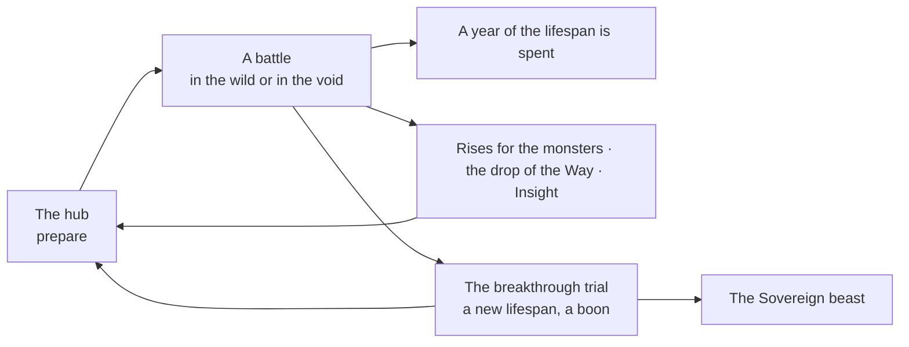
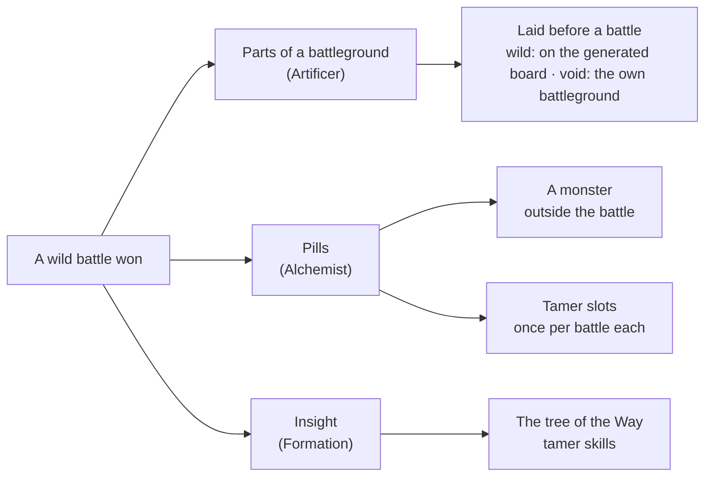

# Vision: the Frame of the Game

- **This file owns** the frame of the game (the hub and the ingame battle), not the multiplayer battle. Read it first.
- **Elsewhere:** the rules ([battle.md](battle.md), [battle_ingame.md](battle_ingame.md), [skills.md](skills.md), [monsters.md](monsters.md), [overworld.md](overworld.md)). Where a rule file contradicts this frame, the frame holds.
- **Status marks:** *set* = stated or decided by the user; *draft* = a proposal that waits for a decision (task [T65](todo/to-clarify/overworld/T65-the-wild-and-the-one-clock.md)).

---

## 1. The Game in One Picture

*Status: set.*

- **The turn-based battle is the game.** Everything around it exists to change the battle or to improve it.
- **The test for every system:** it changes what stands on the board, or it is not part of the game.
- **A roguelike:** a game is short, lost games start anew, and nothing won in one game makes the next one easier.
- **Offline and single player.** A multiplayer part for battles alone may follow much later, or never.
- **Playable on a phone,** in landscape, and on a PC alike.
- **No 3D world:** the player does not walk anywhere. The hub is a screen of buildings, each a theme with its actions.
- **Genre:** xuanhuan first, with wuxia and xianxia: more fantasy than history.

## 2. The Pillars and the Ways

*Status: set; names and numbers are working values.*

A battle is made of three things. **A game follows one Way, and a Way owns one pillar:** what the other two Ways use does not exist in that game.

| Way *(working names)* | Pillar | What it changes in the battle | A wild battle drops |
|---|---|---|---|
| **Way of the Artificer** | Board | the squares before the battle: parts of a battleground that lie from the start | parts of a battleground |
| **Way of the Formation** | Tamer | the squares during the battle: tamer skills, once per battle each | Insight |
| **Way of the Alchemist** | Monsters | the monsters themselves: a rise, stat points, another skill in a slot, pills taken in the battle | pills |

- **A Way shuts the others out:** the Artificer has no tamer skills and no pills; the Formation has no battleground of its own and no pills; the Alchemist has no tamer skills and no battleground of its own.
- **Every game has the same monsters:** a roster, stat points and the development of skills ([monsters.md](monsters.md), [skills.md §8](skills.md#8-development)) belong to no Way.
- **Nothing is made:** there are no materials and no crafting. What a Way uses drops ready from a battle.
- **Equal at the trial:** the three Ways meet the same trials with different means. Whether they weigh the same is to be found by play.

## 3. The Lifespan

*Status: set. Numbers are working values ([overworld.md §5.1](overworld.md#51-stages)).*

- **The lifespan is the one clock:** the tamer has a number of years to live, and every deed is paid from them. There are no days, no nights and no other points to spend.
- **What costs a year:** a battle in the wild, a new look at the wild, an attack on the void ([overworld.md §2.3](overworld.md#23-action-catalog)). A battle costs its year won or lost.
- **Each stage has its lifespan,** and only a breakthrough gives a new one. The years left are always shown. A breakthrough replaces the lifespan: the years left over are lost.
- **The trial comes at the end:** the breakthrough trial is the last depth of the void ([§4](#4-where-battles-happen)); the player may take it at any time before. When the lifespan ends, the trial must be taken, ready or not; who loses that one has lost the game. A game is lost on the board, never to a counter. The forced trial skips the depths not won yet.
- **What this asks of the player:** a year goes to the wild (the monsters and the Way grow) or to the void (Insight, and the stage). Who only gathers runs out of time; who only climbs meets the trial with a weak team.
- **The end:** the Sovereign beast is the last depth of the void. It is drawn from a pool when a game starts, and its sheet is shown from the start. **Defeating it wins the game.** It may be attacked at any time; a defeat costs the year and nothing else until the last lifespan ends.
- **A game is short and the next one differs:** a lost game starts anew from the nest. Its length is meant to be about three to four hours *(working value)*.
- **What a game leaves behind is breadth, never strength:** further species of eggs to draw from, nothing that makes the next game easier.

## 4. Where Battles Happen

*Status: set. Numbers and lists are working values ([overworld.md §3](overworld.md#3-places)).*

| Place | What it is | Costs | What it gives |
|---|---|---|---|
| **Wild** | a few battles shown at once, each against wild monsters; the place to catch | a year per battle; a year for a new look | rises for the monsters ([§8](#8-growth)), the drop of the Way ([§2](#2-the-pillars-and-the-ways)), caught monsters, now and then an egg |
| **Void** | a ladder of battles against void monsters; its last depth is the breakthrough trial | a year per attack | a rise for every monster that fought, also into the next stage; one Insight per depth; from the trial the stage, and with it a lifespan |

- **The hub costs nothing:** looking, planning, spending points and giving pills take no year.
- **Every battle is a new problem.** The battle is deterministic, so one board has one answer: every battle has a board of its own.
- **Every board is a battleground** that sets its team size ([battle_ingame.md](battle_ingame.md)).
- **Whose board:** a battleground is generated for the battle, point-mirrored. The Artificer alone changes that ([§2](#2-the-pillars-and-the-ways)): in the wild they lay parts of their own on the generated board before each battle; in the void they fight on a battleground they built.
- **Every battle starts at full HP.**

**The wild:**

- **A look shows a few battles,** each with its battleground, its opponents and what a win drops. The player picks one; choosing the battle is the strategy.
- **One of them is easy:** a battle a fresh monster can win. The others hold more or stronger monsters and drop more.
- **A battle won leaves the look;** a new look at the wild costs a year.
- **Catching:** wild monsters are caught here on Seal Ground ([battle_ingame.md §7](battle_ingame.md#7-catching)). Each Way brings Seal Ground by its own means: the Artificer lays it before the battle, the Formation has the Seal skill, the Alchemist carries a pill that turns a square into it.
- **The wild follows the stage of the tamer:** each stage has stronger monsters and more to gain.

**The void:**

- **Void monsters are stronger** than anything else of the stage; the Way is what lets the player meet them.
- **Drawn for the game:** the void monsters of each depth are drawn from a pool when a game starts, and shown ahead.
- **A few depths per stage,** three to five *(working value)*, each won once. The last depth is the breakthrough trial.
- **Every depth won gives one Insight** ([§8](#8-growth)). The depths before the trial also show how far the team is from it.
- **The void lifts the monsters into the next stage** ([§8](#8-growth)): no wild battle does.
- **The Artificer's battleground:** the player shapes it freely in an editor from the parts owned and may change it before every battle. Limits: a budget per stage; the start area of the opponent stays reachable. Details are not defined.

## 5. The Start

*Status: set.*

- The player is an orphan and finds a nest with three eggs. The three are drawn anew for every game from a pool of species, each of another Kin and none of the void; every finished game adds species to the pool. A finished game, won or lost, is counted and its save is gone; the pool holds 14 species, 7 from the first game on and 2 more with every finished game *(working values)*. The player chooses one; the first monster hatches from it. Every further monster is caught or hatched.
- **The player chooses a Way** ([§2](#2-the-pillars-and-the-ways)) and keeps it for the whole game.
- **A gift of the Way:** the player takes one of three gifts, drawn anew for every game, so that the first battle already uses the Way: a tamer skill for the Formation, a pack of parts for the Artificer, pills for the battle for the Alchemist ([overworld.md §5.3](overworld.md#53-the-way)).

## 6. The Hub

*Status: draft.*

One screen with buildings; a tap opens a building and its actions. A building of another Way is not there.

| Building | Way | What the player does there |
|---|---|---|
| Monsters | all | in one place: hatch and shape eggs, see and order the roster; spend stat points; teach and develop skills, take the choice of a stage breakthrough, give the rises a battle left |
| Gates | all | where the years go: pick a battle of the wild or take a new look, enter a depth of the void, take the breakthrough trial |
| Cultivation hall | all | spend Insight in the tree of the Way; take the boon of a breakthrough and the vows |
| Inventory | all | see everything the player owns; the Alchemist gives pills to monsters here |
| Battleground workshop | Artificer | shape the battleground for the void |

What the hub is in the world of the game is not defined.

## 7. What the Ways Use

*Status: set; lists and numbers are working values ([overworld.md §6](overworld.md#6-goods)).*

- **The drop is shown before the battle** and grows with the battle: more monsters drop more.
- **Parts:** a ground, a zone or a prop. A part is not used up. There are no weapons and no armour; no part raises a stat, and none raises damage.
- **Pills:** some are given to a monster outside a battle (a rise, stat points, another skill in a slot, a development step, the stat points spent anew); some are carried in a tamer slot and act once in a battle (heal, protect, move, turn a square into Seal Ground). A pill is used up. No pill raises damage.
- **Insight** buys the nodes of the Way ([§8](#8-growth)); every Way gains it in the void, the Formation in the wild too.

## 8. Growth

*Status: the stages, the rises and the Way are set in outline; trees and numbers are working values.*

Qi Gathering → Foundation → Core Formation → Nascent Soul → Immortal. Beyond Immortal stands the Sovereign beast alone.

| What grows | How | Limit |
|---|---|---|
| **The tamer's stage** | the breakthrough trial | the lifespan |
| **The tamer** | a boon at every breakthrough, a longer life among them ([overworld.md §5.1](overworld.md#51-stages)) | one per breakthrough |
| **The Way** | Insight | the tamer's stage |
| **A monster** | rises: stat points, the development of its skills | the tamer's stage |
| **The roster** | catching and hatching | 8, eggs included *(working value)* |
| **What the Way uses** | the drops of the wild | a budget per stage for parts |

**A monster rises by battles, not by points gathered** ([monsters.md §5](monsters.md#5-growth)):

- **In the wild** every monster defeated lifts one monster of the team that still stands and is at its step or below: one step, never past High. Where the rises do not reach for all, the player chooses.
- **In the void** every monster that fought in a battle won and still stands rises a step, also from High into the next stage, never past the stage of the tamer.

**The tamer:**

- **No stage opens a team size.** The battleground says how many monsters may fight.
- **Tamer slots come from the stage** ([overworld.md §5.1](overworld.md#51-stages)). They carry tamer skills (Formation) or pills (Alchemist); the Artificer has none and lays parts instead.

**The Way:**

- **Chosen at the start** and kept for the whole game ([§2](#2-the-pillars-and-the-ways)).
- **A small tree per stage** with two branches. A breakthrough opens the tree of the new stage.
- **Insight buys its nodes.** There are no scrolls and no blueprints.
