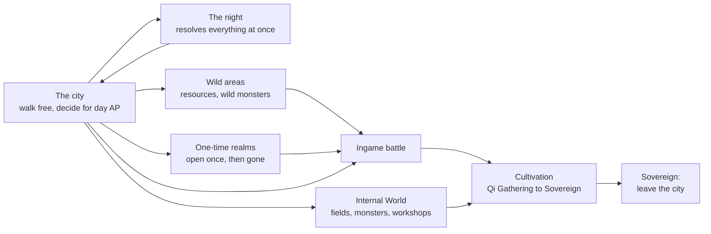
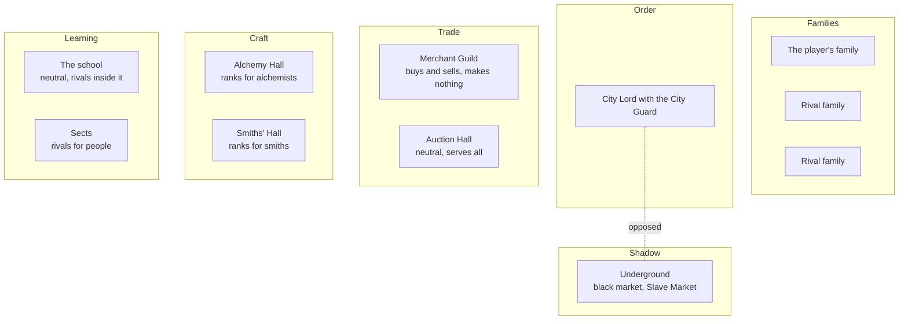
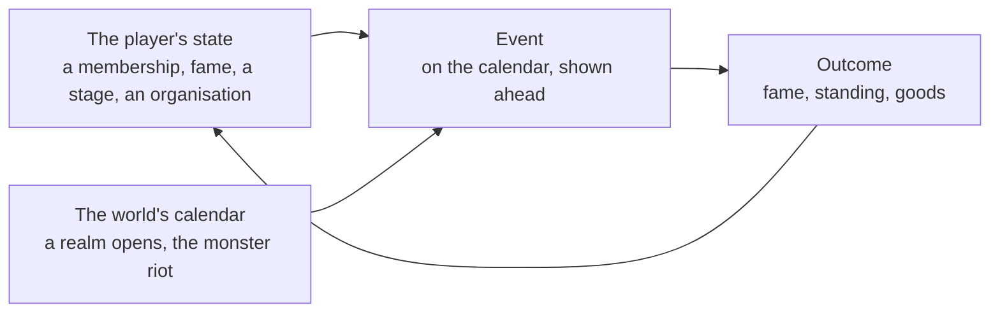
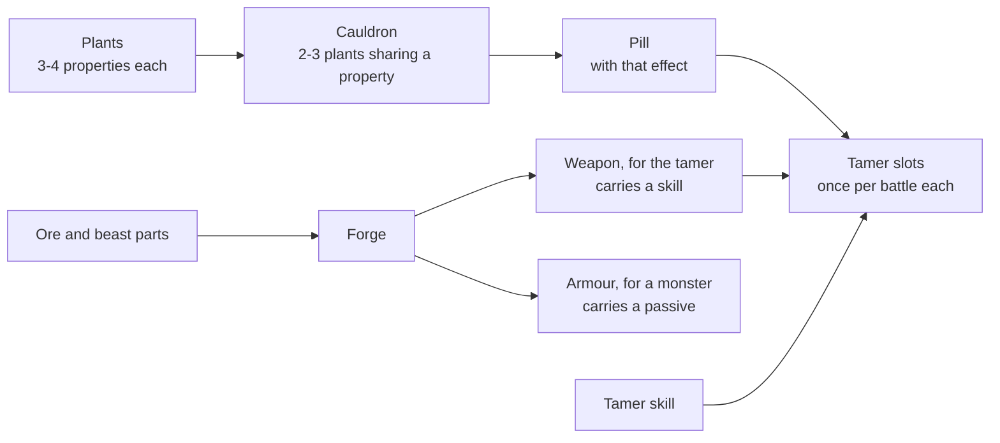

# Vision: the Frame of the Game

- **This file owns** the frame of the game (overworld and ingame battle), not the multiplayer battle. Read it first.
- **Elsewhere:** the rules ([overworld.md](overworld.md), [battle.md](battle.md), [battle_ingame.md](battle_ingame.md)). Where a rule file contradicts this frame, the frame holds.
- **Status marks:** *set* = stated or decided by the user; *draft* = a proposal that waits for a decision (task [T50](todo/to-clarify/overworld/T50-set-the-frame-of-the-game.md)).

---

## 1. The Game in One Picture

*Status: set.*

- **Genre:** xuanhuan first, with wuxia and xianxia: more fantasy than history.
- **A day is one turn:** the player spends day AP in the city, the night resolves everything at once. Walking and looking are free; only decisions cost day AP.
- **One calendar:** day, season, year. Everything that recurs falls on the turn of a season, and every event stands on the calendar with its day ([§6](#6-story-and-the-end)).
- **The player is small:** buildings and districts are imposing, the city is full of people, cultivators and monsters.

## 2. The World

*Status: set.*

- **The city is the whole world.** It encloses many areas: family districts, a school with many buildings and a mountain of wild monsters, markets, wild land. The player cannot leave it.
- **Presentation:** full 3D with a follow camera the player turns and zooms freely. The city is built from areas that are loaded one at a time, not from one seamless world.

## 3. The Groups of the City

*Status: set; persons, bonds and fame are set in outline. Names, key persons and numbers are not defined.*

Ten groups and the sects, each with a standing of its own:

- **One school:** large, with many buildings and its mountain. Its rivalry comes from inside: houses or teachers with their own students, and the children of the three families.
- **The Slave Market** (monsters and subordinates) is a business of the Underground, not a group.
- **Sects** stand beside the school, which stays neutral; they compete for people. How many there are is not defined.
- **Every person has one card, and all of it is visible:** stage, one to three roots, fame, two to four traits, group and position (or none), the bond to the player, hired or not, the current wish.
  - **Roots:** the kind says what work fits a person, the grade how fast and how far they cultivate. Few roots: fast and high but narrow; many: slow and low but broad.
  - **Traits** are drawn from one pool of good, bad and two-sided ones, so a person worth finding exists.
- **Two kinds of person:** a rogue cultivator has no group, is generated, and comes and goes; a member has a group and a position. A key person is a member with an office, fixed traits and written wishes; key persons carry the story.
- **One ladder for persons and groups:** Stranger → Known → Trusted → Allied → Sworn; with a group it is called standing. A fulfilled wish raises it by one, and a request of a group is its wish. Sworn never sinks. There are no gifts and no points to spend.
- **Hiring is apart from the bond:** possible from Trusted on and only if the player's fame reaches the person's. A hired person brings a wish at every turn of a season; an ignored one lowers the bond, and below Trusted the person leaves. Rivals lure hired persons away by an offer shown on the calendar.
- **Fame:** one visible value for persons, groups and the player. Public deeds raise it, nothing lowers it; it opens hiring, offers and events.
- **Why nobody is friends with all:** a request of one group harms another group, and so does hiring one of its members; the harm is shown before the player accepts. No group dislikes the player for a friendship alone.

## 4. Places Outside the Streets

*Status: set. Numbers are not defined.*

| Kind | What it is | What changes |
|---|---|---|
| **Wild area** | a fixed place open to all, such as the school's mountain or a wild forest; split into zones with their resources and monsters, every stage has at least one zone, and every zone is open to all | resources and monsters come back; the layout stays, unless an event changes it |
| **One-time realm** | a world the game generates: opened by a group for some days, or by the world itself for one single visit | everything; it is gone afterwards |
| **Internal World** | the player's own world, which nobody else enters ([§8](#8-growth)) | whatever the player builds |

- **Wild area, cost:** entering and walking are free. Each battle the player starts and each resource the player takes costs day AP.
- **Wild area, return:** what was taken or defeated returns after a fixed number of nights, rare things later; which monsters appear is drawn from the fixed list of the zone.
- **One-time realm, opening:** the city announces a realm some days ahead. Entry to a realm of a group needs a token; tokens come from groups (standing), the auction, requests or battle. Other groups send their people in too. A teleport array is the gate.
- **No other dungeons:** wild areas and one-time realms are the only places of this kind; there are no repeatable dungeons.

## 5. Ways to Power

*Status: set.*

- **The battle is always possible and rarely required.** An obstacle has several keys: fight it, send one's own people, or use one's standing.
- **Required battles:** only the trial of each breakthrough, which the player passes on the board; five in the whole game.
- **One's own people act at night:** the player gives the order by day (harvest an area, guard something, press a demand), from one list that is reachable anywhere. An order has a kind (a root) and a level (a stage); a person fits by root and counts by stage and equipment, and traits change it. The night decides by the visible values of both sides; the outcome is certain and shown before the order is given. No battle on the board.
- **Three means, many routes:** power is monsters, people and standing. A route is where the player gets them: as a beast tamer, as the founder of a sect, as a master of a craft, as a merchant, or as heir of the family.
- **Three ways to lead people:** alone, with hired persons ordered one by one; by a position, since a high standing with a group lends some of its members; by an organisation of one's own.
- **An organisation of one's own:** a sect, a gang or a trading house, built by one schema; the kind sets which orders it does well and which group is its rival. It becomes a group of the city with a fame of its own and gains wings over time: a school (students), a workshop, a trading hall, a monster hall.
- **No fixed number of followers:** every hired person brings wishes, and the player holds as many as they can serve. A follower from Allied on can be a steward: the steward leads a group, takes the order for it and brings one wish for all of it.
- **Several ways to earn:** catching and selling monsters, alchemy, smithing, the wings of the organisation.
- **Several ways to a monster:** catching, the Slave Market, hatching eggs, young monsters at auction.

## 6. Story and the End

*Status: set. The list of great events is a working draft.*

- **The end:** a barrier holds everyone below Sovereign in the city. A player who reaches Sovereign can pass it and leaves. The ending shows as what the player leaves: City Lord, head of the family, grand alchemist, an unknown.
- **The spine is the stage:** the trial of each breakthrough is the only step everyone takes. There is no fixed order of arcs.
- **Events carry the story.** An event names what sets it off, stands on the calendar with its day and is shown ahead; it has a course (a battle on a battleground, an order, a choice) and an outcome (fame, standing, goods, further events).

- **Who never joins never sees:** an event of the school happens only to its students. What the world's calendar brings returns or waits; nothing single is lost by time alone.
- **Two sources:** written events (those of each group and the great ones) and events from pools (wishes, rogue cultivators, realms).
- **Great events** *(draft)*: the best of the year at the school; lead, serve or leave the family; a one-time realm in which all groups compete; the monster riot; the struggle for the city.
- **A few great decisions branch the story:** they open or lock later events, such as leading the family or leaving it.

## 7. Making Things

*Status: set. Lists of plants, properties, pills, weapons and armour are not defined.*

- **Alchemy:** every plant has three or four properties. Two or three plants that share a property give a pill with that effect; the plants set its tier. A property is unknown until the player finds it by trying. The same plants always give the same pill.
- **Smithing:** the tamer carries a weapon, which brings a skill of its own. Every monster wears armour, which gives one more passive. No equipment raises a stat, and none raises damage.
- **A piece has three parts:** a body of ore (tier and grade), a core from a part of a monster (which skill or passive, by the kind of monster), a temper from an essence (one variation). What a part gives is found by trying; the same parts always give the same piece. No crafting is a minigame.
- **One rule for what the tamer brings:** a tamer skill, a weapon and a pill each take a tamer slot and act once per battle. Stages add slots ([§8](#8-growth)).
- **Pills in battle** heal, protect or move; they never raise damage. A pill is used up; a skill and a weapon are not. Other pills serve cultivation, healing between battles and rituals.
- **Uses outside the battle:** trade; pieces for wishes, requests and trials; and one's people. Pills change who a person is (the grade of a root, a trait removed, the stage); forged pieces change what a person can do (a weapon or a tool per kind of root, counted on orders).
- **Rank of a craft:** the Alchemy Hall and the Smiths' Hall are neutral and grant ranks by trial: make the piece they ask for at the grade they ask for. A rank opens better requests and ingredients.

## 8. Growth

*Status: the stages and the Internal World are set; the table of what a stage opens is a draft.*

Qi Gathering → Foundation → Core Formation → Soul Tier → Immortal → Sovereign.

**Four things grow:**

| What | How | Limit |
|---|---|---|
| **The tamer's stage** | cultivation; the same for every player | the breakthrough trial |
| **An insight** | at every breakthrough the player chooses one of three: one for battle, one for people, one for craft and trade | five choices in the game |
| **Ladders of deeds** | the rank of a craft, the standing with a group and the bond to a person, fame, the size of the organisation, the stage of the Internal World; no points to spend | day AP: nobody tends everything |
| **A monster** | stat points, development of its skills, rarity, its armour | the tamer's stage |

There is no skill tree.

**Team and tamer slots:**

- **No stage opens a team size.** The battleground says how many monsters may fight; the player fields as many as the Internal World holds.
- **Tamer slots come from the stage:** 1 at Qi Gathering, 2 at Foundation, 3 at Core Formation, 4 at Immortal.
- **Battlegrounds of one's own:** the player builds them in a building of the Internal World, several, each for a cost, and shapes them to the team, for example with the Dragon Veins on the own side ([battle_ingame.md §3](battle_ingame.md#3-battlegrounds)). The second stage of the Internal World opens this, so Foundation at the earliest.

| Stage | Opens besides *(draft)* |
|---|---|
| Qi Gathering | catching; the Internal World with a field and a cauldron; the wild area of the school |
| Foundation | habitats, a forge and the first golem |
| Core Formation | an organisation of one's own |
| Soul Tier | Beast Swap |
| Immortal | battlegrounds for five monsters; holding districts |
| Sovereign | the barrier opens |

**The Internal World:**

- **A stage of its own:** the player raises it with materials at a world core; each stage gives more grid and holds more monsters. It is never higher than the tamer's stage.
- **A coarse grid** for fields, habitats, a cauldron, a forge and statues. What stands where is free and can be moved at any time at no cost. Neighbours give small gains, such as a field that grows faster beside water.
- **Golems:** built in the forge, one task each (harvest and replant fields, tend monsters, work a workshop), done every night. Without a golem the player does the task. People never enter.
- **Habitats:** any monster can move in. Only a monster with a habitat that fits it thrives and grows by itself at night (XP, breeding, faster recovery).

## 9. What Is Built First

*Status: set.*

A first playable slice of the overworld: the school, its mountain as a wild area, and the Internal World of the first stage. The ingame battle waits until it stands.
