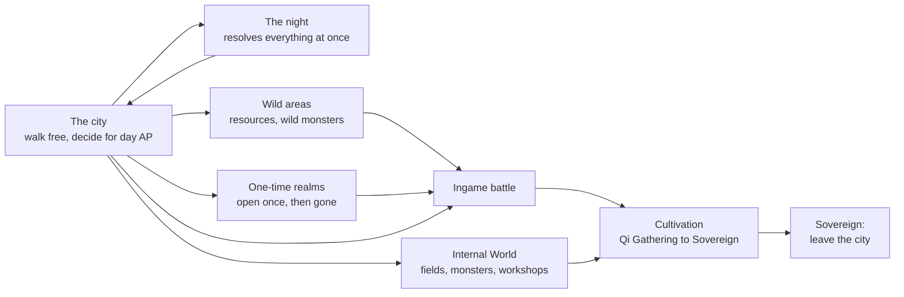
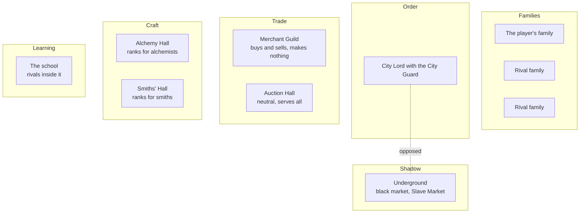
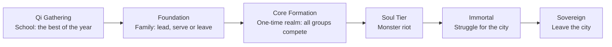
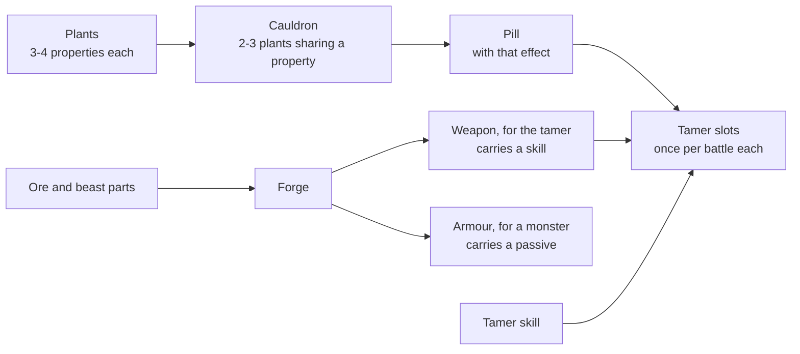

# Vision: the Frame of the Game

- **This file owns** the frame of the game (overworld and ingame battle), not the multiplayer battle. Read it first.
- **Elsewhere:** the rules ([overworld.md](overworld.md), [battle.md](battle.md), [battle_ingame.md](battle_ingame.md)). Where a rule file contradicts this frame, the frame holds.
- **Status marks:** *set* = stated or decided by the user; *draft* = a proposal that waits for a decision (task [T50](todo/to-clarify/overworld/T50-set-the-frame-of-the-game.md)).

---

## 1. The Game in One Picture

*Status: set.*

- **Genre:** xuanhuan first, with wuxia and xianxia: more fantasy than history.
- **A day is one turn:** the player spends day AP in the city, the night resolves everything at once. Walking and looking are free; only decisions cost day AP.
- **The player is small:** buildings and districts are imposing, the city is full of people, cultivators and monsters.

## 2. The World

*Status: set.*

- **The city is the whole world.** It encloses many areas: family districts, a school with many buildings and a mountain of wild monsters, markets, wild land. The player cannot leave it.
- **Presentation:** full 3D with a follow camera the player turns and zooms freely. The city is built from areas that are loaded one at a time, not from one seamless world.

## 3. The Groups of the City

*Status: set. Names, key persons and numbers are not defined.*

Ten groups, each with a standing of its own:

- **One school:** large, with many buildings and its mountain. Its rivalry comes from inside: houses or teachers with their own students, and the children of the three families.
- **The Slave Market** (monsters and subordinates) is a business of the Underground, not a group.
- **Standing belongs to a group.** Each group also has a few named key persons (an elder, a rival, a teacher) with a relation of their own; they carry the story.
- **Why nobody is friends with all:**
  - **Deeds:** a request of one group harms another group, and the harm is shown before the player accepts. No group dislikes the player for a friendship alone.
  - **Weight:** every group has a visible weight, and so has the player. A group whose weight the player passes reacts: it tests, demands, or allies against the player.

## 4. Places Outside the Streets

*Status: set. Numbers are not defined.*

| Kind | What it is | What changes |
|---|---|---|
| **Wild area** | a fixed place open to all, such as the school's mountain or a wild forest; split into zones with their resources and monsters, every stage has at least one zone, and every zone is open to all | resources and monsters come back; the layout stays, unless an event changes it |
| **One-time realm** | a world the game generates: opened by a group for some days, or by the world itself for one single visit | everything; it is gone afterwards |
| **Internal World** | the player's own world, which nobody else enters ([§8](#8-growth)) | whatever the player builds |

- **Wild area, cost:** entering and walking are free. Each battle the player starts and each resource the player takes costs day AP.
- **Wild area, return:** what was taken or defeated returns after a fixed number of nights, rare things later; which monsters appear is drawn from the fixed list of the zone.
- **One-time realm, opening:** the city announces a realm some days ahead. Entry to a realm of a group needs a token; tokens come from groups (standing), the auction, requests or battle. Other groups send their people in too. A teleport array is the gate.
- **No other dungeons:** wild areas and one-time realms are the only places of this kind; there are no repeatable dungeons.

## 5. Ways to Power

*Status: set.*

- **The battle is always possible and rarely required.** An obstacle has several keys: fight it, send one's own people, or use one's standing.
- **Required battles:** only the trial of each breakthrough, which the player passes on the board; five in the whole game.
- **One's own people act at night:** the player gives the order by day (harvest an area, guard something, press a demand). The night decides by the visible values of both sides; the outcome is certain and shown before the order is given. No battle on the board.
- **Three means, many routes:** power is monsters, people and standing. A route is where the player gets them: as a beast tamer, as the founder of a house, as a master of a craft, as a merchant, as heir of the family, or from the shadow.
- **A house of one's own:** the player founds a house, which becomes the eleventh group of the city with a weight of its own. It gains wings over time: a school (students), a workshop, a trading hall, a monster hall. Which wings the player builds is the route.
- **A hidden house:** a house is founded openly or in hiding. A hidden house may do everything and does not count toward the visible weight, but each of its orders costs more (hush money to the Underground). Only an event of the story uncovers it.
- **Several ways to earn:** catching and selling monsters, alchemy, smithing, the wings of the house.
- **Several ways to a monster:** catching, the Slave Market, hatching eggs, young monsters at auction.

## 6. Story and the End

*Status: set. The content of the arcs is a working draft.*

- **The end:** a barrier holds everyone below Sovereign in the city. A player who reaches Sovereign can pass it and leaves. The ending shows as what the player leaves: City Lord, head of the family, grand alchemist, an unknown.
- **One arc per stage, in a fixed order.** Each arc ends with an event, and the breakthrough to the next stage closes it.

- **The choice at the end of every arc:** show oneself or stay unseen. Weight is a key and a target at once ([§3](#3-the-groups-of-the-city)). *(The table is a draft.)*

| | Show oneself | Stay unseen |
|---|---|---|
| **Gains** | the reward of the arc and standing; key persons come with offers and requests; groups below one's weight give way, so standing opens doors without a battle | no group tests, demands or allies against the player; rivals do not prepare for them |
| **Costs** | every group whose weight the player passes reacts | no reward; no door opens by standing, so each obstacle is fought, paid for or left to one's people |
| **Suits** | the craft master, the merchant, the heir | the beast tamer, the shadow, a hidden house |

- **A few great decisions branch the story:** they open or lock later steps, such as leading the family or leaving it.

## 7. Making Things

*Status: set. Lists of plants, properties, pills, weapons and armour are not defined.*

- **Alchemy:** every plant has three or four properties. Two or three plants that share a property give a pill with that effect; the plants set its tier. A property is unknown until the player finds it by trying. The same plants always give the same pill.
- **Smithing:** the tamer carries a weapon, which brings a skill of its own. Every monster wears armour, which gives one more passive. No equipment raises a stat, and none raises damage.
- **A piece has three parts:** a body of ore (tier and grade), a core from a part of a monster (which skill or passive, by the kind of monster), a temper from an essence (one variation). What a part gives is found by trying; the same parts always give the same piece. No crafting is a minigame.
- **One rule for what the tamer brings:** a tamer skill, a weapon and a pill each take a tamer slot and act once per battle. Stages add slots ([§8](#8-growth)).
- **Pills in battle** heal, protect or move; they never raise damage. A pill is used up; a skill and a weapon are not. Other pills serve cultivation, healing between battles and rituals.
- **Uses outside the battle** *(draft)*: trade; gifts to key persons; pieces for requests and trials; equipment for the player's people, which raises their visible values. What the player wears openly counts toward the weight; what lies in the Internal World does not.
- **Rank of a craft:** the Alchemy Hall and the Smiths' Hall grant ranks by trial: make the piece they ask for at the grade they ask for. A rank opens better requests and ingredients and counts toward the player's weight.

## 8. Growth

*Status: the stages and the Internal World are set; the table of what a stage opens is a draft.*

Qi Gathering → Foundation → Core Formation → Soul Tier → Immortal → Sovereign.

**Four things grow:**

| What | How | Limit |
|---|---|---|
| **The tamer's stage** | cultivation; the same for every player | the breakthrough trial |
| **An insight** | at every breakthrough the player chooses one of three: one for battle, one for people, one for craft and trade | five choices in the game |
| **Ladders of deeds** | the rank of a craft, the standing with a group, the size of the house, the stage of the Internal World; no points to spend | day AP: nobody tends everything |
| **A monster** | stat points, development of its skills, rarity, its armour | the tamer's stage |

There is no skill tree.

**Team and tamer slots:**

- **No stage opens a team size.** The battleground says how many monsters may fight; the player fields as many as the Internal World holds.
- **Tamer slots come from the stage:** 1 at Qi Gathering, 2 at Foundation, 3 at Core Formation, 4 at Immortal.
- **Battlegrounds of one's own:** the player builds them in a building of the Internal World, several, each for a cost, and shapes them to the team, for example with the Dragon Veins on the own side ([battle_ingame.md §3](battle_ingame.md#3-battlegrounds)). The second stage of the Internal World opens this, so Foundation at the earliest.

| Stage | Arc | Opens besides *(draft)* |
|---|---|---|
| Qi Gathering | School | catching; the Internal World with a field and a cauldron; the wild area of the school |
| Foundation | Family | habitats, a forge and the first golem |
| Core Formation | One-time realm | a house of one's own and its orders at night |
| Soul Tier | Monster riot | Beast Swap |
| Immortal | Struggle for the city | battlegrounds for five monsters; holding districts |
| Sovereign | Leaving | the barrier opens |

**The Internal World:**

- **A stage of its own:** the player raises it with materials at a world core; each stage gives more grid and holds more monsters. It is never higher than the tamer's stage.
- **A coarse grid** for fields, habitats, a cauldron, a forge and statues. What stands where is free and can be moved at any time at no cost. Neighbours give small gains, such as a field that grows faster beside water.
- **Golems:** built in the forge, one task each (harvest and replant fields, tend monsters, work a workshop), done every night. Without a golem the player does the task. People never enter.
- **Habitats:** any monster can move in. Only a monster with a habitat that fits it thrives and grows by itself at night (XP, breeding, faster recovery).

## 9. What Is Built First

*Status: set.*

A first playable slice of the overworld: the school, its mountain as a wild area, and the Internal World of the first stage. The ingame battle waits until it stands.
