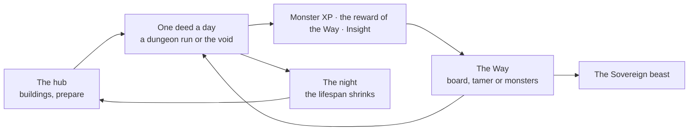
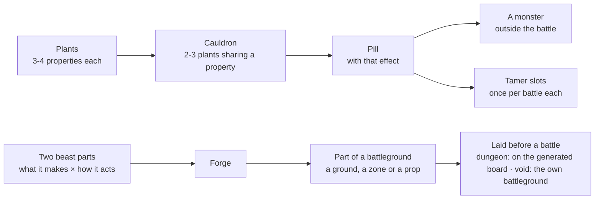

# Vision: the Frame of the Game

- **This file owns** the frame of the game (the hub and the ingame battle), not the multiplayer battle. Read it first.
- **Elsewhere:** the rules ([battle.md](battle.md), [battle_ingame.md](battle_ingame.md), [skills.md](skills.md), [monsters.md](monsters.md), [overworld.md](overworld.md)). Where a rule file contradicts this frame, the frame holds.
- **Status marks:** *set* = stated or decided by the user; *draft* = a proposal that waits for a decision (task [T64](todo/to-clarify/overworld/T64-the-three-ways-and-the-day.md)).

---

## 1. The Game in One Picture

*Status: set.*

- **The turn-based battle is the game.** Everything around it exists to change the battle or to improve it.
- **The test for every system:** it changes what stands on the board, or it is not part of the game.
- **Offline and single player.** A multiplayer part for battles alone may follow much later, or never.
- **Playable on a phone,** in landscape, and on a PC alike.
- **No 3D world:** the player does not walk anywhere. The hub is a screen of buildings, each a theme with its actions.
- **Genre:** xuanhuan first, with wuxia and xianxia: more fantasy than history.

## 2. The Pillars and the Ways

*Status: set; names and numbers are working values.*

A battle is made of three things. **A game follows one Way, and a Way owns one pillar:** what the other two Ways make does not exist in that game.

| Way *(working names)* | Pillar | What it changes in the battle | Made in | Reward of a dungeon |
|---|---|---|---|---|
| **Way of the Artificer** | Board | the squares before the battle: parts of a battleground that lie from the start | the forge, the battleground workshop | beast parts |
| **Way of the Formation** | Tamer | the squares during the battle: tamer skills, once per battle each | the cultivation hall | Insight |
| **Way of the Alchemist** | Monsters | the monsters themselves: more XP, stat points, another skill in a slot, pills taken in the battle | the cauldron | plants |

- **A Way shuts the others out:** the Artificer has no tamer skills and no pills; the Formation has no battleground of its own and no pills; the Alchemist has no tamer skills and no battleground of its own.
- **Every game has the same monsters:** a roster, stat points and the development of skills ([monsters.md](monsters.md), [skills.md §8](skills.md#8-development)) belong to no Way.
- **Three kinds of resource:** monster XP (every battle), Insight (the void, and the dungeon for the Formation), the material of the Way (beast parts or plants).
- **Equal at the trial:** the three Ways meet the same trials with different means. Whether they weigh the same is to be found by play.

## 3. The Day and the Lifespan

*Status: set. Numbers are not defined.*

- **A day is one deed:** a run through the dungeon or an attack on the void. There are no day AP. The night follows.
- **The lifespan:** the tamer has a number of days to live. Each stage has its lifespan, and only a breakthrough lengthens it. The days left are always shown. A breakthrough replaces the lifespan: the years left over are lost.
- **A day of play is a year of the tamer's life:** the game shows years ("year 3", "5 years left"); the rules keep the word day for the unit.
- **The trial comes at the end:** the breakthrough trial is the last depth of the void ([§4](#4-where-battles-happen)); the player may take it on any day before. When the lifespan ends, the trial must be taken, ready or not; who loses that one has lost the game. A game is lost on the board, never to a counter. The forced trial skips the depths not won yet.
- **What this asks of the player:** a day goes to the dungeon (the monsters and the Way grow) or to the void (Insight, and the stage). Who only gathers runs out of time; who only climbs meets the trial with a weak team.
- **The end:** the Sovereign beast is the last depth of the void. It is drawn from a pool when a game starts, and its sheet is shown from the first day. **Defeating it wins the game.** It may be attacked on any day; a defeat costs the day and nothing else until the last lifespan ends.
- **A game is short and the next one differs:** a lost game starts anew from the nest. Its length is meant to be about three to four hours *(working value)*.
- **What a game leaves behind is breadth, never strength:** more to choose from in the next game, nothing that makes it easier: further Ways and further eggs.

## 4. Where Battles Happen

*Status: set. Numbers and lists are not defined.*

| Place | What it is | Costs | What it gives |
|---|---|---|---|
| **Dungeon** | a run through a row of battles in the manner of a roguelike; the place to catch | the day | monster XP, caught monsters, the reward of the Way ([§2](#2-the-pillars-and-the-ways)) |
| **Void** | a ladder of battles against void monsters; its last depth is the breakthrough trial | the day | monster XP, one Insight per depth ([§8](#8-growth)); from the trial the stage, and with it lifespan |

- **The hub only transforms:** brewing, forging and building cost materials and no day.
- **Every battle is a new problem.** The battle is deterministic, so one board has one answer: every battle has a board of its own.
- **Every board is a battleground** with its team size, its ends and its board events ([battle_ingame.md](battle_ingame.md)).
- **Whose board:** a battleground is generated for the battle, point-mirrored. The Artificer alone changes that ([§2](#2-the-pillars-and-the-ways)): in the dungeon they lay parts of their own on the generated board before each battle; in the void they fight on a battleground they built.

**The dungeon:**

- **A map of nodes with forks,** generated anew for every run with its battlegrounds and opponents; four to six battles lead to its end *(working value)*.
- **Nearly every node is a battle.** At a fork the player sees what each way holds: the battleground, the opponents and the loot.
- **HP stay** from battle to battle. Only pills and a few rest nodes heal.
- **Leaving** is possible after every battle, with everything gathered so far.
- **A defeat** ends the run and costs a part of the loot. It does not end the game, and no monster is injured by it.
- **The last battle** holds the best loot.
- **Monster XP** from every battle.
- **Catching:** wild monsters are caught here on Seal Ground ([battle_ingame.md §7](battle_ingame.md#7-catching)). Each Way brings Seal Ground by its own means: the Artificer lays it before the battle, the Formation has the Seal skill, the Alchemist brews a pill that turns a square into it.
- **One dungeon per stage:** each stage opens a new one, harder and with more to gain.
- **Nothing is taken without a battle:** there is no harvest.

**The void:**

- **Void monsters are stronger** than anything else of the stage; the Way is what lets the player meet them.
- **Drawn for the game:** the void monsters of each depth are drawn from a pool when a game starts, and shown ahead.
- **A few depths per stage,** three to five *(working value)*, each won once. The last depth is the breakthrough trial.
- **Every depth won gives one Insight** ([§8](#8-growth)). The depths before the trial also show how far the team is from it.
- **The Artificer's battleground:** its parts are forged from beast parts ([§7](#7-making-things)); the player shapes it freely in an editor and may change it before every battle. Limits: a budget per stage; the start area of the opponent stays reachable. Details are not defined.

## 5. The Start

*Status: set.*

- The player is an orphan and finds a nest with three eggs. The three are drawn anew for every game from a pool of species, each of another Kin and none of the void; every finished game adds species to the pool. The player chooses one; the first monster hatches from it. Every further monster is caught or hatched.
- **The player chooses a Way** ([§2](#2-the-pillars-and-the-ways)) and keeps it for the whole game.

## 6. The Hub

*Status: draft.*

One screen with buildings; a tap opens a building and its actions. A building of another Way is not there.

| Building | Way | What the player does there |
|---|---|---|
| Monsters | all | in one place: hatch and shape eggs, see and order the roster; spend stat points; teach and develop skills, take the choice of a stage breakthrough |
| Gates | all | the deed of the day: start a dungeon run, enter a depth of the void, take the breakthrough trial |
| Cultivation hall | all | spend Insight in the tree of the Way |
| Inventory | all | see everything the player owns |
| Forge | Artificer | make the parts of a battleground |
| Battleground workshop | Artificer | shape the battleground for the void; choose the parts carried into the dungeon |
| Cauldron | Alchemist | make pills |

What the hub is in the world of the game is not defined.

## 7. Making Things

*Status: set; the numbers of materials are working values. Lists of plants, properties, pills and parts of a battleground are not defined.*

- **A dungeon gives the material of the Way:** beast parts to the Artificer, plants to the Alchemist, Insight to the Formation. No game holds a material it cannot use.
- **A material has no tier and no grade:** one kind of each plant and of each beast part, whatever stage it comes from. A later dungeon holds further plants.

| Material | Number *(working value)* | Sets |
|---|---|---|
| Plants | 4 from the start, 1 more per stage | the effect of a pill |
| Beast part | 1 per kin | what a forged piece makes, or how it acts |

- **Properties differ from game to game:** which plant has which properties, and what a part gives, is drawn anew for every game and stays fixed within it.
- **Alchemy:** every plant has three or four properties. Two or three plants that share a property give a pill with that effect. **What a plant holds is known plant by plant:** a property shows on a plant only after that plant went into a pill that had it; the same property in a plant never brewed stays hidden. The same plants always give the same pill. Some properties are flaws: a bad effect that follows the same rule, so a third plant is chosen to avoid one or the flaw is accepted.
- **Pills:** some are given to a monster outside a battle (monster XP, stat points, another skill in a slot, the stat points spent anew, healing between battles); some are carried in a tamer slot and act once in a battle (heal, protect, move, turn a square into Seal Ground). A pill is used up. No pill raises damage.
- **Smithing:** the forge makes parts of a battleground and nothing else: a ground, a zone or a prop. There are no weapons and no armour; no forged piece raises a stat, and none raises damage.
- **A piece is forged from two beast parts:** the first says what it makes (by its Kin), the second how it acts (a shape or a way of laying it, by its Kin). Eight Kins give 64 pieces. The forge shows every piece before it is made; the same parts always give the same piece. No crafting is a minigame.

## 8. Growth

*Status: the stages and the Way are set in outline; trees and numbers are not defined.*

Qi Gathering → Foundation → Core Formation → Nascent Soul → Immortal. Beyond Immortal stands the Sovereign beast alone.

| What grows | How | Limit |
|---|---|---|
| **The tamer's stage** | the breakthrough trial | the lifespan |
| **The Way** | Insight from the depths of the void | the tamer's stage |
| **A monster** | stat points, the development of its skills | the tamer's stage |
| **The roster** | catching and hatching | not defined |
| **What the Way makes** | parts forged, pills brewed | materials; a budget per stage for parts |

- **No stage opens a team size.** The battleground says how many monsters may fight.
- **Tamer slots come from the stage** ([overworld.md §5.1](overworld.md#51-stages)). They carry tamer skills (Formation) or pills (Alchemist); the Artificer has none and lays parts instead.

**The Way:**

- **Chosen at the start** and kept for the whole game ([§2](#2-the-pillars-and-the-ways)).
- **A small tree per stage** with two branches. A breakthrough opens the tree of the new stage.
- **Insight buys its nodes.** What a node is for the Artificer and the Alchemist is not defined. There are no scrolls and no blueprints.
