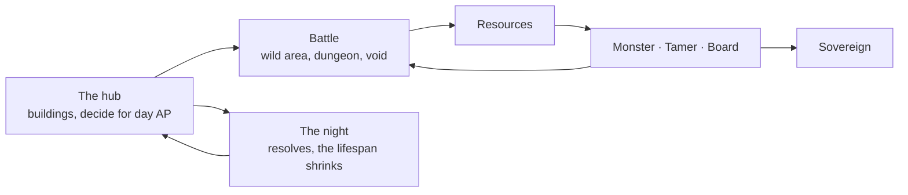
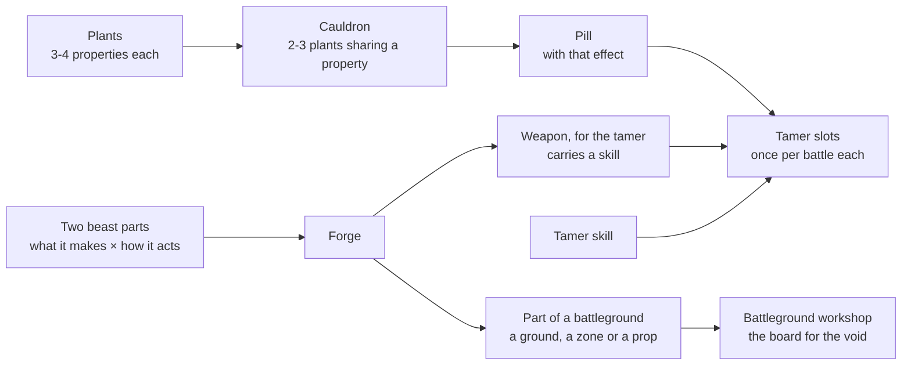

# Vision: the Frame of the Game

- **This file owns** the frame of the game (the hub and the ingame battle), not the multiplayer battle. Read it first.
- **Elsewhere:** the rules ([battle.md](battle.md), [battle_ingame.md](battle_ingame.md), [skills.md](skills.md), [monsters.md](monsters.md), [overworld.md](overworld.md)). Where a rule file contradicts this frame, the frame holds.
- **Status marks:** *set* = stated or decided by the user; *draft* = a proposal that waits for a decision (task [T50](todo/to-clarify/overworld/T50-set-the-frame-of-the-game.md)).

---

## 1. The Game in One Picture

*Status: set.*

- **The turn-based battle is the game.** Everything around it exists to change the battle or to improve it.
- **The test for every system:** it changes what stands on the board, or it is not part of the game.
- **Offline and single player.** A multiplayer part for battles alone may follow much later, or never.
- **Playable on a phone,** in landscape, and on a PC alike.
- **No 3D world:** the player does not walk anywhere. The hub is a screen of buildings, each a theme with its actions.
- **Genre:** xuanhuan first, with wuxia and xianxia: more fantasy than history.

## 2. The Pillars

*Status: the three pillars are set; the split of the monster pillar, the resources and their sources are working values to be tried.*

A battle is made of three things, and every resource of the game feeds one of them:

| Pillar | What it changes in the battle | Resources | Sources |
|---|---|---|---|
| **Monster: roster** | which monsters fight: species, kin, bloodline, stat shape | monsters, eggs | catching in a wild area, hatching |
| **Monster: growth** | the stat points of a monster, capped by the tamer's stage | monster XP | the battles a monster fought; a dungeon gives none |
| **Monster: kit** | its skills and passives, their development, open slots | monster XP, crafting materials | the battles a monster fought, the cauldron |
| **Tamer** | the stage, the tamer slots and what fills them: a tamer skill, a weapon, pills | Insight, crafting materials | the void, dungeons, the cauldron, the forge |
| **Board** | the battleground of one's own, on which every battle in the void is fought | crafting materials | dungeons, wild areas, the forge |

**Three kinds of resource:** monster XP, Insight, crafting materials (plants and beast parts; [§7](#7-making-things)).

## 3. The Day and the Lifespan

*Status: set. Numbers are not defined.*

- **A day is one turn:** the player spends day AP in the hub, the night resolves everything at once.
- **The lifespan:** the tamer has a number of days to live. Each stage has its lifespan, and only a breakthrough lengthens it. The days left are always shown. A breakthrough replaces the lifespan: the years left over are lost.
- **A day of play is a year of the tamer's life:** the game shows years ("year 3", "5 years left"); the rules keep the word day for the unit and day AP for what it gives.
- **The trial comes at the end:** the breakthrough trial is the last depth of the void ([§4](#4-where-battles-happen)); the player may take it on any day before. When the lifespan ends, the trial must be taken, ready or not; who loses that one has lost the game. A game is lost on the board, never to a counter. The forced trial skips the depths not won yet.
- **What this asks of the player:** day AP go to the monsters or to the tamer. Who tends only the monsters runs out of time; who tends only the tamer meets the trial with a weak team.
- **The end:** the Sovereign beast is the last depth of the void. It is drawn from a pool when a game starts, and its sheet is shown from the first day. Defeating it makes the tamer Sovereign and wins the game. It may be attacked on any day for day AP; a defeat costs nothing else until the last lifespan ends.
- **A game is short and the next one differs:** a lost game starts anew from the nest. Its length is meant to be about three to four hours *(working value)*.
- **What a game leaves behind is breadth, never strength:** more to choose from in the next game, nothing that makes it easier: further Ways and further eggs.

## 4. Where Battles Happen

*Status: the places, the wild area, the dungeon and the void are set; what each place feeds is a working value to be tried. Numbers and lists are not defined.*

| Place | What it is | Cost | Feeds | What it gives |
|---|---|---|---|---|
| **Wild area** | wild monsters on battlegrounds; the place to catch on Seal Ground ([battle_ingame.md §7](battle_ingame.md#7-catching)) | day AP per battle | the monsters | monster XP, caught monsters, beast parts |
| **Dungeon** | a run through a row of battles in the manner of a roguelike | a fixed number of day AP | the tamer and the kits | plants, beast parts; no monster XP |
| **Void** | a ladder of battles against void monsters, fought on the player's own battleground; its last depth is the breakthrough trial | not defined | the tamer | one Insight per depth ([§8](#8-growth)); from the trial the stage, and with it lifespan |

- **Day AP go to places of battle.** Where the player spends them decides which pillar grows; the tamer does not cultivate in the hub.
- **The hub only transforms:** brewing, forging and building cost materials and no day AP.
- **Every battle is a new problem.** The battle is deterministic, so one board has one answer: few battles a day, each on a board of its own.
- **What is mastered need not be played again:** a dungeon whose challenge the player has met can be harvested without a battle (below).
- **Every board is a battleground** with its team size, its ends and its board events ([battle_ingame.md](battle_ingame.md)).

**The wild area:**

- **A list of today's encounters,** not a map. Each shows its battleground, its monsters, which of them can be caught, and its loot.
- **One battle costs 1 day AP** *(working value)*; every battle starts at full HP.
- **Every night the encounters are drawn anew** from the fixed list of the zone. An encounter that was won, or whose monster was caught, is gone.
- **Rare encounters** are announced ahead and stay for a few days only.
- **Nothing is taken without a battle:** beast parts are the loot of a battle won.
- **One zone per stage:** each stage opens a new zone with species of its own.

**The dungeon:**

- **A map of nodes with forks,** generated anew for every run with its battlegrounds and opponents; four to six battles lead to its end *(working value)*.
- **Nearly every node is a battle.** At a fork the player sees what each way holds: the battleground, the opponents and the loot.
- **HP stay** from battle to battle. Only pills and a few rest nodes heal.
- **Leaving** is possible after every battle, with everything gathered so far.
- **A defeat** ends the run and costs a part of the loot. It does not end the game, and no monster is injured by it.
- **The last battle** holds the best loot.
- **No monster XP:** a battle in a dungeon gives none; monsters grow in the wild area.
- **One dungeon per stage:** each stage opens a new one, harder and with better materials.
- **The challenge:** every dungeon names one, such as three runs won in a row or a battle won within a number of rounds. Once it is met, the dungeon can be **harvested** without a battle, for fewer day AP than a run.
- **A harvest gives less:** a fixed base yield, safe. A run that is played gives more and can fail.

**The void:**

- **The void has no ground, so the player brings it:** every battle there is fought on a battleground the player built. Everywhere else the board belongs to the place.
- **The board is the answer:** the opponent is shown ahead, and the player builds or changes the battleground before the battle.
- **Void monsters are stronger** than anything else of the stage; the home board is what lets the player meet them.
- **Monster XP:** a battle in the void gives it, like one in the wild area.
- **Drawn for the game:** the void monsters of each depth are drawn from a pool when a game starts.
- **A few depths per stage,** three to five *(working value)*, each won once. The last depth is the breakthrough trial.
- **Every depth won gives one Insight** ([§8](#8-growth)). The depths before the trial also show how far the team and the board are from it.
- **Building a battleground:** its parts are forged from crafting materials ([§7](#7-making-things)); the player shapes it freely in an editor. Limits: a budget per stage; the start area of the opponent stays reachable. Details are not defined.

## 5. The Start

*Status: set.*

- The player is an orphan and finds a nest with three eggs. The three are drawn anew for every game from a pool of species, each of another Kin and none of the void; every finished game adds species to the pool. The player chooses one; the first monster hatches from it. Every further monster is caught or hatched.
- **The player chooses a Way** from a selection ([§8](#8-growth)).

## 6. The Hub

*Status: draft.*

One screen with buildings; a tap opens a building and its actions. Which buildings exist follows from the sources of [§2](#2-the-pillars):

| Building | Pillar | What the player does there |
|---|---|---|
| Monsters | Monster | in one place: hatch and shape eggs, see and order the roster; spend stat points; teach and develop skills, take the choice of a stage breakthrough |
| Gates | all | in one place, everything that costs day AP: enter a wild area, start a dungeon, enter a depth of the void and take the breakthrough trial |
| Cauldron | Tamer | make pills |
| Forge | Tamer, Board | make weapons and the parts of a battleground |
| Cultivation hall | Tamer | spend Insight in the tree of the Way |
| Inventory | — | see everything the player owns |
| Battleground workshop | Board | shape the battleground for the void from forged parts |

What the hub is in the world of the game is not defined.

## 7. Making Things

*Status: set; the numbers of materials are working values. Lists of plants, properties, pills, weapons and parts of a battleground are not defined.*

- **Materials come from battles and harvests:** plants from dungeons; a beast part from every wild monster defeated, in a dungeon and in a wild area; the part of the Void Kin from the void.
- **A material has a tier (a stage) and no grade.**

| Material | Number *(working value)* | Sets |
|---|---|---|
| Plants | 4 from the start, 1 more per stage | the effect of a pill |
| Beast part | 1 per kin | what a forged piece makes, or how it acts |

- **Properties differ from game to game:** which plant has which properties, and what a part gives, is drawn anew for every game and stays fixed within it.
- **Alchemy:** every plant has three or four properties. Two or three plants that share a property give a pill with that effect; the plants set its tier. A property is unknown until the player finds it by trying. The same plants always give the same pill. Some properties are flaws: a bad effect that follows the same rule, so a third plant is chosen to avoid one or the flaw is accepted.
- **Smithing:** the forge makes two things. A weapon is a tamer skill paid with materials instead of Insight. A part of a battleground is a ground, a zone or a prop the player may place on the own battleground. There is no armour; no forged piece raises a stat, and none raises damage.
- **A piece is forged from two beast parts:** the first says what it makes (a ground, a zone, a prop or an effect, by its Kin), the second how it acts (a shape or a way of laying it, by its Kin). Eight Kins give 64 pieces. The tier of a piece is the lower tier of its parts. The forge shows every piece before it is made; the same parts always give the same piece. No crafting is a minigame.
- **One rule for what the tamer brings:** a tamer skill, a weapon and a pill each take a tamer slot and act once per battle. Stages add slots ([§8](#8-growth)).
- **Pills in battle** heal, protect or move; they never raise damage. A pill is used up; a skill and a weapon are not. Other pills heal between battles or reshape a monster: another skill in a slot, the stat points spent anew, a higher bloodline. No pill adds stat points.

## 8. Growth

*Status: the stages, the tamer slots and the Way are set in outline; its systems, trees and numbers are not defined.*

Qi Gathering → Foundation → Core Formation → Nascent Soul → Immortal → Sovereign.

| What grows | How | Limit |
|---|---|---|
| **The tamer's stage** | the breakthrough trial | the lifespan |
| **The Way** | Insight from the depths of the void | the tamer's stage |
| **A monster** | stat points, development of its skills, bloodline | the tamer's stage |
| **The roster** | catching and hatching | not defined |
| **The battlegrounds** | parts forged from materials | a budget per stage |

- **No stage opens a team size.** The battleground says how many monsters may fight.
- **Tamer slots come from the stage:** 1 at Qi Gathering, 2 at Foundation, 3 at Core Formation, 4 at Immortal.

**The Way:**

- **Chosen at the start** from a selection and kept for the whole game. Systems differ in what they offer, tamer skills among it.
- **A small tree per stage.** A breakthrough opens the tree of the new stage.
- **Insight buys its nodes:** tamer skills and their development steps. There are no scrolls and no blueprints.
